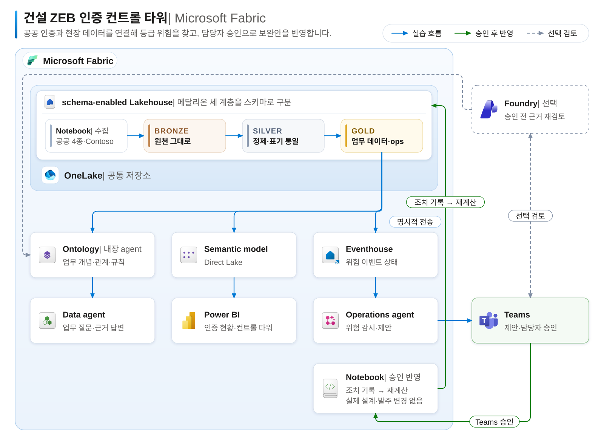

# Workshop: 건설 ZEB 인증 컨트롤 타워

Contoso 건설의 에코시티 D단지는 제로에너지건축물(ZEB) **예비인증 4등급**을 받았습니다. 그런데 원가 절감(VE)으로 옥상 태양광을 줄인 현행 설계로는 **5등급**이 예상됩니다. 이대로라면 사용승인 전 본인증을 받을 수 없습니다. **어느 현장이 위험한지, 어떤 보완안이 가장 싸고 일정 안에 끝나는지** 데이터로 확인해야 합니다.

이 hands-on Workshop에서는 **Microsoft Fabric만으로** 공공 인증 데이터와 현장 데이터를 연결하고, 보고서와 에이전트로 근거를 검토한 뒤, 담당자가 Teams에서 승인한 보완안을 데이터에 반영합니다.

**공공·현장 데이터 연결 → 등급 위험 찾기 → 근거 질문 → Teams 제안·승인 → 보완안 반영과 재계산**

처음 시작한다면 [00. 시나리오와 실습 순서](docs/00-scenario.md)에서 업무 상황과 판단 기준을 확인합니다.

## 이 실습에서 완성하는 것

| 결과 | 할 수 있는 일 |
|---|---|
| Bronze·Silver·Gold 테이블 | 공공데이터포털의 인증 4종(ZEB·녹색건축·BF·녹색기술)을 **Notebook으로 직접 내려받고**, Contoso 내부 시스템(ERP·PMS·BIM·SCM) 데이터와 표기·형식을 맞춰 정리합니다. |
| Ontology와 Data agent | 시스템마다 다른 코드(프로젝트 번호·현장 코드·BIM 모델 번호)와 **등급 판정 규칙**을 Ontology에 정의하고, Data agent의 답을 정답 Notebook과 비교합니다. |
| Power BI 컨트롤 타워 2페이지 | 공공 ZEB 인증 현황은 직접 만들고, 현장 컨트롤 타워는 **Copilot으로 생성**한 뒤 Copilot에게 질문하고 인사이트를 요약받습니다. |
| Teams 제안과 보완안 반영 | Operations agent가 D단지 위험과 **가장 싼 추천 보완안**을 Teams로 제안하고, 담당자가 승인하면 Notebook이 조치를 기록하고 **설계안·예상 등급을 다시 계산**합니다. |

추천안은 Notebook 계산으로 정하고, AI 답변은 그 계산 결과와 비교해 확인합니다. **최종 결정은 담당자가 합니다. 실습에서는 조치를 기록하고 데이터를 다시 계산하는 데까지만 진행하며, 실제 설계 변경이나 발주는 하지 않습니다.**

## 전체 구성

Notebook이 원천 데이터를 **OneLake의 Lakehouse 하나(스키마 사용)**에 적재한 뒤 `bronze` → `silver` → `gold`·`ops` 스키마 순서로 정리합니다. Ontology·Data agent, Power BI, Operations agent는 모두 이 Gold 테이블을 읽습니다.



[그림 크게 보기](assets/architecture.png)

- **Gold에는 원천에서 정리한 데이터만 두고, 예상 등급·위험 여부는 저장하지 않습니다.** 등급을 판정하는 기준은 06장에서 **Ontology의 업무 규칙**으로 정의하고, 보고서와 감시에 쓰는 계산 결과는 따로 `ops` 스키마에 저장합니다.
- 06장에서는 **Ontology에 들어 있는 agent로 구조를 만들고**, 07장에서는 **별도로 만든 Data agent `da_zeb`에 이 Ontology를 연결해 업무 질문**을 합니다.
- Operations agent는 Lakehouse를 직접 감시하지 않고, 09장에서 Eventhouse로 보낸 **위험 이벤트 상태**를 감시합니다.
- 구성도의 파란 실선은 실습 흐름, 초록 선은 승인 후 반영, 점선은 선택 단계(10장 Foundry)입니다.

## 시작 전 확인

**전체 실습은 관리자가 준비한 활성 유료 Fabric 용량(F64 이상 권장)에 참가자 작업 영역을 할당한 상태로 진행합니다.** 준비 방법은 [관리자 준비 가이드](admin/README.md)를 따릅니다.

| 참가자가 확인할 것 | 관리자에게 받을 안내 |
|---|---|
| 실습 계정·참가자 번호 | Fabric·Teams에 사용할 계정과 본인 번호(예: `p001`) |
| 작업 영역 | 본인 작업 영역 `zeb-p001`, Lakehouse `lh_zeb`, 미리 넣어 둔 Notebook 7개와 `Files/workshop`의 파일 2개 |
| 보고서·에이전트 사용 환경 | Power BI Pro 또는 PPU 라이선스, Copilot·Data agent·Ontology·Operations agent 테넌트 설정, Teams의 **Fabric Operations Agent** 앱 |

문서의 `p001`은 예시입니다. 작업 영역은 **본인 번호**를 사용합니다. `lh_zeb`, `ont_zeb`, `da_zeb` 같은 항목 이름은 본인 작업 영역 안에서 그대로 씁니다.

## 실습 순서

00장부터 순서대로 진행하며, 각 장의 **완료 기준**을 확인한 뒤 다음 장으로 넘어갑니다. 예상 시간은 약 **5시간 20분**이며 휴식·AI 응답 대기는 별도입니다([장별 일정](docs/00-scenario.md#실습-일정)).

| 장 | 이번 단계에서 할 일 |
|---|---|
| [00. 시나리오와 실습 순서](docs/00-scenario.md) | 업무 상황·판단 기준과 실습 흐름을 이해합니다. |
| [01. 작업 영역 준비](docs/01-workspace.md) | 본인 작업 영역·Lakehouse·Notebook을 확인하고 Notebook 실행 방법을 익힙니다. |
| [02. Bronze ① 공공 인증 데이터](docs/02-bronze-public.md) | 공공데이터포털에서 인증 4종을 Notebook으로 내려받아 그대로 저장합니다. |
| [03. Bronze ② Contoso 내부 데이터](docs/03-bronze-contoso.md) | ERP·PMS·BIM·SCM의 가상 데이터를 만들고 시스템별 코드 차이를 확인합니다. |
| [04. Silver](docs/04-silver.md) | 시도·용도·등급 표기를 통일하고, 같은 건물을 묶고, 발주 이벤트를 반영합니다. |
| [05. Gold와 운영 지표](docs/05-gold.md) | Gold 테이블과 현장 상태(ops)를 만들고 D단지 위험을 확인합니다. |
| [06. Ontology](docs/06-ontology.md) | Ontology agent로 엔터티·관계·바인딩을 만들고 등급 판정 규칙을 넣습니다. |
| [07. Data agent](docs/07-data-agent.md) | Ontology를 연결한 Data agent에 질문 8개를 하고 정답 Notebook과 비교합니다. |
| [08. Power BI](docs/08-power-bi.md) | 인증 현황 페이지는 직접, 현장 컨트롤 타워는 Copilot으로 만들고 질문·인사이트를 확인합니다. |
| [09. Operations agent](docs/09-operations-agent.md) | 위험 이벤트를 Eventhouse로 보내 Teams 제안을 받습니다. |
| [10. Foundry agent (선택)](docs/10-foundry-agent.md) | 승인 전에 Fabric IQ로 Ontology에 근거를 다시 묻습니다. |
| [11. 승인과 반영](docs/11-approval.md) | Teams에서 승인하고, 조치 기록·설계안 V4·등급 회복·이벤트 종료를 확인한 뒤 Stop합니다. |
| [12. 마무리](docs/12-finish.md) | 결과를 확인하고 감시·실행을 멈춥니다. |

**09장 Teams 제안 → (선택) 10장 근거 검토 → 11장 승인·반영·Stop** 순서를 지킵니다. AI가 만든 구조·페이지·답변은 실행할 때마다 달라질 수 있습니다. 완료 메시지만 보고 넘어가지 말고, 각 장에 적힌 데이터·필드·값과 비교합니다.

## 실습 파일

관리자가 실습 전에 본인 작업 영역에 넣어 둡니다. 참가자가 GitHub에서 내려받을 필요는 없습니다.

| 파일 | 위치 | 용도 |
|---|---|---|
| Notebook 7개 | 작업 영역 `zeb-p001` | `01`–`04` 메달리온, `05_answers` 정답 계산(07장), `06_risk_event` 위험 이벤트(09장), `nb_apply_decision` 승인 반영(11장, 직접 실행 안 함) |
| `sm_zeb.tmdl` | `lh_zeb` → **Files → workshop** | 08장 Semantic model의 관계·측정값 |
| `zeb-theme.json` | `lh_zeb` → **Files → workshop** | 08장 보고서 테마 |

원본은 이 저장소의 [notebooks](notebooks)와 [fabric](fabric) 폴더입니다. Notebook은 `notebooks/src`의 소스에서 만들어집니다(`python tools/build_notebooks.py`).

저장소를 수정했다면 아래 명령으로 Notebook·문서·Fabric 파일이 서로 맞는지 로컬에서 확인합니다. 클라우드에는 접속하지 않습니다.

``` bash
python tools/build_notebooks.py
python -m unittest discover -s tests -v
```

## 관리자용

- [관리자 준비 가이드](admin/README.md) — 용량·테넌트 설정·참가자 작업 영역 일괄 준비(`admin/provision.py`)와 종료 후 정리
- [데이터 설계](admin/data-design.md) — 테이블 구조·판정 규칙·정답 수치
- [구성도 아이콘 출처](assets/icon-attribution.md)

공공데이터는 공공데이터포털 표기 기준 **이용허락범위 제한 없음** 데이터이며, Notebook이 실습 시점에 직접 내려받습니다. 이 저장소는 공공 원본 파일을 포함하지 않습니다. Contoso 건설과 현장·공급사·인물은 모두 가상입니다.
