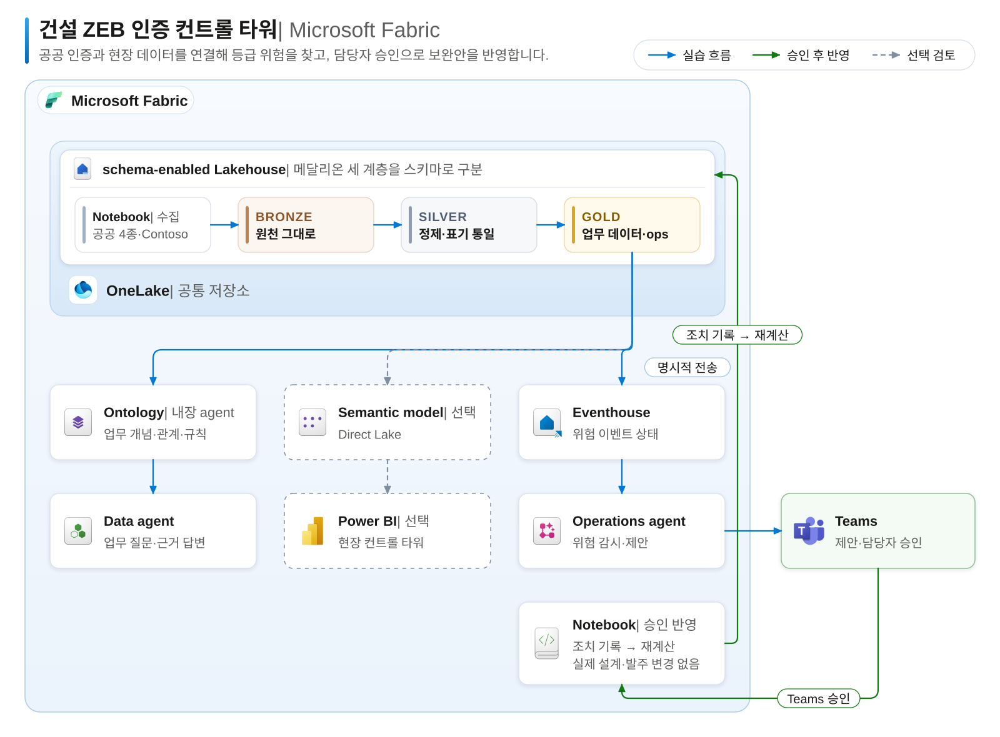

# Workshop: 건설 ZEB 인증 컨트롤 타워

Contoso 건설의 에코시티 D단지는 제로에너지건축물(ZEB) 예비인증 4등급을 받았습니다. 그런데 원가 절감(VE)으로 옥상 태양광을 줄인 현행 설계로는 5등급이 예상됩니다. 이대로라면 사용승인 전 본인증을 받을 수 없습니다. 어느 현장이 위험한지, 어떤 보완안이 가장 싸고 일정 안에 끝나는지 데이터로 확인해야 합니다.

이 hands-on Workshop에서는 Microsoft Fabric을 중심으로 공공 인증 데이터와 현장 데이터를 하나의 업무 모델로 연결합니다. Notebook으로 위험과 보완안을 계산하고, Ontology·보고서·에이전트로 근거를 검토한 뒤, 담당자가 Teams에서 승인한 보완안을 실습 데이터에 기록하고 재계산합니다. Foundry 근거 재검토는 선택입니다.

공공·현장 데이터 연결 → 등급 위험 찾기 → 근거 질문 → Teams 제안·승인 → 보완안 반영과 재계산

처음 시작한다면 [00. 시나리오와 실습 순서](docs/00-scenario.md)에서 업무 상황과 판단 기준을 확인합니다.

## 이 실습에서 완성하는 것

| 기능 | 업무에서 맡는 역할 | 직접 만들고 확인할 것 |
|---|---|---|
| Notebook·Lakehouse | 원본 수집·정리와 명시적인 계산 | 공공 인증 4종과 가상 ERP·PMS·BIM·SCM 데이터를 Bronze → Silver → Gold로 정리하고, 예상 등급·일정·보완안을 계산합니다. |
| Ontology | 업무 대상·관계·원본 바인딩을 연결하는 공유 업무 모델 | 빈 항목에서 Agent로 초안을 만들고, 현장·인증 설계안부터 일정·보완안·공공 사례까지 보강합니다. 사람이 Plan → 검토 → Act로 적용합니다. |
| Graph (선택) | 실제 인스턴스의 다단계 연결 탐색 | 현장 → BIM 모델 → 설계안·인증서 경로를 탐색합니다. Ontology의 필수 저장소가 아니며 원본 변경 후 갱신 여부를 따로 확인합니다. |
| Data agent / Ontology Agent | 업무 맥락을 사용한 읽기 전용 근거 질의 | Data agent를 생성·연결하고 지침을 입력합니다. 기본 질문 검증은 Ontology Agent의 Plan 모드에서 Q1–Q8을 정답 Notebook과 대조하고, Data agent 직접 비교는 선택으로 진행합니다. |
| Power BI·Copilot (선택) | 계산 결과를 업무 화면으로 설명 | Copilot으로 현장 컨트롤 타워 한 페이지를 만들고 D단지 위험을 확인합니다. 기본 과정에서는 건너뛰어도 됩니다. |
| Eventhouse·Operations agent·Teams | 계산된 위험 감시와 사람의 승인 연결 | 이벤트 테이블·감시 규칙·Notebook 액션을 구성하고 제안 → 근거 검토 → 승인 → 기록·재계산 → Stop을 확인합니다. |

추천안은 Notebook 계산으로 정하고, AI 답변은 그 계산 결과와 비교해 확인합니다. 최종 결정은 담당자가 합니다. 실습에서는 조치를 기록하고 데이터를 다시 계산하는 데까지만 진행하며, 실제 설계 변경이나 발주는 하지 않습니다.

## 전체 구성

Notebook이 원천 데이터를 <b>OneLake의 Lakehouse 하나(스키마 사용)</b>에 적재한 뒤 `bronze` → `silver` → `gold`·`ops` 순서로 정리합니다. Ontology·근거 질의는 Gold 원본을, Power BI는 Gold와 ops를 읽습니다. Operations agent는 Notebook이 명시적으로 보낸 Eventhouse 위험 이벤트를 감시합니다.



[그림 크게 보기](assets/architecture.png)

- Gold에는 원천에서 정리한 데이터만 두고, 예상 등급·위험 여부는 저장하지 않습니다. 등급을 판정하는 기준은 06장에서 Ontology의 업무 규칙으로 정의하고, 보고서와 감시에 쓰는 계산 결과는 따로 `ops` 스키마에 저장합니다.
- 06장에서는 Ontology Agent로 구조를 만들고, 07장에서는 별도 Data agent `da_zeb` 구성과 Ontology Agent의 Plan 질의를 구분해 체험합니다. 설명·동의어의 Data agent 연계는 Preview 환경별로 확인합니다.
- Operations agent는 Lakehouse를 직접 감시하지 않고, 10장에서 Eventhouse로 보낸 위험 이벤트 상태를 감시합니다.
- 구성도의 파란 실선은 실습 흐름, 초록 선은 승인 후 반영, 점선은 선택 단계(08장 Power BI·09장 Foundry)입니다.

## 시작 전 확인

전체 실습은 관리자가 준비한 활성 유료 Fabric 용량(F64 이상 권장)에 참가자 작업 영역을 할당한 상태로 진행합니다. 준비 방법은 [관리자 준비 가이드](admin/README.md)를 따릅니다.

| 참가자가 확인할 것 | 관리자에게 받을 안내 |
|---|---|
| 실습 계정·참가자 번호 | Fabric·Teams에 사용할 계정과 본인 번호 |
| 작업 영역 | 용량이 할당된 본인 작업 영역과 미리 넣어 둔 Notebook 7개. Lakehouse `lh_zeb`는 01장에서 직접 생성 |
| 에이전트 사용 환경 | Copilot·Data agent·Ontology·Operations agent 테넌트 설정, Teams의 Fabric Operations Agent 앱 |
| (선택) Power BI | 08장을 진행할 경우 Pro·PPU 또는 활성 체험판 라이선스, 모델·보고서 작성 권한 |
| Teams 로그인 | Fabric과 같은 계정으로 Teams(데스크톱 또는 웹)에 로그인할 수 있는지 미리 확인(10장) |
| (선택) Foundry | 09장을 진행할 경우 Foundry 프로젝트, 또는 프로젝트를 만들 구독·리소스 그룹·지역 |

관리자가 안내한 계정과 본인 작업 영역을 사용합니다. `lh_zeb`, `ont_zeb`, `da_zeb` 같은 항목 이름은 본인 작업 영역 안에서 그대로 씁니다.

## 실습 순서

각 장의 완료 기준을 확인하며 00–07 → 10 → 11장 순서로 진행합니다. 기본 과정은 약 4시간 10분이며, 선택 08·09장까지 모두 포함하면 약 5시간 5분입니다. 휴식·AI 응답 대기와 11장 이후 강사 대시보드 시연은 별도입니다([장별 일정](docs/00-scenario.md#실습-일정)).

| 장 | 이번 단계에서 할 일 |
|---|---|
| [00. 시나리오와 실습 순서](docs/00-scenario.md) | 업무 상황·판단 기준과 실습 흐름을 이해합니다. |
| [01. 작업 영역 준비](docs/01-workspace.md) | 준비된 Notebook을 확인하고 스키마 사용 Lakehouse `lh_zeb`를 직접 만들어 첫 Notebook에 연결합니다. |
| [02. Bronze ① 공공 인증 데이터](docs/02-bronze-public.md) | 공공데이터포털에서 인증 4종을 Notebook으로 내려받아 그대로 저장합니다. |
| [03. Bronze ② Contoso 내부 데이터](docs/03-bronze-contoso.md) | ERP·PMS·BIM·SCM의 가상 데이터를 만들고 시스템별 코드 차이를 확인합니다. |
| [04. Silver](docs/04-silver.md) | 시도·용도·등급 표기를 통일하고, 같은 건물을 묶고, 발주 이벤트를 반영합니다. |
| [05. Gold와 운영 지표](docs/05-gold.md) | Gold 테이블과 현장 상태(ops)를 만들고 D단지 위험을 확인합니다. |
| [06. Ontology](docs/06-ontology.md) | 현장·설계안 중심의 초안을 만들고 일정·보완안·공공 사례로 보강한 뒤, 원본과 업무 규칙을 점검합니다. |
| [07. Data agent](docs/07-data-agent.md) | Data agent를 구성하고, Ontology Agent의 Plan에서 질문 8개를 정답 Notebook과 비교합니다. |
| [08. Power BI (선택)](docs/08-power-bi.md) | 원하는 경우 현장 컨트롤 타워 보고서를 만듭니다. 건너뛰어도 10·11장을 진행할 수 있습니다. |
| [09. Foundry agent (선택)](docs/09-foundry-agent.md) | Foundry 에이전트에서 Fabric IQ로 Ontology에 보완안 근거를 다시 묻습니다. |
| [10. Operations agent](docs/10-operations-agent.md) | 위험 이벤트를 Eventhouse로 보내 Teams 제안을 받고, 승인한 뒤 조치 기록·설계안 V4·등급 회복·이벤트 종료를 확인하고 Stop합니다. |
| [11. 마무리](docs/11-finish.md) | 결과를 확인하고 감시·실행이 멈췄는지 확인합니다. |

10장에서는 Teams 제안 → 근거 검토 → 승인 → 반영 확인 → Stop 순서를 지킵니다. AI가 만든 구조·페이지·답변은 실행할 때마다 달라질 수 있습니다. 완료 메시지만 보고 넘어가지 말고, 각 장에 적힌 데이터·필드·값과 비교합니다.

Graph·파이프라인·Power BI·Foundry를 생략해도 기본 과정은 완료됩니다. 10장은 05장의 계산 결과와 07장의 근거 검토가 필요하며, What-if 질문은 원본을 바꾸지 않습니다. 실제 반영은 10장에서 사람이 승인한 뒤에만 수행합니다.

11장까지 실습과 정리를 마친 뒤 강사가 웹 대시보드를 시연합니다. 시연을 보기 위해 참가자가 로컬 웹 앱을 설치하거나 실행할 필요는 없습니다.

## 실습 파일

관리자는 Notebook 7개만 본인 작업 영역에 넣어 둡니다. 참가자는 01장에서 Lakehouse를 직접 만들고 첫 Notebook에 연결합니다. 나머지 Notebook은 해당 장에서 사용하기 전에 연결합니다. Power BI 파일은 선택 08장을 진행할 때만 아래 저장소 링크로 PC에 내려받으며, Lakehouse에 업로드하지 않습니다.

| 파일 | 위치 | 용도 |
|---|---|---|
| Notebook 7개 | 본인 작업 영역 | `01`–`04` 메달리온, `05_answers` 정답 계산(07장), `06_risk_event` 위험 이벤트(10장), `nb_apply_decision` 승인 반영(10장, 직접 실행 안 함) |
| [`sm_zeb.tmdl`](fabric/sm_zeb.tmdl) | 선택 08장에서 저장소 → PC | Semantic model의 관계·측정값 |
| [`zeb-theme.json`](fabric/zeb-theme.json) | 08장 선택 실습에서 저장소 → PC | 보고서 테마 |

원본은 이 저장소의 [notebooks](notebooks)와 [fabric](fabric) 폴더입니다. Notebook은 `notebooks/src`의 소스에서 만들어집니다(`python tools/build_notebooks.py`).

저장소를 수정했다면 아래 명령으로 Notebook·문서·Fabric 파일이 서로 맞는지 로컬에서 확인합니다. 클라우드에는 접속하지 않습니다.

``` bash
python tools/build_notebooks.py
python -m unittest discover -s tests -v
```

## 관리자용

- [관리자 준비 가이드](admin/README.md) — 용량·테넌트 설정·참가자 작업 영역 일괄 준비(`admin/provision.py`)와 종료 후 정리
- [데이터 설계](admin/data-design.md) — 테이블 구조·판정 규칙·정답 수치
- [구성도 아이콘 출처](assets/icon-attribution.md)

공공데이터는 공공데이터포털 표기 기준 이용허락범위 제한 없음 데이터이며, Notebook이 실습 시점에 직접 내려받습니다. 이 저장소는 공공 원본 파일을 포함하지 않습니다. Contoso 건설과 현장·공급사·인물은 모두 가상입니다.
