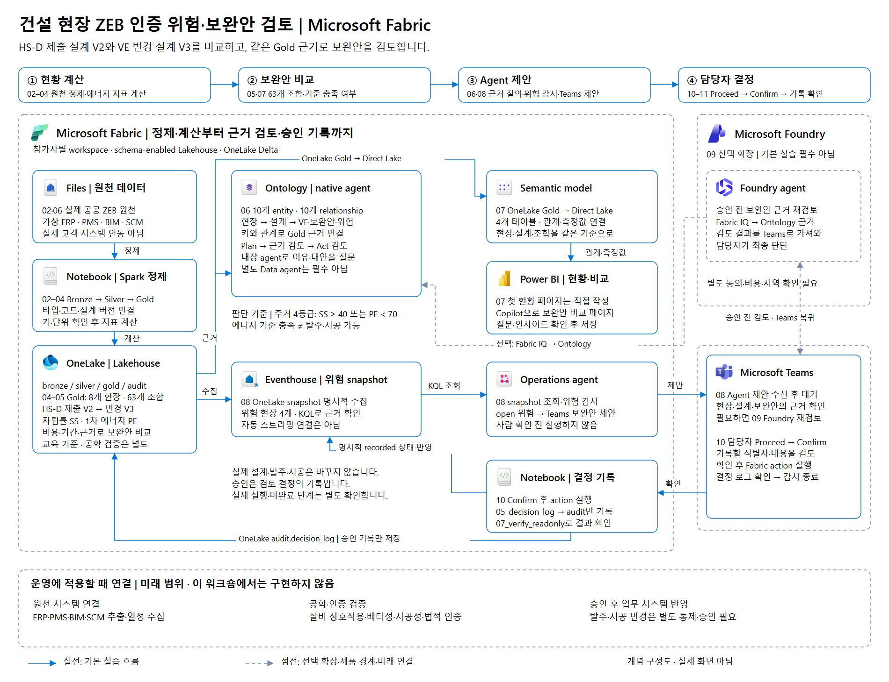

# Fabric 건설 ZEB 의사결정 실습

**HS-D의 인증 제출 설계 V2와 VE 변경 설계 V3를 비교하고, 근거를 검토한 사람이 보완안 검토 결정을 기록하는 워크숍입니다.** 실제 설계·발주·시공을 변경하지 않습니다. Foundry는 **선택 확장**이며 기본 경로의 필수 요소가 아닙니다.

> 2026-10-12 p01 실제 리허설: 기본 7개 실행과 3개 immutable snapshot refresh, 실제 공공 ZEB 9,760행, Ontology, Direct Lake, 수동 첫 페이지·native Copilot·IC-B 교육 근거 답변을 검증했습니다. genuine OneLake 수집과 승인받은 Operations **Start/Stop**도 실행했으나 30분 이상 관찰한 native 활동/Teams에 p01 제안은 나타나지 않았습니다. 사람 확인·audit는 실행하지 않았습니다. 기존 capacity는 18:42 KST **Paused**를 확인했고, 최종 ARM/콜드 재열기에서 승인 당시 F16과 다른 **F64**를 발견했습니다. SKU 변경 요청은 하지 않았으며 재개 전 조사해야 합니다. [실제 증거와 남은 단계](admin/validation.md)를 읽으십시오.

## 학습 경로

| 단계 | 실습 |
|---|---|
| 00 | [업무 시나리오와 판단 경계](docs/00-scenario.md) |
| 01 | [내 환경·출처·바인딩 확인](docs/01-environment.md) |
| 02 | [보존된 원천 → Bronze](docs/02-bronze.md) |
| 03 | [Silver 타입·코드 연결](docs/03-silver.md) |
| 04 | [Gold 및 독립 계산](docs/04-gold.md) |
| 05 | [63개 VE 조합과 정답 검토](docs/05-options.md) |
| 06 | [직접 만드는 Ontology·native agent](docs/06-ontology.md) |
| 07 | [수동 Power BI → Copilot → 검증·저장](docs/07-powerbi.md) |
| 08 | [명시적 snapshot → Operations 제안 → 대기](docs/08-operations.md) |
| 09 | [선택: Foundry 근거 재검토](docs/09-foundry-optional.md) |
| 10 | [Teams 사람 승인 → 결정 로그 → Stop](docs/10-approval.md) |
| 11 | [마무리·재현·검증](docs/11-finish.md) |

## 준비와 실행

- 관리자: [환경·12명 격리·배포 가이드](admin/environment.md), [리허설·캡처 체크리스트](admin/validation.md).
- 데이터: [출처·사전·계산 범위](data/README.md), [정답 해설](data/reference-answers.md).
- 네이티브 Fabric PySpark: `notebooks/*.ipynb` (8개, 원본 ID에 **바인딩되지 않은** 템플릿), 같은 코드의 `.py`. `05_decision_log`는 Teams 승인 후 Operations action으로 실행하고 `07_verify_readonly`로 읽기 검증합니다.
- 기본 데이터는 기존 Notebook02의 **결정적 가상 fixture**입니다. 실제 고객 ERP/PMS 추출물이나 Gold 역추출물이 아닙니다.
- 실제 ZEB snapshot `20251231`을 보존·검토하여 p01에 공급했고 `06_public_zeb`으로 Bronze/Silver 각 **9,760행**을 확인했습니다. **다른 참가자도 승인된 실제 bytes/manifest 공급 및 자신의 실행이 필수**입니다. [공공 원천 준비](data/public/README.md)가 blocked이면 데이터 chapter를 완료로 표시하지 않습니다. 다른 3종은 미취득 관리자 reference이며 raw public 파일을 GitHub에 공개하지 않았습니다.
- 모든 등급·효과·기간은 **잠정 교육 기준**입니다. 법적 인증·물리적 실현 가능성·12명 동시 실행 성능을 보증하지 않습니다.

Windows PowerShell에서 저장소 루트 기준, Python 표준 라이브러리와 Microsoft Edge의 로컬 SVG 렌더러를 사용합니다.

```powershell
python .\tools\build_data.py
python .\tools\reference.py
python .\tools\build_notebooks.py
python .\tools\build_architecture.py
.\tools\render_architecture.ps1
python -m unittest discover -s tests -v
python .\tools\check_kit.py
```

이 명령은 로컬 파일 생성·검사만 합니다. 클라우드 배포·capacity 조작·알림 발송은 없습니다. 배포 준비 도구도 오프라인 정의 패키지만 만들며, 클라우드 프로비저닝은 별도 승인 작업입니다.

## 전체 구성

Fabric Notebook에서 **Bronze → Silver → Gold**로 정제·계산하고, schema-enabled Lakehouse의 **OneLake**에 저장합니다. Ontology·내장 agent와 Power BI의 Direct Lake 모델은 **같은 Gold**를 근거로 현황과 보완안을 검토합니다. Operations agent는 명시적으로 수집한 위험 snapshot을 조회하여 Teams에 제안하고, 담당자가 확인한 뒤 Notebook은 **결정 로그만** 기록합니다.



[선명한 SVG](assets/architecture.svg) · [편집 원본 Excalidraw](assets/architecture.excalidraw) · [장면 JSON](assets/architecture.scene.json) · [공식 제품 아이콘 출처](assets/icon-attribution.md)

기본: 실제 공공 ZEB + SYNTHETIC Files → Bronze → Silver → Gold → Ontology/Power BI Copilot 페이지·질문·인사이트 → 명시적 Eventhouse snapshot → Teams 제안 → native/SQL 근거 검토 → **사람 Proceed/Confirm → creator-delegated Operations Notebook action → 결정 로그만** → 읽기 검증 → 명시적 recorded 상태 → Operations agent Stop. 자유 입력 승인 flag는 사용하지 않으며 notebook에서 verified 인간 identity를 주장하지 않습니다.

선택: Teams 제안 후 승인하지 않고 Foundry Fabric IQ 근거 검토 → Teams로 복귀 → 사람 승인. 미래 ERP·발주·현장 통합은 구현하지 않았습니다.

## 핵심 정답

- HS-D: V2 `43.5%, 69, PV530kW` → V3 `38.2%, 76, PV380kW`, 교육 계산 등급 `4 → 5`.
- 주거 4등급: `SS >= 40 OR PE < 70`; AND가 아닙니다. IC-B `39%, 65`는 4등급입니다.
- 최저 비용 **가산 에너지 기준** 충족 조합: `OPT-D5+OPT-D6`, `40.1%, 72.2`, 110,000,000원, 병렬 가정 최대 30일. 공학·상호작용·배타성·일정 검증이 없어 `decision_feasible=false`입니다.
- 기준일 `2026-09-30`, 위험 현장 4개, 설치 마감 초과 PO **0/25**. 공급 충격을 새로 꾸미지 않습니다.

## 출처·상태

[공식 문서](docs/sources.md) · [기계 판독 검증 상태](validation/status.json) · [전체 파일/hash 목록](validation/artifacts.json) · [배포 계약](deployment/README.md).
공공 데이터의 이용 조건은 해당 제공 기관/포털에서 다시 확인하십시오. 이 저장소는 원본 데이터·코드의 별도 라이선스를 주장하지 않습니다. 토큰·비공개 원본 notebook envelope·원본 Ontology 정의는 포함하지 않습니다.

공개 범위는 학습 kit·가상 fixture·실제 crop 화면과 [식별자 없는 리허설 요약](validation/rehearsal-summary.json)입니다. 계정/tenant/resource/job 식별자, 상세 private ledger, 참가자 binding 설정, prepared 배포 정의, raw 공공 CSV는 제외됩니다. 공개 checkout의 로컬 검사에는 비공개 파일이 필요하지 않습니다. 원본 보호 목록은 관리자가 비공개 inventory로 설정해야 하며 공개 템플릿은 설정 전 실패합니다.

`.gitattributes`는 파일의 정확한 bytes를 보존합니다. Git의 자동 줄바꿈 변환으로 CSV/fixture/inventory hash가 달라지지 않도록 공개 checkout에서도 같은 manifest를 검증합니다.
