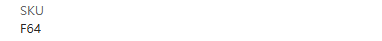

# 관리자: 로컬 검사와 live 리허설 게이트

## 18:42 KST 최종 live 체크포인트

- 17:55 KST에 코디네이터가 제시한 정확한 수신자·완성 본문·5개 parameter·native 포장/LLM 문구 차이를 사용자가 승인했습니다. 이를 사람 Proceed/Confirm 승인으로 대체하지 않았습니다.
- 기존 F16을 재개하고 승인된 같은 p01 Agent의 임시 hold만 제거 → playbook 생성·검토·저장 → 실제 **18:08:59 Start**를 실행했습니다. public `shouldRun=true`를 확인했습니다.
- 자신의 `04_snapshot` 복사본 하나에서 first-write/audit/current-hash guard를 유지하며 새 retained 경로 18:00/18:15/18:30 version을 실제 생성했습니다. 세 job 모두 Completed이며 최초 snapshot과 원본 source를 보존했습니다. 기본 7개와 합계 **10개 completed job**, 승인 writer `05`는 **0 job**입니다.
- 반복 OneLake UI에서 날짜 자동 추정이 `progress_as_of_1/_2`를 추가하는 실제 문제를 발견했습니다. genuine 새 file을 기존 **WorkshopRiskSnapshotJson**으로 직접 OneLake 수집한 결과 최신 4행의 `progress_as_of=2026-09-30`, status_time=`2026-10-12T09:31:02.854287Z`, HS-D event/baseline/result/option의 승인값을 다시 확인했습니다. 잘못 추가한 자신의 두 열만 좁은 allow-list로 제거했고 표준 11개 schema로 복원했습니다. table/row/audit drop이나 synthetic replacement는 하지 않았습니다. append history는 16행이고 latest는 4행입니다.
- **18:40까지 native 활동 없음 / 표시된 error·action·approval 0 / 정확한 Fabric operations agent Teams bot의 최신 위치에 p01 card 없음**입니다. 이는 runtime 전달 blocker이며 정상 알림·실제 card parameter·사람 승인·audit 성공을 주장하지 않습니다. 과거 다른 Agent card를 p01 증거로 사용하지 않았습니다. 데이터/조건의 첫 관찰 전이 등 원인은 추가 진단이 필요하며 확정하지 않았습니다.
- 실제 **18:40:43 Stop**, **18:41:04 public shouldRun=false** 및 `05` job history 0. 최종 **18:42:42 exact resource ARM200 Paused**, portal 일시 중지됨/다시 시작을 확인했습니다.
- **중요: 최종 ARM SKU F64가 승인/재개 당시 F16과 다릅니다.** 처음 portal은 오래된 F16을 보였지만 source account 콜드 재인증/재열기 후 F64를 표시했습니다. 이 리허설의 capacity writes는 resume/suspend뿐이며 SKU PUT/PATCH를 하지 않았습니다. 변경 원인/행위자는 검증하지 못했으므로 재개·SKU 복원 전에 코디네이터가 조사해야 합니다. 아래 15:39/16:54 기록은 과거 체크포인트입니다.
- 정확한 resource로 제한한 Azure Activity Log HTTP200에 `Microsoft.Fabric/capacities/write` Succeeded가 있습니다. 상세 caller/correlation/resource 식별자는 비공개 ledger에만 보존합니다. 반환된 속성에는 실제 initiating client/변경된 SKU 필드가 없으므로 누가 어느 client에서 SKU를 변경했는지 확정하지 않습니다. 관리자가 비공개 변경 이력을 조사하십시오.




## 로컬 검증

저장소에는 Python 표준 `unittest`, AST compile, hash/count/link/notebook parity checker가 있습니다. ChipBalance의 deterministic reference/notebook parity/docs-asset 검사 **방식**을 적용하되 원본 저장소와 factory/Databricks 코드는 수정·복사하지 않았습니다. 추가 테스트 framework 설치가 필요 없습니다.

```powershell
python .\tools\build_data.py
python .\tools\reference.py
python .\tools\build_notebooks.py
python .\tools\build_architecture.py
.\tools\render_architecture.ps1
python -m unittest discover -s tests -v
python .\tools\check_kit.py
```

구성도는 [한 장면의 SVG·Excalidraw 원본](../assets/architecture.scene.json)과 [공식 아이콘 출처](../assets/icon-attribution.md)를 함께 보존합니다. PNG는 Microsoft Edge로 **실제 SVG 자체**를 렌더링합니다. asset 검사는 원본/내장 아이콘 일치, 제품 경계, 직교 화살표의 카드 침범·글자 잘림을 검사하며 최종 PNG를 눈으로도 확인합니다. 구성도에 capacity 상태나 미실행 완료 주장을 넣지 않습니다.

PASS는 계산·파일 무결성의 로컬 증거입니다. Spark runtime, delegated permissions, Direct Lake, Teams card, Copilot 또는 human identity의 실증이 아닙니다. [status.json](../validation/status.json)에서 local/live/공공 source 상태를 따로 읽습니다.

초기 full suite **41개 PASS**를 보존했습니다. 후속 변경은 기존 runner의 관련 asset/OR/strict PE/baseline selector **15개를 한 invocation으로 검사**했고 현재 available case는 추가 교육 measure test를 포함해 42개입니다. 변경되지 않은 나머지를 재실행한 것처럼 표시하지 않습니다. compileall·check_kit과 갱신된 private p01 package/preview의 binding·hash 일치도 별도 확인합니다. offline package 재생성은 cloud 재배포/기존 stage 재실행이 아닙니다.

위 수치는 과거 리허설 체크포인트입니다. 공개 정리 후의 검사 결과는 [status의 publication_checks](../validation/status.json)에 별도로 기록합니다. `check_kit.py`는 공개 요약과 공개 allow-list의 링크·hash만 검사하며 비공개 상세 ledger나 raw CSV에 의존하지 않습니다. 요약은 실제 보존된 readback의 비식별 기록이지 새 runtime proof가 아닙니다.

## 실행 승인 전 확인

- [x] 승인된 p01 workspace/Lakehouse 실제 소속·ID readback (12명 전체 승인은 아님)
- [x] 사용자 승인된 기존 F16만 사용·필요한 readback 재개, 각 live 종료 Paused 확인; SKU 변경·자동 재개 schedule 없음
- [x] source 변경 없음, p01 write isolation
- [x] 승인된 p01 OneLake Files 관리자 공급; source export/권한 확대 없음
- [x] **필수 ZEB public snapshot** 실제 bytes/hash/manifest 공급 및 Bronze/Silver9760/9760
- [x] Operations Start·발송 미리보기 승인 및 실제 Start/Stop 수행
- [ ] 실제 native Teams proposal 전달·사람 Proceed/Confirm·audit 성공
- [ ] 선택 Foundry 외부 서비스 consent·cost·cross-region 승인

## 실제 p01 리허설과 캡처

2026-10-12 p01에서 기본 **7개 real notebook job Completed**, native Ontology **10 entity/10 relationship** saved-definition readback, Direct Lake 기본 **4 table/3 relationship/10 measure**, 수동 첫 페이지와 Copilot 페이지·질문·인사이트·Save/재열기를 실행했습니다. 후속 실제 OneLake 수집·5-string action 구성·11번째 교육 measure 검증·3회 snapshot refresh로 합계 **10개 Completed job**입니다. 승인된 Start/Stop은 수행했지만 native Teams proposal은 관찰되지 않았고 사람 승인/action/audit는 미실행입니다. [식별자를 제거한 실제 결과·한계](../validation/rehearsal-summary.json)를 공개하며 상세 ledger는 비공개로 보존합니다. 스크린샷은 실제 UI 영역의 crop이며 합성 성공 화면이 아닙니다. 공개 crop은 account/resource/item ID 영역을 제외했습니다. `assets/architecture.png`는 별도의 **설계 그림**입니다.

| ID | 필요한 증거/화면 | 현재 상태 |
|---|---|---|
| ENV-01 | 자신의 workspace/Lakehouse 이름·ID 및 preflight runtime 매칭 | Completed · [runtime guard](../assets/screenshots/p01-runtime-guard.png) |
| ENV-02 | 관리자 definition 공급 또는 실제 Save a copy 후 binding | 실제 8개 target-bound definition 배포; Save a copy 경로는 미검증 |
| DATA-01 | Files fixture/hash와 Bronze/Silver counts/type/key checks | Completed · [Files](../assets/screenshots/p01-files-fixture.png), [Bronze](../assets/screenshots/p01-bronze-counts.png) |
| PUB-01 | 필수 genuine ZEB snapshot bytes/hash/label/count 및 Bronze/Silver ingestion | Completed p01 · [9760/9760](../assets/screenshots/p01-public-zeb-counts.png) |
| DATA-02 | Gold 8 baseline, 63 subsets, 25 PO/0 breach | 실제 SQL8/63/25/0; 독립 Silver63조합 최소 D5+D6/110m/MAX30 |
| SQL-01 | V2/V3 join, IC-B OR 반례, PE70 strict 경계 | 8개 독립 등급 일치/IC-B4; 추가 인증서 SQL join은 client timeout으로 결과 미확인 |
| ONT-01 | 10 entity key/binding/relationship 및 저장 readback | REST200: 실제10 keys/gold partitions/relations; [재열기 개요](../assets/screenshots/p01-ontology-graph.png) |
| ONT-02 | Plan evidence, reviewed own-target Act (사용 시) | native Plan/질문/Act 실행; native 답만 아닌 saved-definition 독립 검증 |
| PBI-01 | 수동 첫 페이지 fields/measures/filters | [실제 수동 page](../assets/screenshots/p01-report-manual-page.png), [HS-D slicer 검사](../assets/screenshots/p01-report-hsd-filter.png) |
| PBI-02 | Copilot 두 번째 페이지 및 오류 수정/영문 데이터 질문 | [생성·수정 page](../assets/screenshots/p01-report-copilot-page.png), [110m 질문](../assets/screenshots/p01-copilot-data-answer.png); IC-B 초기 근거 부족은 아래 교육 measure로 보완 |
| PBI-05 | IC-B의 실제 모델 근거와 OR/strict PE 설명 | [DAX 3검사](../assets/screenshots/p01-icb-grade-basis-dax.png), [saved measure native 답변](../assets/screenshots/p01-copilot-icb-grounded.png); 4table/3relation/4partition 보존, measure11, case-specific fixture provenance |
| PBI-04 | 필수 Copilot insight prompt 실제 요청/응답/근거 검증 | [실제 3개 근거 인사이트](../assets/screenshots/p01-copilot-insights.png), 독립 SQL 대조 및 report text 저장 |
| PBI-03 | save/reopen 2페이지 값 유지 | 실제 닫기→workspace 재열기, 2page/110m/0/HS-D filter/insights 및8/4/1/0 유지 |
| OPS-01 | 실제 snapshot→Eventhouse 4행/dedupe | Completed · [own OneLake 수집](../assets/screenshots/p01-onelake-ingestion.png), [실제 네 현장](../assets/screenshots/p01-kql-four-rows.png); schema/mapping/실제 event/hash 독립 readback |
| OPS-03 | 저장된 scoped playbook와 stopped 상태 | [실제 query](../assets/screenshots/p01-operations-playbook.png), [Changes To open](../assets/screenshots/p01-operations-condition.png); public definition200 shouldRun=false |
| TEAM-01 | Teams proposal·인간 승인 실제 evidence | approved native Start 후 30분 이상 proposal 미관찰; 인간 승인은 미실행; private preview는 actual card proof가 아님 |
| ACT-01 | 5 string Notebook action 연결, creator role, own target readback | Completed configuration · [자기05/다섯 parameter](../assets/screenshots/p01-action-binding.png); creator/Admin/05 TARGET/default LH/parameter tag readback, job count0 |
| ACT-02 | Teams Proceed/Confirm 후 creator-delegated Monitor 성공 | not_run · 미리보기 승인과 실제 사람 확인 필요; 수동 실행으로 대체하지 않음 |
| AUD-01 | 1행 audit readback/동일 재실행/충돌 거부 | not_run |
| OPS-02 | audit 후 Stop 상태·다음 평가 중복 알림 없음 | 실제 Stop shouldRun=false; audit 후 반복 억제는 not_run |
| FDR-01 | 선택 Fabric IQ tool 목록/실제 evidence/대상 | optional_not_run |
| LOAD-01 | 12명 Spark/CU/AI/큐 실측 및 동시 실행 창 | not_run |

기본 [DAX 캡처](../assets/screenshots/p01-model-dax-measures.png)의 핵심 count는 공개 요약에 있으며 상세 반환값은 비공개 ledger에 있습니다. [16:54 과거 capacity status](../assets/screenshots/p01-capacity-continuation-paused.png)는 **일시 중지됨** 영역만 보존했습니다. [15:39 초기 종료](../assets/screenshots/p01-capacity-paused.png)도 별도로 보존했고 최종 상태는 위 18:42 체크포인트입니다. 실제 resource 식별자는 공개하지 않습니다.

### 실제 발견한 UI/근거 차이

- TMDL editor의 multiline paste가 들여쓰기를 누적할 수 있습니다. Preview 전에 정확한 script indentation을 복원하고 4 source partition 보존을 확인했습니다.
- Options의 fixed-decimal SS/PE가 자동 Currency로 보였습니다. 실제 model Properties에서 Format만 Decimal로 수정하여 source data type을 유지했고 저장된 report의 `43.50/70.00` 등으로 재확인했습니다.
- Copilot은 요청 page를 만들었지만 처음에는 title/2 cards만 있었고 table/page filter를 누락했습니다. 실제 field wells·Don't summarize·HS-D page filter를 직접 보완했으며 수동 page를 Copilot 생성으로 대체한 것이 아닙니다.
- 복수 데이터 질문을 한 prompt에 넣으면 하나씩 질문하도록 되물었습니다. baseline 날짜를 `design_date`로 추정하지 않고 기존 Options 및 training progress_as_of 맥락을 명시했습니다.
- least-cost110m와 전체 risk4는 native 조회가 독립 SQL과 일치했습니다. 처음에는 IC-B39/65/4만 조회되고 criterion/reason field가 없었습니다. 후속 실행에서 retained synthetic fixture의 IC-B/공동주택/교육 threshold를 확인하고 case-specific measure를 추가했습니다. 실제 DAX는 IC-B의 OR 설명과 HS-D·복수 site BLANK를 반환했습니다.
- Copilot이 grade/target만 잘못 grouping하여 BLANK를 반환한 첫 답은 성공으로 처리하지 않았습니다. **site_code만 grouping + IC-B filter**를 요청한 실제 다음 답에서 saved measure가 반환됐습니다. class/threshold는 내장한 fixture 근거이지 동적 criterion table·법적 인증이 아닙니다. 기존 두 report page는 바꾸지 않았습니다.
- native query에는 model-sync 경고가 있었습니다. 이를 숨기지 않고 독립 값 대조를 했습니다. 네이티브 인사이트는 실제 current/submitted IDs, 110m와 engineering blocker를 사용하며 legal/physical 적용을 주장하지 않았습니다.

### 16:54까지의 과거 체크포인트: 다운로드 제한 해결과 당시 승인 대기

초기 browser의 `acceptDownloads=false`로 JSONL 회수가 실패했지만, **16:02 후속 승인 후 동일한 실제 file을 Get data → OneLake에서 직접 선택**하여 해결했습니다. 별도 `eh_zeb_p01`과 같은 이름의 기본 KQL database를 만들었고 Ontology 내부 backing item은 보존했습니다. `progress_as_of`를 string으로 수정, `status_time`을 datetime으로 유지하여 11열/mapping/네 실제 행과 hashes를 독립 확인했습니다. 제한 변경·새 synthetic 대체·source 역추출은 없었습니다.

`ops_zeb_p01`의 Knowledge와 `RecordZEBDecision` **5-string action**, 실제 생성·저장·재열기한 scoped playbook/Changes To open을 확인했습니다. public `OperationsAgentV1`의 실제 `Configurations.json`은 **shouldRun=false**입니다. 실제 creator Object ID와 workspace Admin role, 자기 05/default Lakehouse/flat5 parameter를 확인한 뒤 TARGET admin 값만 갱신했습니다. update LRO Succeeded 및 후속 getDefinition readback을 보존했고 **05 job history0**입니다. 직렬 writer flag는 절차상 통제이며 인간 승인/호출 origin 인증이 아닙니다.

실제 author 수신 정책과 저장된 제목·본문 template, 현재 HS-D의 event/baseline/result hashes를 치환한 본문과 expected5 parameter payload를 **ignored private** `deployment/prepared/p01/notification-preview.json`에 준비했습니다. **이는 실제 렌더링된 Teams card가 아닙니다.** native LLM 문구/card 포장을 Start 전에 byte-for-byte 확인·보장한 증거는 없으며 이 한계를 포함해 코디네이터가 승인해야 합니다. 현재 instructions에는 Start/외부 메시지 금지 hold가 남아 있습니다. 승인 후 hold만 제거하고 scoped playbook/실제 payload/freshness를 재검증합니다.

이 과거 체크포인트 당시 Start/Teams 제안·사람 Proceed/Confirm·05 실행·audit/idempotency/conflict·recorded marker·실행 후 Stop/반복 억제는 미실행이었습니다. 이후 승인된 fresh snapshot/Start/Stop은 위 최종 체크포인트대로 수행했지만 native proposal·사람 승인·audit 성공은 관찰되지 않았습니다. windowed query의 오래된 snapshot은 미래 알림을 보장하지 않습니다.

### 16:54 과거 비용 종료 (최종 상태는 위 18:42 참조)

초기 종료는 15:39 KST Paused를 확인했습니다. 후속 작업도 16:41 Paused를 확인했으며, post-save getDefinition이 **CapacityNotActive**여서 사용자 승인 범위의 정확한 기존 F16만 잠시 재개해 metadata를 검증했습니다. 새로운 notebook job/action/알림은 없었습니다. 이어 exact-resource Pause/Yes와 ARM200 **state=Paused / SKU=F16**, portal **일시 중지됨 / 다시 시작**을 **16:54:32 KST** 재확인했습니다. source/SKU/권한 변경·commit/push·외부 notification은 없습니다.

## 승인 후 최소 리허설 순서

1. 한 참가자 대상으로 Files/bindings/preflight부터 시작합니다.
2. internal Bronze, **required public ZEB**, Silver/Gold를 실행하고 read-only SQL 값을 독립 비교합니다. public omitted이면 전체 chapter 완료가 아닙니다.
3. native Ontology와 Direct Lake model, 수동 report 첫 페이지를 확인합니다.
4. 4 table/3 relationship/10 measure TMDL Apply, 수동 첫 page, **Copilot 둘째 페이지 생성·질문 응답·인사이트 요청**·Q&A/implicit prerequisites·save/reopen을 확인합니다. unavailable은 stage별 blocked입니다.
5. KQL schema/mapping과 **RecordZEBDecision Notebook action의5 string parameter binding**을 확인합니다. Start 후 explicit snapshot ingest/proposal을 검증하며 자동 승인/설계/발주 action이 없음을 확인합니다.
6. native/SQL 검토 후 **Teams Proceed/Confirm**, creator-delegated **Notebook action Monitor Succeeded**, audit readback/동일 payload1행/충돌 거부, **명시적 Eventhouse recorded marker**, Stop을 확인합니다. 인간 identity는 notebook에서 검증된 것처럼 쓰지 않습니다. 직접 notebook 실행은 승인 flow의 대체 완료가 아닙니다.
7. 선택 Foundry는 별도 승인 시 승인 **전** evidence review로 삽입합니다.
8. 한 명 성공 이후에만 제한된 concurrency window로 확장합니다. measured runtime/CU를 기록하고 절대 보장 시간을 만들어내지 않습니다.
9. 결과를 status와 실제 evidence reference에 반영합니다. identity integration 미구현, 공학/법적 기준 제한은 live 성공 후에도 그대로 표시합니다.

## 중단 조건

잘못된 binding, 누락 Files, stale hash, SQL/Gold 불일치, AI의 근거 없는 claim, 중복 audit, 알림 반복, 권한/정책 거부, quota/capacity 문제는 중단 조건입니다. permissive fallback/에러 무시로 성공 표시하지 않습니다.
