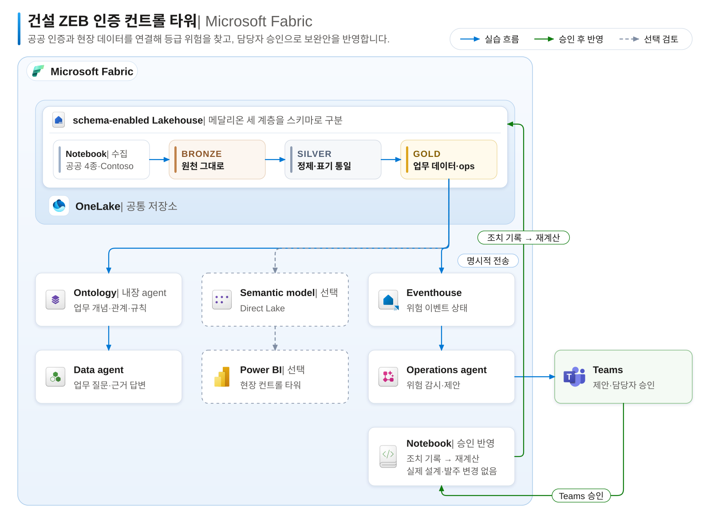

# 00. 시나리오와 실습 순서

[목차](../README.md) \| 다음: [01. 작업 영역 준비](01-workspace.md)

## 업무 상황

당신은 Contoso 건설의 제로에너지건축물(ZEB) 인증 담당자입니다. 회사는 전국 8개 현장에서 공동주택·업무시설·학교·도서관을 짓고 있고, 현장마다 ZEB 인증 등급 목표가 있습니다. 공동주택 일부는 ZEB 예비인증을 조건으로 용적률 완화 인센티브를 받았기 때문에, 사용승인 전에 예비인증 등급 이상의 본인증을 반드시 받아야 합니다.

2026년 9월 30일 기준, 에코시티 D단지(현장 코드 `HS-D`)에 문제가 생겼습니다. 2024년 예비인증 때는 설계안 V2(에너지자립률 43.5%)로 4등급을 받았는데, 이후 원가 절감(VE)으로 옥상 태양광을 530kW에서 380kW로 줄인 <b>V3의 에너지자립률이 38.2%</b>로 떨어졌습니다. 이대로라면 본인증 예상 등급은 5등급입니다.

문제는 이 사실이 한 시스템만 봐서는 드러나지 않는다는 점입니다. 같은 현장을 ERP는 프로젝트 번호 `CT-24-0189`, 공사관리(PMS)는 현장 코드 `HS-D`, BIM·에너지 시뮬레이션은 모델 번호 `BIM-0397`로 부릅니다. 인증서는 PMS에, 설계안은 BIM에, 설비 발주는 구매(SCM) 시스템에 따로 있고, 비교할 공공 인증 사례는 공공데이터포털에 있습니다.

## 오늘 해결할 과제

1.  공공 인증 현황을 파악합니다. 전국 ZEB 인증 9,760건을 시도·용도·등급별로 정리해 우리 현장과 비교할 수 있게 합니다.
2.  현장별 등급 위험을 찾습니다. 시스템마다 다른 코드를 연결하고, 현행 설계안으로 예상 등급을 계산해 예비인증·목표 등급과 비교합니다.
3.  보완안을 정하고 반영합니다. 위험 현장의 보완안 중 기준을 만족하는 가장 싼 안을 찾습니다. 보고서와 에이전트로 근거를 확인하고, 담당자가 Teams에서 승인하면 조치를 기록한 뒤 설계안과 예상 등급을 다시 계산합니다.

오늘의 미션: “D단지는 왜 위험하고, B단지는 왜 같은 위험이 아닌가? 어떤 보완안이 등급과 일정을 함께 지키는가? 승인 후 무엇이 바뀌었는가?”를 현장 ID·설계안 버전·계산값·조치 이력으로 설명합니다. AI가 추천했다는 말만으로 결론을 내리지 않습니다.

## 판단 기준

| 기준 | 내용 |
|---|---|
| ZEB 예상 등급 | 에너지자립률 기준 등급과 1차에너지소요량 기준 등급 중 더 좋은 등급입니다. 두 기준을 모두 충족할 필요는 없습니다. 예: 자립률 39%여도 1차에너지소요량이 주거용 4등급 기준(70 미만)보다 낮으면 4등급입니다. |
| 등급 순서 | `+`(ZEB+)가 가장 좋고 1 → 5등급 순서로 낮아집니다. '4등급 이상'은 +, 1, 2, 3, 4등급입니다. |
| 예비인증 → 본인증 | 예비인증을 받은 현장은 사용승인 전 예비인증 등급 이상의 본인증이 필요합니다. 현행 설계안의 예상 등급이 예비인증 등급보다 낮으면 위험입니다. |
| 필수 요건 | BEMS(건물에너지관리시스템) 또는 원격검침 설치는 인증 필수 요건입니다. |
| 인증 일정 | 예비인증 → 착공 → 설비 설치 완료 → 본인증 신청 → 본인증 취득 → 사용승인. 필수 설비가 설치 완료 계획일보다 늦게 입고되면 이후 일정이 모두 늦어진 일수만큼 밀립니다. |

보완안 추천: 보완안 하나만 적용해도 필요한 등급을 되찾고 설비 설치 완료 계획일 전에 준비가 끝나는 안 가운데 비용이 가장 낮은 안을 추천합니다. 계산은 Notebook이 하고, AI 답변은 그 계산 결과와 비교해 확인합니다. 최종 승인은 담당자가 합니다.

## 실습 흐름과 완성 결과

| 실습 | 하는 일 | 완성 결과 |
|---|---|---|
| 01–05 데이터 | Lakehouse를 직접 만들고 준비된 Notebook에 연결합니다. 공공 인증 4종을 내려받고 Contoso 내부 데이터를 만든 뒤 Bronze → Silver → Gold로 정리합니다. | 서로 비교할 수 있게 정리된 Gold 테이블과 현장 상태(`ops`) |
| 06–07 근거 질의 | Ontology를 Agent와 단계적으로 보강하고 Data agent를 구성합니다. 기본 질문은 Ontology Agent의 Plan에서 검증합니다. | 원본·규칙·계산 근거를 정답 Notebook과 비교한 Q1–Q8 답변 |
| 08 보고서(선택) | 원하는 경우 Copilot으로 현장 컨트롤 타워를 만듭니다. 기본 과정에서는 건너뜁니다. | 승인 전후 등급·위험·일정을 확인할 보고서 한 페이지 |
| 10 제안·승인·반영 | 위험 이벤트를 Eventhouse로 보내 Operations agent의 Teams 제안을 받고, 담당자가 승인합니다. | 조치 기록, 보완안을 반영한 설계안 V4, 회복된 예상 등급, 종료된 위험 이벤트 |
| 강사 시연 | 강사 환경에서 Foundry 근거 질의와 웹 대시보드를 보여줍니다. | 실제 도구 출력과 승인 전후 변화 비교 |
| 11 마무리 | 결과를 확인하고 에이전트를 멈춥니다. | 확인된 결과와 정리된 실행 상태 |

10장에서 Teams 제안을 받아도 바로 승인하지 않습니다. 07장 Q8과 보완안 평가 결과(`ops.option_eval`)의 답과 근거를 비교한 다음 승인합니다.

읽기와 변경을 구분합니다. 06장의 Act는 Ontology 모델만 변경하고, 07장과 강사 Foundry 시연의 질문·What-if는 데이터를 읽기만 합니다. 10장의 승인 액션만 보완안을 기록하고 Silver·Gold·ops를 재계산합니다. Ontology 설명에 규칙을 적는 것만으로 등급 계산이나 발주가 자동 실행되지는 않습니다.

## 실습 데이터

| 구분 | 데이터 | 비고 |
|---|---|---|
| 공공 인증 4종 | 제로에너지건축물 인증현황(한국에너지공단), 녹색건축 인증현황(한국부동산원), BF 인증 시설 정보(한국장애인고용공단), 녹색기술인증현황(한국산업기술진흥원) | 공공데이터포털(data.go.kr), 이용허락범위 제한 없음. 02장 Notebook이 실습 시점에 직접 내려받습니다. |
| Contoso 내부 16개 테이블 | ERP 프로젝트, PMS 현장·설비·인증 목표·인증서·인증 일정·조치 기록, MDM 코드 매핑, BIM 설계안, SCM 공급사·발주·발주 이벤트, 보완안, 기준 정보 | 가상 데이터입니다. 03장 Notebook이 고정 값으로 만듭니다. 회사·현장·공급사·인물은 실제와 관계없습니다. |

등급 기준값(`ref_zeb_grade_criteria`)은 제로에너지건축물 인증시스템(zeb.energy.or.kr)의 인증 등급 기준을 따릅니다. 실습의 등급 판정은 교육용으로 단순화한 것이며 실제 인증 심사를 대신하지 않습니다. 테이블 구조와 정답은 [데이터 설계](../admin/data-design.md)에 있습니다.

## 실습 일정

진행 순서는 00–07 → 10 → 강사 시연 → 11장입니다. 기본 참가자 과정은 약 4시간 10분이며, 아래 시간의 합계는 선택 08장을 포함해 약 4시간 40분입니다. 05장의 파이프라인과 06장의 Graph도 선택이며 휴식·AI 응답 대기·강사 시연 시간은 별도입니다.

- 00\. 시나리오와 실습 순서 — 15분 (이 문서)
- [01. 작업 영역 준비](01-workspace.md) — 15분
- [02. Bronze ① 공공 인증 데이터](02-bronze-public.md) — 15분
- [03. Bronze ② Contoso 내부 데이터](03-bronze-contoso.md) — 15분
- [04. Silver](04-silver.md) — 20분
- [05. Gold와 운영 지표](05-gold.md) — 20분
- [06. Ontology](06-ontology.md) — 45분
- [07. Data agent](07-data-agent.md) — 30분
- [08. Power BI (선택)](08-power-bi.md) — 30분
- [10. Operations agent](10-operations-agent.md) — 65분
- [강사 시연: Foundry와 웹 대시보드](10a-instructor-demo.md) — 참가자 실습 시간과 별도
- [11. 마무리](11-finish.md) — 10분

강사 시연은 10장 완료 후, 11장 마무리 전에 진행합니다. 참가자는 Foundry용 Azure 리소스·권한·인증을 준비하거나 로컬 앱을 설치·실행하지 않습니다.

## 다음 단계

[01. 작업 영역 준비](01-workspace.md)
