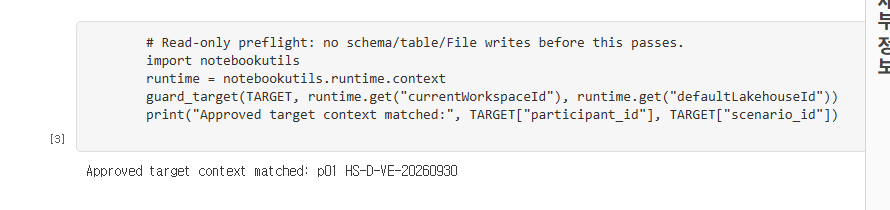

# 01. 내 작업 공간과 출처를 먼저 확인하기

## 업무 목적
12명이 각자 소유한 Lakehouse에서만 작업하고, 원본과 다른 참가자의 데이터를 보호합니다.

## 시작 전 준비
관리자가 [환경 가이드](../admin/environment.md)대로 본인 `p01..p12`에 해당하는 workspace·schema-enabled Lakehouse를 준비해야 합니다. 원본은 읽기 전용 참고이며 복사 대상 쓰기 권한을 갖지 않습니다. F16 재개 및 리허설은 별도 승인 없이는 하지 않습니다.

## 실행 순서
1. 관리자가 제공한 `ws_zeb_pNN`, `lh_zeb_pNN`, **검증된 실제 ID**를 확인합니다. `pNN`은 자신의 번호로 교체할 값이며 실행 가능한 이름이 아닙니다.
2. notebook은 관리자 제공 정의로 가져오는 경로를 우선 사용합니다. 브라우저 복사는 `다른 이름으로 저장` → `새 노트북으로 저장`(영문 Save a copy)에서 자신의 위치를 확인하는 대안입니다. 원본에서는 복사 대화상자만 확인했고 복사·실행 성공은 검증하지 않았습니다.
3. notebook의 기본 Lakehouse 및 코드 `TARGET`의 workspace/Lakehouse ID가 같음을 확인합니다. 같은 이름만으로 판단하지 않습니다.
4. 관리자가 `Files/workshop/fixtures.json`을 올렸는지 확인합니다. Lakehouse Git/배포는 Files/Tables를 복제하지 않습니다.
5. `00_preflight`만 먼저 실행합니다. `approved_target=False`, placeholder, 원본 ID, 다른 runtime ID는 실패해야 합니다.
6. 자동 파이프라인이나 agent action을 아직 시작하지 않습니다.

## 확인할 결과
성공 메시지는 현재 runtime의 `currentWorkspaceId`, `defaultLakehouseId`가 관리자가 검증한 자신의 대상과 일치했음을 뜻할 뿐, 인증·공학·인간 승인 증명이 아닙니다. 관리자가 비공개 원본 inventory에서 입력한 `protected_workspace_ids` / `protected_lakehouse_ids`의 원본 대상으로 쓰기 실행은 거부됩니다. 두 목록이 없거나 비어 있거나 placeholder여도 실패합니다. 실제 원본 ID는 공개 kit에 포함하지 않습니다.

## 완료 기준
workspace, Lakehouse, 참가자, scenario, fixture hash를 관리자 증거와 대조했습니다. 다운로드가 금지된 계정은 승인된 관리자 프로비저닝을 받으며 정책을 우회하지 않습니다.

## 다음 단계
[02. Bronze](02-bronze.md). 바인딩이 불일치하면 진행하지 말고 관리자에게 검증을 요청합니다.
