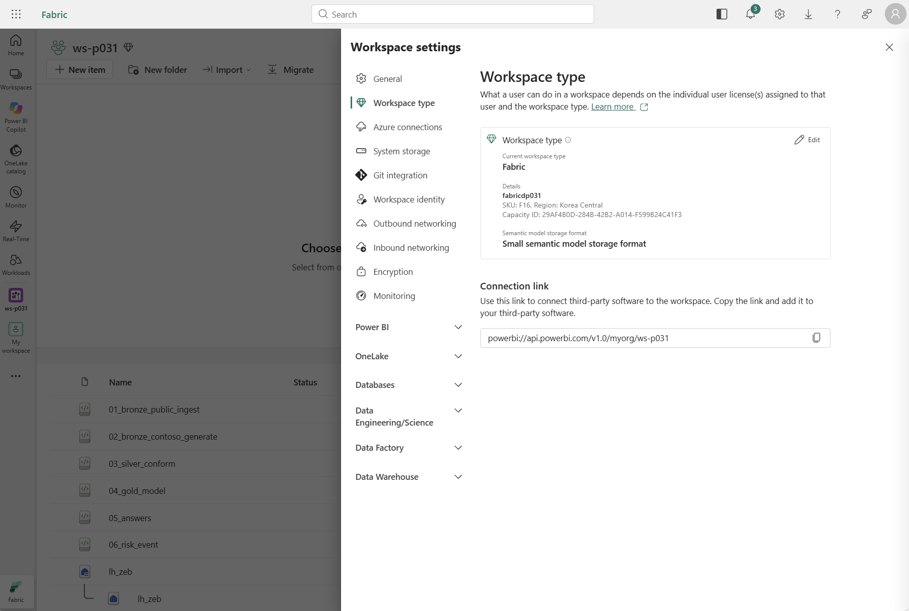
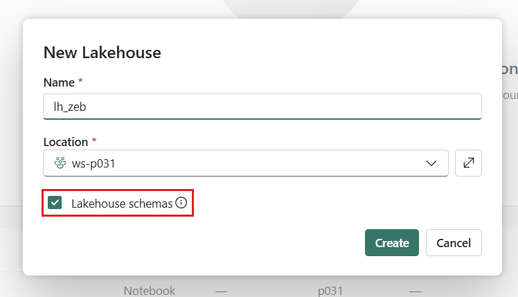
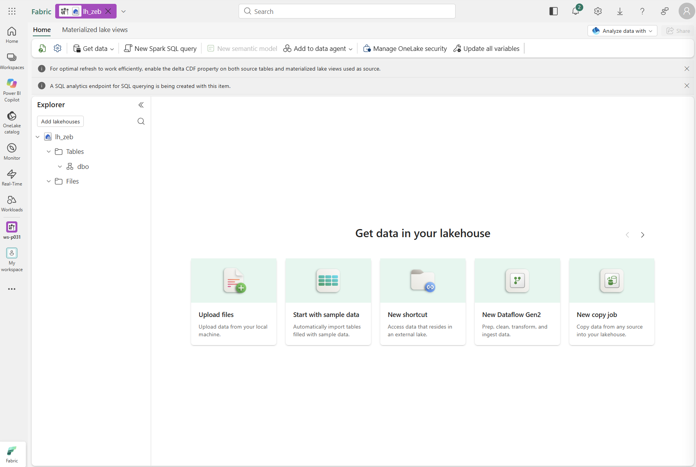
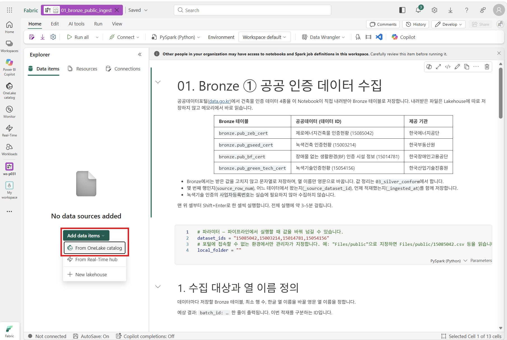
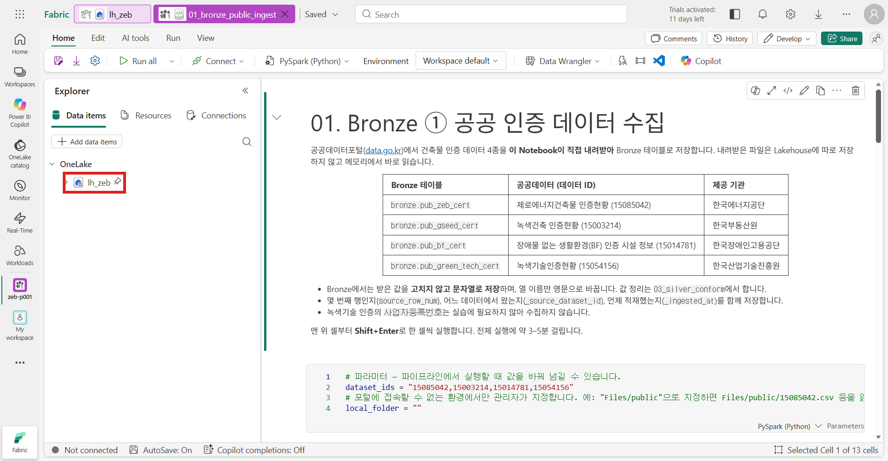

# 01. 작업 영역 준비

[목차](../README.md) \| 이전: [00. 시나리오와 실습 순서](00-scenario.md) \| 다음: [02. Bronze ① 공공 인증 데이터](02-bronze-public.md)

실습에 쓸 본인 작업 영역과 준비된 Notebook 7개를 확인하고, Lakehouse `lh_zeb`를 직접 만듭니다. 만든 Lakehouse를 `01_bronze_public_ingest`에 기본으로 연결하면 이 장은 끝입니다. 나머지 Notebook은 해당 장에서 사용하기 전에 연결합니다. 데이터는 다음 장부터 적재합니다.

Fabric 접속 → 작업 영역 유형 확인 → Notebook 7개 확인 → Lakehouse 직접 생성 → Notebook의 기본 Lakehouse 연결 순서로 진행합니다.

## 시작 전 준비

- 관리자에게 받은 실습 계정과 참가자 번호
- 관리자가 준비한 본인 작업 영역(활성 유료 Fabric 용량에 할당)과 Contributor 이상 권한

관리자가 안내한 계정으로 로그인하고 본인 작업 영역을 선택합니다. 다른 참가자의 작업 영역에서는 아무것도 실행하지 않습니다.

이 장의 미션: 이후 Notebook이 어느 Lakehouse에 쓰는지 설명할 수 있어야 합니다.

## 1. Fabric 접속과 작업 영역 유형 확인

1.  브라우저에서 <https://app.fabric.microsoft.com>을 열고 실습 계정으로 로그인합니다.
2.  왼쪽 Workspaces / 작업 영역을 누르고 본인 작업 영역을 엽니다.
3.  오른쪽 위 Workspace settings / 작업 영역 설정을 누르고 왼쪽 목록에서 Workspace type / 작업 영역 유형을 누릅니다.

예상 결과: Current workspace type이 Fabric이고, Details에 관리자가 안내한 용량 이름과 SKU가 보입니다. Trial이나 Pro로 표시되면 Copilot·Operations agent 단계를 진행할 수 없으니 관리자에게 알립니다. 확인했으면 오른쪽 위 X로 설정 창을 닫습니다.

## 2. 작업 영역 항목 확인

작업 영역 목록에 아래 Notebook 7개가 있는지 확인합니다. 관리자가 미리 넣어 둔 항목이며, Lakehouse는 다음 단계에서 직접 만듭니다.

| 항목 | 종류 | 쓰는 장 |
|---|---|---|
| `01_bronze_public_ingest` | Notebook | 02 |
| `02_bronze_contoso_generate` | Notebook | 03 |
| `03_silver_conform` | Notebook | 04 |
| `04_gold_model` | Notebook | 05 |
| `05_answers` | Notebook | 07 |
| `06_risk_event` | Notebook | 10 |
| `nb_apply_decision` | Notebook | 10 (Operations agent가 실행하므로 직접 실행하지 않음) |

예상 결과: Notebook 7개가 있습니다.

Notebook이 없다면 관리자에게 준비를 요청합니다. 원본은 [notebooks 폴더의 `.ipynb` 파일 7개](../notebooks)에 있습니다. Notebook 이름은 파일 이름 그대로 둡니다. `nb_apply_decision`이 `03_silver_conform`과 `04_gold_model`을 이름으로 찾아 실행하기 때문입니다.

## 3. Lakehouse 직접 만들기

1.  본인 작업 영역에서 + New item을 누르고 `Lakehouse`로 검색해 Lakehouse를 선택합니다.
2.  Name에 `lh_zeb`를 입력하고 Location이 본인 작업 영역인지 확인합니다.
3.  Lakehouse schemas / 스키마 사용을 켠 뒤 Create를 누릅니다. 기본으로 켜져 있어도 그대로 유지합니다.

    

4.  생성된 `lh_zeb`를 열고 왼쪽 Explorer의 Tables 아래에 `dbo` 스키마가 있는지 확인합니다. `bronze`·`silver`·`gold`·`ops` 스키마는 이후 Notebook이 만듭니다.

예상 결과: 본인 작업 영역에 Lakehouse `lh_zeb`와 같은 이름의 SQL analytics endpoint가 생깁니다. Tables에는 아직 실습 데이터가 없고 Files도 비어 있습니다. 파일 업로드는 필요하지 않습니다.

이미 `lh_zeb`가 있으면 새로 만들거나 삭제하지 말고 본인 작업 영역의 스키마 사용 Lakehouse인지 확인합니다. 기존 실습 데이터가 있다면 관리자에게 초기 상태를 확인한 뒤 진행합니다.

## 4. Notebook의 기본 Lakehouse 연결

Notebook 코드는 테이블을 `bronze.pub_zeb_cert`처럼 스키마.테이블 형식으로만 가리킵니다. 실제로 어느 Lakehouse에 저장할지는 Notebook에 연결된 기본 Lakehouse로 정해집니다.

1.  작업 영역으로 돌아가 `01_bronze_public_ingest`를 엽니다. Copilot 소개 창이 뜨면 Skip for now를 누릅니다.
2.  왼쪽 Explorer의 Add data items → From OneLake catalog에서 본인 작업 영역의 Lakehouse 아이콘 `lh_zeb`를 체크하고 Add를 누릅니다. 같은 이름의 SQL analytics endpoint를 고르지 않습니다. 이미 연결되어 있다면 중복으로 추가하지 않습니다.

    

3.  Data items → OneLake 아래 `lh_zeb`의 …에서 Set as default lakehouse를 누르고, 이름 오른쪽에 핀 아이콘(기본 Lakehouse 표시)이 생겼는지 확인합니다. 이미 핀이 있으면 그대로 둡니다.
4.  나머지 Notebook 6개는 해당 장에서 사용하기 전에 같은 방법으로 본인 `lh_zeb`를 기본 Lakehouse로 연결합니다. 지금은 연결하지 않습니다.

예상 결과: `01_bronze_public_ingest`에 본인 작업 영역의 `lh_zeb`가 기본 Lakehouse로 연결되어 있습니다.

 OneLake 아래에 lh_zeb와 핀 아이콘이 있고, 가운데에 01. Bronze ① 공공 인증 데이터 수집 제목과 수집할 데이터 4종 표, 파라미터 셀이 보입니다." />

## 5. Notebook 실행 방법

다음 장부터 아래 방법으로 Notebook을 실행합니다.

- 도구 모음의 Run all로 전체 셀을 실행합니다. 실행이 끝나면 각 장의 ‘셀별 결과 확인’과 셀 위 설명에 적힌 예상 결과를 비교합니다. `nb_apply_decision`은 직접 실행하지 않고 10장에서 Operations agent가 승인 후 실행합니다.
- 첫 셀을 실행하면 Spark 세션이 시작됩니다. 보통 수십 초가 걸리고, 용량 사용량이 많으면 더 오래 걸립니다.
- `# 파라미터`로 시작하는 셀은 parameters 셀입니다. 파이프라인이나 에이전트가 Notebook을 실행할 때 값을 바꿔 넘기는 셀이며, 실습에서는 기본값을 그대로 둡니다.
- 한 장을 마치면 도구 모음의 Stop session / 세션 중지로 Spark 세션을 멈춥니다. 다음 Notebook을 실행하면 새 세션이 시작됩니다.

## 이 장의 완료 기준

본인 작업 영역의 유형이 Fabric이고, 직접 만든 스키마 사용 Lakehouse `lh_zeb`와 Notebook 7개가 있습니다. `01_bronze_public_ingest`에 본인 `lh_zeb`가 기본 Lakehouse로 연결되어 있습니다.

## Troubleshooting

- 작업 영역 목록에 본인 작업 영역이 없으면 실습 계정으로 로그인했는지 확인하고, 그래도 없으면 관리자에게 권한을 요청합니다. 다른 계정으로 자동 로그인되어 "you don't have access to that group" 창이 뜨는 경우도 같습니다.
- 작업 영역을 열었는데 "Unable to complete the action because this Fabric capacity is currently paused"가 보이면 용량이 일시 중지된 상태입니다. 관리자에게 알리고 재개될 때까지 기다립니다.
- Tables 아래에 스키마가 없으면 스키마 사용 Lakehouse인지 확인합니다. 스키마를 사용하지 않는 항목으로 진행하거나 기존 데이터를 삭제하지 말고 관리자에게 확인합니다.
- From this computer 가져오기가 막혀 있는 환경이면 관리자가 Notebook을 대신 넣어 줍니다([관리자 준비 가이드](../admin/README.md)).

## 다음 단계

[02. Bronze ① 공공 인증 데이터](02-bronze-public.md)
