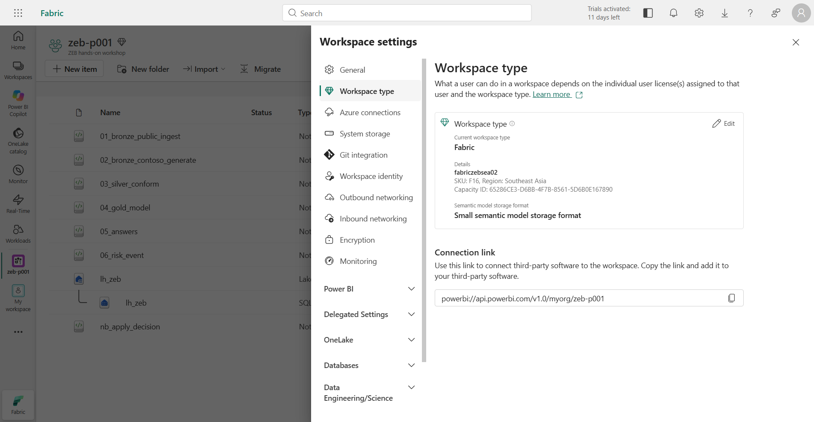
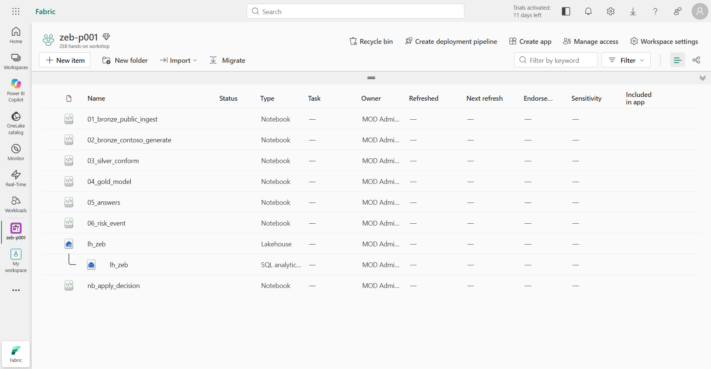
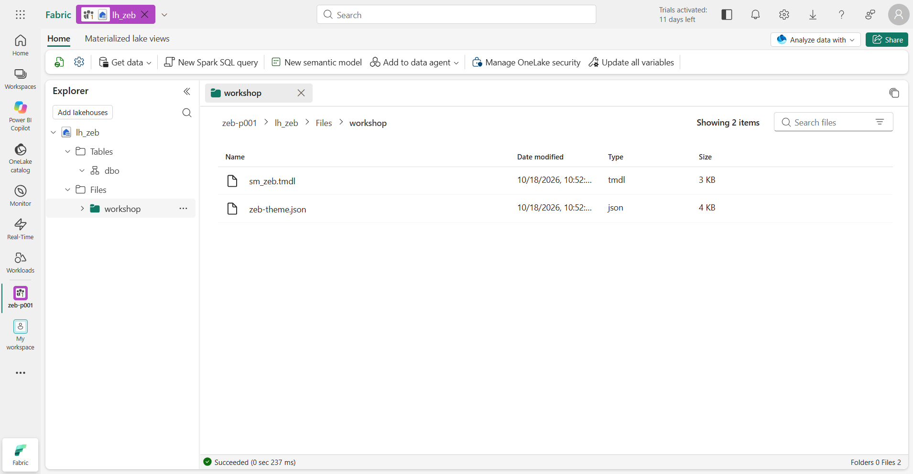
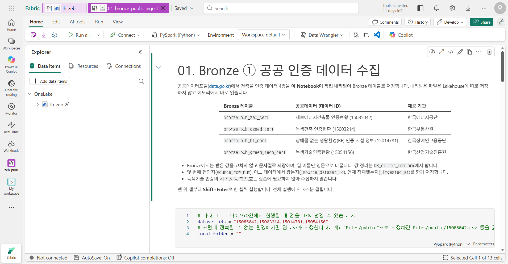

# 01. 작업 영역 준비

[목차](../README.md) \| 이전: [00. 시나리오와 실습 순서](00-scenario.md) \| 다음: [02. Bronze ① 공공 인증 데이터](02-bronze-public.md)

실습에 쓸 본인 작업 영역을 확인합니다. 작업 영역이 유료 용량에 있는지, Lakehouse와 Notebook 7개가 준비되어 있는지, Notebook이 본인 Lakehouse를 기본으로 쓰는지 확인하면 이 장은 끝입니다. 데이터는 다음 장부터 적재합니다.

**Fabric 접속 → 작업 영역 유형 확인 → 항목 확인 → Lakehouse와 실습 파일 확인 → Notebook의 기본 Lakehouse 확인** 순서로 진행합니다.

## 시작 전 준비

- 관리자에게 받은 실습 계정과 참가자 번호(예: `p001`)
- 관리자가 준비한 본인 작업 영역 `zeb-p001`(활성 유료 Fabric 용량에 할당)과 **Contributor 이상** 권한

문서의 `p001`은 예시입니다. 화면에서는 **본인 번호의 작업 영역**을 선택하고, 다른 참가자의 작업 영역에서는 아무것도 실행하지 않습니다.

## 1. Fabric 접속과 작업 영역 유형 확인

1.  브라우저에서 <https://app.fabric.microsoft.com>을 열고 실습 계정으로 로그인합니다.
2.  왼쪽 **Workspaces / 작업 영역**을 누르고 `zeb-p001`을 엽니다.
3.  오른쪽 위 **Workspace settings / 작업 영역 설정**을 누르고 왼쪽 목록에서 **Workspace type / 작업 영역 유형**을 누릅니다.

**예상 결과:** **Current workspace type**이 **Fabric**이고, **Details**에 관리자가 안내한 용량 이름과 SKU가 보입니다. **Trial**이나 **Pro**로 표시되면 Copilot·Operations agent 단계를 진행할 수 없으니 관리자에게 알립니다. 확인했으면 오른쪽 위 **X**로 설정 창을 닫습니다.

## 2. 작업 영역 항목 확인

작업 영역 목록에 아래 항목이 있는지 확인합니다. 관리자가 미리 넣어 둔 항목입니다.

| 항목 | 종류 | 쓰는 장 |
|---|---|---|
| `lh_zeb` | Lakehouse (같은 이름의 **SQL analytics endpoint**가 바로 아래에 함께 보임) | 전체 |
| `01_bronze_public_ingest` | Notebook | 02 |
| `02_bronze_contoso_generate` | Notebook | 03 |
| `03_silver_conform` | Notebook | 04 |
| `04_gold_model` | Notebook | 05 |
| `05_answers` | Notebook | 07 |
| `06_risk_event` | Notebook | 09 |
| `nb_apply_decision` | Notebook | 11 (Operations agent가 실행하므로 **직접 실행하지 않음**) |

**예상 결과:** Lakehouse 1개, SQL analytics endpoint 1개, Notebook 7개가 있습니다.

**Notebook이 없다면:** 관리자가 미리 넣지 않은 환경입니다. 관리자에게 받은 `.ipynb` 파일 7개(이 저장소의 `notebooks` 폴더와 같음)를 **Import → Notebook → From this computer**로 가져온 뒤 4단계에서 기본 Lakehouse를 연결합니다. Notebook 이름은 파일 이름 그대로 둡니다. `nb_apply_decision`이 `03_silver_conform`과 `04_gold_model`을 이름으로 찾아 실행하기 때문입니다.

## 3. Lakehouse와 실습 파일 확인

1.  `lh_zeb`를 엽니다. 안내 풍선이나 알림 배너가 보이면 **X**로 닫습니다.
2.  왼쪽 **Explorer**에서 **Tables** 아래에 `dbo` 스키마 하나만 있는지 봅니다. 이 Lakehouse는 스키마를 쓰는 Lakehouse이며, `bronze`·`silver`·`gold`·`ops` 스키마는 이후 Notebook이 만듭니다.
3.  **Files → workshop**을 누릅니다.

**예상 결과:** 가운데에 `sm_zeb.tmdl`과 `zeb-theme.json`이 보입니다. 08장에서 쓰는 파일입니다.

 workshop 폴더. sm_zeb.tmdl(tmdl, 3 KB)과 zeb-theme.json(json, 4 KB) 두 파일이 있고, 왼쪽 Explorer의 Tables 아래에는 dbo만 있습니다." />

4.  두 파일을 PC로 내려받습니다. 파일 이름 오른쪽 **…**를 누르고 **Download / 다운로드**를 누른 뒤, PC의 한 폴더(예: `Downloads\zeb`)에 원래 이름과 확장자 그대로 둡니다.

**확인할 결과:** PC에 `sm_zeb.tmdl`과 `zeb-theme.json`이 있습니다. 메모장으로 `sm_zeb.tmdl`을 열면 첫 줄이 `createOrReplace`입니다.

## 4. Notebook의 기본 Lakehouse 확인

Notebook 코드는 테이블을 `bronze.pub_zeb_cert`처럼 **스키마.테이블** 형식으로만 가리킵니다. 실제로 어느 Lakehouse에 저장할지는 Notebook에 연결된 **기본 Lakehouse**로 정해집니다.

1.  작업 영역으로 돌아가 `01_bronze_public_ingest`를 엽니다. Copilot 소개 창이 뜨면 **Skip for now**를 누릅니다.
2.  왼쪽 **Explorer**의 **Data items → OneLake** 아래에 `lh_zeb`가 있고, 이름 오른쪽에 **핀 아이콘**(기본 Lakehouse 표시)이 있는지 확인합니다.
3.  `lh_zeb`가 없다면 **Add data items → From OneLake catalog**에서 **본인 작업 영역**의 **Lakehouse 아이콘** `lh_zeb`를 체크하고 **Add**를 누릅니다. 같은 이름의 SQL analytics endpoint를 고르지 않도록 주의합니다. 핀 아이콘이 없으면 `lh_zeb`의 **…**에서 **Set as default lakehouse**를 누릅니다.
4.  나머지 Notebook 6개도 같은 방법으로 확인합니다.

**예상 결과:** Notebook 7개 모두 본인 작업 영역의 `lh_zeb`가 기본 Lakehouse로 연결되어 있습니다.

 OneLake 아래에 lh_zeb와 핀 아이콘이 있고, 가운데에 01. Bronze ① 공공 인증 데이터 수집 제목과 수집할 데이터 4종 표, 파라미터 셀이 보입니다. 위쪽에 이 작업 영역의 다른 사람이 Notebook에 접근할 수 있으니 실행 전에 내용을 확인하라는 안내 배너가 있습니다." />

Notebook 위쪽에 "Other people in your organization may have access to notebooks…" 배너가 보일 수 있습니다. 같은 작업 영역의 다른 사람이 Notebook을 수정할 수 있으니 실행 전에 내용을 확인하라는 일반 안내이며, 실습 진행에는 영향이 없습니다.

## 5. Notebook 실행 방법

다음 장부터 아래 방법으로 Notebook을 실행합니다.

- 맨 위 셀부터 **Shift+Enter**로 한 셀씩 실행하면서, 셀 위 설명에 적힌 **예상 결과**와 비교합니다. 도구 모음의 **Run all**로 한 번에 실행한 뒤 결과를 확인해도 됩니다.
- 첫 셀을 실행하면 Spark 세션이 시작됩니다. 보통 수십 초가 걸리고, 용량 사용량이 많으면 더 오래 걸립니다.
- `# 파라미터`로 시작하는 셀은 **parameters 셀**입니다. 파이프라인이나 에이전트가 Notebook을 실행할 때 값을 바꿔 넘기는 셀이며, 실습에서는 기본값을 그대로 둡니다.
- 한 장을 마치면 도구 모음의 **Stop session / 세션 중지**로 Spark 세션을 멈춥니다. 다음 Notebook을 실행하면 새 세션이 시작됩니다.

## 이 장의 완료 기준

본인 작업 영역 `zeb-p001`의 유형이 Fabric이고, `lh_zeb`와 Notebook 7개가 있으며, Notebook 7개 모두 본인 `lh_zeb`를 기본 Lakehouse로 씁니다. PC에 `sm_zeb.tmdl`과 `zeb-theme.json`을 내려받았습니다.

## Troubleshooting

- 작업 영역 목록에 `zeb-p001`이 없으면 실습 계정으로 로그인했는지 확인하고, 그래도 없으면 관리자에게 권한을 요청합니다. 다른 계정으로 자동 로그인되어 "you don't have access to that group" 창이 뜨는 경우도 같습니다.
- 작업 영역을 열었는데 "Unable to complete the action because this Fabric capacity is currently paused"가 보이면 용량이 일시 중지된 상태입니다. 관리자에게 알리고 재개될 때까지 기다립니다.
- **Files → workshop**이 비어 있으면 관리자에게 파일 2개를 요청합니다. 이 저장소의 `fabric` 폴더에 있는 파일과 같습니다.
- **From this computer** 가져오기가 막혀 있는 환경이면 관리자가 Notebook을 대신 넣어 줍니다([관리자 준비 가이드](../admin/README.md)).

## 다음 단계

[02. Bronze ① 공공 인증 데이터](02-bronze-public.md)
