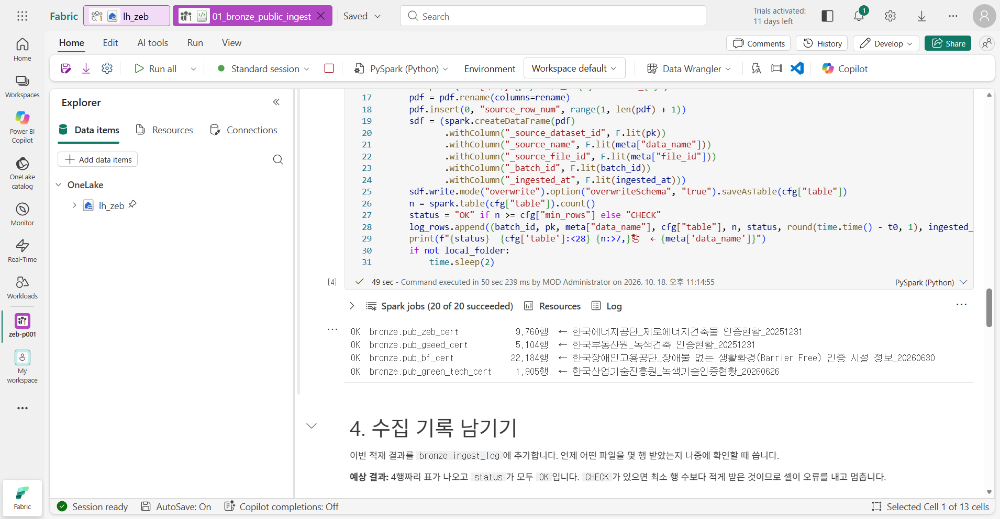
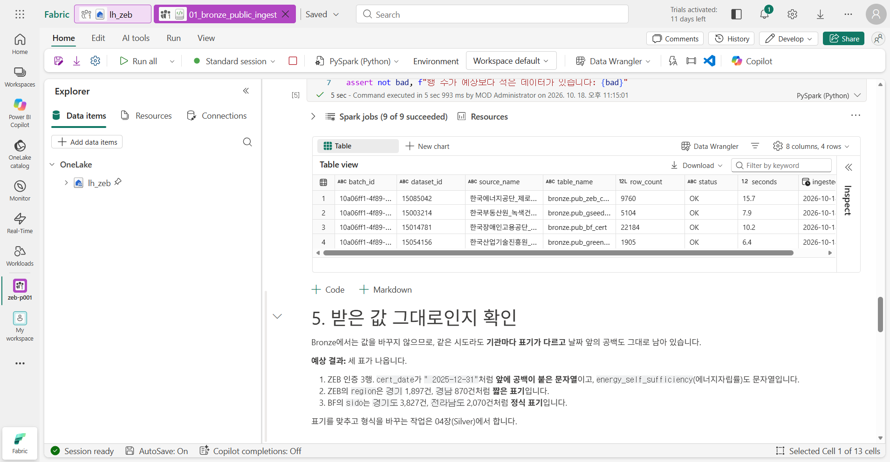
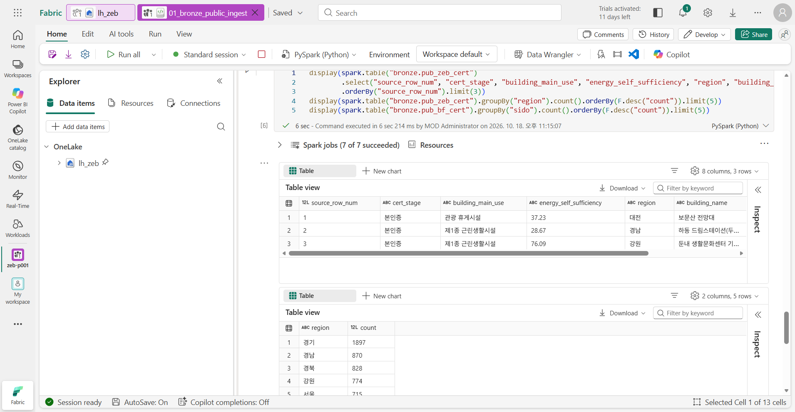
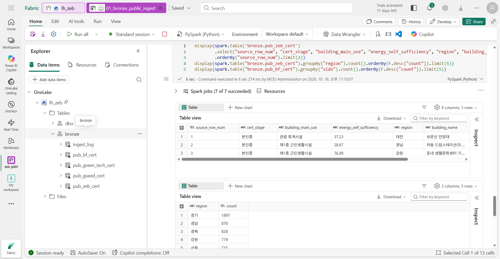

# 02. Bronze ① 공공 인증 데이터

[목차](../README.md) \| 이전: [01. 작업 영역 준비](01-workspace.md) \| 다음: [03. Bronze ② Contoso 내부 데이터](03-bronze-contoso.md)

우리 현장과 비교할 공공 인증 사례부터 가져옵니다. 이 장에서는 공공데이터포털(data.go.kr)의 건축물 인증 데이터 4종을 **Notebook이 직접 내려받아 Bronze 테이블로 저장**합니다. 파일을 PC에 내려받거나 Lakehouse에 올릴 필요가 없습니다.

Bronze에서는 **받은 값을 고치지 않습니다.** 모든 값을 문자열로 두고 열 이름만 영문으로 바꿉니다. 대신 몇 번째 행인지(`source_row_num`), 어느 데이터에서 왔는지(`_source_dataset_id`), 언제 적재했는지(`_ingested_at`)를 붙여 둡니다. 다음 장에서 정리한 결과가 이상하면 **Bronze의 원본 행을 찾아 비교**할 수 있습니다.

| Bronze 테이블 | 공공데이터 (데이터 ID) | 제공 기관 | 실습 기준 파일 |
|---|---|---|---|
| `bronze.pub_zeb_cert` | 제로에너지건축물 인증현황 (15085042) | 한국에너지공단 | 2025-12-31, 9,760행 |
| `bronze.pub_gseed_cert` | 녹색건축 인증현황 (15003214) | 한국부동산원 | 2025-12-31, 5,104행 |
| `bronze.pub_bf_cert` | 장애물 없는 생활환경(BF) 인증 시설 정보 (15014781) | 한국장애인고용공단 | 2026-06-30, 22,184행 |
| `bronze.pub_green_tech_cert` | 녹색기술인증현황 (15054156) | 한국산업기술진흥원 | 2026-06-26, 1,905행 |

공공데이터포털 표기 기준 **이용허락범위 제한 없음** 데이터입니다. 포털이 파일을 갱신하면 행 수와 이후 장의 일부 공공 통계(예: 시도별 건수)가 이 문서와 다를 수 있습니다. 그때는 07장 정답 Notebook이 계산한 값을 기준으로 삼습니다.

**시작 전:** 01장을 마쳐 `01_bronze_public_ingest`의 기본 Lakehouse가 본인 `lh_zeb`여야 합니다.

## 1. Notebook 열고 실행

1.  작업 영역 `zeb-p001`에서 `01_bronze_public_ingest`를 엽니다.
2.  맨 위 셀부터 **Shift+Enter**로 한 셀씩 실행합니다. **Run all**로 한 번에 실행한 뒤 결과를 확인해도 됩니다. Spark 세션 시작을 포함해 약 3–5분 걸립니다.

## 2. 셀별 결과 확인

1.  **1. 수집 대상과 열 이름 정의**

    데이터마다 저장할 Bronze 테이블, 최소 행 수, 한글 열 이름을 바꿀 영문 열 이름을 정합니다. 예: `에너지자립률` → `energy_self_sufficiency`, `제로에너지건축물 인증등급(ZEB)` → `zeb_grade`. 녹색기술 인증의 `사업자등록번호`는 실습에 필요하지 않아 `drop`에 넣어 수집하지 않습니다.

    **예상 결과:** `batch_id: …` 한 줄이 출력됩니다. 이번 적재를 구분하는 ID입니다.

2.  **2. 공공데이터포털 다운로드 함수**

    포털 화면에서 **다운로드** 버튼을 눌렀을 때와 같은 순서로 요청하므로 로그인이나 인증키가 필요 없습니다. 포털이 CSV 대신 오류·제한 화면(HTML)을 돌려주면 저장하지 않고 멈춥니다. 파일 인코딩(UTF-8 또는 CP949)은 자동으로 판별합니다.

    **예상 결과:** 결과 없이 끝납니다.

3.  **3. 내려받아 Bronze 테이블로 저장**

    4종을 차례로 내려받아 Delta 테이블로 저장합니다. 다시 실행하면 기존 테이블을 덮어씁니다.

    **예상 결과:** 4줄이 모두 `OK`로 시작합니다. 오른쪽 `←` 뒤에 내려받은 파일 이름과 기준일이 보입니다.

    ``` text
    OK  bronze.pub_zeb_cert            9,760행  ← 한국에너지공단_제로에너지건축물 인증현황_20251231
    OK  bronze.pub_gseed_cert          5,104행  ← 한국부동산원_녹색건축 인증현황_20251231
    OK  bronze.pub_bf_cert            22,184행  ← 한국장애인고용공단_장애물 없는 생활환경(Barrier Free) 인증 시설 정보_20260630
    OK  bronze.pub_green_tech_cert     1,905행  ← 한국산업기술진흥원_녹색기술인증현황_20260626
    ```

    

    `[주의] … 새 열` 줄이 보이면 포털 파일에 열이 새로 추가된 것입니다. 새 열은 `extra_1` 같은 이름으로 저장되며 실습에는 영향이 없습니다.

4.  **4. 수집 기록 남기기**

    이번 적재 결과를 `bronze.ingest_log`에 추가합니다. 언제 어떤 파일을 몇 행 받았는지 나중에 확인할 때 씁니다.

    **예상 결과:** 4행짜리 표가 나오고 `status`가 모두 `OK`입니다.

    

5.  **5. 원본 그대로인지 확인**

    **예상 결과:** 세 표가 나옵니다.

    - ZEB 인증 3행. `cert_date`가 `" 2025-12-31"`처럼 **앞에 공백이 있는 문자열**이고, `energy_self_sufficiency`(에너지자립률)도 문자열입니다. 3번째 행의 건물명은 `둔내 생활문화센터 기본 및 실시설계용역`입니다.
    - ZEB의 `region`은 `경기` 1,897건, `경남` 870건, `경북` 828건처럼 **짧은 표기**입니다.
    - BF의 `sido`는 `경기도` 3,827건, `전라남도` 2,070건처럼 **정식 표기**입니다.

    

    기관마다 같은 시도를 다르게 쓰고, 건물 이름 뒤에 `기본 및 실시설계용역` 같은 말이 붙기도 합니다. 이대로는 기관끼리 비교하거나 연결할 수 없습니다. 그래도 Bronze에서는 **고치지 않고 받은 그대로 둡니다.** 표기 통일은 04장(Silver)에서 합니다.

## 3. Lakehouse에서 확인

1.  Notebook 왼쪽 **Explorer**에서 `lh_zeb` → **Tables**를 펼칩니다. `dbo`만 보이면 **Tables** 오른쪽 **…**를 누르고 **Refresh**를 누릅니다.
2.  새로 생긴 `bronze` 스키마를 펼칩니다.

**예상 결과:** `bronze` 아래에 `ingest_log`, `pub_bf_cert`, `pub_green_tech_cert`, `pub_gseed_cert`, `pub_zeb_cert` 5개가 있습니다.

 Tables 아래에 dbo와 bronze 스키마가 있고, bronze 아래에 ingest_log, pub_bf_cert, pub_green_tech_cert, pub_gseed_cert, pub_zeb_cert 5개 테이블이 보입니다." />

## 이 장의 완료 기준

`bronze` 스키마에 공공 인증 4개 테이블과 `ingest_log`가 있고, 수집 기록의 `status`가 모두 `OK`입니다. ZEB 인증은 실습 기준 파일에서 9,760행이며, 기관별 시도 표기와 날짜 앞 공백이 **받은 그대로** 남아 있습니다.

## Troubleshooting

- `다운로드 횟수 제한에 걸렸습니다` 오류가 나면 여러 참가자가 동시에 같은 파일을 내려받은 것입니다. 1–2분 뒤 **3. 내려받아 Bronze 테이블로 저장** 셀부터 다시 실행합니다. 테이블을 덮어쓰므로 데이터가 중복되지 않습니다.
- `다운로드 정보를 찾지 못했습니다` 또는 `CSV가 아닌 응답` 오류가 계속되면 포털 화면 구조가 바뀌었거나 네트워크가 막힌 것입니다. 관리자에게 알리면 [관리자 준비 가이드](../admin/README.md)의 대체 방법을 안내받을 수 있습니다.
- 4번 셀이 `CHECK` 때문에 멈추면 해당 데이터를 최소 행 수보다 적게 받은 것입니다. 3번 셀부터 다시 실행합니다.
- Explorer에 `bronze`가 보이지 않으면 **Tables**의 **… → Refresh**를 누릅니다. 기본 Lakehouse가 본인 `lh_zeb`인지 01장 4단계로 확인합니다.

## 다음 단계

[03. Bronze ② Contoso 내부 데이터](03-bronze-contoso.md)
