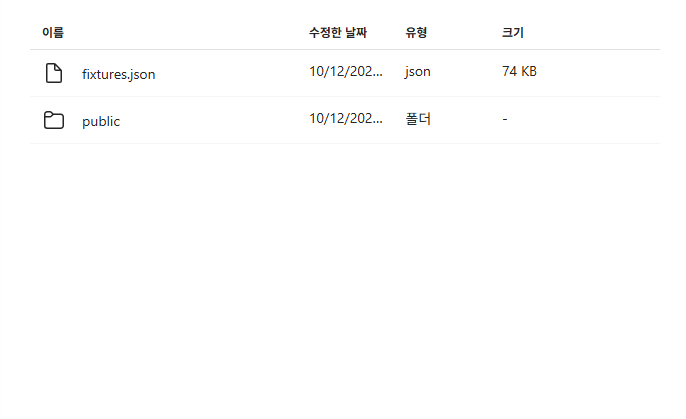
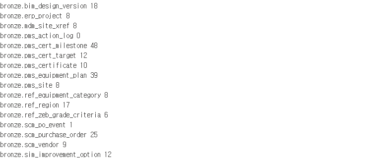
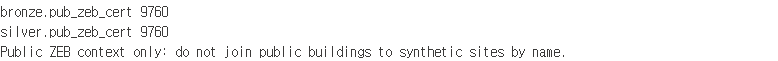

# 02. 원천을 보존하고 Bronze에 담기

## 업무 목적
실제 시스템 추출물과 가상 실습 데이터를 혼동하지 않고, 원천 문자열과 출처 hash를 보존합니다.

**메달리온의 Raw 계층**입니다. `Files/workshop/`의 원본 JSON/CSV는 재처리 근거이고, `bronze.*`는 그 값을 문자열로 표현한 **별도 Delta table**입니다. 여기서 등급·지역 표준화·보완안 계산을 하지 않습니다. 원본 bytes까지 보존해야 문자열 table만으로 복원할 수 없는 파일 표현도 확인할 수 있습니다. [계층별 설계](../admin/medallion-architecture.md)를 참고합니다.

## 시작 전 준비
[01](01-environment.md) preflight 완료, 자체 Files fixture 제공, 첫 실행의 Bronze 테이블이 없는 상태가 필요합니다. 데이터 사전은 [data/README](../data/README.md)를 엽니다.

## 실행 순서
1. `Files/workshop/fixtures.json`과 [manifest](../data/synthetic/manifest.json)를 확인합니다. 원본 Notebook02의 결정적 literal fixture에서 가져왔으며 Gold 역추출이 아닙니다.
2. `01_bronze`의 TARGET 바인딩을 다시 확인하고 셀을 순서대로 실행합니다. 파일 SHA-256이 기대값과 다르면 중단합니다.
3. notebook은 16개 source table을 모든 값이 문자열인 Bronze Delta로 저장합니다. 빈 source action log는 0행이며 승인 audit와 별개입니다.
4. 데이터 탐색기로 `bronze.erp_project`, `bronze.pms_site`, `bronze.mdm_site_xref`, `bronze.bim_design_version`을 조회합니다.
5. `CT-24-0189` 원천 시도 표기 `경기 `의 공백을 확인합니다. 인위적인 오류를 더하지 않습니다.
6. **공공 ZEB 부분은 이 원천 실습의 필수 segment**입니다. [공공 원천 가이드](../data/public/README.md)에 따라 관리자가 실제 bytes와 hash/encoding/actual count/label manifest를 `Files/workshop/public/15085042/`에 제공했는지 확인합니다. 미취득이면 내부 계산 연습은 가능하지만 이 chapter는 **blocked/미완료**입니다.
7. 자신의 `06_public_zeb`을 열고 TARGET/default Lakehouse와 source 파일·manifest를 확인합니다. 관리자의 실제 source review 승인을 확인한 뒤 PUBLIC_SNAPSHOT_APPROVED=True로 바꾸고 셀을 순서대로 실행합니다. 학생 notebook은 인터넷 다운로드를 실행하지 않습니다.
8. `bronze.pub_zeb_cert`의 `source_row_num`, `_source_dataset_id=15085042`, `_source_file_sha256`, 문자열 `cert_date`를 보고 실제 manifest count와 대조합니다. public Silver date parse/trim 검사도 같은 notebook에서 확인합니다. HTML/captcha/hash/mapping/date 오류면 실패이며 synthetic 대체는 없습니다. public 시설을 내부 가상 site와 이름으로 join하지 않습니다.

## 확인할 결과
내부 Bronze 16개: 프로젝트/현장/MDM 각 8, 설계 18, 목표 12, 인증서 10, 일정 48, 설비 39, 공급사 9, 발주 25, 이벤트 1, 옵션 12, source action 0, 등급 기준 6, 지역 17, 설비 분야 8. **공공 ZEB 추가 후 Bronze 총17개**이며 public count는 실제 retained manifest와 같아야 합니다. 원본 관찰9760을 다른 snapshot에도 강제로 적용하지 않습니다.
`_source_kind=SYNTHETIC`, `_source_sha256`이 남습니다. 원천 JSON/CSV도 보존되어 재검증할 수 있습니다. 공공 미취득을 가상 데이터로 바꾸지 않습니다.

가상 metadata와 공공 metadata는 다릅니다. 가상 16개는 `_source_kind`·`_source_sha256`, 공공은 `source_row_num`·`_source_dataset_id`·`_source_file_sha256`으로 출처를 추적합니다. 공공 컬럼명은 명시 mapping으로 바꾸되 값은 string으로 유지합니다. 수집 timestamp·batch ID를 추가했다고 주장하지 않습니다.

## 완료 기준
내부 및 **실제 공공 ZEB** manifest/hash/actual count를 비교하고 문자열 보존을 확인했습니다. 공공 bytes 미제공이면 완료로 표시하지 않습니다. 기존 테이블 재실행은 errorifexists로 중단됩니다. 자동 overwrite/reset은 없습니다.

## 다음 단계
[03. Silver 타입·키 연결](03-silver.md).
