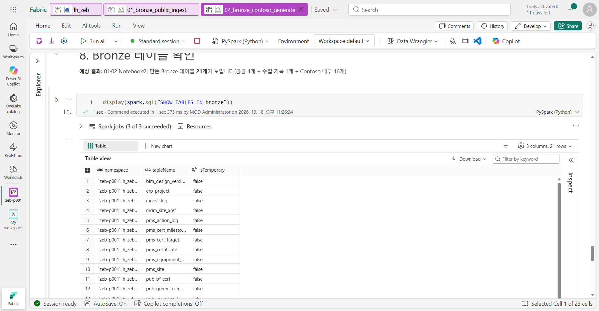
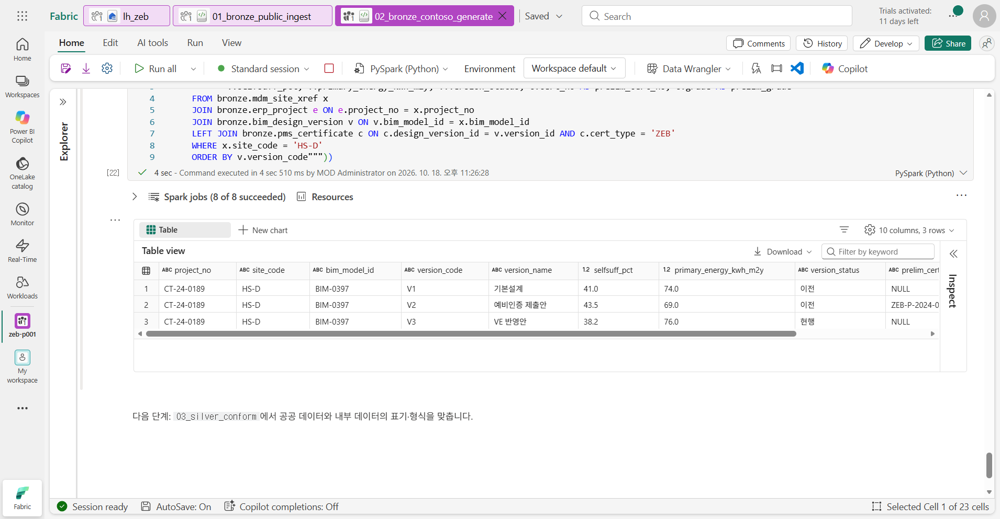

# 03. Bronze ② Contoso 내부 데이터

[목차](../README.md) \| 이전: [02. Bronze ① 공공 인증 데이터](02-bronze-public.md) \| 다음: [04. Silver](04-silver.md)

이번에는 회사 내부 데이터를 준비합니다. `02_bronze_contoso_generate`가 Contoso 건설의 **가상** 내부 시스템 데이터 16개 테이블을 Bronze에 만듭니다. 값이 고정되어 있어 몇 번을 실행해도 결과가 같고, 다시 실행하면 **실습을 처음 시작할 때의 상태로 돌아갑니다.**

실제 건설사처럼 **시스템마다 코드 체계가 다릅니다.** 같은 현장이 시스템마다 어떻게 다르게 기록되는지 이 장에서 확인합니다.

| 원천 시스템(가상) | Bronze 테이블 | 키 예시 | 내용 |
|---|---|---|---|
| ERP | `erp_project` | 프로젝트 번호 `CT-24-0189` | 프로젝트 8개, 시도(원천 표기), 주용도, 준공 예정일, 인센티브 |
| 공사관리(PMS) | `pms_site`, `pms_equipment_plan`, `pms_cert_target`, `pms_certificate`, `pms_cert_milestone`, `pms_action_log` | 현장 코드 `HS-D`, WBS `HS-D-GEO` | 공정률, 설비 계획, 인증 목표·인증서·인증 일정, 조치 기록 |
| 기준정보(MDM) | `mdm_site_xref` | — | ERP 프로젝트 번호 ↔ PMS 현장 코드 ↔ BIM 모델 번호 |
| BIM·에너지 시뮬레이션 | `bim_design_version` | 설계안 `BIM-0397-V3` | 설계안별 에너지자립률·1차에너지소요량·태양광 용량 |
| 구매(SCM) | `scm_vendor`, `scm_purchase_order`, `scm_po_event` | 거래처 `V-30452`, 발주 번호 | 공급사, 발주(WBS로 설비와 연결), 납기 변경 이벤트 |
| 에너지 컨설팅 | `sim_improvement_option` | 보완안 `OPT-D2` | 보완안별 자립률 증가·1차에너지 감소·비용·준비 기간 |
| 기준 정보 | `ref_zeb_grade_criteria`, `ref_region`, `ref_equipment_category` | 등급 `4` | 인증 등급 기준값, 시도와 별칭, 설비 분야 |

**시작 전:** 02장을 마쳐 `bronze` 스키마에 공공 인증 테이블이 있어야 합니다.

## 1. Notebook 열고 실행

1.  작업 영역에서 `02_bronze_contoso_generate`를 엽니다.
2.  맨 위 셀부터 **Shift+Enter**로 한 셀씩 실행합니다. 약 2분 걸립니다.

## 2. 셀별 결과 확인

1.  **0. 준비**

    기준일 `as_of_date = "2026-09-30"`과 테이블 저장 함수 `save`를 정합니다. 저장할 때 출처(`_source`)와 생성 시각(`_generated_at`)을 붙입니다.

    **예상 결과:** 결과 없이 끝납니다.

2.  **1. 기준 정보 — 인증 등급 기준값, 시도, 설비 분야**

    ZEB 등급마다 **에너지자립률 하한**과 **1차에너지소요량 기준값**(주거용/주거용 이외)이 정해져 있습니다. 시도 표에는 `경기도|경기|김포|…`처럼 원천마다 다르게 쓰는 표기를 별칭(`aliases`)으로 함께 적어 둡니다.

    | 등급 | 자립률 하한(%) | 1차에너지 기준 — 주거용 | 주거용 이외 |
    |---|---|---|---|
    | ZEB+ | 120 | -10 | -70 |
    | 1등급 | 100 | 10 | -30 |
    | 2등급 | 80 | 30 | 10 |
    | 3등급 | 60 | 50 | 50 |
    | 4등급 | 40 | 70 | 90 |
    | 5등급 | 20 | 90 | 130 |

    **예상 결과:** `bronze.ref_zeb_grade_criteria 6행`, `bronze.ref_region 17행`, `bronze.ref_equipment_category 8행`

    이 표에는 기준값만 있고, 등급을 **어떻게 판정하는지**(두 기준 중 더 좋은 등급, BEMS 필수 등)는 없습니다. 판정 방법은 06장에서 **Ontology의 업무 규칙**으로 정의합니다.

3.  **2. ERP 프로젝트, PMS 현장, MDM 코드 매핑**

    **예상 결과:** `bronze.erp_project 8행`, `bronze.pms_site 8행`, `bronze.mdm_site_xref 8행`

4.  **3. 설계안 — BIM·에너지 시뮬레이션**

    현장마다 가장 최근 설계안이 `현행`이고, 나머지는 `이전`입니다.

    **예상 결과:** `bronze.bim_design_version 18행`

5.  **4. 인증 목표와 취득 인증서 — PMS**

    예비인증서에는 **어느 설계안으로 받았는지**(`design_version_id`)가 함께 기록되어 있습니다. 세종 E학교는 ZEB·녹색건축·BF 세 가지 인증을 목표로 합니다.

    **예상 결과:** `bronze.pms_cert_target 12행`, `bronze.pms_certificate 10행`

6.  **5. 인증 일정 — PMS**

    모든 현장의 일정을 같은 기준으로 세웁니다. 준공(사용승인) **121일 전에 설비 설치 완료**, 75일 전에 본인증 신청, 30일 전에 본인증 취득입니다. 기준일 전에 끝난 일정에는 실적일이 들어 있습니다.

    **예상 결과:** `bronze.pms_cert_milestone 48행` (현장 8개 × 일정 6단계)

7.  **6. 설비 계획(PMS)과 공급사·발주(SCM)**

    발주는 **WBS 코드**로 설비 계획과 이어집니다(`scm_purchase_order.wbs_element` = `pms_equipment_plan.wbs_code`). Northwind 지열(`V-30452`)이 A단지와 D단지의 지열 히트펌프를 납품하고, 스마트오피스 C센터는 설비 계획에 BEMS가 빠져 있습니다.

    **예상 결과:** `bronze.pms_equipment_plan 39행`, `bronze.scm_vendor 9행`, `bronze.scm_purchase_order 25행`, `bronze.scm_po_event 1행`

8.  **7. 등급 보완안 — 에너지 컨설팅 시뮬레이션 결과, 조치 기록**

    보완안마다 적용했을 때 에너지자립률이 몇 %p 오르는지(`selfsuff_gain_pp`), 1차에너지소요량이 얼마나 줄어드는지(`primary_energy_delta`), 비용과 준비 기간이 들어 있습니다. D단지의 보완안은 6개입니다.

    | 보완안 | 내용 | 자립률 | 1차에너지 | 비용(원) | 준비 기간 |
    |---|---|---|---|---|---|
    | OPT-D1 | 옥상 태양광 원설계 복원(+150kW) | +5.3%p | -6.0 | 420,000,000 | 60일 |
    | OPT-D2 | 주차장 캐노피 태양광(+90kW) | +3.2%p | -3.5 | 230,000,000 | 45일 |
    | OPT-D3 | 발코니 BIPV(+40kW) | +1.4%p | -1.5 | 280,000,000 | 75일 |
    | OPT-D4 | 창호 성능 상향(로이 3중) | +2.1%p | -4.0 | 340,000,000 | 50일 |
    | OPT-D5 | 전열교환 환기 효율 상향 | +1.0%p | -2.0 | 60,000,000 | 30일 |
    | OPT-D6 | 공용부 LED·조명 제어 | +0.9%p | -1.8 | 50,000,000 | 20일 |

    `pms_action_log`(조치 기록)는 **처음에는 비어 있습니다.** 10장에서 담당자가 Teams에서 보완안을 승인하면 이 테이블에 기록이 추가됩니다.

    **예상 결과:** `bronze.sim_improvement_option 12행`, `bronze.pms_action_log 0행`

9.  **8. Bronze 테이블 확인**

    **예상 결과:** `bronze` 스키마에 테이블 **21개**(공공 4개 + 수집 기록 1개 + Contoso 내부 16개)가 있습니다. 표 오른쪽 위에 `3 columns, 21 rows`가 보입니다.

    

10. **9. 같은 현장, 시스템마다 다른 코드**

    **예상 결과:** 3행이 나옵니다. 같은 현장(`CT-24-0189` = `HS-D` = `BIM-0397`)의 설계안 V1·V2·V3입니다.

    | 설계안 | 이름 | 자립률(%) | 1차에너지 | 태양광(kW) | 상태 | 예비인증 |
    |---|---|---|---|---|---|---|
    | V1 | 기본설계 | 41.0 | 74.0 | 500 | 이전 | |
    | V2 | 예비인증 제출안 | 43.5 | 69.0 | 530 | 이전 | `ZEB-P-2024-0831`, 4등급 |
    | V3 | VE 반영안 | 38.2 | 76.0 | 380 | **현행** | |

    

    예비인증은 V2로 받았지만 **현재 설계안은 V3**입니다. 인증서만 보면 4등급인데, V3로 다시 판정하면 몇 등급일까요? 05장에서 계산합니다.

## 이 장의 완료 기준

`bronze` 스키마에 테이블 21개가 있고, 내부 테이블의 행 수가 위와 같으며, `pms_action_log`는 0행입니다. D단지가 시스템마다 다른 코드로 기록되어 있고, 예비인증을 받은 설계안(V2)과 현재 설계안(V3)이 다르다는 것을 확인했습니다.

## Troubleshooting

- `Table or view not found` 오류가 나면 기본 Lakehouse가 본인 `lh_zeb`인지 확인합니다(01장 4단계).
- 행 수가 다르면 이 Notebook을 처음부터 다시 실행합니다. 실행할 때마다 같은 값으로 덮어씁니다.
- **주의:** 10장에서 승인을 반영한 뒤 이 Notebook을 다시 실행하면 조치 기록이 지워지고 실습 처음 상태로 돌아갑니다. 실습을 처음부터 다시 할 때만 실행합니다.

## 다음 단계

[04. Silver](04-silver.md)
