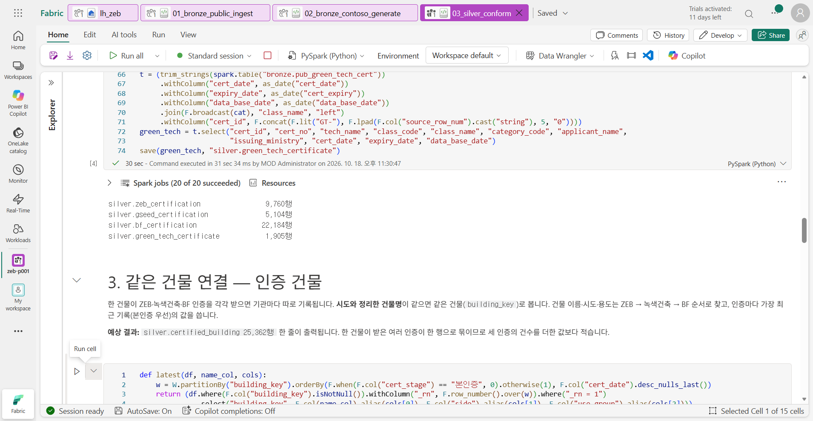
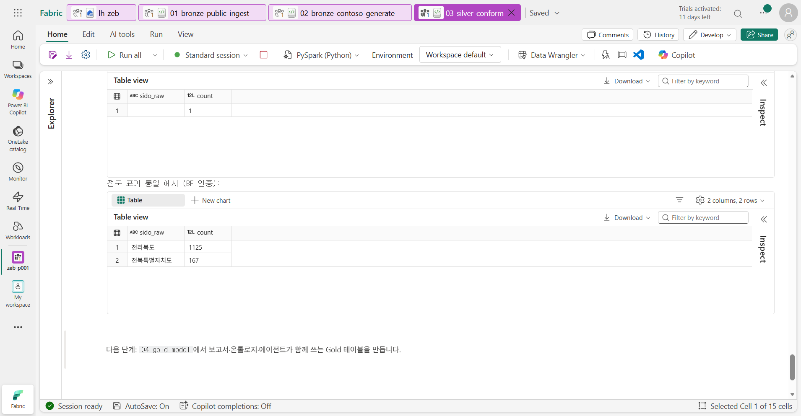
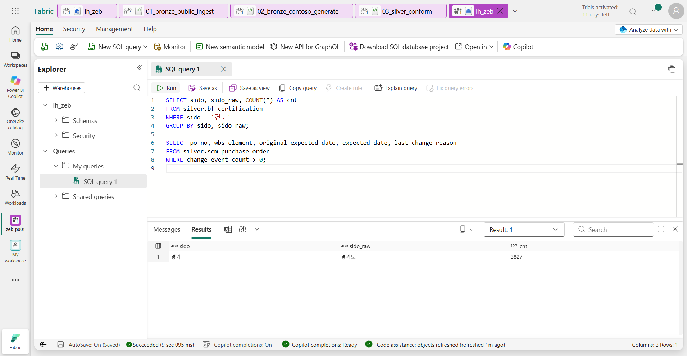
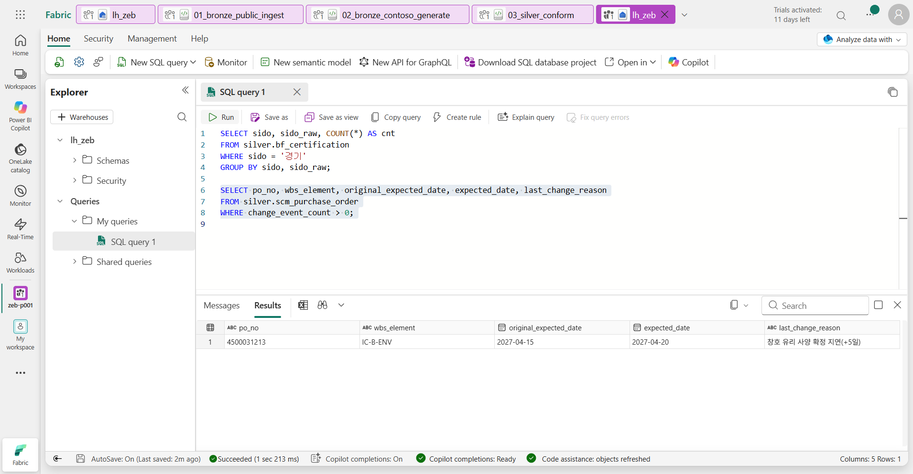

# 04. Silver

[목차](../README.md) \| 이전: [03. Bronze ② Contoso 내부 데이터](03-bronze-contoso.md) \| 다음: [05. Gold와 운영 지표](05-gold.md)

02·03장에서 확인한 문제를 이제 고칩니다. 기관마다 다른 시도 표기, 건물 이름 뒤에 붙은 `기본 및 실시설계용역`, 날짜 앞의 공백, 발주의 납기 변경 이벤트를 `03_silver_conform`으로 정리합니다. 이 장을 마치면 **공공 데이터와 내부 데이터를 서로 비교하고 연결할 수 있습니다.**

Silver에서는 값을 정리하고 표기를 맞추고 이벤트를 반영하기만 합니다. **예상 등급이나 위험 여부는 계산하지 않습니다.** 행을 지우지 않으므로 공공 인증 테이블의 행 수는 Bronze와 같습니다.

| 규칙 | 예시 |
|---|---|
| 시도 표기 통일 | `전라북도`·`전북특별자치도` → `전북`, `서울시`·`서울특별시` → `서울`, `경기 ` → `경기` |
| 용도 통일 | `제1종 근린생활시설` → `근린생활시설`, 녹색건축 `학교시설` → `교육연구시설` |
| 인증 구분·등급 표기 통일 | BF `본`/`예비` → `본인증`/`예비인증`, 녹색건축 `우수(그린2등급)` → `우수` |
| 같은 건물 연결 | 시도와 정리한 건물명이 같으면 ZEB·녹색건축·BF 인증을 한 건물(`building_key`)로 묶음 |
| 날짜·숫자 형식 | 앞뒤 공백을 지우고 날짜·숫자로 변환. 날짜가 아닌 값(예: `본인증 교부전 또는 사용승인 후 1년 이내`)은 비고 열로 옮김 |
| 이벤트·조치 반영 | 발주 납기 변경·공급사 변경 이벤트와 승인된 보완안을 반영해 현재 상태로 맞춤 |

**시작 전:** 03장까지 마쳐 `bronze` 스키마에 테이블 21개가 있어야 합니다.

## 1. Notebook 열고 실행

1.  작업 영역에서 `03_silver_conform`을 엽니다.
2.  맨 위 셀부터 **Shift+Enter**로 한 셀씩 실행합니다. 약 3분 걸립니다. 이 Notebook은 실행할 때마다 `silver` 스키마를 비우고 Bronze에서 다시 만듭니다.

## 2. 셀별 결과 확인

1.  **0. 준비 — 정제 함수**

    문자열 앞뒤 공백 제거(`trim_strings`), 빈 문자열을 null로 바꾸기(`blank_null`), 날짜·숫자 변환(`as_date`, `as_double`) 함수를 만듭니다. 날짜나 숫자로 바꿀 수 없는 값이 있어도 멈추지 않고 null로 둡니다.

    **예상 결과:** 결과 없이 끝납니다.

2.  **1. 공통 규칙 — 시도, 건물명, 용도**

    - **시도:** `ref_region`의 정식명과 별칭을 모두 펼쳐 `별칭 → 시도` 대응표를 만들고, 원천 표기를 이 표로 바꿉니다.
    - **건물명 키:** 괄호 안 내용, 기호, `신축공사`·`실시설계용역` 같은 말을 지워서 기관마다 조금씩 다른 건물명이 같은 키가 되게 합니다.
    - **용도:** 원천 용도를 실습에서 쓰는 용도 그룹(`use_group`)으로 바꿉니다. 목록에 없는 용도는 `기타`로 둡니다.

    **예상 결과:** `silver.ref_zeb_grade_criteria 6행`, `silver.ref_region 17행`, `silver.ref_equipment_category 8행`

3.  **2. 공공 인증 데이터**

    인증 4종을 같은 규칙으로 정리합니다. 인증마다 `cert_id`(예: `ZEB-00001`)와, 같은 건물을 묶는 `building_key`(`시도|정리한 건물명`)가 붙습니다. 02장에서 본 `둔내 생활문화센터 기본 및 실시설계용역`은 `강원|둔내생활문화센터`가 됩니다.

    **예상 결과:** 4줄이 출력되고, 행 수는 Bronze와 같습니다.

    ``` text
    silver.zeb_certification                  9,760행
    silver.gseed_certification                5,104행
    silver.bf_certification                  22,184행
    silver.green_tech_certificate             1,905행
    ```

    

4.  **3. 같은 건물 연결 — 인증 건물**

    한 건물이 ZEB·녹색건축·BF 인증을 각각 받으면 기관마다 따로 기록됩니다. **시도와 정리한 건물명**이 같으면 같은 건물로 봅니다. 건물 이름·시도·용도는 ZEB → 녹색건축 → BF 순서로 찾고, 인증마다 가장 최근 기록(본인증 우선)의 값을 씁니다.

    **예상 결과:** `silver.certified_building 25,362행`. 한 건물이 받은 여러 인증이 한 행으로 묶이므로 세 인증의 건수를 더한 값보다 적습니다.

5.  **4. Contoso 내부 데이터 — 이벤트와 승인된 조치를 반영한 현재 상태**

    - **발주 이벤트:** 납기 변경 이벤트가 있으면 `expected_date`를 새 날짜로 바꾸고, 원래 날짜는 `original_expected_date`에 남깁니다. 리버뷰 B단지 창호(`IC-B-ENV`)의 예상 입고일이 `2027-04-15`에서 `2027-04-20`으로 바뀝니다.
    - **승인된 보완안:** `pms_action_log`에 `apply_options` 기록이 있으면, 현재 설계안에 보완안 효과를 더한 **새 설계안(조치 반영안)**을 만들어 `현행`으로 바꾸고, 보완안 설비도 설비 계획에 추가합니다. **지금은 조치 기록이 없어서 새 설계안이 생기지 않습니다.** 11장에서 승인한 뒤에 이 셀이 V4를 만듭니다.

    **예상 결과:** 내부 테이블 13개가 만들어집니다. `silver.bim_design_version 18행`, `silver.pms_equipment_plan 39행`, `silver.scm_purchase_order 25행`, `silver.pms_action_log 0행` 등 모두 Bronze와 행 수가 같습니다.

6.  **5. 정제 결과 확인**

    **예상 결과:** 두 표가 나옵니다.

    - `시도를 정하지 못한 원천 값`: 1행. 원천 값이 비어 있는 1건뿐이고, 나머지 표기는 모두 시도로 바뀌었습니다.
    - BF 인증에서 `전북`으로 바뀐 원천 표기: 2행. `전라북도` 1,125건, `전북특별자치도` 167건

    

## 3. SQL analytics endpoint로 확인

Silver 결과를 SQL로도 조회해 봅니다. SQL analytics endpoint는 같은 Delta 테이블을 **읽기 전용**으로 조회하는 창구입니다.

1.  작업 영역에서 **SQL analytics endpoint** `lh_zeb`를 엽니다. 작업 영역 목록에서 Lakehouse `lh_zeb` 바로 아래에 있는 항목입니다.
2.  도구 모음의 **New SQL query**를 누르고 아래 쿼리를 붙여 넣은 뒤 **Run**을 누릅니다.

    ``` sql
    SELECT sido, sido_raw, COUNT(*) AS cnt
    FROM silver.bf_certification
    WHERE sido = '경기'
    GROUP BY sido, sido_raw;

    SELECT po_no, wbs_element, original_expected_date, expected_date, last_change_reason
    FROM silver.scm_purchase_order
    WHERE change_event_count > 0;
    ```

**예상 결과:** 아래 **Results**에 첫 번째 쿼리의 결과 `경기` / `경기도` / `3827`이 보입니다. BF에서 `경기도`로 쓰던 값이 ZEB와 같은 `경기`로 바뀌었습니다.



3.  두 번째 쿼리(6–8행)만 마우스로 드래그해 선택하고 다시 **Run**을 누릅니다. 선택한 부분만 실행됩니다.

**예상 결과:** 1행이 보입니다. `IC-B-ENV`의 예상 입고일이 `2027-04-15`에서 `2027-04-20`으로 바뀌었고, 사유는 `창호 유리 사양 확정 지연(+5일)`입니다.



Notebook을 실행한 직후에는 새 테이블이 SQL에 바로 보이지 않을 수 있습니다. SQL analytics endpoint가 테이블 정보를 동기화하는 데 시간이 조금 걸리기 때문입니다. 1–2분 뒤 탐색기에서 새로 고침을 누르고 다시 실행합니다.

## 이 장의 완료 기준

`silver` 스키마에 테이블 21개(기준 3 + 공공 4 + 인증 건물 1 + 내부 13)가 있고, 공공 인증의 행 수가 Bronze와 같습니다. 시도 표기가 하나로 맞춰졌고(`전라북도`·`전북특별자치도` → `전북`), `IC-B-ENV` 발주에 납기 변경 이벤트가 반영되었습니다.

## Troubleshooting

- `bronze.… not found` 오류가 나면 02·03장 Notebook을 먼저 실행합니다.
- SQL 쿼리에서 `Invalid object name` 오류가 나면 테이블 정보가 아직 동기화되지 않은 것입니다. 1–2분 뒤 다시 실행합니다.
- 시도를 정하지 못한 값이 여러 행이면 02장에서 다른 기준일의 파일을 받은 것입니다. 실습 진행에는 영향이 없습니다.

## 다음 단계

[05. Gold와 운영 지표](05-gold.md)
