# 05. Gold와 운영 지표

[목차](../README.md) \| 이전: [04. Silver](04-silver.md) \| 다음: [06. Ontology](06-ontology.md)

Silver에서 표기와 형식을 맞췄습니다. 이제 `04_gold_model`로 보고서·Ontology·에이전트가 함께 쓰는 Gold 테이블을 만들고, 현장별 예상 등급과 위험 상태를 계산합니다.

이 장에서는 두 스키마를 나눠서 씁니다.

| 스키마 | 저장하는 데이터 | 쓰는 곳 |
|---|---|---|
| `gold` (22개) | Silver에서 정리한 업무 데이터. 원천 시스템의 코드(ERP 프로젝트 번호, PMS 현장 코드, BIM 모델 번호, SCM 거래처 코드)를 그대로 쓰고, 예상 등급이나 위험 여부 같은 판정 결과는 저장하지 않습니다. | Ontology(06장)·Data agent(07장) |
| `ops` (3개) | 판정 규칙을 적용해 계산한 운영 지표. 현장 상태, 발주 상태, 인증 일정 예측 | Operations agent(10장)·Power BI(선택 08장) |

Gold에 판정 결과를 미리 넣어 두지 않는 이유는 판정 규칙이 바뀌어도 업무 데이터는 그대로이기 때문입니다. 실행되는 계산은 Notebook에 있고, 06장의 Ontology에는 같은 기준을 업무 설명으로 담습니다. 설명 자체가 계산을 실행하지는 않습니다. 07장에서는 Ontology Agent의 Plan 질의 결과를 정답 Notebook과 비교합니다.

이 장의 미션: D단지와 B단지의 자립률만 비교하지 않고, 자립률·1차에너지 기준 등급 → 최종 예상 등급 → 예비인증·목표와 비교하는 판단 과정을 설명합니다. 계산 결과는 이후 보고서와 위험 이벤트의 기준입니다.

시작 전: 04장을 마쳐 `silver` 스키마에 테이블 21개가 있어야 합니다.

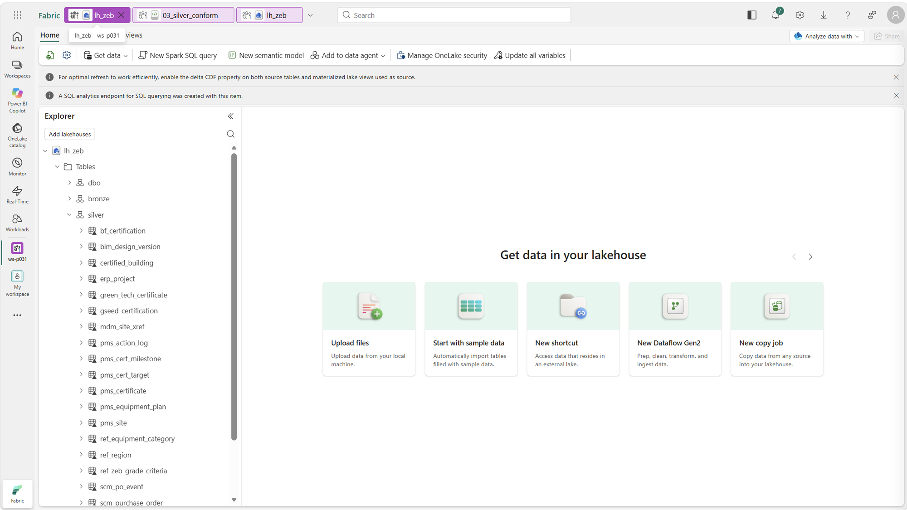

## 1. Notebook 열고 실행

1.  작업 영역에서 `04_gold_model`을 열고, [01장 4단계](01-workspace.md#4-notebook의-기본-lakehouse-연결)와 같은 방법으로 본인 `lh_zeb`를 기본 Lakehouse로 연결합니다.
2.  도구 모음의 Run all을 누릅니다. 약 4분 걸립니다. 실행이 끝나면 아래 셀별 결과를 확인합니다.

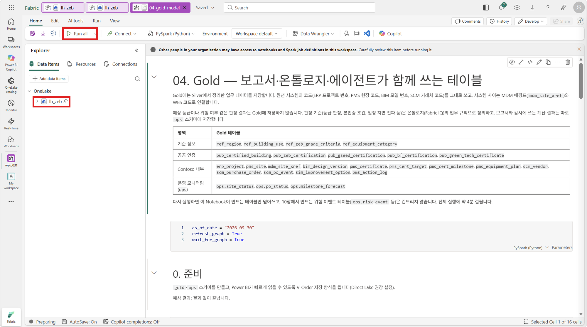

## 2. 셀별 결과 확인

1.  준비

    `gold`·`ops` 스키마를 만들고, Power BI가 빠르게 읽을 수 있도록 V-Order 저장 방식을 켭니다(Direct Lake 권장 설정).

    예상 결과: 결과 없이 끝납니다.

2.  기준 정보

    등급별 보고서 색(`grade_color`)과 용도별 주거 구분(`use_family`: 주거용/주거용 이외)을 추가합니다. 1차에너지 기준값이 주거 구분에 따라 다르기 때문입니다.

    예상 결과: `gold.ref_region 17행`, `gold.ref_building_use 14행`, `gold.ref_zeb_grade_criteria 6행`, `gold.ref_equipment_category 8행`

    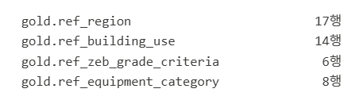

3.  공공 인증

    Silver의 공공 인증 테이블을 옮기면서 원천 시도 표기 열(`sido_raw`)만 뺍니다. 테이블 이름 앞의 `pub_`는 공공 데이터라는 뜻입니다.

    예상 결과: 5줄이 출력됩니다. `gold.pub_zeb_certification 9,760행`, `gold.pub_certified_building 25,362행` 등입니다.

    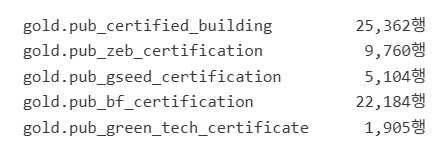

4.  Contoso 내부 — 시스템별 업무 데이터

    예상 결과: 13줄이 출력됩니다. `gold.erp_project 8행`부터 `gold.pms_action_log 0행`까지입니다.

    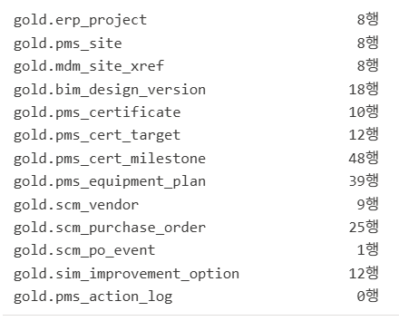

5.  운영 모니터링(`ops`) — 보고서용 계산 결과

    06장에서 Ontology에 넣을 규칙과 같은 기준으로 현재 상태를 계산합니다.

    - 예상 등급 = 에너지자립률 기준 등급과 1차에너지소요량 기준 등급(주거용/주거용 이외 기준값) 중 더 좋은 등급
    - 예비인증을 받은 현장은 사용승인 전 예비 등급 이상의 본인증이 필요
    - BEMS는 인증 필수 요건
    - 필수 설비가 설치 완료 계획일보다 늦게 입고되면 이후 인증 일정이 늦어진 일수만큼 밀림

    | 상태(`risk_level`) | 조건 |
    |---|---|
    | 위험 | 예상 등급이 예비인증 등급보다 낮음, 또는 필수 설비가 설치 완료 계획일보다 늦게 입고됨 |
    | 주의 | 예상 등급이 목표 등급보다 낮음, BEMS 미계획, 추가 인증(녹색건축·BF) 목표 미달 |
    | 정상 | 위 조건에 해당하지 않음 |

    예상 결과: `ops.po_status 25행`, `ops.milestone_forecast 48행`, `ops.site_status 8행`

    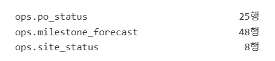

6.  결과 확인

    예상 결과: 첫 번째 표에 현장 8곳이 위험한 순서대로 나옵니다.

    | 현장 | 자립률(%) | 1차에너지 | 예상 등급 | 등급 근거 | 예비 | 목표 | 상태 | 사유 |
    |---|---|---|---|---|---|---|---|---|
    | 에코시티 D단지 현장 | 38.2 | 76.0 | 5등급 | 두 기준 동일 | 4 | 4 | 위험 | 예상 5등급(자립률 38.2%)이 예비인증 4등급보다 낮음 |
    | 마포 H단지 현장 | 36.0 | 82.0 | 5등급 | 두 기준 동일 | – | 4 | 주의 | 예상 5등급이 목표 4등급보다 낮음 |
    | 세종 E학교 현장 | 64.2 | 52.0 | 3등급 | 에너지자립률 | 3 | 3 | 주의 | BF 예비 우수 < 목표 최우수 |
    | 스마트오피스 C센터 현장 | 63.0 | 82.0 | 3등급 | 에너지자립률 | – | 3 | 주의 | BEMS가 설비 계획에 없음 |
    | 해운대 F청사 현장 | 82.5 | 8.0 | 2등급 | 두 기준 동일 | 2 | 2 | 정상 | |
    | 에코시티 A단지 현장 | 44.0 | 66.0 | 4등급 | 두 기준 동일 | 4 | 4 | 정상 | |
    | 리버뷰 B단지 현장 | 39.0 | 65.0 | 4등급 | 1차에너지소요량 | 4 | 4 | 정상 | |
    | 전주 G도서관 현장 | 61.0 | 55.0 | 3등급 | 에너지자립률 | 3 | 3 | 정상 | |

    두 번째 표에는 `gold` 스키마의 테이블 22개가 나옵니다.

    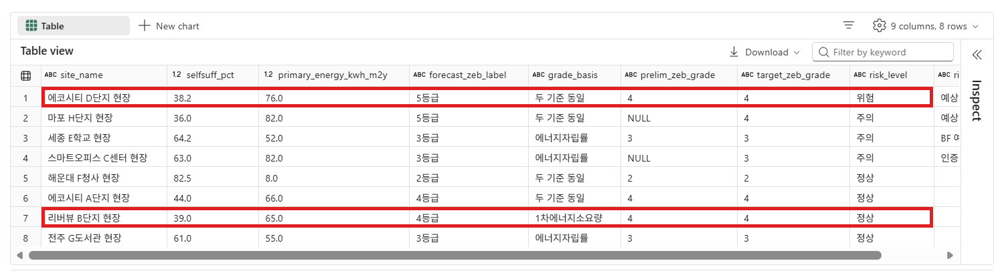

    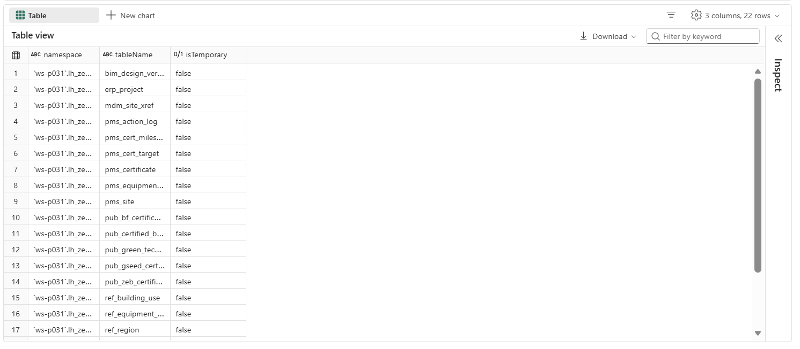

7.  온톨로지 그래프 새로 고침

    Gold를 다시 만들었을 때 온톨로지 그래프가 있으면 함께 새로 고칩니다. 지금은 Ontology가 없으므로 건너뜁니다.

    예상 결과: `온톨로지 그래프가 없어 새로 고침을 건너뜁니다.`

    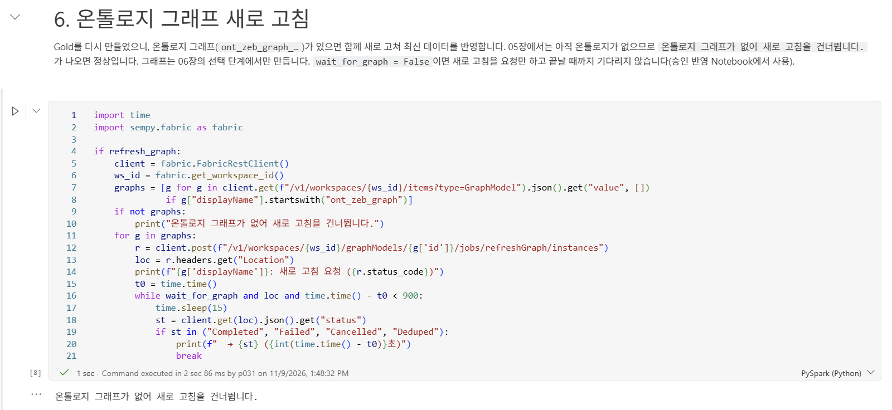

## 3. 결과 읽기

`04_gold_model`의 ‘결과 확인’ 셀 아래 첫 번째 표(현장 상태 8행)를 보면서 진행합니다. 위 2단계의 현장 상태 캡처와 같은 표입니다. Notebook을 다시 실행하거나 새 쿼리를 작성할 필요는 없습니다.

1.  `site_name`에서 `에코시티 D단지 현장`과 `리버뷰 B단지 현장` 두 행을 찾습니다. 아래 열의 값을 비교합니다. 오른쪽 열이 안 보이면 표 아래 가로 스크롤을 오른쪽으로 옮깁니다.

    | 확인할 열 | 에코시티 D단지 | 리버뷰 B단지 |
    |---|---|---|
    | `selfsuff_pct`(자립률) | 38.2 | 39.0 |
    | `primary_energy_kwh_m2y`(1차에너지소요량) | 76.0 | 65.0 |
    | `forecast_zeb_label`(예상 등급) | 5등급 | 4등급 |
    | `grade_basis`(최종 등급을 정한 기준) | 두 기준 동일 | 1차에너지소요량 |
    | `prelim_zeb_grade`(예비인증 등급) | 4 | 4 |
    | `risk_level`(상태) | 위험 | 정상 |

2.  두 현장의 자립률을 4등급 하한인 40%와 비교합니다. D단지 38.2%, B단지 39.0%는 모두 40% 미만입니다. 자립률 기준만 보면 둘 다 5등급입니다.
3.  1차에너지소요량을 주거용 4등급 기준인 70 미만과 비교합니다. D단지의 76.0은 충족하지 못해 5등급이고, B단지의 65.0은 충족해 4등급입니다. 두 기준 중 더 좋은 등급을 적용하므로 최종 예상 등급은 D단지 5등급, B단지 4등급입니다. 표의 `forecast_zeb_label`과 `grade_basis`가 이 계산과 같은지 확인합니다.
4.  최종 예상 등급을 `prelim_zeb_grade`와 비교합니다. D단지는 예비인증 4등급보다 낮은 5등급이라 `위험`이고, B단지는 4등급을 유지해 `정상`입니다. D단지의 `risk_reason`에 예상 5등급이 예비인증 4등급보다 낮다는 사유가 있고, B단지는 사유가 비어 있는지 확인합니다.

확인할 결론: 두 현장 모두 자립률은 40% 미만이지만, B단지는 1차에너지 기준을 충족해 예비인증 등급을 지킵니다. “자립률만 보면 둘 다 위험인데, 왜 B단지만 정상인가?”에 이 근거로 답할 수 있으면 됩니다. 07장에서는 에이전트의 답도 같은 기준으로 확인합니다.

## 4. (선택) 파이프라인으로 묶기

지금까지 Notebook 4개를 하나씩 실행했습니다. 실제 운영에서는 이 순서를 Pipeline으로 묶어 한 번에 실행합니다. 시간이 남으면 만들어 봅니다. 공공 데이터를 다시 내려받느라 약 10분 걸리므로 실행까지 하지 않아도 됩니다.

1.  본인 작업 영역에서 + New item → Pipeline을 고릅니다. New Pipeline 창의 Name에 `pl_zeb_medallion`을 입력하고, Location이 본인 작업 영역인지 확인한 뒤 Create를 누릅니다.

    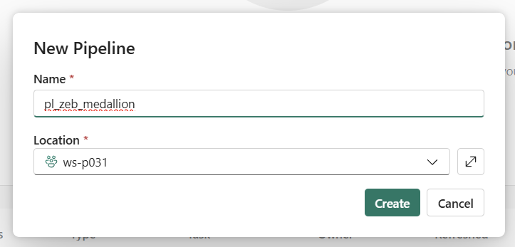

2.  위쪽 도구 모음의 Notebook을 눌러 활동 4개를 추가합니다. 각 활동을 선택하고 아래 Settings에서 본인 작업 영역의 Notebook을 `01_bronze_public_ingest` → `02_bronze_contoso_generate` → `03_silver_conform` → `04_gold_model` 순서로 고릅니다.
3.  각 활동 오른쪽의 On success(초록 체크) 핸들을 다음 활동으로 끌어 순서대로 연결합니다.
4.  저장합니다.

확인할 결과: 활동 4개가 성공 조건으로 한 줄로 이어져 있습니다. 실행할 경우 `02_bronze_contoso_generate`가 조치 기록을 지운다는 점에 주의합니다(03장 Troubleshooting).

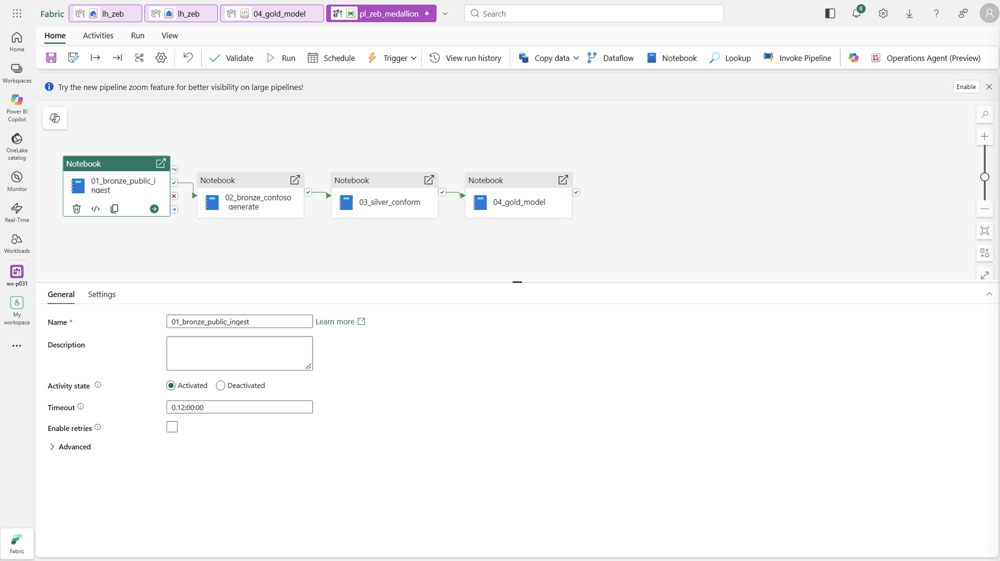

## 이 장의 완료 기준

`gold` 스키마에 테이블 22개, `ops` 스키마에 3개가 있습니다. `ops.site_status`에서 <b>에코시티 D단지가 위험(예상 5등급, 예비인증 4등급)</b>이고, 리버뷰 B단지는 1차에너지 기준으로 4등급·정상인 것을 확인했습니다.

## Troubleshooting

- `silver.… not found` 오류가 나면 04장 Notebook을 먼저 실행합니다.
- 6번 셀에서 그래프 관련 오류가 나도 Gold·ops 테이블은 이미 저장된 상태입니다. 06장에서 Graph를 만들기 전이라면 무시해도 됩니다.
- 이 Notebook은 다시 실행해도 됩니다. 이 Notebook이 만드는 테이블만 덮어쓰고, 10장에서 만드는 `ops.risk_event`·`ops.option_eval`은 건드리지 않습니다.

## 다음 단계

[06. Ontology](06-ontology.md)
