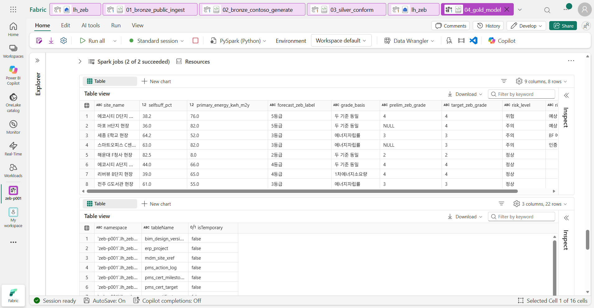

# 05. Gold와 운영 지표

[목차](../README.md) \| 이전: [04. Silver](04-silver.md) \| 다음: [06. Ontology](06-ontology.md)

Silver에서 표기와 형식을 맞췄습니다. 이제 `04_gold_model`로 보고서·Ontology·에이전트가 함께 쓰는 Gold 테이블을 만들고, **현장별 예상 등급과 위험 상태를 계산**합니다.

이 장에서는 두 스키마를 나눠서 씁니다.

| 스키마 | 저장하는 데이터 | 쓰는 곳 |
|---|---|---|
| `gold` (22개) | Silver에서 정리한 **업무 데이터**. 원천 시스템의 코드(ERP 프로젝트 번호, PMS 현장 코드, BIM 모델 번호, SCM 거래처 코드)를 그대로 쓰고, 예상 등급이나 위험 여부 같은 **판정 결과는 저장하지 않습니다.** | Ontology(06장)·Data agent(07장) |
| `ops` (3개) | 판정 규칙을 적용해 계산한 **운영 지표**. 현장 상태, 발주 상태, 인증 일정 예측 | Power BI(08장)·Operations agent(09장) |

Gold에 판정 결과를 미리 넣어 두지 않는 이유는 **판정 규칙이 바뀌어도 업무 데이터는 그대로이기 때문**입니다. 판정 규칙은 06장에서 Ontology의 업무 규칙으로 정의하고, Data agent가 그 규칙대로 답하는지 07장에서 확인합니다.

**시작 전:** 04장을 마쳐 `silver` 스키마에 테이블 21개가 있어야 합니다.

## 1. Notebook 열고 실행

1.  작업 영역에서 `04_gold_model`을 엽니다.
2.  맨 위 셀부터 **Shift+Enter**로 한 셀씩 실행합니다. 약 4분 걸립니다.

## 2. 셀별 결과 확인

1.  **0. 준비**

    `gold`·`ops` 스키마를 만들고, Power BI가 빠르게 읽을 수 있도록 V-Order 저장 방식을 켭니다(Direct Lake 권장 설정).

    **예상 결과:** 결과 없이 끝납니다.

2.  **1. 기준 정보**

    등급별 보고서 색(`grade_color`)과 용도별 **주거 구분**(`use_family`: 주거용/주거용 이외)을 추가합니다. 1차에너지 기준값이 주거 구분에 따라 다르기 때문입니다.

    **예상 결과:** `gold.ref_region 17행`, `gold.ref_building_use 14행`, `gold.ref_zeb_grade_criteria 6행`, `gold.ref_equipment_category 8행`

3.  **2. 공공 인증**

    Silver의 공공 인증 테이블을 옮기면서 원천 시도 표기 열(`sido_raw`)만 뺍니다. 테이블 이름 앞의 `pub_`는 공공 데이터라는 뜻입니다.

    **예상 결과:** 5줄이 출력됩니다. `gold.pub_zeb_certification 9,760행`, `gold.pub_certified_building 25,362행` 등입니다.

4.  **3. Contoso 내부 — 시스템별 업무 데이터**

    **예상 결과:** 13줄이 출력됩니다. `gold.erp_project 8행`부터 `gold.pms_action_log 0행`까지입니다.

5.  **4. 운영 모니터링(`ops`) — 보고서용 계산 결과**

    06장에서 Ontology에 넣을 규칙과 **같은 기준**으로 현재 상태를 계산합니다.

    - 예상 등급 = 에너지자립률 기준 등급과 1차에너지소요량 기준 등급(주거용/주거용 이외 기준값) 중 **더 좋은 등급**
    - 예비인증을 받은 현장은 사용승인 전 **예비 등급 이상의 본인증**이 필요
    - BEMS는 인증 필수 요건
    - 필수 설비가 설치 완료 계획일보다 늦게 입고되면 이후 인증 일정이 늦어진 일수만큼 밀림

    | 상태(`risk_level`) | 조건 |
    |---|---|
    | 위험 | 예상 등급이 **예비인증 등급보다 낮음**, 또는 필수 설비가 설치 완료 계획일보다 늦게 입고됨 |
    | 주의 | 예상 등급이 목표 등급보다 낮음, BEMS 미계획, 추가 인증(녹색건축·BF) 목표 미달 |
    | 정상 | 위 조건에 해당하지 않음 |

    **예상 결과:** `ops.po_status 25행`, `ops.milestone_forecast 48행`, `ops.site_status 8행`

6.  **5. 결과 확인**

    **예상 결과:** 첫 번째 표에 현장 8곳이 위험한 순서대로 나옵니다.

    | 현장 | 자립률(%) | 1차에너지 | 예상 등급 | 등급 근거 | 예비 | 목표 | 상태 | 사유 |
    |---|---|---|---|---|---|---|---|---|
    | 에코시티 D단지 현장 | 38.2 | 76.0 | 5등급 | 두 기준 동일 | 4 | 4 | **위험** | 예상 5등급(자립률 38.2%)이 예비인증 4등급보다 낮음 |
    | 마포 H단지 현장 | 36.0 | 82.0 | 5등급 | 두 기준 동일 | – | 4 | 주의 | 예상 5등급이 목표 4등급보다 낮음 |
    | 세종 E학교 현장 | 64.2 | 52.0 | 3등급 | 에너지자립률 | 3 | 3 | 주의 | BF 예비 우수 < 목표 최우수 |
    | 스마트오피스 C센터 현장 | 63.0 | 82.0 | 3등급 | 에너지자립률 | – | 3 | 주의 | BEMS가 설비 계획에 없음 |
    | 해운대 F청사 현장 | 82.5 | 8.0 | 2등급 | 두 기준 동일 | 2 | 2 | 정상 | |
    | 에코시티 A단지 현장 | 44.0 | 66.0 | 4등급 | 두 기준 동일 | 4 | 4 | 정상 | |
    | 리버뷰 B단지 현장 | 39.0 | 65.0 | **4등급** | **1차에너지소요량** | 4 | 4 | 정상 | |
    | 전주 G도서관 현장 | 61.0 | 55.0 | 3등급 | 에너지자립률 | 3 | 3 | 정상 | |

    두 번째 표에는 `gold` 스키마의 테이블 **22개**가 나옵니다.

    

7.  **6. 온톨로지 그래프 새로 고침**

    Gold를 다시 만들었을 때 온톨로지 그래프가 있으면 함께 새로 고칩니다. 지금은 Ontology가 없으므로 건너뜁니다.

    **예상 결과:** `온톨로지 그래프가 없어 새로 고침을 건너뜁니다.`

## 3. 결과 읽기

두 현장을 비교해 봅니다. 여기서 확인하는 등급 판정 방식이 06–07장에서도 핵심입니다.

- **에코시티 D단지(위험):** 현재 설계안 V3의 자립률 38.2%는 4등급 하한(40%)보다 낮고, 1차에너지 76도 주거용 4등급 기준(70 미만)을 넘습니다. 두 기준 모두 5등급이므로 예상 등급은 5등급입니다. 예비인증 4등급보다 낮아서 **본인증을 받지 못할 위험**이 있습니다.
- **리버뷰 B단지(정상):** 자립률 39%는 4등급 하한에 못 미치지만, 1차에너지 65가 주거용 4등급 기준(70 미만)을 충족합니다. **두 기준 중 더 좋은 등급**을 받으므로 4등급이고, 예비인증 등급을 지킵니다.

자립률만 보면 B단지도 위험하다고 잘못 판단하게 됩니다. 07장에서 Data agent가 이 차이를 제대로 구분하는지 확인합니다.

## 4. (선택) 파이프라인으로 묶기

지금까지 Notebook 4개를 하나씩 실행했습니다. 실제 운영에서는 이 순서를 **Data pipeline**으로 묶어 한 번에 실행합니다. 시간이 남으면 만들어 봅니다. 공공 데이터를 다시 내려받느라 약 10분 걸리므로 **실행까지 하지 않아도 됩니다.**

1.  작업 영역에서 **+ New item → Data pipeline**을 고르고 이름 `pl_zeb_medallion`으로 만듭니다.
2.  **Pipeline activity → Notebook**을 4번 추가하고, 각 활동의 **Settings**에서 Notebook을 `01_bronze_public_ingest` → `02_bronze_contoso_generate` → `03_silver_conform` → `04_gold_model` 순서로 고릅니다.
3.  각 활동 오른쪽의 **On success**(초록 체크) 핸들을 다음 활동으로 끌어 순서대로 연결합니다.
4.  저장합니다.

**확인할 결과:** 활동 4개가 성공 조건으로 한 줄로 이어져 있습니다. 실행할 경우 `02_bronze_contoso_generate`가 조치 기록을 지운다는 점에 주의합니다(03장 Troubleshooting).

## 이 장의 완료 기준

`gold` 스키마에 테이블 22개, `ops` 스키마에 3개가 있습니다. `ops.site_status`에서 <b>에코시티 D단지가 위험(예상 5등급, 예비인증 4등급)</b>이고, 리버뷰 B단지는 1차에너지 기준으로 4등급·정상인 것을 확인했습니다.

## Troubleshooting

- `silver.… not found` 오류가 나면 04장 Notebook을 먼저 실행합니다.
- 6번 셀에서 그래프 관련 오류가 나도 Gold·ops 테이블은 이미 저장된 상태입니다. 06장에서 Graph를 만들기 전이라면 무시해도 됩니다.
- 이 Notebook은 다시 실행해도 됩니다. 이 Notebook이 만드는 테이블만 덮어쓰고, 09장에서 만드는 `ops.risk_event`·`ops.option_eval`은 건드리지 않습니다.

## 다음 단계

[06. Ontology](06-ontology.md)
