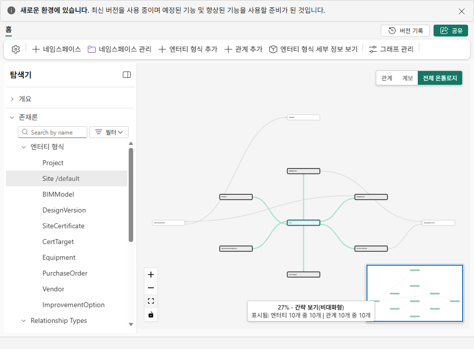

# 06. 직접 만든 Ontology에서 근거를 연결하기

## 업무 목적
같은 현장의 시스템별 키·설계 버전·인증서·옵션을 연결하여 AI 답변을 원천 행까지 추적합니다. 기존 22-entity Ontology를 그대로 복제하지 않습니다.

## 시작 전 준비
본인 Gold 완료 및 native Ontology 사용 가능 여부를 관리자에게 확인합니다. [10-entity 계약](../ontology/contract.json)은 **학습용 설계 계약**이지 오래된 JSON deployment payload가 아닙니다. 현행 저장 정의는 native 형식/TMDL을 실제로 검사해야 합니다.

## 실행 순서
1. 자신의 workspace **+ New item → Ontology**, 이름=`ont_zeb_pNN` → **Create**. Home의 **Start with Ontology agent**를 누르면 오른쪽 **Ontology Agent**가 열립니다. 별도 Data agent item이 아니라 **내장 agent**입니다. 입력 아래 **Plan**으로 설정합니다. 해당 native UI가 tenant에서 없으면 blocked이며 다른 제품의 agent로 완료 처리하지 않습니다.
2. **Say something**에 아래 prompt를 붙이고 전송 화살표를 누릅니다. `lh_zeb_pNN`만 자신의 실제 이름으로 교체합니다.

```text
내 lh_zeb_pNN Lakehouse gold 스키마로 아래 10개 entity type만 구성할 초안을 만들어줘.
원본 WS_ZEB, 다른 참가자 workspace, audit/Files/public source를 바인딩하지 마.
모든 원천 열을 속성으로 넣고 괄호의 column을 key로 사용해.
Project: gold.project (project_no)
Site: gold.site_status (site_code)
BIMModel: gold.mdm_site_xref (bim_model_id)
DesignVersion: gold.design_version (version_id)
SiteCertificate: gold.site_certificate (cert_no)
CertTarget: gold.cert_target (target_id)
Equipment: gold.equipment (wbs_code)
PurchaseOrder: gold.purchase_order (po_no)
Vendor: gold.vendor (vendor_code)
ImprovementOption: gold.improvement_option (option_id)
관계 이름과 양쪽 연결:
ProjectSite: Project.project_no -> Site.project_no
SiteBIM: Site.site_code -> BIMModel.site_code
BIMDesign: BIMModel.bim_model_id -> DesignVersion.bim_model_id
SiteCert: Site.site_code -> SiteCertificate.site_code
SubmittedDesign: SiteCertificate.design_version_id -> DesignVersion.version_id
SiteTarget: Site.site_code -> CertTarget.site_code
SiteEquipment: Site.site_code -> Equipment.site_code
EquipmentPO: Equipment.wbs_code -> PurchaseOrder.wbs_element
POVendor: PurchaseOrder.vendor_code -> Vendor.vendor_code
SiteOption: Site.site_code -> ImprovementOption.site_code
기본 데이터는 SYNTHETIC, 기준일2026-09-30, threshold는 잠정 교육 기준이야.
인증 제출 설계와 현행 설계를 섞지 말고 실제 key/속성/binding을 검증해.
초안과 검증 결과를 먼저 보여줘. Plan에서는 적용하지 마.
```

3. 답 아래 **Preview ontology**가 있으면 제안 graph를 열어 **10 entity/10 relationship**을 [contract](../ontology/contract.json)와 대조합니다. 버튼 없이 Plan 텍스트만 반환되면 entity/key/table과 관계의 양쪽 column을 텍스트로 먼저 검토하고, 8의 Act 경로를 사용합니다. proposed/read-only 상태는 저장 완료가 아닙니다. Project→Site→BIM→Design, Certificate→**submitted** Design 관계가 정확해야 합니다. 부족/오류가 있으면 같은 Plan 대화에서 수정 요청하고 적용하지 않습니다.
4. 모든 binding이 자신의 Lakehouse와 `gold`임을 확인합니다. Site는 gold.site_status 8행, BIMModel은 gold.mdm_site_xref 8행입니다.
5. 계약의 업무 규칙을 교육 맥락으로 기록합니다. 규칙 metadata가 계산을 실행하지 않으며 `ask_ontology`가 business rules를 사용한다고 보장하지 않습니다. Gold/SQL이 수치 근거입니다.
6. native agent의 **Plan**에서 다음을 질문합니다.

```text
HS-D의 프로젝트/현장/BIM 연결, 인증서 제출 설계 버전과 현행 버전을
각 엔터티 키와 출처로 제시하라. V2/V3의 SS, PE, PV를 비교하라.
현재 grade_rank를 Gold와 독립 SQL 결과에 대조하라.
OPT-D5+OPT-D6의 비용과 가산 효과를 설명하되
engineering feasibility를 검증된 것으로 주장하지 마라.
```

7. 답변의 키·join·근거값을 [04 SQL](../sql/reference_checks.sql), [05 정답](../data/reference-answers.md)과 비교합니다. graph를 사용했다면 갱신 시점/지연도 확인합니다. materialized graph는 최신값 보증이 아닙니다.
8. 검토한 **본인 Ontology 초안만** 적용합니다. **Switch to 'Act' + approve**를 누릅니다. 버튼이 없고 Plan 텍스트 제안만 나오면 먼저 key/binding을 검토한 뒤 **Act** 선택 후 `검토한 10개 entity와 10개 relationship 초안을 내 Ontology에 적용해. 내 gold binding만 유지하고 Notebook 실행/설계/발주 변경은 하지 마.`를 전송합니다. Act 성공을 실제 확인하지 못하면 미완료입니다. 이는 Ontology 편집 승인이지 10장의 Teams decision 승인과 다릅니다.
9. 저장 후 Ontology를 닫고 다시 엽니다. **Explorer**에서 각 entity를 선택하여 **Properties/key**와 data binding의 실제 table/Lakehouse/workspace를 확인합니다. Plan 답의 수량만 믿지 말고 저장된 10개 key/binding과 10개 관계를 검사합니다.
10. **개요 / Overview → 전체 온톨로지**에서 **fit view** 버튼을 누릅니다. footer의 표시 수가 entity10/10·relationship10/10인지 확인합니다. 작은 배율의 간략 graph는 key/binding 검사 자체를 대신하지 않습니다.

## 확인할 결과
인증서 `ZEB-P-2024-0831`이 `BIM-0397-V2`를 가리키고 현행이 V3임을 추적할 수 있습니다. 원본의 TEST placeholder, BEMS-vs-meter 모순, GreenTech/BF 오연결을 복사하지 않습니다.



## 완료 기준
10개 entity와 정확한 관계, 자기 대상 binding을 검증했습니다. 답변 오류/미근거 응답은 실패로 기록하며 해결되기 전 승인 단계로 넘기지 않습니다.

## 다음 단계
[07. Power BI](07-powerbi.md).
