# 06. Ontology

[목차](../README.md) \| 이전: [05. Gold와 운영 지표](05-gold.md) \| 다음: [07. Data agent](07-data-agent.md)

05장의 Gold 테이블에는 데이터만 있고 판정 방법은 없습니다. "D단지가 위험한가?"에 답하려면 **같은 현장을 가리키는 시스템별 코드가 어떻게 연결되는지**, **예상 등급을 어떻게 판정하는지**를 알아야 합니다. 이 장에서는 이런 업무 용어·관계·규칙을 **Ontology**로 정의합니다. 07장의 Data agent는 이 Ontology를 참고해 질문에 답합니다.

**빈 Ontology 만들기 → Ontology agent 초안 검토 → Act로 적용 → 업무 규칙 추가 → 키·바인딩·데이터 점검** 순서로 진행합니다. **1–5단계는 필수**이고 6단계 Graph 생성은 선택입니다.

## 시작 전 확인

- 05장을 마치고 본인 `lh_zeb`의 **Tables → gold**에 테이블 22개가 있는지 확인합니다.
- 작업 영역 **Contributor** 이상 권한과 원본 테이블 읽기 권한이 필요합니다. 관리자가 **Users can create Fabric items**, **Users can create ontology (preview) items**, Copilot·Azure OpenAI 기반 AI 기능을 허용했는지 확인합니다([Ontology 테넌트 설정](https://learn.microsoft.com/en-us/fabric/iq/ontology/overview-tenant-settings)).

Ontology는 업무 대상을 나타내는 **엔터티 타입**, 엔터티 사이의 **관계**, 엔터티를 원본 테이블과 이어 주는 **데이터 바인딩**으로 구성됩니다. 예를 들어 `Site`는 엔터티 타입이고, `gold.pms_site`의 각 행(실제 현장 하나하나)은 **인스턴스**입니다.

## 1. Ontology 만들기

1.  작업 영역 `zeb-p001`에서 **+ New item**을 누르고 오른쪽 위 **Filter by keyword** 칸에 `Ontology`를 입력한 뒤 **Ontology (preview)** 카드를 누릅니다.

    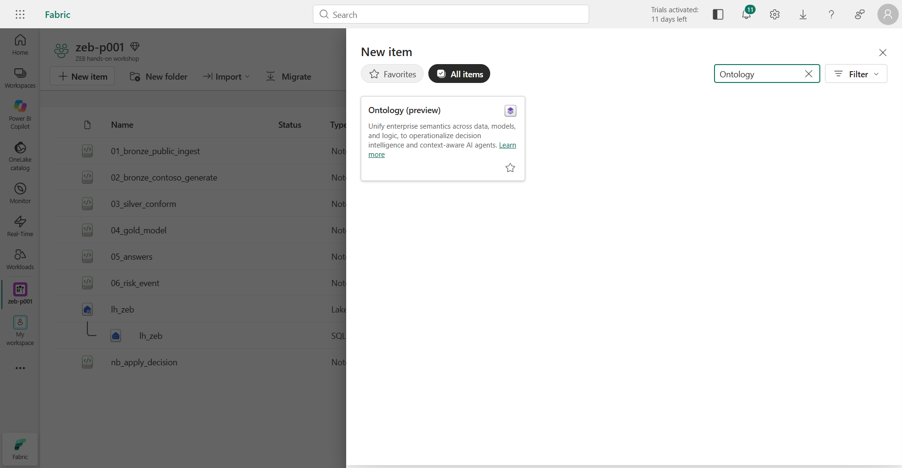

2.  **Name**에 `ont_zeb`를 입력하고 **Location**이 `zeb-p001`인지 확인한 뒤 **Create**를 누릅니다.

    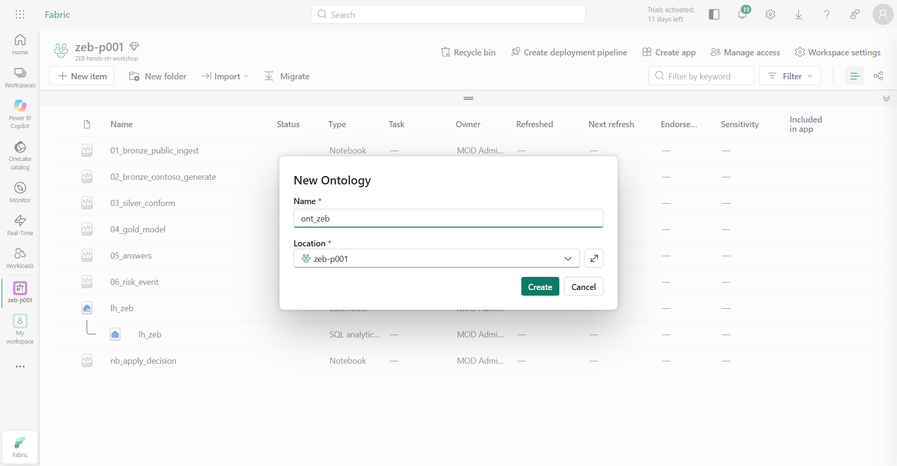

3.  "Getting Ontology (preview) ready..."가 1분 넘게 계속되면 브라우저를 새로 고칩니다. **Welcome to Ontology** 창이 나오면 창 오른쪽 위 **X**로 닫습니다.

**확인할 결과:** 가운데에 **Get started**와 카드 3개(**Start with Ontology agent**, **Import ontology**, **Learn more**)가 보입니다. 왼쪽 **Explorer**의 **Entity Types**에는 "No entity types available"이 표시됩니다.

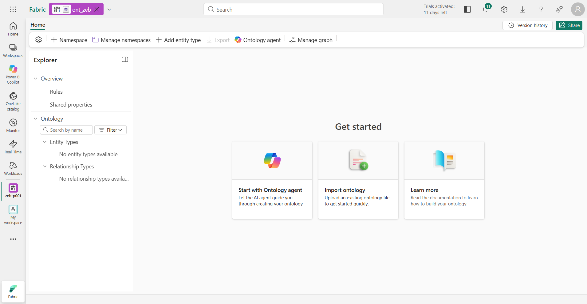

## 2. Ontology agent로 초안 만들기

엔터티와 관계를 하나씩 직접 만들지 않습니다. **업무 목적과 질문을 Ontology agent에게 알려 주면** 에이전트가 원본 테이블을 살펴보고 설계를 제안합니다. 참가자는 그 설계로 업무 질문에 답할 수 있는지, 키와 관계가 실제 데이터와 맞는지 검토합니다.

1.  **Start with Ontology agent** 카드를 누릅니다. 오른쪽에 **Ontology Agent** 창이 열립니다. 입력 칸 아래 **Plan | Act** 스위치에서 **Plan**이 선택되어 있는지 확인합니다(처음 열면 Plan입니다). **Plan**은 초안을 만들고 검증만 하는 모드이고, **Act**는 변경을 실제로 적용하는 모드입니다.

2.  **Say something** 칸에 아래 프롬프트를 붙여 넣고 오른쪽 아래 화살표를 눌러 보냅니다.

    ``` text
    lh_zeb Lakehouse의 gold 스키마를 조사해서 Contoso 건설의 제로에너지건축물(ZEB) 인증 컨트롤 타워 온톨로지를 설계해줘.
    목적은 공공 인증 데이터와 우리 현장 데이터를 연결해서, 담당자가 현장별 ZEB 예상 등급, 본인증 위험, 인증 일정, 보완안을 근거와 함께 확인할 수 있게 하는 거야.
    아래 업무 질문에 필요한 엔터티, 속성, 고유 키, 관계와 데이터 바인딩을 제안하고 선택 이유를 설명해줘. 개수와 구조는 원본을 보고 판단해줘.
    - 시도·용도별 공공 ZEB 인증은 몇 건이고, 그중 4등급 이상은 몇 건인가?
    - 같은 현장의 ERP 프로젝트 번호, PMS 현장 코드, BIM 모델 번호는 무엇인가?
    - 현장의 예비인증서는 어느 설계안으로 받았고, 지금 현행 설계안은 무엇인가?
    - 현행 설계안의 에너지자립률·1차에너지소요량으로 예상 등급을 구하면 예비인증·목표 등급을 지키는가?
    - 공급사의 납품이 늦어지면 어느 발주·설비·현장의 인증 일정이 영향을 받는가? 대체 공급사는 있는가?
    - 위험 현장의 보완안은 무엇이고 비용·효과·준비 기간은 얼마인가?
    - 우리 현장과 같은 시도·용도의 공공 인증 사례는 어떤가? 설비 분야별 유효한 녹색기술 인증이 있는가?
    현장에서 BIM 모델을 거쳐 인증받은 설계안과 현행 설계안까지 관계로 따라갈 수 있어야 해. 한 테이블은 엔터티 타입 하나에만 바인딩해줘.
    gold 스키마만 사용하고 ops, bronze, silver, dbo와 Files는 쓰지 마. 이름은 영어, 설명과 동의어는 한국어로 작성해줘.
    원본 열과 실제 행으로 키·관계를 검증해줘. 필요한 데이터 읽기에 실패하면 테이블이 없다고 단정하지 말고, 조회 대상과 오류 원문, 해결하지 못한 업무 질문을 보고하고 중단해. 데이터나 연결을 추측해서 만들지 마.
    먼저 Plan에서 설계 근거, 검증 결과와 미리 보기를 보여줘. 적용은 내가 검토하고 Act에서 승인한 다음에 해.
    ```

    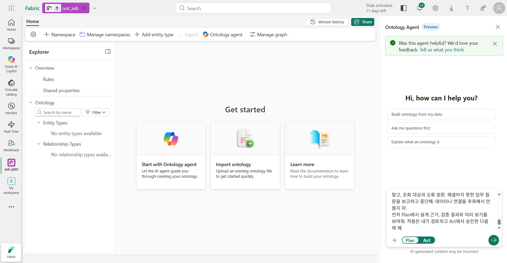

    `ops` 스키마를 빼는 이유는 05장에서 본 것처럼 `ops`에는 **판정 결과**가 들어 있기 때문입니다. Ontology에는 업무 데이터와 판정 **규칙**만 두고, 결과는 질문할 때마다 규칙으로 구하게 합니다.

3.  에이전트가 Lakehouse의 열과 샘플 행을 살펴보고 초안을 만들어 검증할 때까지 기다립니다. 진행 중에는 "Considering…", "Deciding…" 같은 생각 단계가 보이고, 보통 5–8분 걸립니다.

**확인할 결과:** 답에 제안된 엔터티·관계 목록, 업무 질문별 연결 경로, 실제 행으로 검증한 근거, **검증 결과(엔터티·관계 개수와 오류 0개)**가 있습니다. 아래 참고 설계와 비교해 **빠진 업무 범위가 없는지** 확인합니다. 개수나 이름까지 같을 필요는 없습니다.

특히 **현장 → BIM 모델 → 설계안** 경로가 있는지 확인합니다. 이 경로가 없으면 "D단지의 현행 설계안은?"에 답할 수 없습니다. 에이전트가 "논리 관계로만 넣었다"거나 "모델 번호는 연결하지 않았다"고 답하면 같은 Plan 대화에서 아래처럼 보완을 요청합니다. 이름은 에이전트가 제안한 이름에 맞춰 바꿉니다.

``` text
현장 교차표 엔터티를 bim_model_id 키의 BimModel로 바꾸고(gold.mdm_site_xref), BimModel → 현장(site_code), BimModel → 프로젝트(project_no), 설계안 → BimModel(gold.bim_design_version의 bim_model_id) 관계를 실제 열로 바인딩해줘. 다른 엔터티와 관계는 그대로 두고, HS-D 현장에서 현행 설계안까지 이어지는지 실제 행으로 검증해줘.
```

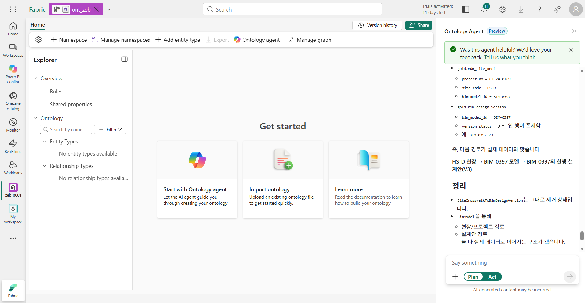

아래는 이 Workshop의 원본 데모에서 쓴 **참고 설계(엔터티 22개·관계 27개)**입니다. 프롬프트에 넣어 구조를 지정하는 용도가 아니라, 에이전트의 제안을 검토할 때 비교용으로만 씁니다.

| 영역 | 엔터티 타입 (gold 테이블, 키) |
|---|---|
| 현장·코드 | `Project` (`erp_project`, `project_no`), `Site` (`pms_site`, `site_code`), `BIMModel` (`mdm_site_xref`, `bim_model_id`), `DesignVersion` (`bim_design_version`, `version_id`) |
| 인증 | `SiteCertificate` (`pms_certificate`, `cert_no`), `CertTarget` (`pms_cert_target`, `target_id`), `CertMilestone` (`pms_cert_milestone`, `milestone_id`), `ZEBGradeCriteria` (`ref_zeb_grade_criteria`, `grade_code`) |
| 설비·구매 | `Equipment` (`pms_equipment_plan`, `wbs_code`), `EquipmentCategory`, `PurchaseOrder` (`scm_purchase_order`, `po_no`), `POEvent`, `Vendor` (`scm_vendor`, `vendor_code`) |
| 보완·조치 | `ImprovementOption` (`sim_improvement_option`, `option_id`), `ActionLog` (`pms_action_log`, `action_id`) |
| 공공 인증 | `ZEBCertification`, `GSEEDCertification`, `BFCertification` (각 `pub_*`, `cert_id`), `CertifiedBuilding` (`building_key`), `GreenTechCertificate` |
| 기준 | `Region` (`ref_region`, `sido`), `BuildingUse` (`ref_building_use`, `use_group`) |

핵심 관계: `Project → BIMModel`, `Site → BIMModel`, `BIMModel → DesignVersion`, `SiteCertificate → DesignVersion`(**인증받은 설계안**), `PurchaseOrder → Equipment`(`wbs_element` = `wbs_code`), `PurchaseOrder → Vendor`, `ImprovementOption → Site`, `ZEBCertification → Region·BuildingUse·ZEBGradeCriteria`.

**빠진 업무 범위나 해결되지 않은 조회 오류가 있으면 적용하지 말고**, 같은 Plan 대화에서 보완해 달라고 요청합니다.

## 3. 적용

1.  업무 범위, 원본 연결, 검증 결과에 남은 문제가 없으면 입력 칸 아래 스위치에서 **Act**를 누릅니다.
2.  아래 요청을 보냅니다.

    ``` text
    업무 질문과 원본 매핑을 검토한 초안을 적용해줘. gold 스키마만 사용하고 내가 검토한 엔터티·키·관계·바인딩을 유지해줘.
    ```

    답 아래에 **Preview ontology**, **Switch to 'Act' + approve** 버튼이 보이면 그 버튼으로 적용해도 됩니다. **Preview ontology**는 적용 전 초안을 읽기 전용 캔버스로 보여 주고, **Switch to 'Act' + approve**는 스위치를 Act로 바꾸고 바로 적용합니다.

3.  "Applying ontology changes"가 끝나고 결과 답이 나올 때까지 기다립니다. 보통 2–3분 걸립니다.

**확인할 결과:** 답에 적용 성공이 표시되고, 왼쪽 **Explorer**의 **Entity Types** 아래에 엔터티가, 가운데 캔버스(**Full ontology**)에 엔터티와 관계가 보입니다. 캔버스 아래 상태 표시줄의 "Visible: … of N entities | … of M relationships"에서 전체 개수를 확인합니다. 이 캔버스는 **엔터티 타입과 관계를 보여 주는 설계도**이며, 실제 데이터를 연결한 Graph가 아닙니다.

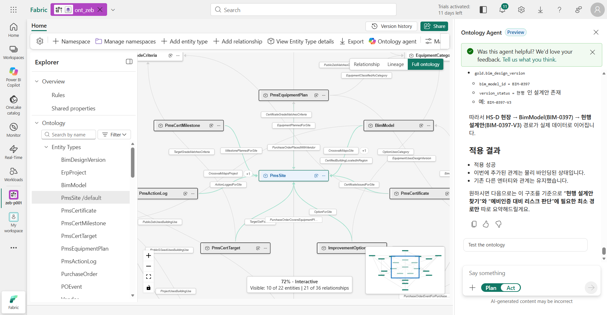

**답에 "일부만 적용됐다"고 나오는 경우:** 적용되지 않은 항목과 이유를 읽습니다. 예를 들어 같은 테이블을 엔터티 두 개에 바인딩하려 하면 그 부분만 적용되지 않습니다. 에이전트가 제안한 해결 방법 중 하나를 골라 Act 모드에서 다시 요청합니다.

## 4. 업무 규칙 추가

구조만 있으면 "자립률 39%면 4등급인가?" 같은 질문에 답할 수 없습니다. 등급 판정, 본인증 조건, 일정 지연 전파 같은 **업무 규칙을 엔터티 설명(Description)에 적어 두면** Data agent와 10장의 Foundry가 같은 규칙으로 판단합니다. 원본 데모에서도 이 규칙을 넣은 Ontology를 연결한 Data agent가 규칙·관계 질문에 가장 정확하게 답했습니다.

1.  에이전트 창의 스위치가 **Act**인지 확인합니다.
2.  아래 요청을 보냅니다. 설명만 추가하는 단계이며 이름·키·바인딩·관계는 바꾸지 않습니다.

    ``` text
    아래 업무 규칙을 해당 엔터티 타입의 설명 끝에 한국어로 덧붙여줘. 아래 이름은 참고 설계의 이름이므로, 현재 온톨로지의 업무 의미와 원본 바인딩(괄호 안 gold 테이블)으로 해당 타입을 찾아줘. 대응되는 타입이 없으면 누락을 보고하고 중단해. 이름, 키, 속성, 데이터 바인딩, 관계는 바꾸지 마.
    - ZEBGradeCriteria(ref_zeb_grade_criteria): ZEB 등급은 +(ZEB+)가 가장 높고 1, 2, 3, 4, 5 순서로 낮아진다. 'N등급 이상'은 N등급과 그보다 높은 등급이다(4등급 이상 = +, 1, 2, 3, 4). 예상 등급 판정: (1) 자립률 등급 = selfsuff_pct >= selfsuff_min_pct를 만족하는 가장 높은 등급 (2) 1차에너지 등급 = primary_energy_kwh_m2y < 기준값을 만족하는 가장 높은 등급(주거용이면 primary_energy_limit_residential, 주거용 이외면 primary_energy_limit_nonresidential) (3) 최종 등급 = (1)과 (2) 중 더 높은 등급. 두 기준을 모두 충족할 필요는 없다. (4) BEMS 설치는 필수 요건이다.
    - DesignVersion(bim_design_version): version_status='현행'이 현재 설계안이다. 현장의 예상 등급은 현행 설계안의 selfsuff_pct·primary_energy_kwh_m2y에 ZEBGradeCriteria의 판정을 적용해 구한다.
    - SiteCertificate(pms_certificate): design_version_id는 인증을 받을 때 제출한 설계안이다. 예비인증을 받은 현장은 사용승인 전에 예비인증 등급 이상의 본인증을 받아야 한다. 현행 설계안의 예상 등급이 예비인증 등급보다 낮으면 본인증 위험이다. 예비인증은 설계 단계 인증, 본인증은 준공(사용승인) 무렵 인증이며 '준공 후 인증'이라고도 한다.
    - Project(erp_project): zeb_incentive가 '용적률 완화'인 프로젝트는 본인증 규칙(예비 등급 이상)이 반드시 적용된다. 주거용은 공동주택과 단독주택이고 그 밖의 용도는 주거용 이외다(ref_building_use.use_family).
    - Site(pms_site): 같은 현장의 ERP project_no, PMS site_code, BIM bim_model_id는 mdm_site_xref로 연결한다. 질문의 'D단지' 같은 이름은 일부만 일치해도 site_name이나 project_name에서 찾는다. 현장의 시도·용도는 연결한 프로젝트의 sido·use_group이며, 공공 인증과 비교할 때 같은 시도·용도를 고른다. 우리 현장은 공공 인증 데이터에 없다.
    - CertMilestone(pms_cert_milestone): 일정 순서는 1 예비인증 취득 → 2 착공 → 3 설비 설치 완료 → 4 본인증 신청 → 5 본인증 취득 → 6 사용승인이다. 미입고 발주(delivered_date 없음)가 늦어지면 새 예상 입고일 = expected_date + 지연 일수, 초과 일수 = 새 예상 입고일 − 그 현장 '설비 설치 완료' planned_date다. 초과 일수가 0보다 크면 3–6 일정이 모두 초과 일수만큼 밀리고, 0 이하이면 영향이 없다(남은 일수가 여유).
    - PurchaseOrder(scm_purchase_order): wbs_element는 Equipment의 wbs_code와 같고 vendor_code는 Vendor의 vendor_code와 같다. delivered_date가 있으면 입고 완료다.
    - Vendor(scm_vendor): is_alternative_pool=true인 공급사는 같은 category_code 설비를 대체 공급할 수 있다. 대체하면 예상 입고일 = 기준일 2026-09-30 + standard_lead_time_days다.
    - ImprovementOption(sim_improvement_option): 보완안을 적용하면 현행 설계안의 selfsuff_pct에 selfsuff_gain_pp를, primary_energy_kwh_m2y에 primary_energy_delta를 더한 값으로 예상 등급을 다시 구한다. lead_time_days는 준비 기간이며 기준일 2026-09-30부터 센다.
    - EquipmentCategory(ref_equipment_category): category_code='BEMS'가 설비 계획에 없는 현장은 ZEB 인증 필수 요건을 충족하지 못한다.
    - ZEBCertification(pub_zeb_certification): 공공 ZEB 인증 1건이다. sido는 통일한 표기(경기, 서울, 전북 등)다. cert_stage가 '본인증'이면 준공 후 인증이다.
    - GreenTechCertificate(pub_green_tech_certificate): expiry_date가 기준일 2026-09-30 이후이면 유효하다.
    - CertTarget(pms_cert_target): 녹색건축(G-SEED) 등급은 최우수 > 우수 > 우량 > 일반, BF 등급은 최우수 > 우수 > 일반 순서다.
    ```

3.  답에서 **설명만 수정**했는지 확인합니다.

**확인할 결과:** 답에 규칙을 덧붙인 엔터티 13개가 나열되고 "누락된 대응 타입은 없습니다"처럼 누락이 없다고 나옵니다. 3단계에서 적용한 이름·키·바인딩·관계는 그대로입니다. 이 설명은 실행되는 코드가 아니라 **에이전트가 참고하는 업무 설명**입니다. 정확한 값은 07장의 정답 Notebook을 기준으로 확인합니다.

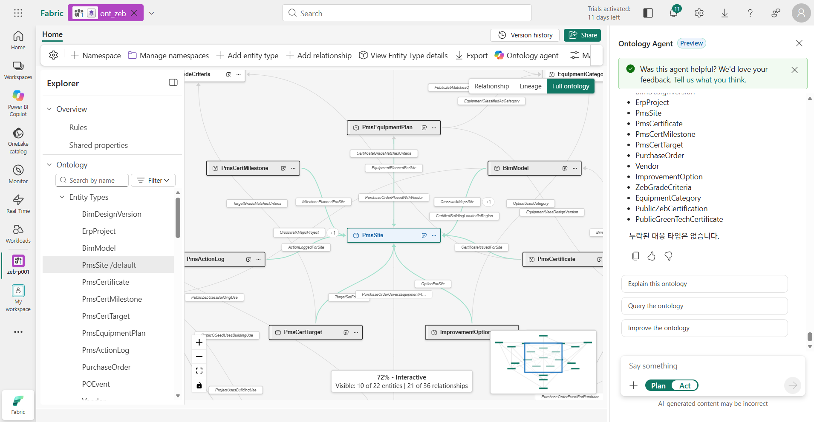

## 5. 엔터티 타입과 관계 점검

적용이 끝났다고 바로 넘어가지 말고 실제로 데이터가 연결됐는지 점검합니다. **Configure** 탭에서는 설계와 원본 연결을, **Instances** 탭에서는 실제 데이터를 확인합니다.

1.  에이전트 창을 **X**로 닫습니다.

2.  **Explorer**에서 현장 타입(이 예에서는 `PmsSite`, 즉 `gold.pms_site`에 연결된 타입)을 누르고 리본의 **View Entity Type details**를 누릅니다. 처음 열면 "Entity type configuration" 같은 안내 말풍선이 나오는데 **X**로 닫습니다.

    **확인할 결과:** **Configure** 탭의 **Entity type key**가 `site_code`이고, 속성의 **Data source**가 `pms_site.…` 열입니다. 아래로 스크롤하면 **Entity metadata**의 **Description** 끝에 4단계에서 넣은 "업무 규칙:"이 있고(칸 안에서 스크롤), **Synonyms**에 `PMS 현장`, `공사 현장` 같은 한국어 동의어가 있습니다.

    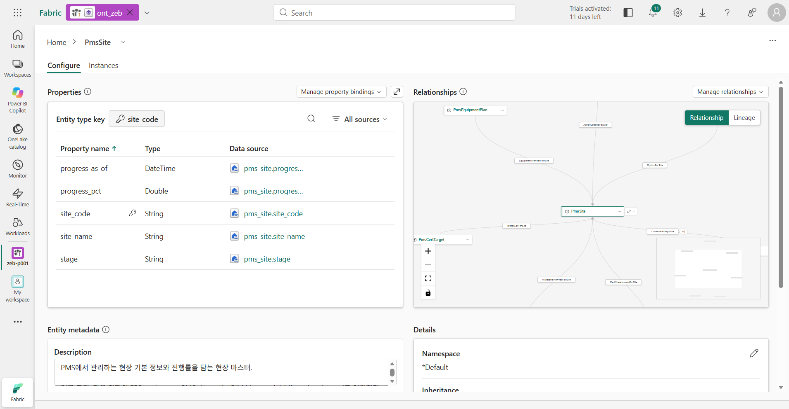

    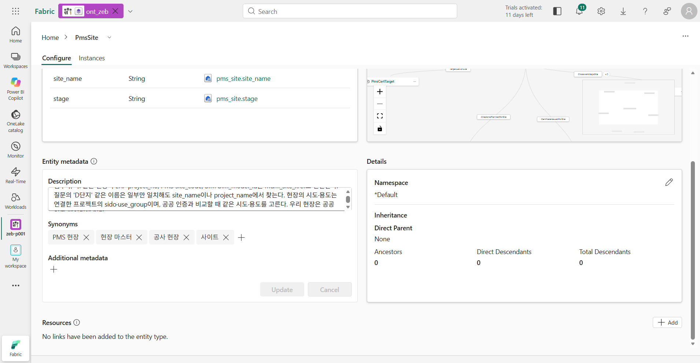

3.  위쪽 **Instances** 탭을 누릅니다.

    **확인할 결과:** 현장 **8개**가 보입니다. `HS-D`의 이름은 `에코시티 D단지 현장`, 공정률(`progress_pct`)은 `72`입니다. 에이전트가 지어낸 값이 아니라 **연결된 원본 테이블에서 읽은 데이터**입니다.

    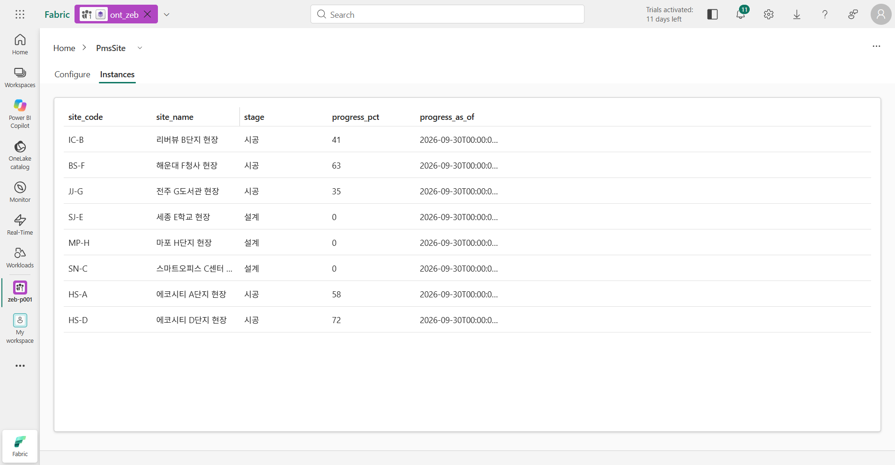

4.  화면 위쪽 이름(`PmsSite`) 옆 **∨**를 눌러 설계안 타입(`gold.bim_design_version`에 연결된 타입)으로 바꾸고 **Instances**를 엽니다.

    **확인할 결과:** 설계안 18개가 보입니다. `BIM-0397-V2`는 `예비인증 제출안`(자립률 43.5), `BIM-0397-V3`는 `VE 반영안`(자립률 38.2)입니다. 오른쪽으로 스크롤하면 `version_status`에서 V3가 `현행`인 것을 볼 수 있습니다.

    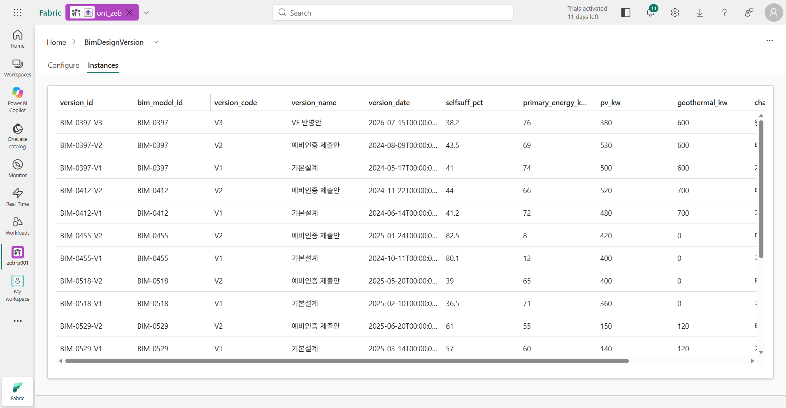

5.  같은 방법으로 인증서 타입(`gold.pms_certificate`)의 **Configure**를 열고, 오른쪽 **Manage relationships**를 누릅니다. 목록에서 인증서와 설계안을 잇는 관계(이 예에서는 `CertificateUsesDesignVersion`)를 누릅니다.

    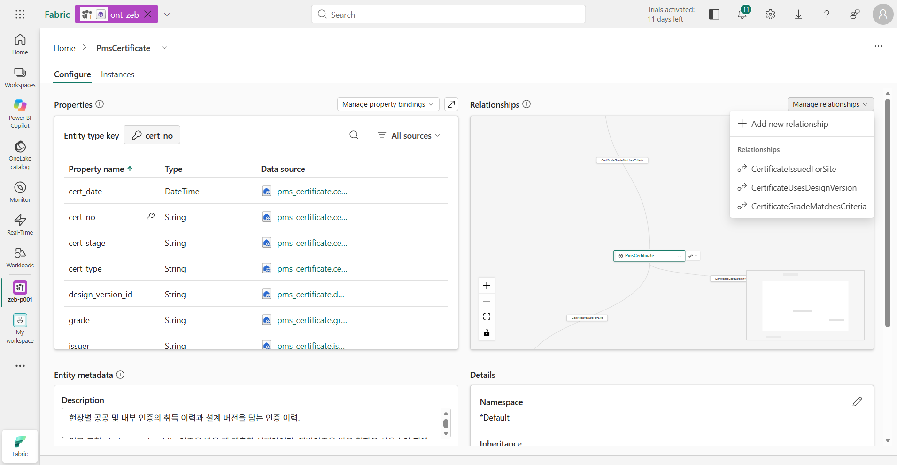

    **확인할 결과:** **Origin entity type**의 **Property**가 `design_version_id`, **Target entity type**의 **Property**가 `version_id`입니다. 이 관계가 있어야 "예비인증은 V2로 받았는데 지금은 V3"라는 사실을 찾아낼 수 있습니다. 관계의 방향이나 이름은 달라도 두 원본 열만 맞으면 됩니다. 확인했으면 아무것도 바꾸지 말고 오른쪽 아래 **Cancel**을 누릅니다.

    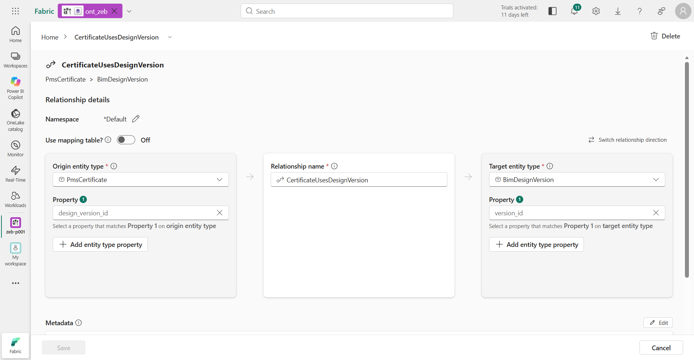

6.  같은 방법으로 BIM 모델 타입(`gold.mdm_site_xref`, 키 `bim_model_id`)의 **Manage relationships**에 현장(`site_code`)·프로젝트(`project_no`)·설계안(`bim_model_id`)으로 가는 관계가 있는지, `PurchaseOrder`와 설비 계획이 `wbs_element` = `wbs_code`로 연결되는지 확인합니다.

여기까지 마쳤으면 업무 질문에 필요한 구조·키·바인딩·규칙과 실제 데이터를 모두 확인한 것입니다. **바로 07장으로 넘어가도 됩니다.** Graph로 관계를 탐색해 보고 싶을 때만 6단계를 진행합니다.

## 6. Graph 만들기 (선택)

Graph는 실제 인스턴스를 노드로, 인스턴스 사이의 연결을 에지로 저장합니다. 여러 단계에 걸친 관계를 직접 따라가 보고 싶을 때 **Materialize**해서 만듭니다. 07장 실습에는 필요하지 않습니다.

1.  리본의 **Manage graph**를 누릅니다. **Choose what to project**에서 엔터티와 관계의 **Status**가 **Eligible**인지 확인합니다. **Ineligible**이나 **Not mapped**가 있으면 아래 Troubleshooting을 참고해 원본 연결을 확인합니다.
2.  **Continue** → **Materialize**를 누릅니다. 위쪽 탭에 `ont_zeb_graph_`로 시작하는 Graph model이 열립니다. 공공 인증 데이터가 많아서 몇 분에서 수십 분까지 걸릴 수 있습니다.
3.  생성이 끝나면 `ont_zeb`의 **Home**에서 **Explore graph**를 눌러 `HS-D` 현장 노드에서 설계안·인증서·설비·발주로 이어지는 관계를 펼쳐 봅니다.

Graph를 만들어 두면, 11장에서 `04_gold_model`이 Gold를 다시 만들 때 Graph도 자동으로 새로 고쳐집니다.

## 이 장의 완료 기준

- 검토한 설계가 `ont_zeb`에 적용되어 있고, 2단계의 업무 질문(공공 인증 통계, 코드 연결, 인증받은 설계안과 현재 설계안, 예상 등급, 일정 영향, 보완안, 공공 사례 비교)에 답할 수 있는 구조입니다. 엔터티·관계 개수는 완료 기준이 아닙니다.
- 등급 판정·본인증·일정·대체 공급·보완안 규칙이 해당 엔터티의 설명에 들어가 있습니다.
- 현장 → BIM 모델 → 설계안 경로가 실제 열로 바인딩되어 있습니다.
- 현장 8개, 설계안 18개(D단지는 V3가 현행)의 실제 데이터와, 인증서와 설계안의 관계를 확인했습니다.

## Troubleshooting

- **업무 범위가 빠진 경우(예: 보완안, 공급사, 공공 인증):** 개수보다 필요한 범위가 빠졌는지가 중요합니다. 이미 적용했다면 Ontology를 지우지 말고 Plan 모드에서 `gold.sim_improvement_option, gold.scm_vendor를 다시 확인해서 해당 업무 질문을 지원할 엔터티·키·관계를 제안해줘. 기존 항목은 유지하고 중복 생성하지 마.`처럼 보완을 요청합니다.
- 4단계에서 해당하는 엔터티가 없다는 답이 오면, 그 엔터티를 먼저 2–3단계 방식으로 추가한 뒤 규칙을 다시 넣습니다.
- **Manage graph**에서 관계가 **Not mapped**로 나오면 관계 설정을 열어 양쪽 엔터티의 키와 **Property**에 연결된 원본 열을 확인합니다. 관계 방향부터 바꾸지는 않습니다.
- 적용을 요청했는데 변화가 없으면 입력 칸 아래 스위치가 **Act**인지 확인합니다.
- 보완을 거치며 같은 연결의 관계가 두 개 생기면(예: 이전 이름의 관계와 새 관계) 그대로 두어도 답에는 영향이 없습니다. 지우려면 관계 화면 오른쪽 위 **Delete**를 누릅니다.
- 에이전트가 "Something went wrong"을 내거나 화면에 "This item is not currently available … capacity is currently paused"가 나오면 Fabric 용량이 일시 중지된 것입니다. 관리자에게 용량 재개를 요청하고, 재개 후 페이지를 새로 고칩니다. 이미 적용한 항목은 남아 있습니다.
- 브라우저를 새로 고치면 에이전트와 나눈 대화는 사라지지만, 이미 적용한 엔터티 타입과 관계는 남아 있습니다.
- **Instances**에 데이터가 없으면 본인 `lh_zeb`에 `gold` 테이블이 있는지(05장), 엔터티의 **Data source**가 그 테이블을 가리키는지 확인합니다.
- 에이전트로 설계를 끝내지 못했다면 관리자에게 요청합니다. 관리자가 참고 설계를 본인 작업 영역에 배포해 줄 수 있습니다([관리자 준비 가이드](../admin/README.md)의 참고 Ontology 배포).

## 공식 문서

- [Ontology agent 사용·권한·Plan/Act 모드](https://learn.microsoft.com/en-us/fabric/iq/ontology/how-to-use-ontology-agent)
- [관계 타입과 양쪽 속성·매핑 테이블](https://learn.microsoft.com/en-us/fabric/iq/ontology/how-to-create-relationship-types)
- [선택적 Graph 생성과 제한 사항](https://learn.microsoft.com/en-us/fabric/iq/ontology/how-to-use-ontology-graph)

## 다음 단계

[07. Data agent](07-data-agent.md)에서 이 Ontology를 Data agent에 연결하고 업무 질문 8개를 정답 Notebook과 비교합니다.
