# 07. Data agent — 구성 체험과 업무 질문 검증

[목차](../README.md) \| 이전: [06. Ontology](06-ontology.md) \| 다음: [10. Operations agent](10-operations-agent.md)

06장에서 만든 업무 모델로 공공 인증 통계·등급 위험·일정 영향·보완안을 확인합니다. Data agent를 생성·연결하고 지침을 입력한 뒤, 기본 질문은 Ontology Agent의 Plan 모드에서 검증합니다. 답이 그럴듯한지가 아니라 Q1–Q8의 대상·수치·결론과 조회 근거가 정답 Notebook과 같은지를 확인합니다.

정답 계산 → Data agent 구성·지침 저장 → Ontology Agent에 공통 규칙 전달 → Plan 질의 → Notebook 대조 순서입니다. Ontology가 아직 Preview 단계여서 Data agent와의 연계에 제약이 있으므로 기본 실습은 Plan 모드로 진행합니다. 원하면 두 에이전트에 같은 질문을 보내 답을 비교해도 됩니다.

이 장의 미션: 같은 원본에 업무 규칙을 적용해 D단지·B단지의 차이와 보완안 추천 근거를 설명합니다. 수치가 맞는 답, 잘못된 답, 실제 조회하지 못한 답을 구분하고 What-if를 실제 변경으로 확대하지 않습니다.

| 실행 위치 | 이 장에서 할 일 | 변경 범위 |
|---|---|---|
| `da_zeb` | Ontology·원본 연결과 Agent instructions 저장, 선택적으로 Q1–Q8 비교 | 에이전트 설정만 변경, 질의는 읽기 전용 |
| `ont_zeb`의 Ontology Agent Plan | 공통 규칙을 전달하고 Q1–Q8 질의 | 원본·Ontology 변경 없음 |
| `05_answers` | 동일 데이터 시점의 정답 계산·대조 | 읽기 전용 |

## 시작 전 확인

- 본인 `ont_zeb`에 06장의 구조·바인딩·업무 규칙이 적용되어 있어야 합니다. Graph는 만들지 않았어도 됩니다.
- 활성 유료 Fabric 용량, Data agent를 만들고 쓸 수 있는 AI 테넌트 설정, Ontology와 연결된 원본 테이블의 읽기 권한이 필요합니다([Data agent 요구 사항](https://learn.microsoft.com/fabric/data-science/concept-data-agent), [테넌트 설정](https://learn.microsoft.com/fabric/data-science/data-agent-tenant-settings)).

## 1. 정답 계산

에이전트에게 묻기 전에 정답부터 계산합니다. `05_answers`는 Gold·ops 테이블을 읽기만 하고 바꾸지 않습니다.

1.  작업 영역에서 `05_answers`를 열고, [01장 4단계](01-workspace.md#4-notebook의-기본-lakehouse-연결)와 같은 방법으로 본인 `lh_zeb`를 기본 Lakehouse로 연결한 뒤 Run all을 누릅니다. 약 1분 걸립니다.
2.  질문별 셀의 결과를 셀 위에 적힌 예상 결과와 비교하고, 마지막 정답 요약 표를 확인합니다.

예상 결과: 맨 아래 정답 요약에 Q1–Q8의 정답이 한 줄씩 나오고, 내용은 4단계 표의 확인할 정답과 같습니다.


아래를 펼쳐 질문별 결과를 확인합니다. Run all로 이미 계산했으므로 셀을 다시 실행하지 않고 출력만 읽으면 됩니다. 에이전트의 답을 대조할 때도 해당 Q번호의 결과를 사용합니다.

<details>
<summary>등급 기준과 Q1–Q8의 Notebook 실행 결과 펼쳐 보기</summary>

### 준비 — 등급 판정 함수

등급 기준 6행이 출력됩니다. 4등급 행의 자립률 하한은 40%, 주거용 1차에너지 기준은 70 미만입니다. 두 기준으로 각각 구한 등급 중 더 좋은 등급을 선택합니다.

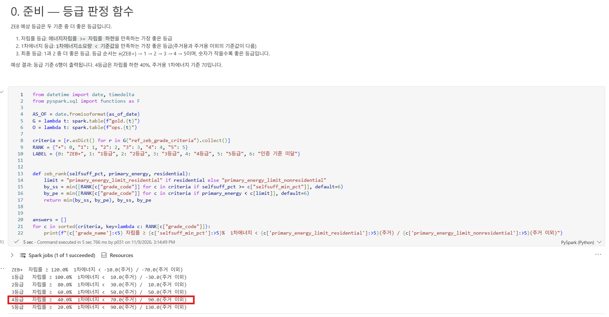

### Q1. ZEB 인증이 가장 많은 시도 3곳

결과 표의 `sido`와 `count`를 읽습니다. 경기 1,897건, 경남 870건, 경북 828건 순서입니다.

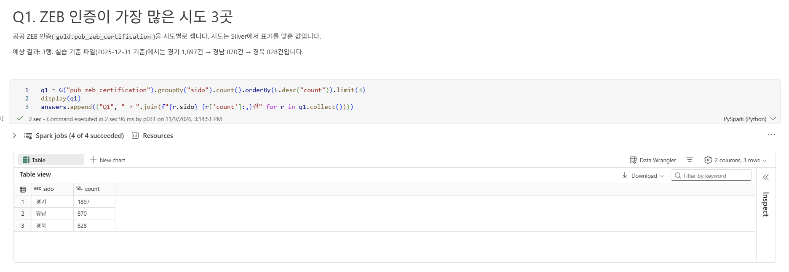

### Q2. 리버뷰 B단지의 4등급 가능 여부

출력 두 줄을 함께 읽습니다. 자립률 39%만 보면 5등급이지만, 주거용 1차에너지 65가 70 미만이므로 최종 예상 등급은 4등급입니다. `BEMS 계획 True`도 확인합니다.

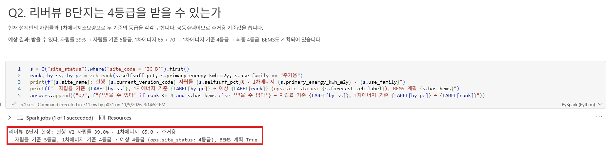

### Q3. 본인증 때 문제가 될 현장

결과는 `HS-D` 한 행입니다. `current_version_code`는 `V3`, `prelim_zeb_grade`는 `4`, `forecast_zeb_label`은 `5등급`인지 비교합니다. B단지는 이 표에 없습니다.

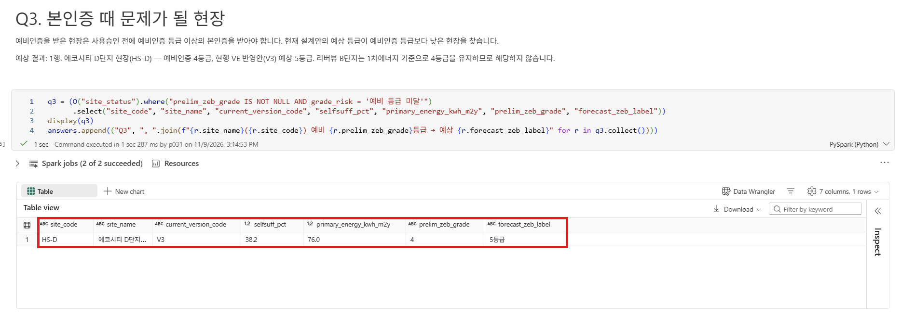

### Q4. 준공 후 인증을 받은 공동주택

`본인증 공동주택: 30건`을 확인합니다. 여기서 준공 후 인증은 `cert_stage = '본인증'`을 뜻합니다.

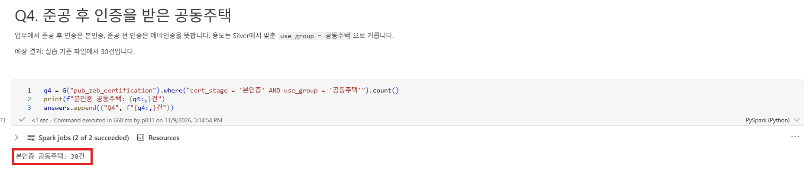

### Q5. Northwind 납품이 21일 늦어질 때

`new_expected_date`와 `install_deadline`을 비교하고 `over_days`를 읽습니다. `HS-D`는 12월 3일 입고로 설치 완료 계획일인 11월 30일보다 3일 늦습니다. `HS-A`의 `-52`는 52일 여유가 있다는 뜻이므로 일정 영향이 없습니다.

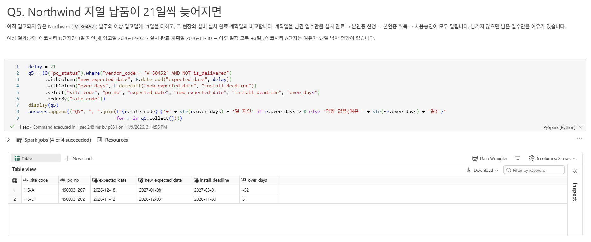

### Q6. 경기 공동주택 4등급 이상 사례와 D단지 비교

공공 사례는 9건, 평균 자립률은 52.2%입니다. D단지 현행 V3의 38.2%와 비교한 차이는 14.0%p입니다. ‘4등급 이상’은 `+`, `1`, `2`, `3`, `4`등급을 포함합니다.

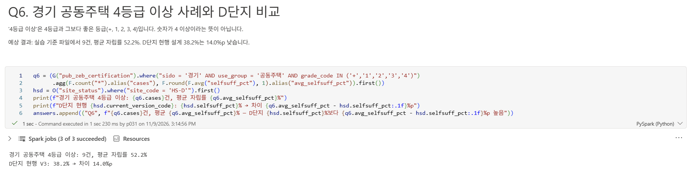

### Q7. D단지 지열 히트펌프 공급사를 바꿀 때

대체 공급사는 `V-30977` Alpine 지열입니다. 표준 납기 55일을 적용한 입고일 `2026-11-24`가 설치 완료 계획일 `2026-11-30`보다 빠르고, `slack_days`는 `6`이므로 일정을 지킬 수 있습니다.

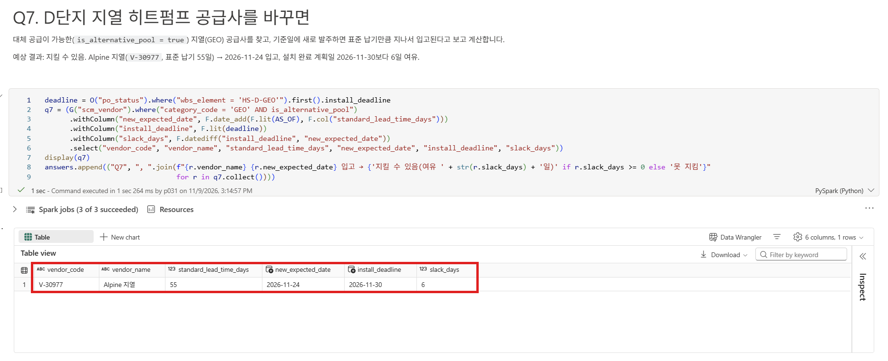

### Q8. 예비인증 등급을 지키는 가장 싼 단일 보완안

`keeps_prelim_grade`와 `ready_before_install`이 모두 `true`인 행끼리 `cost_krw`를 비교합니다. 가장 싼 `OPT-D2`는 230,000,000원이며 적용 후 자립률 41.4%, 예상 4등급, 준비 완료일은 `2026-11-14`입니다. 더 싼 D6·D5는 `keeps_prelim_grade`가 `false`이므로 제외합니다.

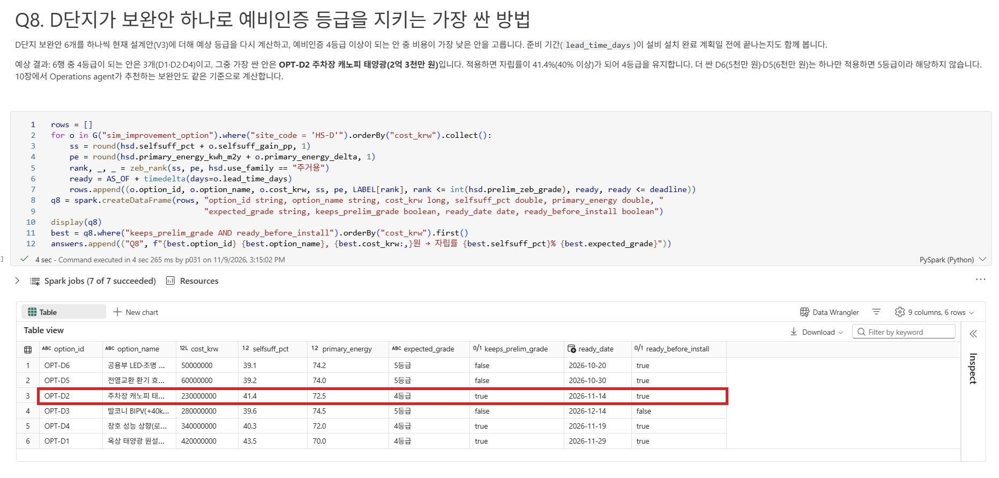

</details>

## 2. Data agent 만들고 Ontology 연결

1.  본인 작업 영역에서 + New item을 누르고 `Data agent`로 검색해 Data agent를 고릅니다. 이름에 `da_zeb`를 입력하고 Create를 누릅니다. Welcome to Data Agent 창이 나오면 Skip for now를 누릅니다.

    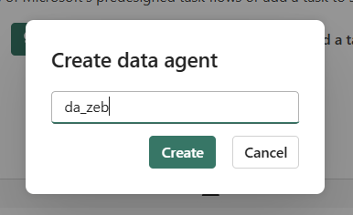

2.  Build your data agent 화면에서 Add an ontology 카드를 누릅니다. 목록에서 `ont_zeb`를 선택하고 Add를 누릅니다.

    

3.  왼쪽 Explorer → Sources에서 `ont_zeb` → Entity types를 펼쳐 06장에서 만든 `BIMModel`, `DesignVersion`, `Site` 등의 엔터티가 있는지 확인합니다.

    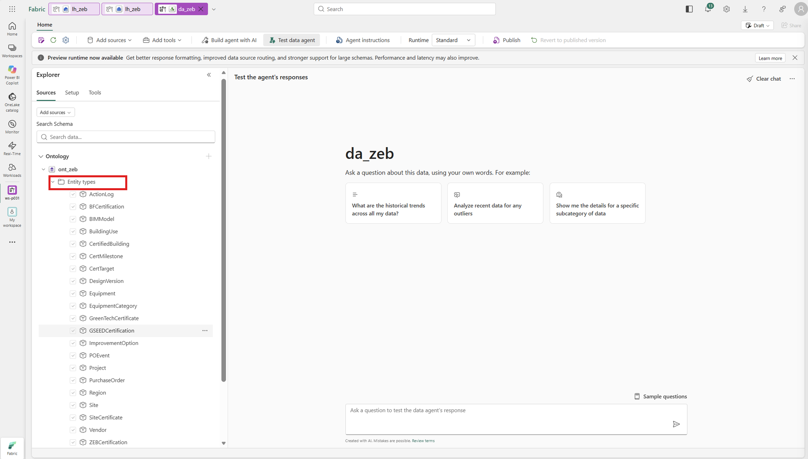

4.  Entity types를 접고 Ontology data sources를 펼칩니다. `lh_zeb` → Schemas → `gold` → Tables 아래에 원본 테이블이 있는지 확인합니다. Lakehouse를 기타 데이터 원본으로 따로 추가하지 않습니다.

    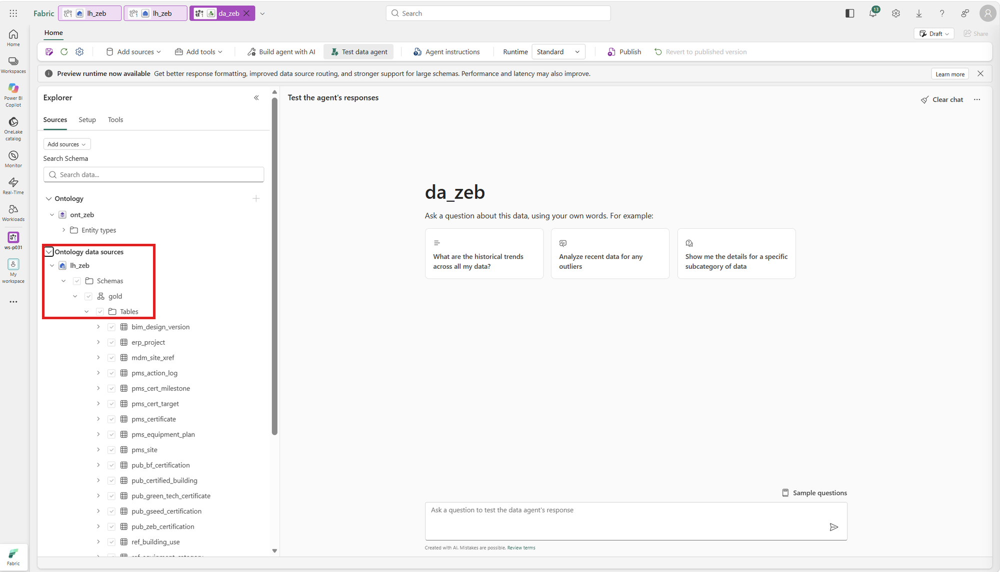

Ontology는 업무 문맥이고 실행은 바인딩된 원본에 대한 질의입니다. Graph를 별도로 연결하지 않으며, Runtime은 관리자가 사전 확인한 설정을 사용합니다. 원본이 표시되지 않거나 읽기에 실패하면 연결·바인딩·본인의 읽기 권한을 먼저 확인합니다.

## 3. 에이전트 지침 저장

1.  리본의 Agent instructions를 누릅니다.
2.  안내 문장이 있는 칸을 누르면 Markdown 편집기로 바뀝니다. Ctrl+A로 기본 문장을 모두 지우고 아래 내용을 붙여 넣은 뒤, 편집기 바깥을 누르면 자동 저장됩니다.

    ``` text
    - 한국어로 답한다. 기준일(오늘)은 2026-09-30이다.
    - 질문에 나온 현장·프로젝트·공급사 이름은 일부만 일치해도(예: 'D단지') 이름에 그 문자열이 들어간 대상을 데이터에서 먼저 찾아 진행하고, 되묻기 전에 먼저 조회한다.
    - 데이터 도구에 보내는 자연어 질의는 800자 이내로, 필요한 대상·열·조건만 간결하게 쓴다. 한 번에 너무 많은 것을 묻지 말고 필요하면 여러 번 나누어 조회한다.
    - 조회에 실패하면 확인하지 못했다고 명시하며, 확인하지 못한 결과를 0건으로 만들지 않는다. 답변에 근거가 된 현장·대상과 수치를 함께 쓴다.
    - 업무 정의·동의어·관계·판정 규칙(ZEB 등급 판정, 예비인증→본인증, 인증 일정 연쇄, 대체 공급, 보완안 적용)은 연결된 ont_zeb 온톨로지의 설명에서 확인한다.
    - 설계 변경·발주·승인·데이터 변경은 하지 않는다. 결정은 담당자가 Teams에서 한다.
    ```

확인할 결과: 지침이 글머리표 6줄로 보이고 기본 안내 문장은 남아 있지 않습니다.


정답 숫자를 지침에 넣어 답을 맞추지 않습니다. 업무 규칙은 지침이 아니라 06장에서 Ontology 설명에 넣었습니다.

### 다음 단계: Ontology Agent에서 질문하기

Data agent의 연결과 지침 저장을 마쳤습니다. 다만 현재 Ontology는 Preview 단계로, Data agent와의 호환성이 아직 완전하지 않아 Ontology에 저장한 설명·관계·업무 규칙이 답변에 충분히 반영되지 않을 수 있습니다. 그래서 다음 단계에서는 `ont_zeb`의 Ontology Agent로 이동해 공통 규칙을 직접 전달하고 Plan 모드에서 질문합니다. Plan은 설계 검토뿐 아니라 데이터 조회에도 사용할 수 있으며, 이번에는 조회만 하므로 Act로 전환하지 않습니다.

Data agent 직접 비교는 선택 사항입니다. 원하면 Q1–Q8을 Data agent와 Ontology Agent의 Plan 모드에 모두 질문해, 어떤 근거와 규칙을 사용해 답하는지 정답 Notebook과 비교할 수 있습니다. 이후 호환성이 개선되었을 때 같은 질문을 다시 해 보면 답변 품질의 변화도 확인할 수 있습니다.

## 4. Ontology Agent의 Plan에서 질문하고 정답과 비교

1.  본인 작업 영역의 `ont_zeb` → Ontology Agent를 열고 Plan으로 둡니다. 아래 공통 프롬프트를 대화 첫 메시지로 보냅니다. `da_zeb`에 저장한 지침은 이 대화에 자동 적용되지 않습니다.

    대화 내역을 초기화하려면 브라우저를 새로 고칩니다. Ontology Agent를 다시 열고 Plan 모드인지 확인한 뒤 아래 공통 프롬프트부터 보냅니다. 이미 적용한 Ontology의 엔터티·관계·설명은 그대로 유지됩니다.

    ``` text
    이 대화에서는 ont_zeb와 lh_zeb.gold를 근거로 Contoso 건설의 ZEB 인증 업무 질문을 검증합니다.
    한국어로 간결하게 답하고, 조회만 수행하세요. 원본 데이터·Ontology·키·관계·바인딩·다른 Fabric 항목을 변경하지 마세요.
    기준일은 2026-09-30입니다. 현장·공급사 이름은 일부 일치로 실제 대상을 찾고 ID와 근거 원본을 함께 표시하세요.
    업무 정의·동의어·관계는 현재 Ontology와 실제 원본 열을 대조하세요. 관계 이름을 SQL 테이블명으로 가정하지 마세요.
    공통 판정 규칙:
    - ZEB 등급은 +, 1, 2, 3, 4, 5 순서로 높습니다. N등급 이상은 N과 더 높은 등급입니다.
    - 현행 설계안은 version_status='현행'입니다. 자립률 >= selfsuff_min_pct를 만족하는 가장 높은 등급과, 1차에너지 < 용도별 기준값을 만족하는 가장 높은 등급 중 더 높은 등급을 최종 예상 등급으로 선택하세요.
    - 공동주택·단독주택은 주거용입니다. 그 밖은 주거용 이외 기준을 사용하세요. 기준값은 ref_zeb_grade_criteria에서 조회하세요. BEMS 또는 원격검침은 인증 필수 요건입니다.
    - 예비인증 설계안은 pms_certificate.design_version_id입니다. 현행 예상 등급이 예비인증 등급보다 낮으면 본인증 등급 위험입니다. 공공 데이터의 '준공 후 인증'은 cert_stage='본인증'입니다.
    - 미입고 발주만 지연 가정에 포함하세요. 새 입고일=expected_date+질문의 지연 일수, 초과 일수=새 입고일-그 현장의 '설비 설치 완료' planned_date입니다. 양수이면 설치 완료·본인증 신청·취득·사용승인을 그 일수만큼 늦추고, 0 이하이면 일정 영향이 없습니다.
    - 대체 공급은 같은 category_code의 is_alternative_pool=true 공급사만 검토하고, 입고일=기준일+standard_lead_time_days로 계산하세요.
    - 보완안은 하나씩 적용합니다. 현행 selfsuff_pct+selfsuff_gain_pp, primary_energy_kwh_m2y+primary_energy_delta로 등급을 재계산하세요. 필요한 등급을 회복하고 기준일+lead_time_days가 설치 완료 계획일 이내인 안 중 비용이 가장 낮은 안을 찾으세요.
    - 공공 사례 비교는 프로젝트의 같은 sido·use_group으로 한정하세요. 우리 현장을 공공 인증 데이터에서 찾지 마세요.
    What-if는 조회용 가정이며 변경·승인·발주는 하지 않습니다. 답에 대상 ID·기준일·가정·핵심 값·계산·결론을 표시하세요.
    실행한 원본 질의와 필터·조인 근거를 확인할 수 있게 하고, 실제 조회 결과와 해석을 구분하세요.
    샘플·일부 반환만으로 전체 건수나 대상의 부재를 단정하지 마세요. 전체 집계·필터 질의를 실행할 수 없으면 미실행으로 표시하세요.
    조회 실패는 원본·오류·미확인 질문을 보고하고 중단하세요. 미확인 결과를 0건이나 '없음'으로 바꾸지 마세요.
    ```

2.  아래 질문을 하나씩 보냅니다. 앞 답의 수치를 다음 답의 근거로 재사용하지 말고 실제 원본을 다시 조회하게 합니다. 새 대화로 시작하거나 페이지를 새로 고쳤다면 공통 프롬프트부터 다시 전달합니다.
3.  답을 1단계 정답과 아래 표의 '확인할 정답'에 대조합니다. AI의 표현이나 설명 순서는 실행마다 달라질 수 있지만, '확인할 정답'의 대상·핵심 수치·판정 근거·결론은 답변에 포함되어야 합니다. 내용이 빠졌으면 추가로 질문하고, 다르면 규칙과 조회 조건을 확인해 Notebook 결과로 검증합니다. 조회를 실행하지 못했으면 정답이 아니라 미확인으로 남깁니다.

| 번호 | 유형 | 질문 | 확인할 정답 | 눈여겨볼 점 |
|---|---|---|---|---|
| Q1 | 집계 | 제로에너지건축물(ZEB) 인증이 가장 많은 시도 3곳과 건수를 알려줘. | 경기 1,897건 → 경남 870건 → 경북 828건 | 시도별 전체 건수를 집계한 뒤 내림차순 상위 3곳을 골랐는지 확인합니다. |
| Q2 | 규칙 | 리버뷰 B단지는 에너지자립률이 39%입니다. 지금 설계로 ZEB 4등급을 받을 수 있나요? | 받을 수 있다. 자립률 39%는 4등급 하한(40%)에 못 미치지만, 1차에너지 65가 주거용 4등급 기준(70 미만)을 충족한다. 두 기준 중 하나만 충족하면 된다 | 두 기준 중 더 좋은 등급을 선택해야 합니다. 규칙을 설명했더라도 자립률만 보고 불가능하다고 결론 내리면 오답입니다. |
| Q3 | 규칙 | 예비인증을 받은 현장 중에서 지금 설계대로 가면 본인증 때 문제가 될 현장은 어디야? | 에코시티 D단지(HS-D) 한 곳. 예비인증 4등급인데 현재 설계안 V3의 예상 등급은 5등급. 리버뷰 B단지는 해당 없음 | 현행 설계안을 두 기준으로 판정한 뒤 예비인증 등급과 비교합니다. 자립률만 보면 B단지까지 위험하다고 잘못 답할 수 있습니다. |
| Q4 | 용어 | 제로에너지건축물(ZEB) 인증 중에서 준공 후 인증을 받은 공동주택은 몇 건이야? | 30건 ('준공 후 인증' = 본인증) | '준공 후 인증'을 본인증으로 해석하고 공동주택 조건도 적용했는지 확인합니다. |
| Q5 | 관계 | 지열 설비 업체 Northwind가 아직 납품하지 않은 주문을 전부 21일씩 늦게 납품하면, 어느 현장의 인증 일정이 어떻게 달라져? | D단지만 3일 늦어짐. 새 입고일(12/03)이 설치 완료 계획일(11/30)보다 3일 늦어 설치 완료·본인증 신청·취득·사용승인이 모두 3일씩 밀림. A단지는 52일 여유가 있어 영향 없음 | 미입고 발주만 대상으로 현장별 여유일을 반영합니다. 두 현장 모두 21일 밀린다고 답하면 오답입니다. |
| Q6 | 공공×현장 | 경기 지역 공동주택 중 ZEB 4등급 이상 사례는 몇 건이고, 평균 에너지자립률은 D단지 현행 설계와 비교해 얼마나 차이 나? | 9건, 평균 52.2%. D단지 현재 설계(38.2%)보다 14.0%p 높음 | 4등급 이상은 `+`, `1`–`4`입니다. 같은 지역·용도의 공공 사례와 현행 설계를 비교하고 차이는 %p로 표시합니다. |
| Q7 | What-if | Northwind의 납품이 21일 늦어질 때, 에코시티 D단지의 지열 히트펌프를 다른 업체로 바꾸면 인증 일정을 지킬 수 있어? | 지킬 수 있음. 대체 공급이 가능한 Alpine 지열(표준 납기 55일)로 바꾸면 11/24에 입고되어 설치 완료 계획일(11/30)보다 6일 여유 | 같은 설비 분야의 대체 공급사인지 확인하고 기준일에 표준 납기를 더해 설치 완료 계획일과 비교합니다. |
| Q8 | What-if | 에코시티 D단지가 VE 설계는 그대로 두고 보완안을 하나만 추가해서 예비인증 등급을 지키려면, 가장 싼 보완안은 뭐고 비용은 얼마야? | OPT-D2 주차장 캐노피 태양광, 2억 3천만 원. 적용하면 자립률 41.4%로 4등급. 더 싼 D6·D5는 하나만 적용하면 5등급 | 보완안 6개를 하나씩 적용해 등급·준비 일정을 확인한 뒤 조건을 만족하는 최저 비용 안을 고릅니다. 추천은 AI 답변이 아니라 Notebook 계산으로 검증하며, 10장도 같은 계산(`06_risk_event`)을 사용합니다. |

Q8의 Plan 답변 예시입니다. 보완안 이름·비용뿐 아니라 적용 후 자립률과 예상 등급이 Notebook 결과와 같은지 확인합니다. 준비 완료일이 설치 완료 계획일 이내인지도 확인하고, 답에 빠져 있으면 추가로 질문합니다.

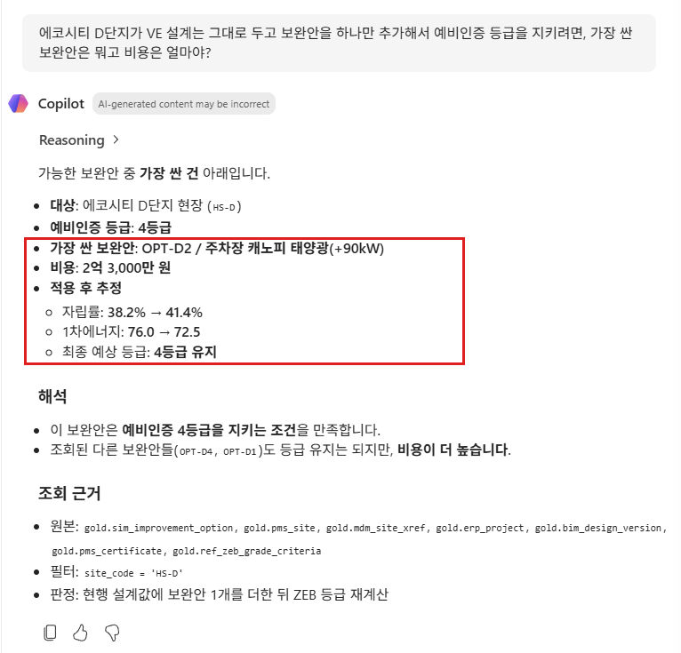

## 이 장의 완료 기준

`da_zeb`에 본인 `ont_zeb`와 연결된 원본이 보이고 지침이 저장되어 있습니다. Ontology Agent의 Plan에서 공통 규칙을 전달하고 Q1–Q8을 정답 Notebook과 비교해 정답·오답·미확인을 구분했습니다. 특히 Q2·Q3의 두 기준 판정과 Q8의 등급·일정·비용 조건을 대조했습니다. 미실행 질의는 검증 완료로 표시하지 않으며 정답 숫자를 지침이나 질문에 넣어 맞추지 않습니다.

Data agent와 이 장의 Plan 질의는 데이터를 읽기만 합니다. Gold·Ontology 변경이나 승인은 하지 않습니다. Q5·Q7의 지연·공급사 변경 가정은 원본에 반영하지 않습니다.

## Troubleshooting

- Q2에 "받을 수 없다"고 답하면: 06장 4단계에서 `ZEBGradeCriteria` 설명에 판정 규칙이 저장되었는지 확인합니다. 저장되어 있다면 새 대화에서 `리버뷰 B단지 현행 설계안의 자립률 기준 등급과 1차에너지 기준 등급을 각각 구하고, 온톨로지의 판정 규칙대로 최종 등급을 알려줘.`처럼 단계를 나눠 묻습니다.
- Q5에서 두 현장 모두 지연된다고 답하면: `Northwind 미입고 발주의 현장별 expected_date + 21일과 그 현장 '설비 설치 완료' planned_date를 비교해 초과 일수를 구해줘.`로 확인합니다.
- Q8에 OPT-D6(가장 싼 안)이나 OPT-D4라고 답하면: `D단지 보완안 6개 각각을 현행 설계안에 하나씩 적용했을 때 자립률·1차에너지·예상 등급·비용을 표로 보여줘.`로 표를 받아 1단계 정답의 Q8 표와 비교합니다.
- `데이터 없음`이라고 답하면 실제 조회 조건부터 확인합니다. 현장 이름이 PMS에서는 `에코시티 D단지 현장`, ERP에서는 `에코시티 D단지`로 서로 다릅니다.
- 온톨로지 추가 버튼이 없거나 추가가 실패하면 테넌트 AI 설정, 용량, 본인 Ontology와 원본 테이블의 읽기 권한을 확인합니다.
- Ontology Agent가 전체 질의를 실행하지 못하면 샘플에 없는 대상을 ‘없음’으로 처리하지 않습니다. 읽기 권한·바인딩·오류를 확인하고 `05_answers`로 검증합니다. 질의만 하려고 Act로 바꾸지 않습니다.
- 같은 질문이라도 답이 달라질 수 있습니다. Ontology Agent의 대화 내역은 브라우저 새로 고침으로 초기화합니다. 다시 열어 Plan 모드에서 공통 프롬프트부터 전달합니다. Data agent 선택 비교에서는 지침·문맥을 갱신한 뒤 Clear chat을 누릅니다.

## 공식 문서

- [Data agent의 지원 원본·권한·지침](https://learn.microsoft.com/fabric/data-science/concept-data-agent)
- [원본 추가·테스트·게시 절차](https://learn.microsoft.com/fabric/data-science/data-agent-end-to-end-tutorial)
- [Data agent 테넌트 설정](https://learn.microsoft.com/fabric/data-science/data-agent-tenant-settings)
- [Ontology 문맥·실행 원본·문맥 다운로드·Refresh](https://learn.microsoft.com/en-us/fabric/data-science/data-agent-ontology-sources)
- [Ontology Agent의 질의·Plan/Act 모드](https://learn.microsoft.com/en-us/fabric/iq/ontology/how-to-use-ontology-agent)

## 다음 단계

[10. Operations agent](10-operations-agent.md)에서 D단지 위험과 추천 보완안을 Teams로 제안받고 승인합니다. 원하면 먼저 [08. Power BI (선택)](08-power-bi.md)에서 보고서를 만들 수 있습니다. Foundry와 웹 대시보드는 10장과 11장 사이에 강사가 시연합니다.
