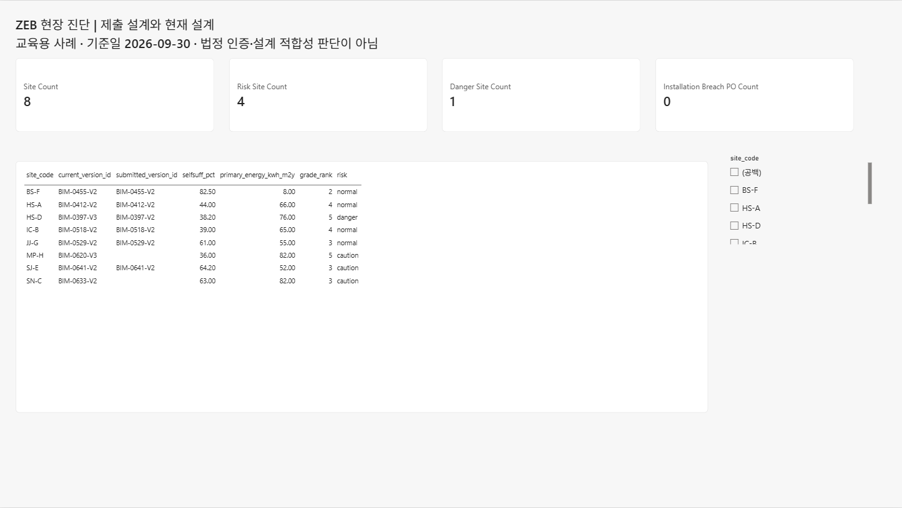
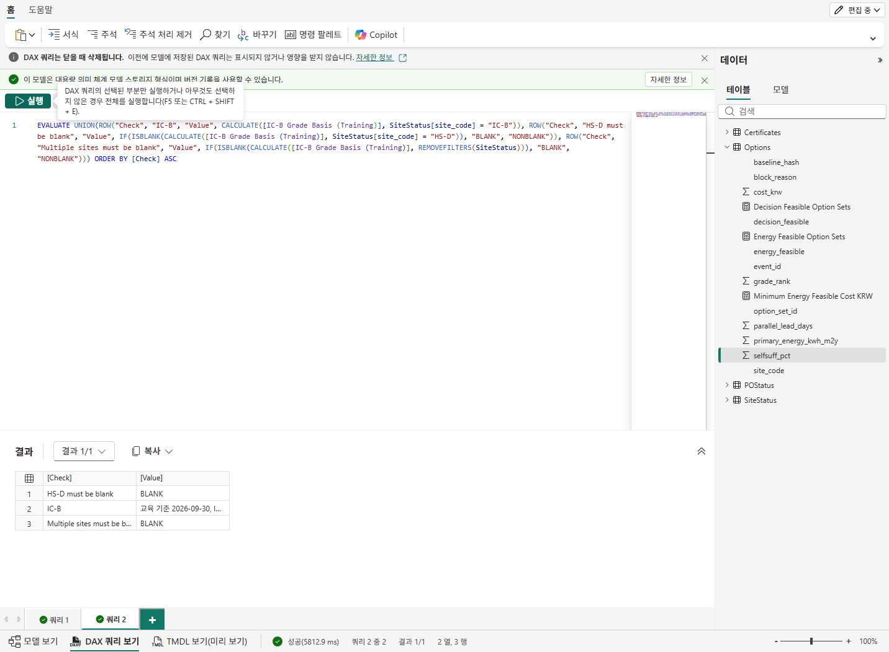
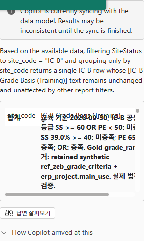
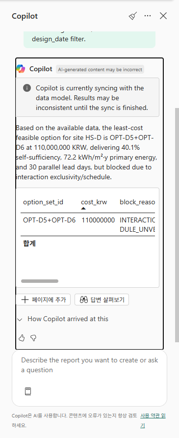
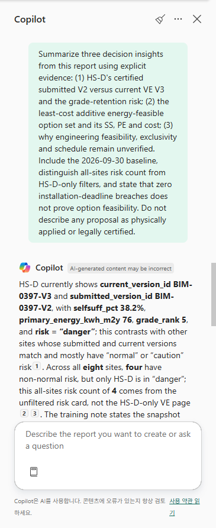
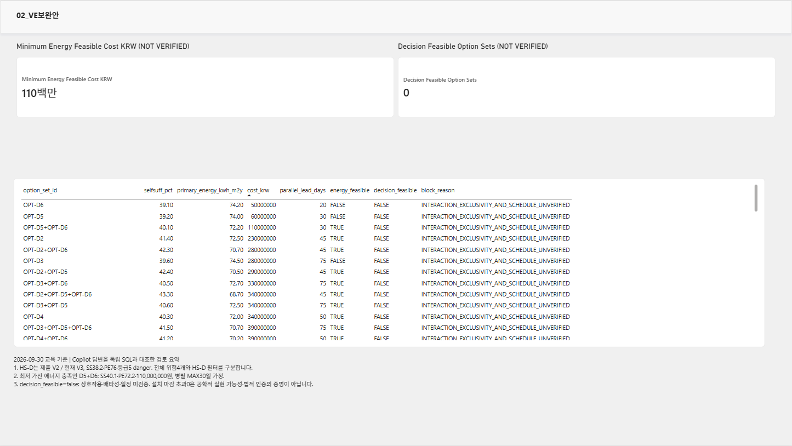

# 07. 수동 상태 페이지 → Copilot 옵션 페이지·질문·인사이트 → 저장

## 업무 목적
현재 위험과 가산 보완안의 한계를 보고서로 설명하고 **Copilot 페이지 생성, 데이터 질문, 인사이트 요청까지** 실제 결과를 검증합니다. 기능 실패를 수동 대안으로 대신 완료하지 않습니다.

## 시작 전 준비
자신의 Gold, Power BI Pro/PPU 및 모델/보고서 edit 권한, 승인된 paid capacity와 Copilot tenant/지역/언어 조건이 필요합니다. [model contract](../semantic_model/model-contract.json), [apply-model.tmdl](../semantic_model/apply-model.tmdl), [동일 DAX](../semantic_model/measures.dax)를 준비합니다. p01에서 실제 사용한 한국어 메뉴와 영문 대응을 함께 안내합니다. 자신의 tenant에서 메뉴나 Copilot이 없으면 해당 단계는 **blocked/미완료**입니다.

## 실행 순서
1. 자신의 `lh_zeb_pNN`을 엽니다. 리본 **New semantic model** → **Direct Lake semantic model name**=`sm_zeb_pNN`, **Workspace**=자신의 `ws_zeb_pNN`, gold 아래 **site_status, option_eval, po_status, site_certificate** 4개만 선택 → **Confirm**합니다. Model view가 열리면 오른쪽 위 **Editing**, Data의 4개 table을 확인합니다. eval/benchmark/source workspace를 추가하지 않습니다.
2. **Model view → Data**에서 각 table을 선택하고 **Properties → Name**(또는 해당 table **… → Rename**)으로 display name을 아래처럼 설정합니다. 이것은 모델 이름만 바꾸며 Lakehouse physical table은 바꾸지 않습니다.

| physical source | model display name |
|---|---|
| gold.site_status | SiteStatus |
| gold.option_eval | Options |
| gold.po_status | POStatus |
| gold.site_certificate | Certificates |

3. 4개 table의 실제 source/partition이 자신의 Lakehouse Direct Lake인지 확인합니다. SiteStatus.site_code unique 8행, Options 63행, POStatus 25행, Certificates 10행입니다. 자동 탐지된 관계가 있으면 확인하고 동일 column pair의 중복 관계를 제거한 후 아래 script를 적용합니다. 다른 원천 관계를 임의 삭제하지 않습니다.
   - **Options.selfsuff_pct / primary_energy_kwh_m2y**를 각각 선택하여 **Properties → 서식 / Format → 10진수 / Decimal**로 설정합니다. 고정 10진수의 자동 통화 서식으로 SS/PE에 `₩`가 붙으면 잘못된 단위입니다. source data type은 바꾸지 않습니다. SS38.2를 3820%로 만드는 percentage scaling도 적용하지 않습니다.
4. 화면 아래 **TMDL View (Preview)** → 안내가 나오면 **Try it now**. 로컬 `semantic_model/apply-model.tmdl` 전체를 복사하여 editor에 붙여 넣습니다. multiline paste가 들여쓰기를 누적하면 원본의 `ref table`/measure/relationship 계층과 같게 먼저 수정합니다. **Preview**에서 자기 4개 table의 **3개 관계와 10개 measure**만 바뀌는지 검토 → **Apply**. Output success를 실제 확인합니다. script는 `ref table` measure patch이며 source partitions를 replace하지 않습니다.
5. **Model view**로 돌아가 관계 Options/POStatus/Certificates(*)→SiteStatus(1), single filter를 확인합니다. Data의 계산기 아이콘 measure 10개를 확인하고 선택한 measure의 formula가 [DAX](../semantic_model/measures.dax)와 같은지 봅니다. `%` format은 SS 값38.2에 percentage scaling을 적용하지 않고 `0.0`로 표시합니다.
6. Model view **Home → Refresh 옆 화살표 → Data**. 확인 창이 표시되면 **Refresh**를 누르고 table의 마지막 refresh 시각과 실제 값을 확인합니다. 확인 창이 없는 UI도 있습니다. error는 성공이 아니며 다른 source로 바꾸지 않습니다. **DAX 쿼리 보기**에서 10개 measure 값을 독립 정답과 대조합니다.
7. Model view 리본 **New report**로 열린 새 탭의 빈 보고서를 기다립니다. 첫 page tab을 두 번 클릭하거나 **… → Rename**으로 `01_현장진단`을 지정합니다. Visualizations의 **Card**, **Table**, **Slicer**, 리본 **텍스트 상자 / Text box**를 아래대로 **수동** 배치합니다.

| visual | Data에서 넣을 실제 field/measure | 기대값/검사 |
|---|---|---|
| Card 1 | SiteStatus[Site Count] | 8 |
| Card 2 | SiteStatus[Risk Site Count] | 4 |
| Card 3 | SiteStatus[Danger Site Count] | 1 |
| Card 4 | POStatus[Installation Breach PO Count] | 0 |
| Table | SiteStatus의 site_code,current_version_id,submitted_version_id,selfsuff_pct,primary_energy_kwh_m2y,grade_rank,risk | numeric column **Don't summarize**; SS 합산 금지 |
| Slicer | SiteStatus.site_code | HS-D 선택 시 site1/SS38.2/PE76/grade5 |
| Text box | `교육 기준 / as of 2026-09-30 / 법적·공학 검증 아님` | 실제 날짜/한계 |

Table/Card를 선택한 뒤 Data field 체크 또는 Visualizations field well로 drag합니다. numeric 원시 열의 field well **▼ → Don't summarize**를 확인합니다. explicit measure는 정의된 aggregation을 그대로 사용합니다. slicer 선택을 해제하여 전체 8개 상태를 다시 확인합니다.

새 visual을 추가할 때는 **먼저 빈 canvas를 클릭하여 기존 visual 선택을 해제**합니다. 선택된 상태에서 다른 visual icon을 누르면 기존 visual 유형이 바뀔 수 있습니다. 제목과 교육 한계 문구를 위쪽에, 4개 card를 한 줄로, 현장 table과 slicer를 아래에 배치합니다.



8. 리본 **File → Save**(또는 Save icon), report name=`rpt_zeb_pNN`, 자신의 workspace로 저장합니다. **Copilot** pane을 열어 새 페이지 생성을 요청합니다. prompt 아래는 그대로 복사하며 이름 변경은 필요 없습니다.

```text
Create a second report page named 02_VE보완안 using the existing model only.
Set a page filter SiteStatus.site_code = "HS-D".
Add a table with Options.option_set_id, selfsuff_pct, primary_energy_kwh_m2y,
cost_krw, parallel_lead_days, energy_feasible, decision_feasible and block_reason.
Use Don't summarize for numeric per-option rows.
Add cards using the explicit Minimum Energy Feasible Cost KRW
and Decision Feasible Option Sets measures.
Label additive energy assumptions and engineering feasibility NOT VERIFIED.
Do not invent a certification result, a validated installation schedule or a purchase action.
```

9. Copilot 생성 결과의 **Visualizations → field wells**, actual measure formulas, Filters의 **Filters on this page**=`SiteStatus.site_code HS-D`, visual filters를 확인합니다. minimum110,000,000, decision-feasible0을 정답과 비교합니다. 일부 visual만 생성될 수 있으므로 누락 table/field/filter를 직접 확인하여 근거를 적고 수정합니다. 누락 page filter는 Data의 **SiteStatus.site_code**를 **이 페이지의 필터 / Filters on this page**로 drag한 뒤 **HS-D**를 선택합니다. numeric option rows는 Don't summarize이고 cost 오름차순에서 50m/60m 단독안의 energy_feasible=false와 110m 조합의 true를 구분합니다. Copilot 생성 자체가 실패한 경우 수동 둘째 페이지로 완료 처리하지 않습니다.
10. 같은 Copilot pane에 다음 **영문 데이터 질문을 한 번에 하나씩** 제출하고 각 응답을 기다립니다. Q&A enabled와 implicit measures 조건을 현재 지원 문서대로 확인합니다. explicit measures를 쓴다고 prerequisite가 사라지지 않으며 report filter가 질문 context에 자동 전달되지 않을 수 있어 site/전체 범위를 prompt에 명시합니다. `2026-09-30`은 training `progress_as_of`이지 `design_date`가 아닙니다. baseline을 추측하라는 UI suggestion을 그대로 승인하지 않습니다.

```text
Query the existing Options table for site_code = "HS-D" and energy_feasible = TRUE.
Return the least-cost row ordered by cost_krw ascending with option_set_id,
selfsuff_pct, primary_energy_kwh_m2y, cost_krw, parallel_lead_days and block_reason.
These existing rows are the 2026-09-30 training baseline; do not add a design_date filter.
```

```text
Across all eight sites, ignoring the HS-D report page filter,
how many sites have risk other than normal?
```

```text
For site IC-B, explain why its grade_rank is 4 even though selfsuff_pct is 39 percent.
Use the actual primary_energy_kwh_m2y and model evidence;
do not invent a legal certification criterion.
```

답변을 D5+D6/40.1/72.2/110m/병렬MAX30, 전체 risk4, IC-B39/65/4와 대조합니다. 이 4-table 모델에는 등급 criterion/reason table과 V2의 SS/PE/PV가 직접 포함되지 않습니다. Copilot이 이유의 근거 부족을 밝히면 이를 보존하고 **IC-B OR 이유는 독립 Silver SQL/정답에서 확인**합니다. 값 조회 성공을 미근거 이유 설명 성공으로 바꾸지 않습니다. 질문 기능/언어가 지원되지 않거나 응답이 없으면 해당 질문 stage는 **blocked/미완료**입니다. model sync 경고가 있으면 독립 값 비교 없이 답변을 승인하지 않습니다.

### IC-B의 교육 이유를 모델에 연결하기

근거가 없는 설명을 요구하는 대신 [IC-B 전용 교육 measure](../semantic_model/ic-b-grade-basis.tmdl)를 **자신의 모델**에 추가합니다. retained fixture의 `IC-B → CT-25-0107 → erp_project.main_use=공동주택`과 주거 교육 기준을 먼저 독립 확인합니다. 이 script는 SS/PE/grade를 현재 Gold에서 읽지만 class/threshold는 확인한 fixture 근거를 명시적으로 내장합니다. 법적 인증이나 모든 현장의 동적 criterion 모델이 아닙니다.

- **TMDL View (Preview) → 새 script → 붙여 넣기 → Preview**에서 source 4 table/3 relationship/4 Direct Lake partition 보존과 measure **10→11**만 확인 → **Apply**합니다. HS-D와 여러 site context에서는 이 case-specific measure가 BLANK여야 합니다.
- DAX 쿼리 보기에서 IC-B의 measure를 읽고 SS39가 SS40 조건에 실패해도 PE65가 **strict PE<70**에 성공하여 OR로 4등급임을 대조합니다. 3등급 SS≥60 OR PE<50은 충족하지 않습니다.
- Copilot에는 아래처럼 **site_code만 grouping**하고 IC-B를 명시적으로 filter하도록 요청합니다. grade/target만 grouping하여 BLANK를 반환하면 그 응답은 설명 성공이 아닙니다.

```text
Filter SiteStatus.site_code = "IC-B" and group only by site_code.
Return the saved measure [IC-B Grade Basis (Training)] unchanged in one row.
Do not infer a legal criterion or add grade/target grouping.
```







11. **Copilot 인사이트 요약을 반드시 요청**합니다. 현재 보고서 둘째 페이지를 연 상태에서 아래 prompt를 제출합니다. 반환 근거·실제 fields/measures·filter context를 검사하고 최소 3개 insight 및 수정사항을 보고서 text box에 정리합니다. 자신이 작성한 insight만으로 Copilot 요청을 완료한 것으로 표시하지 않습니다.

```text
Summarize three decision insights from this report using explicit evidence:
(1) HS-D's certified submitted V2 versus current VE V3 and the grade-retention risk;
(2) the least-cost additive energy-feasible option set and its SS, PE and cost;
(3) why engineering feasibility, exclusivity and schedule remain unverified.
Include the 2026-09-30 baseline, distinguish all-sites risk count from HS-D-only filters,
and state that zero installation-deadline breaches does not prove option feasibility.
Do not describe any proposal as physically applied or legally certified.
```

인사이트 호출이 unavailable/error면 **insight stage 미완료**입니다. 생성값이 틀리면 원본 답변/정답 대조/수정 내용을 남깁니다.
Copilot pane을 닫으면 대화가 초기화될 수 있으므로 응답·근거를 먼저 보존합니다. 과거 V2 성능 숫자는 이 모델만으로 추정하지 말고 Ontology/SQL로 추적합니다.



12. 모델/보고서를 **Save**, 닫고 workspace에서 `rpt_zeb_pNN`을 다시 엽니다. **2페이지, actual fields/measures, HS-D page filter, 요청/검증한 insight text, 110m/0 및 전체8/4/1/0**가 유지되는지 확인합니다.
   - 새 리본의 읽기 화면에서는 **보는 중 / Viewing → 편집 중 / Editing**으로 전환합니다. 변경 후 **저장**하고, 닫을 때 저장되지 않은 변경 dialog가 있으면 다시 **저장**합니다. 자기 workspace에서 재열기하여 값과 filter를 확인해야 완료입니다.



## 확인할 결과
Direct Lake 4개 table·3개 관계·기본 10개 explicit measures와 IC-B 이유용 11번째 교육 measure, 수동 첫 페이지, **Copilot 생성 둘째 페이지**, **Copilot 질문 응답 및 insight 요청 결과**, 저장·재열기 증거가 있어야 합니다. 계산된 Options는 Gold 물리 Delta table이며 unsupported Direct Lake calculated-table 기능을 가정하지 않습니다.

## 완료 기준
모든 requested Copilot stage가 실제 수행·대조됐습니다. Korea Central/tenant/권한/언어 기능 미지원은 정확한 blocked stage로 기록합니다. 오프라인 파일 검사만으로 TMDL Apply/실제 Copilot runtime 성공을 주장하지 않습니다.

## 다음 단계
[08. Eventhouse·Notebook action·Teams 제안](08-operations.md).
