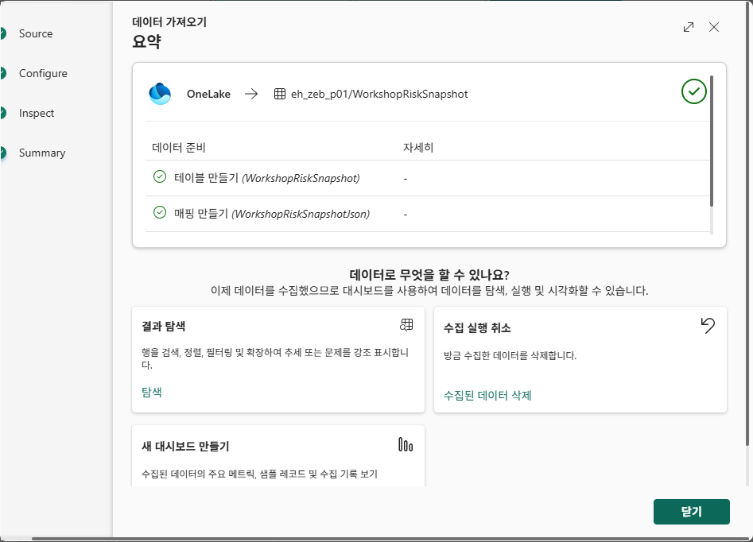
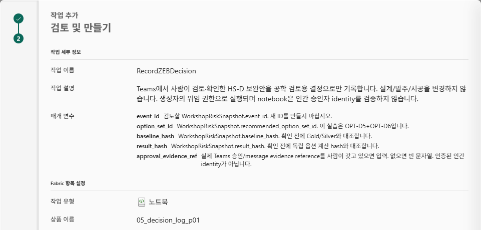
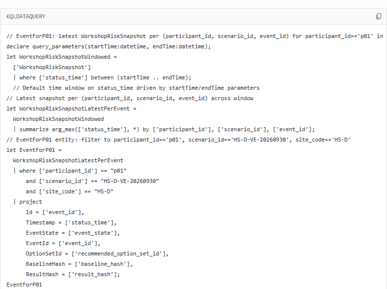
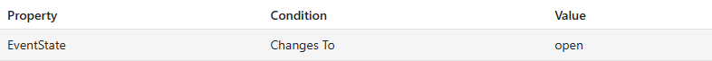
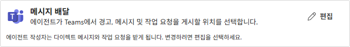
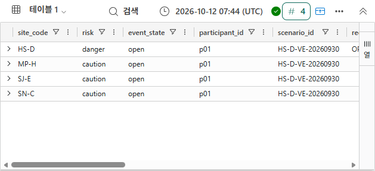
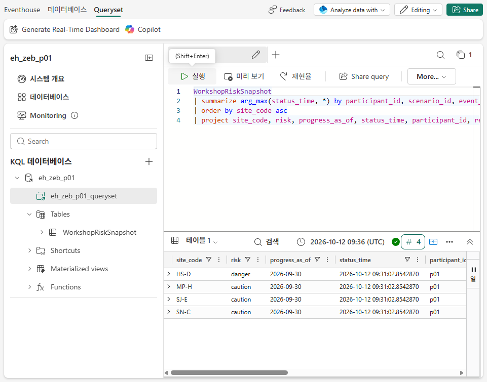

# 08. 명시적 snapshot → Teams 제안 → 승인 전 대기

## 업무 목적
자신의 HS-D 위험을 Teams로 제안하고, **사람이 Proceed/Confirm한 뒤에만 Operations Notebook action이 결정 기록을 실행**하도록 연결합니다. 실제 설계·발주·시공은 변경하지 않습니다.

## 시작 전 준비
이 단계의 cloud 실행과 외부 알림은 별도 승인이 필요합니다. 자기 workspace와 Gold, Teams 동일 계정, KQL/Notebook 작성·실행 권한, 활성 승인된 paid capacity가 있어야 합니다. [action contract](../operations/action-contract.json)의 실제 연결과 승인 후 실행을 구분합니다. 기능이 없으면 해당 단계는 blocked/미완료이지 수동 notebook 실행으로 대체 완료하지 않습니다.

## 실행 순서
1. 자신의 workspace inventory에서 기존 실습 Eventhouse가 없는지 먼저 확인합니다. **+ New item → Eventhouse**, 이름 `eh_zeb_pNN`을 선택합니다. 기본 생성된 **같은 이름의 KQL Database**를 사용하며 별도 database를 중복 생성하지 않습니다. `pNN`은 실제 자기 번호로 교체합니다. Ontology가 자동 만든 내부 backing database를 risk ingestion 대상으로 바꾸지 않습니다. database의 embedded queryset 또는 **New KQL queryset**에서 자신의 query target을 확인합니다.
2. 자신의 `04_snapshot`에서 생성한 retained `Files/workshop/operations_snapshot.jsonl`을 확인합니다. database **Get data / 데이터 가져오기 → OneLake**에서 자신의 `ws_zeb_pNN → lh_zeb_pNN → Files → workshop → operations_snapshot.jsonl`을 선택합니다. 첫 수집은 table=`WorkshopRiskSnapshot`, format=`JSON`(JSONL의 한 줄 한 event), mapping=`WorkshopRiskSnapshotJson`으로 진행합니다. **Edit columns**에서 `progress_as_of`가 날짜로 추정되면 **string**으로 수정하고 `status_time`만 **datetime**, 나머지 10개는 string임을 [setup.kql](../operations/setup.kql)과 비교 → **Finish**합니다. 이미 table/mapping이 있으면 기존 것을 선택하며 재생성하지 않습니다. 별도 다운로드나 실제 bytes의 재계산이 필요하지 않습니다.


3. 관리자 제공 `05_decision_log_pNN`을 준비합니다. 미제공 시 workspace **Import → Notebook → From this computer**, **Upload**로 관리자 바인딩 파일을 가져옵니다. notebook **Explorer → Add data items → From OneLake catalog**에서 자신의 Lakehouse 유형/위치/ID를 확인하여 **Add**, 필요 시 Lakehouse **… → Set as default**. TARGET와 metadata를 검사하며 **Run all/수동 실행은 하지 않습니다**.
4. parameter-tag 셀은 다음 **5개 string**입니다. TARGET와 승인 boolean은 action parameter가 아닙니다.

| 매개 변수 | 제안/확인에 쓸 값 |
|---|---|
| event_id | WorkshopRiskSnapshot.event_id |
| option_set_id | WorkshopRiskSnapshot.recommended_option_set_id |
| baseline_hash | WorkshopRiskSnapshot.baseline_hash |
| result_hash | WorkshopRiskSnapshot.result_hash |
| approval_evidence_ref | 실제 Teams/message reference가 있으면 사람이 입력; 플랫폼 미제공이면 빈 문자열 유지 |

5. workspace **+ New item → Operations agent**(한국어 `운영 에이전트`), 이름 `ops_zeb_pNN` → **Create**. **Knowledge → Add data 옆 화살표 → Add from OneLake catalog**, 자신의 `eh_zeb_pNN` **KQL Database**를 선택하여 **Add**합니다.
6. **Actions → Add action → Select action type: Fabric item → Browse**에서 자신의 `05_decision_log_pNN` Notebook을 선택 → **Add**합니다. 아래 내용을 입력합니다. Parameters가 자동 발견되지 않으면 parameter-tag 셀/개별 string 변수/저장 상태를 수정하고 다시 연결합니다. 지원되지 않는 임의 JSON request parameter를 만들지 않습니다.

| UI 입력 | 값 |
|---|---|
| Action name | `RecordZEBDecision` |
| Action description | `Teams에서 사람이 검토·확인한 HS-D 보완안을 공학 검토용 결정으로만 기록합니다. 설계/발주/시공을 변경하지 않습니다. 생성자의 위임 권한으로 실행되며 notebook은 인간 승인자 identity를 검증하지 않습니다.` |
| event_id Description | `검토할 WorkshopRiskSnapshot.event_id. 새 ID를 만들지 마십시오.` |
| option_set_id Description | `WorkshopRiskSnapshot.recommended_option_set_id. 이 실습은 OPT-D5+OPT-D6입니다.` |
| baseline_hash Description | `WorkshopRiskSnapshot.baseline_hash. 확인 전에 Gold/Silver와 대조합니다.` |
| result_hash Description | `WorkshopRiskSnapshot.result_hash. 확인 전에 독립 옵션 계산 hash와 대조합니다.` |
| approval_evidence_ref Description | `실제 Teams 승인/message evidence reference를 사람이 갖고 있으면 입력. 없으면 빈 문자열. 인증된 인간 identity가 아닙니다.` |

**Next → Review and create**에서 action type Notebook, workspace/Notebook 이름, **5개 string**을 확인 → **Create**. **Action connected** 표시와 저장을 확인합니다.



7. 관리자와 action binding evidence를 확인합니다. Notebook TARGET의 `platform_approval_binding_verified=True`, `action_binding_evidence_ref`에 실제 binding readback 증거 위치, `configured_creator_actor_id`에 **agent 생성자의 확인된 Entra object ID**, `serialized_writer_attested=True`를 저장합니다. 이러한 admin 설정은 인간 승인 증명이 아니라 검증된 배포 경계입니다. 직접 notebook 호출을 Teams approval과 구분하는 인증 토큰을 플랫폼이 제공한다고 주장하지 않습니다. 설정 방법과 권한 제한은 [관리자 가이드](../admin/environment.md)에 있습니다.
8. **Agent instructions**에 다음을 붙여 넣습니다. `pNN`, database 이름은 실제 자기 값으로 교체합니다.

```text
건설 ZEB 교육 시나리오 HS-D-VE-20260930을 감시합니다.
대상: 내 KQL Database eh_zeb_pNN의 WorkshopRiskSnapshot.
participant_id=pNN, scenario_id=HS-D-VE-20260930, site_code=HS-D만 조치 제안합니다.
객체 키는 WorkshopRiskSnapshot.event_id, 시간은 WorkshopRiskSnapshot.status_time입니다.
최신 status_time 행을 participant_id/scenario_id/event_id별로 선택합니다.
WorkshopRiskSnapshot.event_state가 open으로 변할 때만 Teams로 알려
RecordZEBDecision 조치를 추천합니다. 매 평가마다 Is open 알림을 반복하지 마십시오.
event_id <- WorkshopRiskSnapshot.event_id
option_set_id <- WorkshopRiskSnapshot.recommended_option_set_id
baseline_hash <- WorkshopRiskSnapshot.baseline_hash
result_hash <- WorkshopRiskSnapshot.result_hash
approval_evidence_ref는 실제 reference가 없으면 빈 문자열로 두고 인간이 확인하도록 합니다.
메시지에 V2 인증/현행 V3 차이, D5+D6 가산 가정과 공학/배타성/일정 미검증을 표시합니다.
최저 비용은 에너지 가산 기준일 뿐 시공 가능성 증명이 아닙니다.
사람이 Teams에서 검토 후 Proceed 및 Confirm할 때만 Notebook 조치를 제출합니다.
스스로 승인하거나 apply_options/설계/발주/현장작업/graph refresh를 실행하지 마십시오.
Notebook의 승인 로그는 생성자 위임 실행 provenance이며 인간 identity 인증이 아닙니다.
메시지는 한국어로 작성합니다.
```

9. **Agent setup → Generate playbook**. glossary의 EventId/시간/EventState/옵션/BaselineHash/ResultHash를 실제 source 열과 비교합니다. 생성 이름은 달라도 source binding이 같아야 합니다. **Rules**를 펼쳐 participant/scenario/site 필터, `arg_max(status_time, *) by participant_id, scenario_id, event_id`, `EventState → Changes To → open`을 확인합니다. `Is open` 반복 조건이면 수정·재생성 후 저장합니다. generated query가 `startTime/endTime`으로 status_time을 제한하면 그 **실제 평가 window**와 snapshot freshness를 확인합니다. 오래된 file이 성공적으로 수집됐다고 현재 window에서 알림이 발생한다고 가정하지 않습니다.





10. **Agent behavior → 메시지 배달 / Message delivery**에서 수신자가 **자신/agent author**인지 확인합니다. action은 수신자가 아닌 **agent 생성자의 위임 권한**으로 실행됩니다. 자기 action binding/TARGET 범위를 확인하되 기존 계정의 전역 권한까지 제한됐다고 주장하지 않습니다.



11. **Start 전에** 정확한 수신자, 저장할 메시지 제목·본문과 실제 event/hash를 치환한 내용, 다섯 action parameter를 코디네이터에게 검토받습니다. native Teams card를 사전에 렌더링할 수 없다면 saved instructions의 문구가 실제 LLM/card 포장까지 고정된다는 보장은 없음을 함께 알립니다. 단순 resource 생성 승인을 알림 승인으로 간주하지 않습니다. 승인되지 않았다면 **Start하지 않고 capacity를 일시 중지**합니다. 승인된 이후에만 Start와 fresh snapshot 전송을 수행합니다.
12. `04_snapshot`의 기본 file은 **최초 생성 전용**입니다. 이미 있으면 재실행하거나 `overwrite=True`로 바꾸지 않습니다. 승인 후 fresh snapshot이 필요하면 자신의 Notebook 복사본에서 출력 경로만 `Files/workshop/operations_snapshot_YYYYMMDD_HHMM.jsonl` 같은 **새 versioned 경로**로 지정하고 first-write guard를 유지합니다. 기존 audit/recorded event를 먼저 검사하고 승인받은 event/baseline/result hash가 실제 Gold·독립 계산과 같을 때만 실행합니다. 최초 file과 모든 version을 보존합니다. status_time은 실제 실행 시각이고 progress_as_of는 **2026-09-30**입니다. **Get data → OneLake**에서 그 실제 새 file과 **기존 table/mapping**을 선택하여 수집합니다. 기존 table에서도 날짜 자동 추정이 `progress_as_of_1` 같은 새 열을 추가할 수 있으므로 **Finish 전에** `progress_as_of → string`, `status_time → datetime`, 원래 11개 열 및 mapping을 다시 확인합니다. suffix 열이나 빈 progress_as_of는 정상 결과가 아닙니다. 파일 수집은 자동 Gold sync가 아닙니다. 대안으로 아래 명령 뒤에 **실제 notebook 출력 JSONL만 그대로** 붙여 Run할 수 있습니다. hash/IDs를 새 sample로 만들어 대체하지 않습니다.

```kql
.ingest inline into table WorkshopRiskSnapshot
with (format='multijson', ingestionMappingReference='WorkshopRiskSnapshotJson') <|
```

inline ingestion이 거부되면 정책을 우회하지 않고 앞의 **own OneLake** 경로를 사용합니다. 승인된 관리자가 실제 retained bytes를 이미 보유한 경우에만 **Get data → Local file**도 가능합니다. `acceptDownloads=false`를 변경하거나 synthetic file로 우회하지 않습니다. 실제 ingestion/schema/count/hash가 확인될 때까지 단계는 미완료입니다.

13. [queries.kql](../operations/queries.kql)을 실행하여 자기 latest 위험 4개, HS-D `OPT-D5+OPT-D6`, event/baseline/result hash를 확인합니다. 수동 재수집으로 physical rows가 늘어도 latest-status 4행과 중복을 구분합니다. **View activity**에서 실제 평가/전이/반복 억제를 확인해야 하며 저장된 rule만으로 runtime dedupe 성공을 주장하지 않습니다. 5분 평가 주기는 알림 도착 보장 시간이 아닙니다.



재수집에서 자동 날짜 추정이 원래 열 대신 suffix 열을 만든다면 Finish를 중단합니다. 기존 mapping이 실제 11개 JSON path를 가리키는 것을 확인한 뒤, 관리자의 허용된 대안은 **같은 실제 retained OneLake file**의 URI를 사용한 아래 수집입니다. URI는 자신의 pNN file만 사용하고 `;impersonate`는 이미 가진 사용자 권한으로 읽는 방식입니다. 새로운 권한·token·synthetic inline 데이터를 만들지 않습니다.

```kusto
.ingest into table WorkshopRiskSnapshot ('<실제_자신의_새_OneLake_file_URI>;impersonate')
with (format='multijson', ingestionMappingReference='WorkshopRiskSnapshotJson')
```

수집 후 latest 4행의 교육 날짜/현재 status_time/승인 hash를 다시 읽습니다. append history count와 latest count는 다릅니다.


14. Teams **Fabric operations agent** 제안을 열어 action 이름/실제 parameters를 확인합니다. **아직 Proceed/Confirm을 누르지 않습니다.** native Ontology/[독립 SQL](../sql/reference_checks.sql)로 근거를 검토합니다. 선택 Foundry는 [09](09-foundry-optional.md)를 승인 전에 수행합니다.

## 확인할 결과
자신의 4개 explicit snapshot, HS-D proposal 1건, RecordZEBDecision 연결 및 승인 **전** 상태입니다. `Action connected`는 Notebook 실행 성공이나 인간 승인 증명이 아닙니다. error/rate limit/반복 알림이면 Stop하고 조사합니다.

## 완료 기준
실제 table/schema/ingest/playbook/Teams proposal/5개 action parameters가 확인됐습니다. 자동 notebook 실행을 금지한 대신, **Teams 인간 승인으로만 시작하는 decision-only action을 실제로 연결**했습니다. 아직 실행하지 않았습니다.

## 다음 단계
선택 [09. Foundry](09-foundry-optional.md) 또는 기본 [10. Proceed/Confirm → Notebook → 검증 → Stop](10-approval.md).
