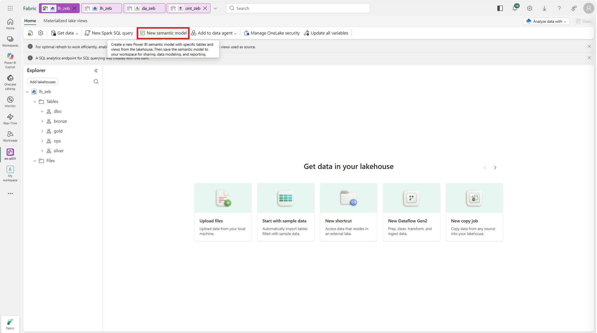
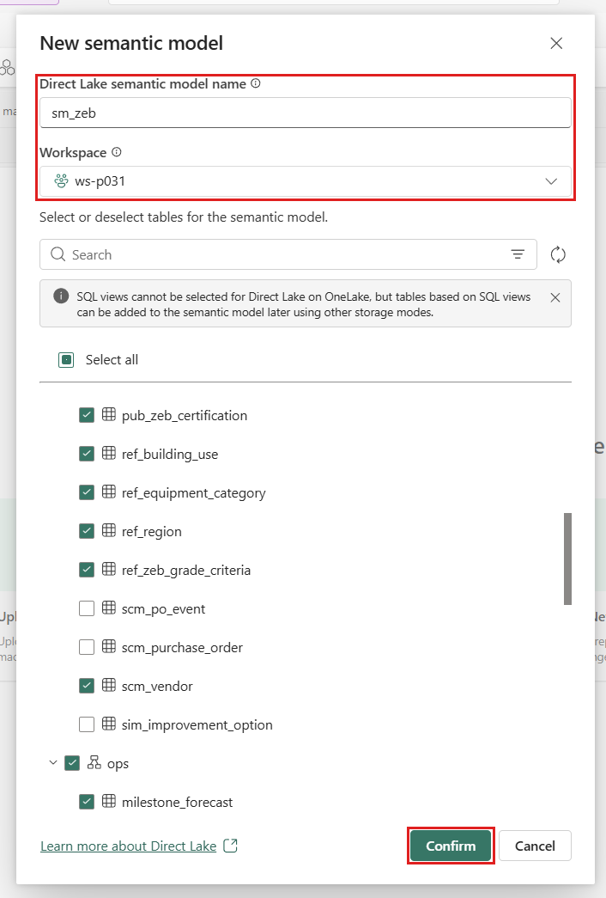
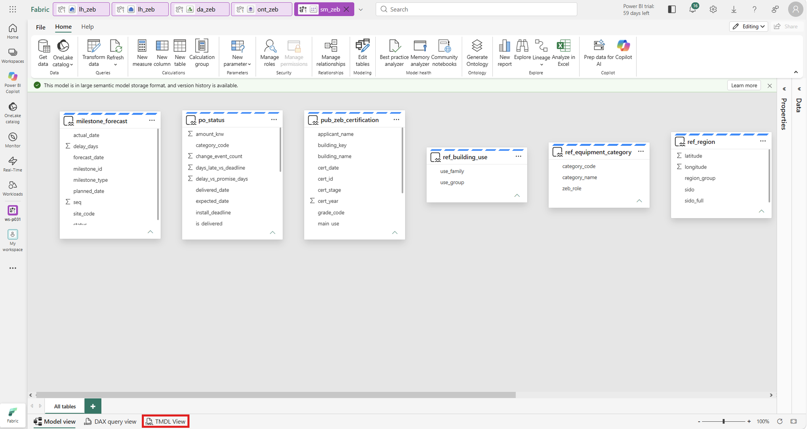
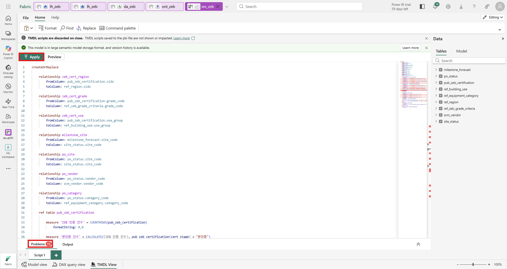
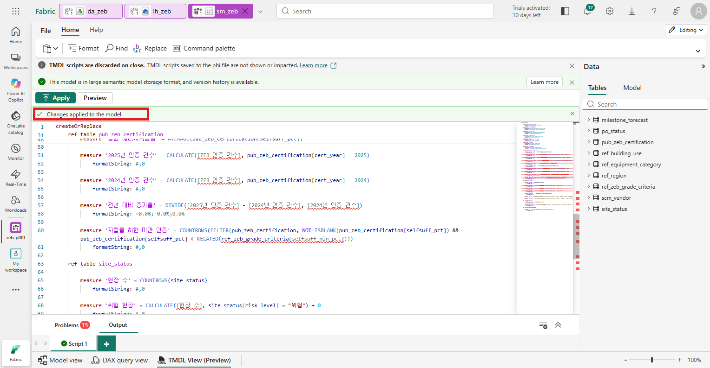
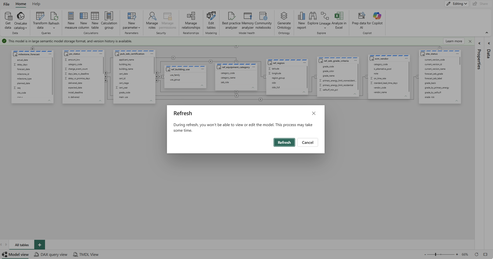
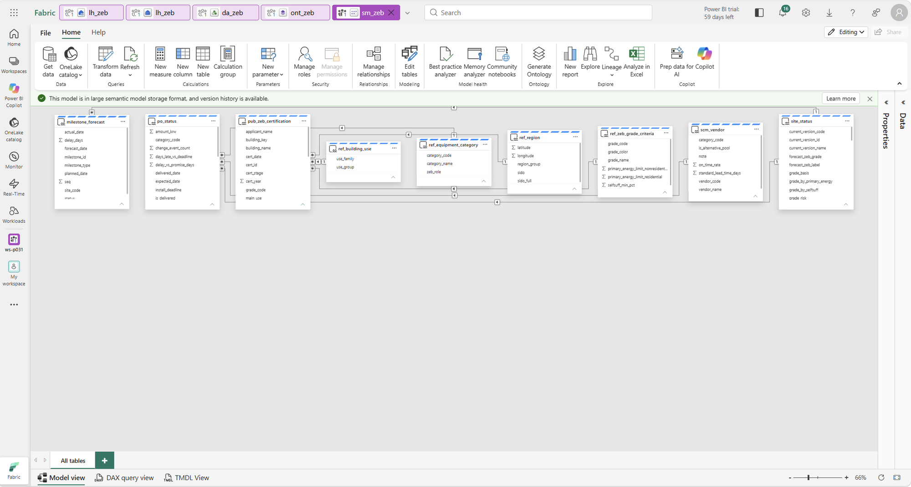
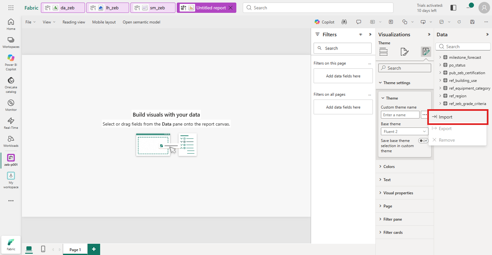
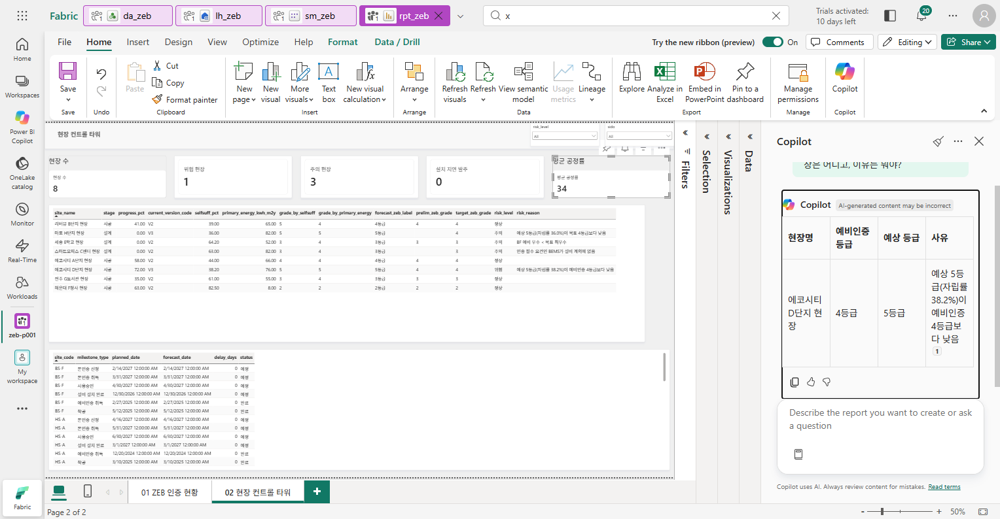

# 08. Power BI (선택)

[목차](../README.md) \| 이전: [07. Data agent](07-data-agent.md) \| 다음: [09. Operations agent](09-operations-agent.md)

Copilot으로 현장 컨트롤 타워 보고서 한 페이지를 만들고 D단지의 등급 위험을 확인합니다. 09장에서 보완안을 승인한 뒤 같은 보고서를 다시 열어 변화를 확인합니다.

이 장은 선택입니다. 기본 과정에서는 [09. Operations agent](09-operations-agent.md)로 바로 이동합니다. 보고서 없이도 원본 SQL과 Ontology Agent의 Plan으로 승인 결과를 확인할 수 있습니다.

Power BI 라이선스 활성화 → 모델 만들기 → 관계·측정값 적용 → Copilot으로 현장 페이지 생성 → 저장 → D단지 위험 질문 순서로 진행합니다. 공공 인증 현황 페이지와 테마 꾸미기는 선택입니다.

이 장의 미션: D단지 위험을 보고서에서 찾고, 해당 수치가 어떤 테이블·측정값·필터에서 나왔는지 확인합니다. Copilot은 페이지와 설명을 돕지만 계산의 정답은 아닙니다. Ontology의 규칙이 Semantic model에 자동 복사되는 것이 아니라, 이 장에서 TMDL의 관계·측정값을 따로 적용합니다.

## 시작 전 준비

- 05장까지 완료한 본인 `lh_zeb`: `gold` 22개, `ops` 3개 테이블
- 관리자가 준비한 활성 유료 Fabric 용량, Power BI Pro·PPU 또는 활성 체험판 라이선스, 모델·보고서 작성 권한과 Copilot 설정
- [`sm_zeb.tmdl`](../fabric/sm_zeb.tmdl)을 PC로 내려받습니다. GitHub 파일 화면의 Download raw file을 사용해 원래 이름과 확장자로 저장합니다. Lakehouse에 업로드하지 않습니다.

용량·지원 지역·Copilot 설정은 [관리자 준비 가이드](../admin/README.md)와 [공식 요구 사항](https://learn.microsoft.com/power-bi/create-reports/copilot-introduction#requirements-at-a-glance)을 따릅니다.

### Semantic model을 만들기 전에: Power BI 체험판 활성화

실습 계정에 Power BI Pro·PPU가 없다면 먼저 Power BI 체험판(Trial) 라이선스를 활성화합니다. 이미 유효한 Pro·PPU 또는 체험판이 있으면 이 과정은 건너뜁니다.

1.  Fabric 오른쪽 위 프로필 아이콘을 눌러 본인 계정의 Power BI 라이선스를 확인합니다.
2.  무료 계정이면 계정 메뉴의 라이선스·무료 체험 안내에서 Power BI 체험판을 시작하고 활성화 절차를 마칩니다. 체험판 시작 항목이 없거나 조직 정책으로 차단되면 관리자에게 라이선스 할당을 요청합니다.
3.  활성화된 라이선스를 확인한 뒤 페이지를 새로 고치고 아래 모델 만들기를 진행합니다.

Power BI 개인 라이선스와 작업 영역의 Fabric 용량은 별개입니다. Fabric Trial 용량을 새로 시작하거나 작업 영역의 기존 유료 용량을 변경하는 단계가 아닙니다.

## 1. Semantic model 만들기

제공된 TMDL과 맞도록 테이블 9개를 선택합니다. 기본 현장 페이지에 쓰지 않는 공공 인증 테이블도 포함합니다. 저장 모드는 Direct Lake로, OneLake의 Delta 테이블을 가져오기(Import) 없이 바로 읽습니다.

1.  본인 작업 영역에서 Lakehouse `lh_zeb`를 엽니다.
2.  리본의 New semantic model을 누릅니다.

    

3.  New semantic model 창에 아래와 같이 입력하고 Confirm을 누릅니다.

    - Direct Lake semantic model name: `sm_zeb`
    - Workspace: 본인 작업 영역
    - 테이블 9개를 체크합니다. 같은 이름의 테이블이 `bronze`·`silver`에도 있으므로 스키마를 확인하고 체크합니다. 맨 위 `bronze`의 > 를 눌러 접어 두면 찾기 쉽습니다.

    | 스키마 | 테이블 |
    |---|---|
    | `gold` | `pub_zeb_certification`, `ref_building_use`, `ref_equipment_category`, `ref_region`, `ref_zeb_grade_criteria`, `scm_vendor` |
    | `ops` | `milestone_forecast`, `po_status`, `site_status` |

    목록을 아래로 스크롤해 `ops`의 테이블 3개까지 모두 선택합니다. 아래 화면에는 선택 목록의 일부만 보입니다.

    

예상 결과: `sm_zeb`가 Model view로 열리고 오른쪽 위는 Editing입니다. 오른쪽 Data 창이 접혀 있으면 펼쳐 테이블 9개를 확인합니다.



## 2. 관계와 측정값 넣기

TMDL(Tabular Model Definition Language)은 모델 구성을 글로 적는 형식입니다. 제공된 `sm_zeb.tmdl`을 적용하면 관계 7개와 측정값 20개가 만들어집니다. 직접 관계와 계산식을 하나씩 만들 필요는 없습니다.

1.  화면 아래 TMDL View (Preview) 탭을 누릅니다. Edit your model with TMDL 안내가 나오면 Try it now를 누릅니다.
2.  PC의 `sm_zeb.tmdl`을 메모장으로 열고 Ctrl+A, Ctrl+C로 전체를 복사합니다.
3.  TMDL 편집기의 1행을 누르고 Ctrl+V로 붙여 넣습니다. 1행이 `createOrReplace`입니다.

    

4.  편집기 위 Apply를 누릅니다.

    붙여 넣은 직후 아래 Problems에 `Cannot find name '[ZEB 인증 건수]'` 같은 경고가 15개쯤 보입니다. 같은 스크립트 안에서 아직 만들어지지 않은 측정값을 참조해서 생기는 경고이므로 그대로 Apply합니다.

    예상 결과: 편집기 위에 Changes applied to the model.이 보입니다.

    

5.  화면 아래 Model view 탭을 누르고, 오른쪽 아래 Fit to page를 눌러 전체를 봅니다.

6.  관계를 계산하도록 Model view 리본의 Refresh에서 Data 새로 고침을 선택합니다. Refresh 확인 창에서 Refresh를 누르고 완료될 때까지 기다립니다. 새로 고침 중에는 모델을 보거나 편집할 수 없습니다. 이 과정을 생략하면 보고서에 *"…relationship … needs to be recalculated"* 오류가 날 수 있습니다.

    

예상 결과: `pub_zeb_certification`이 `ref_region`·`ref_zeb_grade_criteria`·`ref_building_use`와, `milestone_forecast`·`po_status`가 `site_status`와, `po_status`가 `scm_vendor`·`ref_equipment_category`와 관계선으로 이어집니다.



## 3. Copilot으로 현장 컨트롤 타워 만들기

1.  리본의 New report를 누릅니다. 새 탭에 빈 보고서가 편집 화면으로 열립니다.

2.  (선택) 보고서 테마를 적용합니다. [`zeb-theme.json`](../fabric/zeb-theme.json)을 GitHub의 Download raw file로 PC에 내려받습니다. 보고서 편집 화면에서 View → Theme → Open theme format pane.을 누르고, 오른쪽 Theme settings → Theme의 Custom theme name 옆 … → Import에서 내려받은 파일을 엽니다.

    테마는 Semantic model이 아니라 보고서에 적용합니다. 색·글꼴 등 서식을 맞추는 선택 단계이므로 건너뛰어도 아래 실습에는 영향이 없습니다.

    

3.  보고서가 편집 보기(Editing)인지 확인하고 리본 오른쪽 Copilot을 눌러 아래 내용을 보냅니다.

    ``` text
    연결된 sm_zeb 모델로 '현장 컨트롤 타워' 보고서 한 페이지를 만들어줘.
    기존 보고서 테마를 유지하고 페이지 크기를 너비 1280, 높이 720으로 설정해줘.
    아래 X·Y는 페이지 왼쪽 위 기준 위치이고 너비·높이와 함께 픽셀 단위야. 자동으로 2열 레이아웃을 만들거나 카드 크기를 제각각으로 바꾸지 말고 아래 구성을 사용해줘.

    제목: '현장 컨트롤 타워', X=24, Y=16, 너비=1232, 높이=44.
    상단 요약: 아래 기존 측정값을 각각 독립된 Card 시각적 개체 하나에 연결해줘. 같은 크기의 카드 영역으로 한 줄에 다섯 개를 나란히 배치하고, 카드 제목은 12pt, 값은 24pt로 통일해줘.
    - 현장 수: site_status[현장 수], X=24, Y=76, 너비=236, 높이=100.
    - 위험 현장: site_status[위험 현장], X=272, Y=76, 너비=236, 높이=100.
    - 주의 현장: site_status[주의 현장], X=520, Y=76, 너비=236, 높이=100.
    - 설치 지연 발주: po_status[설치 지연 발주], X=768, Y=76, 너비=236, 높이=100.
    - 평균 공정률: site_status[평균 공정률], X=1016, Y=76, 너비=236, 높이=100.
    여러 지표를 한 카드에 몰아넣거나, 일부 지표를 별도의 작은 텍스트로 표시하지 마.

    중단 현장 상태: site_status의 site_name, current_version_code, selfsuff_pct, primary_energy_kwh_m2y, forecast_zeb_label, prelim_zeb_grade, risk_level, risk_reason만 이 순서로 넣은 표를 만들어줘. 한 행은 현장 하나이고, 숫자는 합계·평균·개수로 집계하지 마.
    위치·크기: X=24, Y=192, 너비=1232, 높이=260.
    이 표의 표시 제목만 '현장', '현행안', '자립률(%)', '1차에너지', '예상 등급', '예비 등급', '상태', '위험 사유'로 짧게 표시해줘. 모델의 원본 열 이름은 바꾸지 마. 현장명과 위험 사유에 충분한 열 너비를 주고 긴 위험 사유는 줄 바꿈해줘.

    하단 인증 일정: milestone_forecast의 site_code, milestone_type, planned_date, forecast_date, delay_days, status를 이 순서로 넣은 표를 만들어줘. 한 행은 현장별 일정 하나이고, 숫자를 집계하지 마.
    위치·크기: X=24, Y=468, 너비=1232, 높이=228.
    이 표의 표시 제목은 '현장 코드', '일정', '계획일', '예상일', '지연일', '상태'로 표시하고 날짜는 yyyy-MM-dd 형식으로 보여줘.

    두 표는 좌우로 나누지 말고 각각 페이지 전체 폭을 사용해 위아래로 배치해줘. 표의 글자는 11pt 이상으로 하고, 열 너비를 조정해 가로 스크롤 없이 읽을 수 있게 해줘. 인증 일정의 나머지 행은 표 안에서 세로 스크롤로 볼 수 있어도 돼.
    최종 구성은 제목 하나, 카드 다섯 개, 표 두 개야. 제목·카드·표가 겹치거나 페이지 밖으로 나가지 않게 하고, 추가 차트·슬라이서·중복 개체는 만들지 마.
    카드와 표는 실제 모델 필드에 연결하고, 새 측정값이나 등급 판정식을 만들지 마. 데이터값을 텍스트로 직접 입력하지 마.
    ```

4.  생성된 페이지 이름을 `현장 컨트롤 타워`로 바꿉니다. 별도의 새 페이지가 생겼다면 처음의 빈 페이지는 삭제합니다. 카드 5개가 같은 크기로 한 줄에 있고 표 2개가 전체 폭으로 위아래에 배치됐는지 확인합니다.

5.  카드를 하나씩 선택하고 Build visual의 값이 아래 기존 측정값에 연결되어 있는지 확인합니다.

    | 카드 | 사용할 측정값 | 확인할 값 |
    |---|---|---|
    | 현장 수 | `site_status[현장 수]` | `8` |
    | 위험 현장 | `site_status[위험 현장]` | `1` |
    | 주의 현장 | `site_status[주의 현장]` | `3` |
    | 설치 지연 발주 | `po_status[설치 지연 발주]` | `0` |
    | 평균 공정률 | `site_status[평균 공정률]` | `34` |

    `Count of site_code` 같은 자동 집계가 아니라 기존 측정값이어야 합니다. 맞는 숫자가 보이는 것만으로 연결을 확인한 것으로 간주하지 않습니다.

6.  현장 표에서 `에코시티 D단지 현장`의 행을 찾습니다.

    확인할 값: 현행 설계안 `V3`, 자립률 `38.2`, 1차에너지 `76`, 예상 `5등급`, 예비 `4`, 상태 `위험`, 사유 `예상 5등급(자립률 38.2%)이 예비인증 4등급보다 낮음`. `리버뷰 B단지 현장`은 예상 `4등급`, `정상`입니다. 두 기준별 등급 계산은 05·07장의 결과와 대조합니다.

7.  인증 일정 표에 현장 코드·일정 종류·계획일·예상일·지연일이 표시되는지 확인합니다. 숫자 열이 합계(Sum)로 집계되었으면 아래 Troubleshooting으로 보완합니다.

8.  Save this report(디스크 아이콘)를 누르고 본인 작업 영역에 `rpt_zeb`로 저장합니다. Report saved 알림을 확인합니다.

예상 결과: `rpt_zeb`에 현장 8곳의 예상 등급·위험과 인증 일정을 보여 주는 한 페이지가 있고, 카드 5개가 기존 측정값에 연결되어 `8`, `1`, `3`, `0`, `34`를 표시합니다.

## 4. D단지 위험을 질문으로 확인

1.  저장 후 읽기 보기로 바뀌었다면 오른쪽 위 Viewing ▾ → Editing을 누릅니다. `현장 컨트롤 타워` 페이지의 Copilot에서 `예비인증 등급보다 예상 등급이 낮은 현장은 어디고, 이유는 뭐야?`를 묻습니다.

    예상 결과: `에코시티 D단지 현장`. 현행 V3 자립률 38.2%·1차에너지 76으로 예상 5등급, 예비인증 4등급보다 낮음. 05장·07장과 같습니다.

    

2.  답의 대상·수치·이유가 현장 표와 05·07장 결과에 일치하는지 확인합니다. 설명이 달라도 핵심 근거와 결론은 포함되어야 합니다. 답이 틀리거나 빠진 경우 아래 Troubleshooting으로 필드와 집계를 확인합니다.

## (선택) 공공 인증 현황

시간이 남으면 공공 인증 현황 페이지를 직접 추가합니다. 기본 과정과 09장 진행에는 필요하지 않습니다.

<details>
<summary>공공 인증 현황 페이지 만들기</summary>

1.  보고서 편집 화면 아래의 +로 새 페이지를 추가하고 이름을 `ZEB 인증 현황`으로 바꿉니다.
2.  Build visual에서 Card를 골라 `pub_zeb_certification`의 측정값 `ZEB 인증 건수`, `2025년 인증 건수`, `전년 대비 증가율`, `4등급 이상 비율`을 Value에 넣습니다. 확인할 값은 `9,760`, `2,732`, `+23.0%`, `45.1%`이며, 큰 수는 `10K`, `3K`로 표시될 수 있습니다.
3.  Clustered bar chart의 Y-axis에 `ref_region[sido]`, X-axis에 `ZEB 인증 건수`를 넣습니다. 차트 오른쪽 위 … → Sort axis에서 인증 건수 내림차순으로 정렬합니다. 경기 `1,897`건이 가장 많습니다.
4.  원하는 위치로 개체를 배치하고 Ctrl+S로 저장합니다. 정확한 위치·크기를 맞출 필요는 없습니다.

</details>

## 이 장의 완료 기준

- 본인 작업 영역에 `sm_zeb`(테이블 9개·관계 7개·측정값 20개)와 저장된 `rpt_zeb`가 있습니다.
- Copilot으로 생성한 현장 컨트롤 타워의 카드 5개가 기존 측정값에 연결되어 `8`, `1`, `3`, `0`, `34`를 표시합니다.
- 현장 표와 Copilot 답변에서 D단지의 V3·예상 5등급·예비 4등급·위험 사유를 확인했고, 인증 일정 표가 있습니다.

이 보고서는 09장에서 승인을 반영한 뒤 다시 열어 D단지의 변화를 확인합니다.

## Troubleshooting

- Apply 뒤 테이블이 없다는 오류가 나면 Model view 리본의 Edit tables에서 1단계의 테이블 9개가 모두 체크되어 있는지 확인합니다. Data 창의 테이블 이름이 `site_status`처럼 스키마 없이 표시되는지도 확인합니다.
- 시각적 개체에 *Error fetching data* / *relationship … needs to be recalculated* 오류가 보이면 2단계 6번의 모델 Data 새로 고침이 완료됐는지 확인합니다. 새로 고친 뒤 보고서의 Refresh visuals를 누릅니다.
- 표에서 행을 누르면 그 행으로 다른 개체가 필터됩니다(카드 숫자가 바뀜). 같은 행을 한 번 더 누르면 풀립니다.
- Semantic model이 Viewing으로 열리면 오른쪽 위에서 Editing으로 바꿉니다.
- Copilot이 비활성화되면 작업 영역의 용량이 활성 유료 F2 이상인지, Copilot 테넌트·지역 설정이 맞는지 확인합니다. 새 용량을 Copilot이 인식하는 데 최대 24시간이 걸릴 수 있습니다.
- Copilot 표의 숫자가 합계로 보이면 `site_status의 현장별 값을 집계하지 않은 표로 다시 보여줘`라고 보완 요청합니다.
- 카드가 자동 집계(`Count of …`)이면 `카드에는 기존 site_status[위험 현장], site_status[주의 현장], po_status[설치 지연 발주] 측정값을 사용해줘`로 수정합니다. 정답 숫자를 프롬프트에 넣어 카드값만 맞추지 않습니다.

## 다음 단계

[09. Operations agent](09-operations-agent.md)에서 D단지 위험을 Eventhouse로 보내고 Teams로 보완안 제안을 받습니다.
