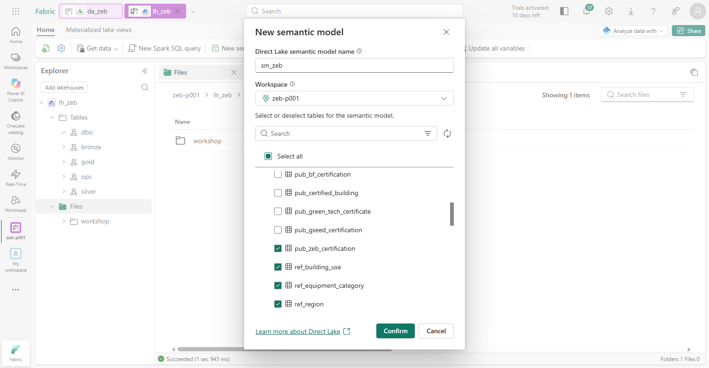
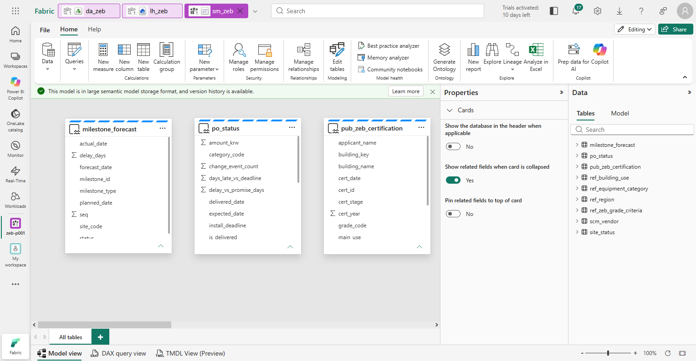
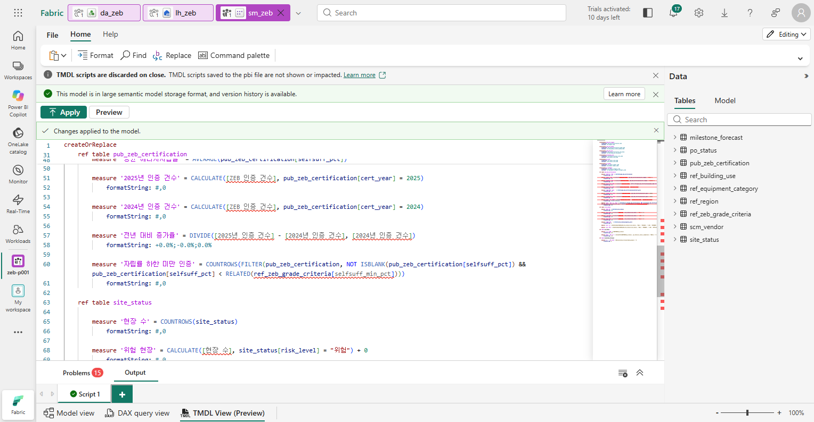
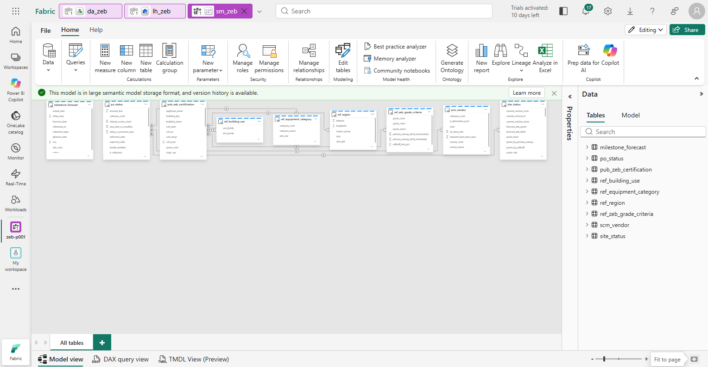
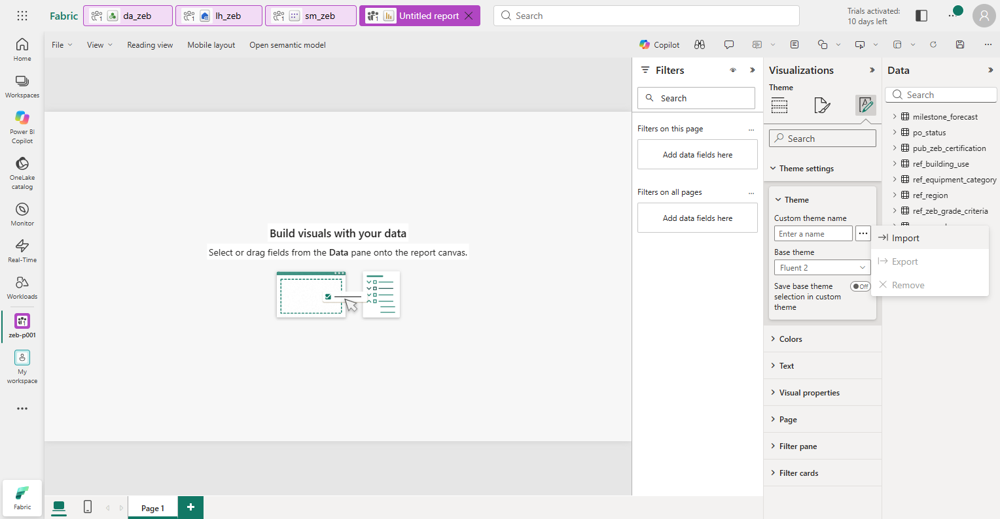
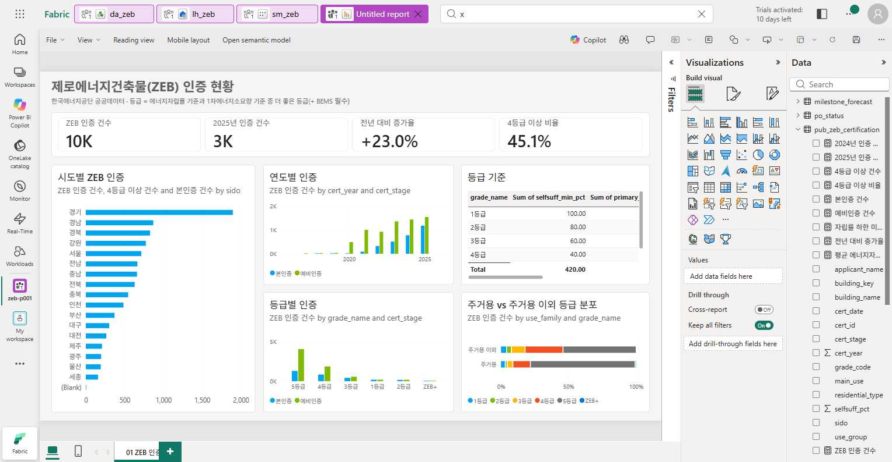
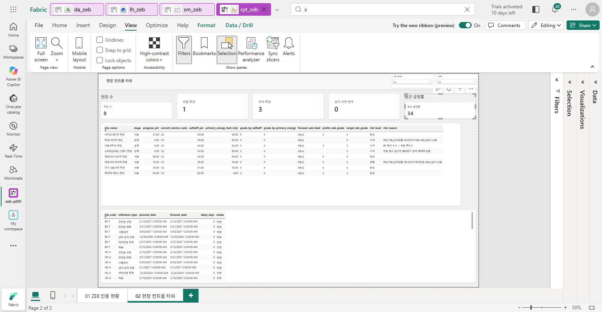
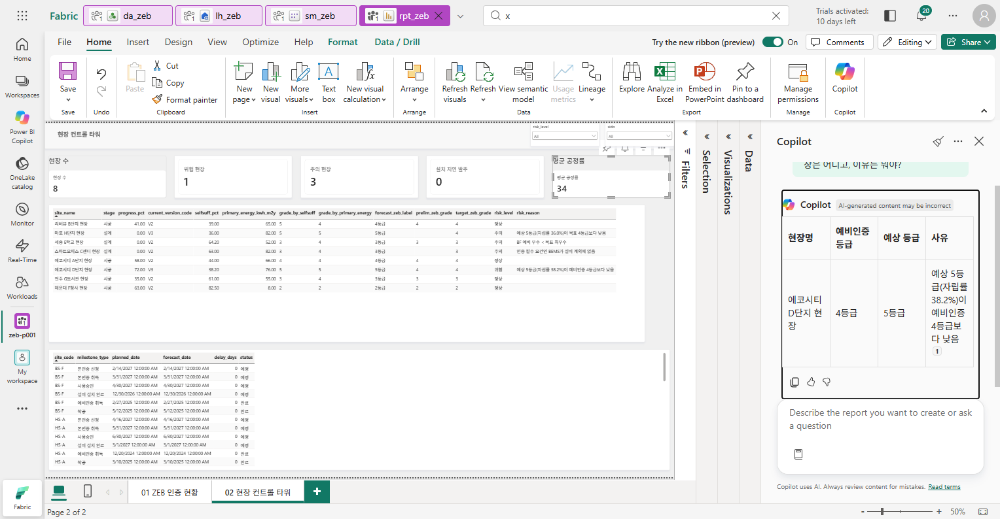

# 08. Power BI

[목차](../README.md) \| 이전: [07. Data agent](07-data-agent.md) \| 다음: [09. Foundry agent (선택)](09-foundry-agent.md)

공공 인증 현황과 현장 위험을 보고서로 확인합니다. 이 장의 목표는 **전국 ZEB 인증 현황과 우리 현장의 예상 등급·위험을 두 페이지로 설명하는 것**입니다.

**Gold·ops 테이블로 모델 만들기 → 관계·측정값 적용 → 1페이지 직접 만들기 → 저장 → Copilot으로 2페이지 생성 → 질문과 인사이트 확인** 순서로 진행합니다.

| 페이지 | 확인할 업무 질문 |
|---|---|
| 01 ZEB 인증 현황 — 직접 배치 | 전국 ZEB 인증은 몇 건이고 어디에 많은가? 등급·연도·주거 구분별로 어떻게 분포하는가? 등급 기준값은 무엇인가? |
| 02 현장 컨트롤 타워 — Copilot으로 생성 | 우리 현장 8곳의 예상 등급은 예비인증·목표 등급을 지키는가? 위험 현장과 사유는 무엇인가? 인증 일정은 계획대로인가? |

## 시작 전 준비

- 05장까지 완료한 본인 `lh_zeb`: `gold` 22개, `ops` 3개 테이블
- 관리자가 준비한 **활성 유료 Fabric 용량**, Power BI Pro 또는 PPU 라이선스, 모델·보고서 작성 권한과 Copilot 설정
- 01장에서 내려받은 PC의 두 파일

| 파일 | 사용할 때 |
|---|---|
| `sm_zeb.tmdl` | 2단계에서 관계 7개와 측정값 20개를 한 번에 적용합니다. |
| `zeb-theme.json` | 3단계에서 보고서의 색, 글꼴, 배경, 테두리를 맞춥니다. |

용량·지원 지역·Copilot 설정은 [관리자 준비 가이드](../admin/README.md)와 [공식 요구 사항](https://learn.microsoft.com/power-bi/create-reports/copilot-introduction#requirements-at-a-glance)을 따릅니다.

## 1. Semantic model 만들기

보고서에 사용할 테이블 9개를 선택합니다. 저장 모드는 **Direct Lake**로, OneLake의 Delta 테이블을 가져오기(Import) 없이 바로 읽습니다.

1.  작업 영역 `zeb-p001`에서 Lakehouse `lh_zeb`를 엽니다.
2.  리본의 **New semantic model**을 누릅니다.
3.  **New semantic model** 창에 아래와 같이 입력하고 **Confirm**을 누릅니다.

    - **Direct Lake semantic model name**: `sm_zeb`
    - **Workspace**: `zeb-p001`
    - 테이블 9개를 체크합니다. 같은 이름의 테이블이 `bronze`·`silver`에도 있으므로 **스키마를 확인**하고 체크합니다. 맨 위 `bronze`의 **>** 를 눌러 접어 두면 찾기 쉽습니다.

    | 스키마 | 테이블 |
    |---|---|
    | `gold` | `pub_zeb_certification`, `ref_region`, `ref_zeb_grade_criteria`, `ref_building_use`, `scm_vendor`, `ref_equipment_category` |
    | `ops` | `site_status`, `milestone_forecast`, `po_status` |

    

**예상 결과:** `sm_zeb`가 **Model view**로 열립니다. 오른쪽 **Data** 창에 테이블 9개가 있고, 오른쪽 위는 **Editing**입니다.



## 2. 관계와 측정값 넣기

TMDL(Tabular Model Definition Language)은 모델 구성을 글로 적는 형식입니다. 제공된 `sm_zeb.tmdl`을 적용하면 **관계 7개와 측정값 20개**가 만들어집니다. 측정값은 원본 데모 보고서와 같은 정의입니다.

| 테이블 | 측정값 |
|---|---|
| `pub_zeb_certification` | `ZEB 인증 건수`, `본인증 건수`, `예비인증 건수`, `4등급 이상 건수`, `4등급 이상 비율`, `평균 에너지자립률`, `2025년 인증 건수`, `2024년 인증 건수`, `전년 대비 증가율`, `자립률 하한 미만 인증` |
| `site_status` | `현장 수`, `위험 현장`, `주의 현장`, `정상 현장`, `평균 공정률`, `상태 색`, `상태 배경` |
| `po_status` | `발주 건수`, `설치 지연 발주` |
| `milestone_forecast` | `최대 지연 일수` |

1.  화면 아래 **TMDL View (Preview)** 탭을 누릅니다. **Edit your model with TMDL** 안내가 나오면 **Try it now**를 누릅니다.
2.  PC의 `sm_zeb.tmdl`을 메모장으로 열고 **Ctrl+A**, **Ctrl+C**로 전체를 복사합니다.
3.  TMDL 편집기의 1행을 누르고 **Ctrl+V**로 붙여 넣습니다. 1행이 `createOrReplace`입니다.
4.  편집기 위 **Apply**를 누릅니다.

    붙여 넣은 직후 아래 **Problems**에 `Cannot find name '[ZEB 인증 건수]'` 같은 경고가 15개쯤 보입니다. 같은 스크립트 안에서 아직 만들어지지 않은 측정값을 참조해서 생기는 경고이므로 그대로 **Apply**합니다.

    **예상 결과:** 편집기 위에 **Changes applied to the model.**이 보입니다.

    

5.  화면 아래 **Model view** 탭을 누르고, 오른쪽 아래 **Fit to page**를 눌러 전체를 봅니다.

6.  **관계를 계산하도록 모델을 새로 고칩니다.** 새 관계는 새로 고침 전까지 데이터가 없어서, 보고서에 *"…relationship … needs to be recalculated"* 오류가 납니다. 위쪽 탭에서 작업 영역 `zeb-p001`로 가서 `sm_zeb` 행의 이름 오른쪽 **새로 고침 아이콘(Refresh now)** 을 누르고, 1분쯤 뒤 `sm_zeb` 탭으로 돌아옵니다.

**예상 결과:** `pub_zeb_certification`이 `ref_region`·`ref_zeb_grade_criteria`·`ref_building_use`와, `milestone_forecast`·`po_status`가 `site_status`와, `po_status`가 `scm_vendor`·`ref_equipment_category`와 관계선으로 이어집니다.



## 3. 보고서 만들기와 테마 적용

1.  리본의 **New report**를 누릅니다. 새 탭에 빈 보고서가 편집 화면으로 열립니다.
2.  위쪽 **View** 메뉴 → **Theme** → **Open theme format pane.**을 누릅니다. 오른쪽 **Theme settings** → **Theme**의 **Custom theme name** 옆 **…** → **Import**를 누르고 PC의 `zeb-theme.json`을 엽니다.

    

    **예상 결과:** **Custom theme name**에 `ZEB Contoso`가 표시됩니다.

3.  캔버스 바깥 회색 영역을 누르고 **Visualizations** 창 → **Format page**(두 번째 아이콘) → **Canvas settings**에서 **Size**를 **1280 x 720 (HD)** 로 바꿉니다. 새 보고서의 기본값은 1920 x 1080이고, 이 장의 위치·크기 값은 1280 × 720을 기준으로 합니다.

## 4. 1페이지: ZEB 인증 현황

공공 ZEB 인증 9,760건의 분포를 **카드·차트·표로 직접 배치**합니다. 시각적 개체를 추가할 때는 아래 두 가지를 반복합니다.

- **필드 넣기:** 캔버스 바깥 회색 영역을 눌러 선택을 해제하고 **Build visual**에서 시각적 개체를 고른 뒤, **Data** 창의 필드를 **Build visual**의 칸(**X-axis**, **Y-axis**, **Legend** 등)으로 끌어 넣습니다. 같은 열 이름(`sido` 등)이 여러 테이블에 있으므로 **테이블을 확인**하고 끌어 넣습니다.
- **위치·크기 맞추기:** **Format visual → General → Properties**의 **Size**(Height, Width)와 **Position**(Horizontal, Vertical)에 안내된 값을 입력합니다.

1.  아래쪽 **Page 1** 탭을 두 번 누르고 `01 ZEB 인증 현황`을 입력합니다.

2.  **제목** — 도구 모음의 **Text box**를 누르고 두 줄을 입력합니다. 첫 줄은 크기 `20`·굵게, 둘째 줄은 크기 `11`로 합니다.

    ``` text
    제로에너지건축물(ZEB) 인증 현황
    한국에너지공단 공공데이터 · 등급 = 에너지자립률 기준과 1차에너지소요량 기준 중 더 좋은 등급(+ BEMS 필수)
    ```

    위치와 크기: Height `66`, Width `1232`, Horizontal `24`, Vertical `10`

3.  **카드** — **Card**를 고르고 `pub_zeb_certification`의 측정값 4개를 차례로 체크해 **Value**에 넣습니다: `ZEB 인증 건수`, `2025년 인증 건수`, `전년 대비 증가율`, `4등급 이상 비율`. 카드 하나에 값 4개가 나란히 표시됩니다.

    위치와 크기: Height `92`, Width `1232`, Horizontal `24`, Vertical `84`

4.  **시도별 인증** — **Clustered bar chart**를 고릅니다.

    - **Y-axis**: `ref_region`의 `sido`
    - **X-axis**: `ZEB 인증 건수`
    - **Tooltips**: `4등급 이상 건수`, `본인증 건수`
    - 기본으로 `ZEB 인증 건수` 내림차순입니다. 다르면 차트 오른쪽 위 **…** → **Sort axis**에서 바꿉니다.
    - 제목: **Format visual → General → Title → Text**에 `시도별 ZEB 인증`을 입력합니다. 표처럼 Title이 **Off**인 개체는 먼저 켭니다.
    - 위치와 크기: Height `512`, Width `420`, Horizontal `24`, Vertical `192`

5.  **연도별 인증** — **Clustered column chart**를 고릅니다.

    - **X-axis**: `pub_zeb_certification`의 `cert_year`. 날짜 계층이 생기면 `cert_year` 자체를 고릅니다.
    - **Y-axis**: `ZEB 인증 건수`, **Legend**: `cert_stage`
    - 제목: `연도별 인증`
    - 위치와 크기: Height `248`, Width `392`, Horizontal `460`, Vertical `192`

6.  **등급 기준** — **Table**을 고르고 `ref_zeb_grade_criteria`의 `grade_name`, `selfsuff_min_pct`, `primary_energy_limit_residential`, `primary_energy_limit_nonresidential`을 넣습니다. 숫자 열은 **Build visual**의 필드 메뉴(**▼**)에서 **Don't summarize**를 고릅니다.

    - 제목: `등급 기준`
    - 위치와 크기: Height `248`, Width `388`, Horizontal `868`, Vertical `192`

7.  **등급별 인증** — **Clustered column chart**를 고릅니다.

    - **X-axis**: `ref_zeb_grade_criteria`의 `grade_name`, **Y-axis**: `ZEB 인증 건수`, **Legend**: `cert_stage`
    - 제목: `등급별 인증`
    - 위치와 크기: Height `248`, Width `392`, Horizontal `460`, Vertical `456`

8.  **주거 구분별 등급 분포** — **100% stacked bar chart**를 고릅니다.

    - **Y-axis**: `ref_building_use`의 `use_family`, **X-axis**: `ZEB 인증 건수`, **Legend**: `ref_zeb_grade_criteria`의 `grade_name`
    - 제목: `주거용 vs 주거용 이외 등급 분포`
    - 위치와 크기: Height `248`, Width `388`, Horizontal `868`, Vertical `456`

**예상 결과:** 카드에 `10K`, `3K`, `+23.0%`, `45.1%`가 보입니다. 큰 수는 자동으로 천 단위(K)로 줄여 표시되며, 실제 값은 `9,760`, `2,732`입니다(카드에 마우스를 올려 확인). 시도별 차트는 경기(1,897)가 가장 길고, 등급별 차트는 5등급(5,359)·4등급(2,697) 순으로 많습니다. 주거용은 285건, 주거용 이외는 9,475건입니다. 등급 기준 표의 4등급 행은 `40`, `70`, `90`입니다.



시각적 개체를 하나씩 눌러 **Build visual**에 넣은 필드가 위와 같은지 확인합니다. 등급 축은 이름순이라 `ZEB+`가 맨 뒤에 올 수 있습니다. 순서는 이 장의 확인 대상이 아닙니다.

## 5. 저장

1.  도구 모음의 **Save this report**(디스크 아이콘)를 누릅니다.
2.  작업 영역 `zeb-p001`을 고르고 이름 `rpt_zeb`를 입력한 뒤 **Save**를 누릅니다.

**예상 결과:** **Report saved** 알림이 보이고 보고서가 읽기 보기로 바뀝니다. 오른쪽 위 **Viewing ▾** → **Editing**을 눌러 편집을 이어 갑니다.

## 6. Copilot으로 현장 컨트롤 타워 페이지 만들기

2페이지는 직접 배치하지 않고 **Copilot에게 생성하도록 요청**합니다. 생성된 화면을 그대로 정답으로 받아들이지 않고, 05장의 현장 상태와 필드 연결을 확인합니다.

1.  보고서가 편집 보기(**Editing**)인지 확인하고 리본 오른쪽 **Copilot**을 눌러 Copilot 창을 엽니다.

2.  아래 입력 칸에 다음을 입력하고 Enter를 누릅니다.

    ``` text
    현장 컨트롤 타워 보고서 페이지를 만들어줘. site_status 테이블을 중심으로, 위쪽에 현장 수, 위험 현장, 주의 현장, 설치 지연 발주, 평균 공정률 측정값 카드를 두고, 현장별로 site_name, stage, progress_pct, current_version_code, selfsuff_pct, primary_energy_kwh_m2y, grade_by_selfsuff, grade_by_primary_energy, forecast_zeb_label, prelim_zeb_grade, target_zeb_grade, risk_level, risk_reason을 집계하지 않은 표로 보여줘. 아래에는 milestone_forecast의 현장별 인증 일정(milestone_type, planned_date, forecast_date, delay_days, status) 표를 넣어줘.
    ```

3.  생성이 끝나면 기존 `01 ZEB 인증 현황` 페이지가 유지되고 **새 페이지가 추가되었는지** 확인합니다. 새 페이지 이름을 `02 현장 컨트롤 타워`로 바꿉니다. 시각적 개체의 종류와 배치는 생성 결과에 따라 다릅니다.

    카드만 만들고 표가 빠지는 경우가 많습니다. 그러면 같은 Copilot 창에 `이 페이지에 표 두 개를 추가해줘. 하나는 site_status의 현장별 (위 열 목록)을 집계하지 않은 표이고, 다른 하나는 milestone_forecast의 site_code, milestone_type, planned_date, forecast_date, delay_days, status 표야.`처럼 보완을 요청합니다. 개체가 겹치면 **View → Selection**으로 개체를 골라 **Format visual → General → Properties**에서 위치·크기를 조정합니다. Copilot이 만든 페이지는 1920 × 1080일 수 있습니다.

    

4.  카드를 하나씩 선택하고 **Build visual**의 값이 아래 **기존 측정값**에 연결되어 있는지 확인합니다.

    | 카드 | 사용할 측정값 | 확인할 값 |
    |---|---|---|
    | 현장 수 | `site_status[현장 수]` | `8` |
    | 위험 현장 | `site_status[위험 현장]` | `1` |
    | 주의 현장 | `site_status[주의 현장]` | `3` |
    | 설치 지연 발주 | `po_status[설치 지연 발주]` | `0` |
    | 평균 공정률 | `site_status[평균 공정률]` | `34` |

    `Count of site_code` 같은 자동 집계가 아니라 **기존 측정값**이어야 합니다. 맞는 숫자가 보이는 것만으로 연결을 확인한 것으로 간주하지 않습니다.

5.  현장 표에서 `에코시티 D단지 현장`의 행을 찾습니다.

    **확인할 값:** 현행 설계안 `V3`, 자립률 `38.2`, 1차에너지 `76`, 두 기준 등급 `5`·`5`, 예상 `5등급`, 예비 `4`, 목표 `4`, 상태 `위험`, 사유 `예상 5등급(자립률 38.2%)이 예비인증 4등급보다 낮음`. `리버뷰 B단지 현장`은 자립률 기준 `5`, 1차에너지 기준 `4`, 예상 `4등급`, `정상`입니다.

6.  숫자 열이 합계(Sum)로 집계되었거나 카드가 겹치면 아래 Troubleshooting으로 보완합니다. **Ctrl+S**로 저장합니다.

**예상 결과:** 현장 8곳의 예상 등급·위험과 인증 일정을 보여 주는 2페이지가 있고, 카드 5개가 기존 측정값에 연결되어 `8`, `1`, `3`, `0`, `34`를 표시합니다.

## 7. Copilot에게 질문하고 인사이트 얻기

답을 비교하기 쉽도록 **질문을 한 번에 하나씩** 합니다.

1.  `02 현장 컨트롤 타워` 페이지에서 `예비인증 등급보다 예상 등급이 낮은 현장은 어디고, 이유는 뭐야?`를 묻습니다.

    **예상 결과:** `에코시티 D단지 현장`. 현행 V3 자립률 38.2%·1차에너지 76으로 예상 5등급, 예비인증 4등급보다 낮음. 05장·07장과 같습니다.

    

2.  이어서 `이 보고서 페이지의 핵심 인사이트를 요약해줘`를 묻습니다.

    **비교할 기준:** 8개 현장 중 위험 1곳(D단지, 예비 등급 미달), 주의 3곳(마포 H단지 목표 등급 미달, 세종 E학교 BF 목표 미달, 스마트오피스 C센터 BEMS 미계획), 설치 지연 발주 0건. 리버뷰 B단지는 자립률이 40% 미만이지만 1차에너지 기준으로 4등급을 유지합니다. 표현은 달라도 수치·대상이 다르면 정답으로 처리하지 않습니다.

3.  `01 ZEB 인증 현황` 페이지로 가서 `자립률이 그 등급의 자립률 하한보다 낮은데도 그 등급을 받은 ZEB 인증은 몇 건이야?`를 묻습니다.

    **예상 결과:** `176`건(`자립률 하한 미만 인증` 측정값). 자립률이 낮아도 **1차에너지소요량 기준으로 등급을 받을 수 있기 때문**입니다. 리버뷰 B단지와 같은 경우가 공공 데이터에도 있다는 뜻입니다.

## 이 장의 완료 기준

- 본인 작업 영역에 `sm_zeb`(테이블 9개·관계 7개·측정값 20개)와 저장된 `rpt_zeb`가 있습니다.
- 직접 만든 **01 ZEB 인증 현황**에서 카드 `10K`(9,760), `3K`(2,732), `+23.0%`, `45.1%`와 시도·연도·등급·주거 구분 분포를 확인했습니다.
- **Copilot으로 생성한 02 현장 컨트롤 타워**의 카드 5개가 기존 측정값에 연결되어 `8`, `1`, `3`, `0`, `34`를 표시하고, D단지의 위험 사유를 확인했습니다.
- Copilot 질문·인사이트의 대상·수치가 05·07장 결과와 일치합니다.

이 보고서는 10장에서 승인을 반영한 뒤 다시 열어 D단지의 변화를 확인합니다.

## Troubleshooting

- **Apply** 뒤 테이블이 없다는 오류가 나면 **Model view** 리본의 **Edit tables**에서 1단계의 테이블 9개가 모두 체크되어 있는지 확인합니다. Data 창의 테이블 이름이 `site_status`처럼 스키마 없이 표시되는지도 확인합니다.
- 시각적 개체에 *Error fetching data* / *relationship … needs to be recalculated* 오류가 보이면 2단계 6번의 **Refresh now**를 하지 않은 것입니다. 새로 고친 뒤 보고서의 **Refresh visuals**를 누릅니다.
- 표에서 행을 누르면 그 행으로 다른 개체가 필터됩니다(카드 숫자가 바뀜). 같은 행을 한 번 더 누르면 풀립니다.
- Semantic model이 **Viewing**으로 열리면 오른쪽 위에서 **Editing**으로 바꿉니다.
- Copilot이 비활성화되면 작업 영역의 용량이 활성 유료 F2 이상인지, Copilot 테넌트·지역 설정이 맞는지 확인합니다. 새 용량을 Copilot이 인식하는 데 최대 24시간이 걸릴 수 있습니다.
- Copilot 표의 숫자가 합계로 보이면 `site_status의 현장별 값을 집계하지 않은 표로 다시 보여줘`라고 보완 요청합니다.
- 카드가 자동 집계(`Count of …`)이면 `카드에는 기존 site_status[위험 현장], site_status[주의 현장], po_status[설치 지연 발주] 측정값을 사용해줘`로 수정합니다. 정답 숫자를 프롬프트에 넣어 카드값만 맞추지 않습니다.
- 카드가 겹치면 **View → Selection pane**에서 카드를 선택하고 **Format visual → General → Properties**의 크기·위치를 조정합니다.

## 다음 단계

선택: [09. Foundry agent](09-foundry-agent.md)에서 Ontology에 보완안 근거를 다시 묻습니다. 건너뛰면 [10. Operations agent](10-operations-agent.md)에서 D단지 위험을 Eventhouse로 보내고 Teams로 보완안 제안을 받습니다.
