# 09. Operations agent

[목차](../README.md) \| 이전: [08. Power BI](08-power-bi.md) \| 다음: [10. Foundry agent (선택)](10-foundry-agent.md)

보고서로 D단지 위험을 확인했습니다. 운영에서는 사람이 보고서를 열기 전에 **위험을 감지해 담당자에게 알리고, 할 일을 제안**해야 합니다. 이 장에서는 **Operations agent가 D단지 위험과 추천 보완안을 Teams로 제안**하도록 만듭니다. 승인은 11장에서 합니다.

| 항목 | 역할 |
|---|---|
| Eventhouse `eh_zeb` | 위험 이벤트의 상태가 바뀔 때마다 `ZebRiskEvent` 테이블에 한 행씩 쌓습니다(`open` → `approved` → `resolved`). |
| Notebook `06_risk_event` | 위험 현장의 보완안을 평가해 **가장 싼 추천 보완안**을 정하고, 위험 이벤트를 `open`으로 Eventhouse에 보냅니다. |
| Operations agent `oa_zeb` | `ZebRiskEvent`를 약 5분마다 조회해 `event_status`가 `open`이 된 이벤트를 찾고, Teams로 알리며 조치를 추천합니다. |
| Notebook `nb_apply_decision` | 담당자가 Teams에서 승인하면 실행됩니다. 조치를 기록하고 Silver·Gold를 다시 계산합니다(11장). |

Operations agent가 감시하는 것은 Lakehouse가 아니라 **Eventhouse의 `ZebRiskEvent`**입니다. Gold·ops의 위험을 Notebook이 **명시적으로 전송**합니다. 자동 수집 파이프라인을 만드는 단계는 아닙니다.

**시작 전:** 05장의 `ops.site_status`가 있어야 합니다. 작업 영역 Contributor 이상, KQL 데이터베이스·Notebook 작업 권한, Teams 라이선스와 **Fabric Operations Agent** 앱 사용 권한이 필요합니다([공식 요구 사항](https://learn.microsoft.com/fabric/real-time-intelligence/operations-agent#prerequisites)).

## 1. Eventhouse 만들기

1.  작업 영역 `zeb-p001`에서 **+ New item**을 누르고 `Eventhouse`를 검색해 **Eventhouse**를 고릅니다. 한국어 UI에서는 `이벤트하우스`로 검색합니다.
2.  **Eventhouse name**에 `eh_zeb`를 입력하고 **Create**를 누릅니다.

**예상 결과:** Eventhouse가 열리고 같은 이름의 KQL 데이터베이스 `eh_zeb`가 만들어집니다(1분 이내).

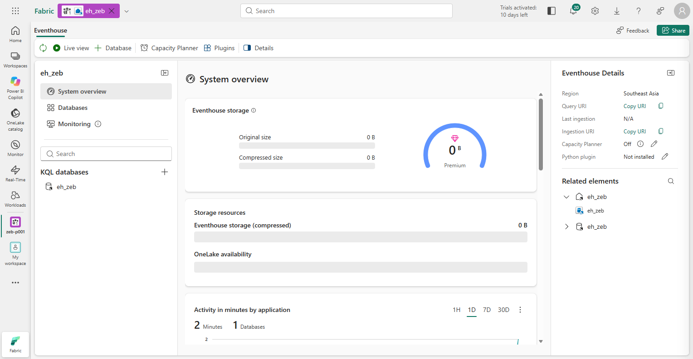

## 2. ZebRiskEvent 테이블 만들기

이 테이블은 **상태 이력**입니다. 같은 `event_id`의 상태가 바뀔 때 새 행을 추가하고, 시간 열 `status_time`으로 순서를 구분합니다.

1.  KQL 데이터베이스 `eh_zeb`에 연결된 Queryset `eh_zeb_queryset`을 엽니다. 없으면 데이터베이스에서 **New KQL queryset**을 만들고 대상이 `eh_zeb`인지 확인합니다.
2.  편집 창의 내용을 지우고 아래 명령을 붙여 넣은 뒤 **Run**을 누릅니다.

    ``` text
    .create-merge table ZebRiskEvent (
        event_id: string,
        status_time: datetime,
        event_status: string,
        site_code: string,
        site_name: string,
        risk_reason: string,
        prelim_grade: string,
        forecast_grade: string,
        selfsuff_pct: real,
        recommended_option_id: string,
        recommended_option_name: string,
        option_cost_krw: long,
        expected_selfsuff_pct: real,
        expected_grade: string)
    ```

    | 열 | 뜻 |
    |---|---|
    | `event_id`, `status_time`, `event_status` | 위험 이벤트 ID, 상태가 바뀐 시각, 상태(`open` 대응 전, `approved` 담당자 승인, `resolved` 위험 해소) |
    | `site_code`, `site_name`, `risk_reason` | 위험 현장과 사유 |
    | `prelim_grade`, `forecast_grade`, `selfsuff_pct` | 예비인증 등급, 현재 예상 등급과 자립률 |
    | `recommended_option_id`, `recommended_option_name`, `option_cost_krw` | 추천 보완안과 비용 |
    | `expected_selfsuff_pct`, `expected_grade` | 추천 보완안을 적용했을 때의 자립률과 예상 등급 |

**예상 결과:** 결과 창에 `ZebRiskEvent` 한 행이 보이고, 왼쪽 **Tables** 아래에 `ZebRiskEvent`가 생깁니다.

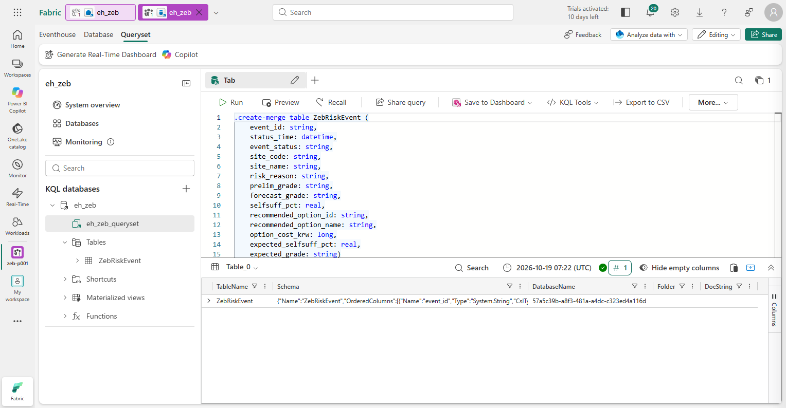

## 3. 승인 반영 Notebook 확인

승인할 때 실행할 `nb_apply_decision`을 먼저 확인합니다. Operations agent가 넘기는 `event_id`, `option_id`로 위험 이벤트를 확인한 뒤 **조치 기록 → Eventhouse `approved` → Silver·Gold 재계산 → `resolved`**를 차례로 처리합니다. **지금은 열어서 확인만 하고 실행하지 않습니다.**

1.  작업 영역에서 `nb_apply_decision`을 엽니다.
2.  **Explorer**에서 기본 Lakehouse가 본인 `lh_zeb`인지 확인합니다(01장 4단계).
3.  **1. 매개 변수** 셀이 **parameters 셀**이고 `event_id`, `option_id` 두 변수가 있는지 확인합니다.

**예상 결과:** 기본 Lakehouse가 `lh_zeb`이고, parameters 셀에 `event_id = "ZEB-HS-D-20260930"`, `option_id = "OPT-D2"`가 있습니다. 이 값은 직접 실행할 때의 기본값이며, 에이전트는 이벤트의 값을 넘깁니다.

## 4. Operations agent 만들기

1.  작업 영역에서 **+ New item** → **Operations agent**(한국어 UI: **운영 에이전트**)를 고릅니다. **Name**에 `oa_zeb`를 입력하고 **Create**를 누릅니다. **Welcome** 창은 **X**로 닫습니다.

2.  **Agent instructions**에 아래 지침을 붙여 넣습니다. 감시할 열을 `ZebRiskEvent.event_status`처럼 테이블 이름과 함께 적어야 에이전트가 규칙을 만들 때 열을 찾습니다.

    ``` text
    Contoso 건설의 제로에너지건축물(ZEB) 인증 위험 이벤트를 감시합니다.

    감시 대상: KQL 데이터베이스 eh_zeb의 ZebRiskEvent 테이블
    - 위험 이벤트 ID: ZebRiskEvent.event_id
    - 상태가 바뀐 시각: ZebRiskEvent.status_time
    - 상태: ZebRiskEvent.event_status ("open", "approved", "resolved")
    - 추천 보완안 ID: ZebRiskEvent.recommended_option_id
    - 알림에 넣을 값: ZebRiskEvent.site_name, ZebRiskEvent.risk_reason, ZebRiskEvent.prelim_grade, ZebRiskEvent.forecast_grade, ZebRiskEvent.selfsuff_pct, ZebRiskEvent.recommended_option_name, ZebRiskEvent.option_cost_krw, ZebRiskEvent.expected_selfsuff_pct, ZebRiskEvent.expected_grade

    규칙: 위험 이벤트(event_id)의 event_status가 "open"이 되면 담당자에게 Teams로 알리고 ApplyZebOption 조치를 추천합니다.
    ApplyZebOption의 event_id에는 ZebRiskEvent.event_id를, option_id에는 ZebRiskEvent.recommended_option_id를 넣습니다.
    메시지에는 현장, 위험 사유, 예비인증 등급과 현재 예상 등급, 추천 보완안과 비용, 적용 후 예상 자립률·등급을 포함합니다.
    메시지는 한국어로 씁니다.
    ```

3.  **Knowledge**에서 **Add data** 옆 아래 화살표 → **Add from OneLake catalog**를 고릅니다. 오른쪽 위 **Filter by keyword**에 `eh_zeb`를 입력하고, Location이 `zeb-p001`인 `eh_zeb`를 고른 뒤 **Add**를 누릅니다.

    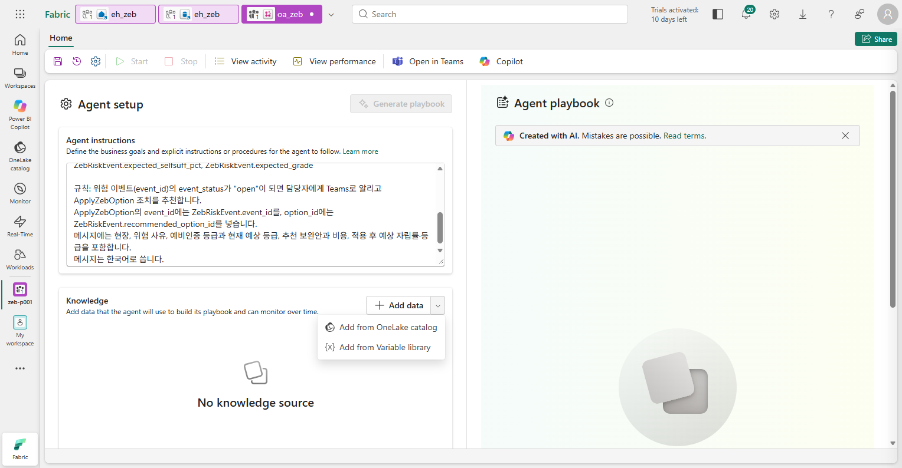

    **예상 결과:** **Knowledge**에 `eh_zeb`가 **KQL Database** 형식으로 보이고, 위쪽 **Generate playbook**이 활성화됩니다.

    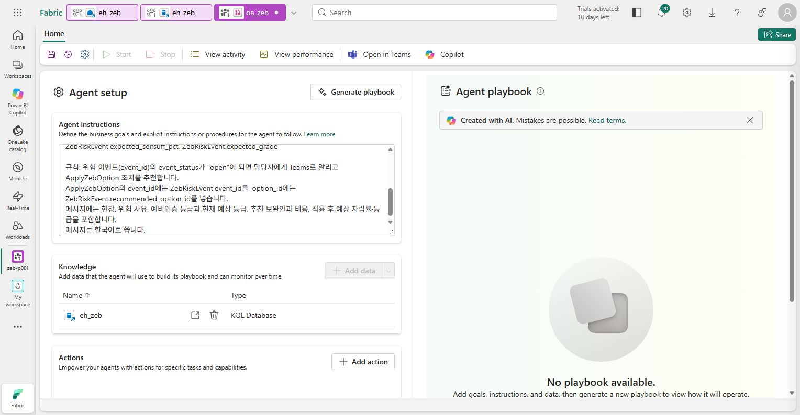

4.  **Actions**의 **Add action**을 누르고 **Select action type**에서 **Fabric item**을 고릅니다. **Browse**를 누르고 **Filter by keyword**에 `nb_apply_decision`을 입력해 Location이 `zeb-p001`인 항목을 고른 뒤 **Add**를 누릅니다.

5.  아래와 같이 입력하고 **Next**를 누릅니다. **Parameters**의 `event_id`, `option_id`는 Notebook의 parameters 셀에서 자동으로 채워집니다. **Description**만 입력합니다.

    | 입력란 | 값 |
    |---|---|
    | **Action name** | `ApplyZebOption` |
    | **Action description** | `담당자가 승인한 ZEB 등급 보완안을 반영합니다. 조치 기록을 남기고 Silver·Gold를 다시 계산해 설계안과 예상 등급을 갱신하며, ZebRiskEvent에 approved와 resolved 상태를 추가합니다. 실제 설계 변경이나 발주는 하지 않습니다.` |
    | `event_id`의 **Description** | `승인할 위험 이벤트의 event_id` |
    | `option_id`의 **Description** | `승인할 보완안 ID. 위험 이벤트의 recommended_option_id를 넣습니다.` |

    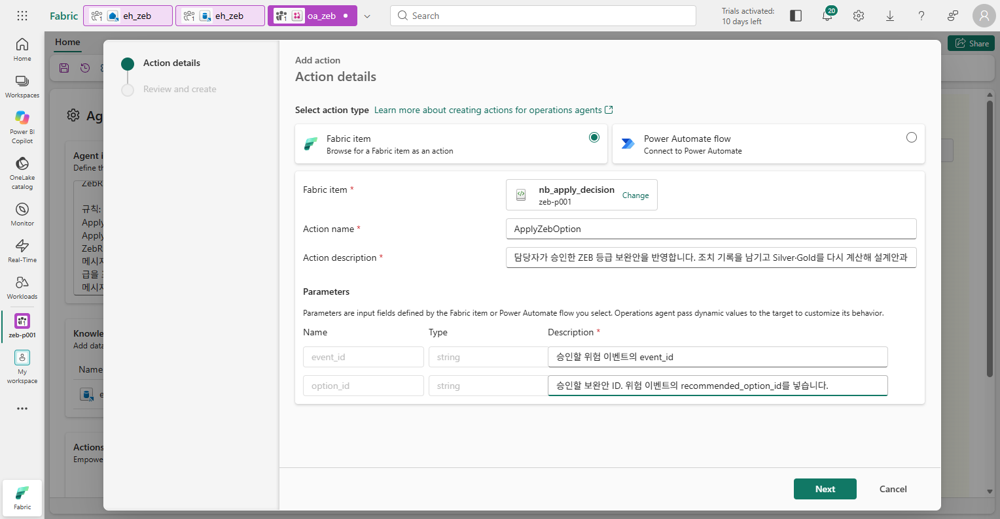

6.  **Review and create**에서 Action type `Notebook`, Item name `nb_apply_decision`, Workspace `zeb-p001`, Parameters 2개를 확인하고 **Create**를 누릅니다.

    **예상 결과:** **Actions**에 `ApplyZebOption`이 **Action connected** 상태로 보입니다.

    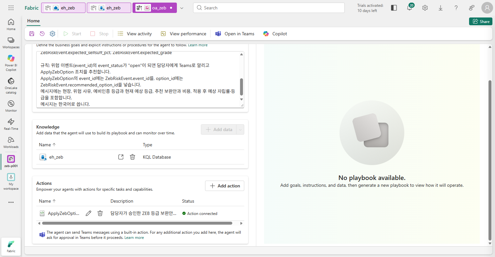

7.  도구 모음 왼쪽의 저장 아이콘을 누릅니다.

**수신자 확인:** 도구 모음의 톱니바퀴(설정) → **Agent behavior**에서 **Run as**가 본인이고, **Message delivery**가 기본값(에이전트를 만든 사람에게 메시지와 조치 요청을 보냄)인지 확인합니다. Teams에는 Fabric과 같은 계정으로 로그인합니다. 조치는 수신자가 아니라 **에이전트 생성자의 위임된 권한**으로 실행됩니다([조치·수신자 설정](https://learn.microsoft.com/fabric/real-time-intelligence/operations-agent-actions)).

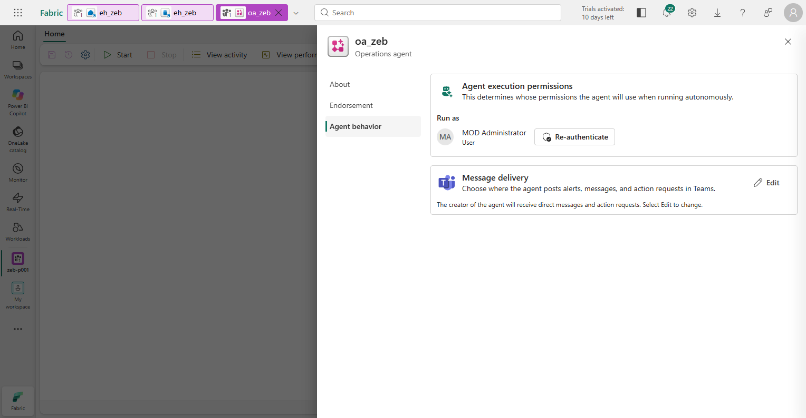

## 5. Playbook 만들기

Playbook은 Operations agent가 지침과 데이터를 읽고 만드는 감시 규칙입니다.

1.  **Agent setup**의 **Generate playbook**을 누릅니다(2–3분).

    **예상 결과:** 오른쪽 **Agent playbook**의 **Business term glossary**에 Class 하나(예: `ZebRiskEventItem`, Table `ZebRiskEvent`)가 있고, `Id`, `Timestamp`, `ZebEventStatusText`, `OptionId` 같은 속성이 `ZebRiskEvent`의 열(`event_id`, `status_time`, `event_status`, `recommended_option_id` 등)과 연결되어 있습니다. Class와 속성 이름은 생성할 때마다 다를 수 있습니다.

    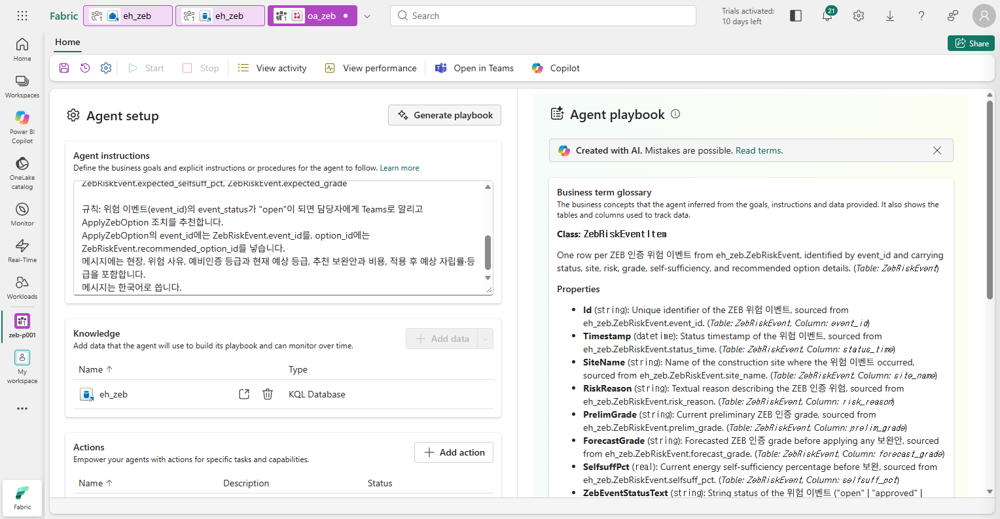

2.  **Agent playbook**을 아래로 내려 **Rules**의 규칙을 펼칩니다.

    **확인할 기준:** KQL 쿼리가 `ZebRiskEvent`를 `status_time`으로 거르고(`where ['status_time'] between (startTime .. endTime)`), ID 속성이 `event_id`에 연결되어 있어야 합니다. 조건은 상태 속성(`event_status`)이 `open`으로 **바뀔 때**입니다(`Changes To` 또는 `Becomes`). `Is open`처럼 현재 상태를 매번 평가하는 조건이면 반복 알림이 생길 수 있습니다. 규칙 이름과 개수는 생성 결과에 따라 다릅니다(예: `Zeb Risk Event Open Notify And Recommend` 1개).

    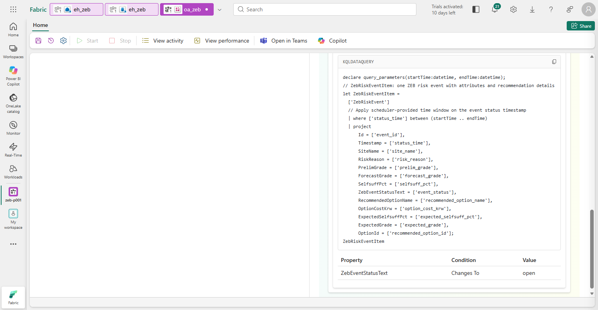

3.  저장 아이콘을 누릅니다.

**예상 결과:** 오른쪽 위에 **Configuration saved successfully**가 보이고 도구 모음의 **Start**를 누를 수 있습니다. Playbook을 만들기 전과 저장하기 전에는 **Start**가 비활성입니다.

## 6. 에이전트를 시작하고 위험 이벤트 보내기

1.  도구 모음의 **Start**를 누릅니다. **Start**가 비활성이 되고 **Stop**을 누를 수 있게 되면 감시가 시작된 것입니다(**Start**에 마우스를 올리면 `The agent is already running.`). 다음 Notebook은 **Start 뒤에** 실행합니다.

2.  작업 영역에서 `06_risk_event`를 열고 **Run all**을 누릅니다. 세션 시작을 포함해 약 2–3분 걸립니다.

    1.  **1. 보완안 평가**

        위험·주의 현장 중 보완안이 있는 D단지·H단지의 보완안을 **하나씩** 현행 설계안에 더해 예상 등급을 다시 계산합니다. 필요 등급(예비인증이 있으면 예비 등급, 없으면 목표 등급)을 회복하고(`meets_grade`), 기준일부터 준비 기간이 설비 설치 완료 계획일 안에 끝나는(`meets_schedule`) 안이 `feasible`입니다.

        **예상 결과:** `ops.option_eval 11행`과 표.

        | 현장 | 보완안 | 비용(원) | 적용 후 자립률 | 1차에너지 | 예상 등급 | 준비 완료 | feasible | 순위 |
        |---|---|---|---|---|---|---|---|---|
        | HS-D | OPT-D6 | 50,000,000 | 39.1 | 74.2 | 5등급 | 2026-10-20 | false | |
        | HS-D | OPT-D5 | 60,000,000 | 39.2 | 74.0 | 5등급 | 2026-10-30 | false | |
        | HS-D | **OPT-D2** | **230,000,000** | **41.4** | **72.5** | **4등급** | 2026-11-14 | **true** | **1** |
        | HS-D | OPT-D3 | 280,000,000 | 39.6 | 74.5 | 5등급 | 2026-12-14 | false | |
        | HS-D | OPT-D4 | 340,000,000 | 40.3 | 72.0 | 4등급 | 2026-11-19 | true | 2 |
        | HS-D | OPT-D1 | 420,000,000 | 43.5 | 70.0 | 4등급 | 2026-11-29 | true | 3 |

        H단지는 `OPT-H3`(지열 히트펌프 도입)만 목표 4등급을 회복합니다. D단지의 설치 완료 계획일은 `2026-11-30`이며, OPT-D3는 등급도 회복하지 못하고 준비도 늦습니다.

    2.  **2. 위험 이벤트와 추천 보완안**

        현장 상태가 **위험**이고 예상 등급이 예비인증 등급보다 낮은 현장마다 이벤트 1건을 만들고, 순위 1 보완안을 추천합니다.

        **예상 결과:** 1행. `ZEB-HS-D-20260930`, 에코시티 D단지 현장, 예비 `4` → 예상 `5등급`, 추천 `OPT-D2` 주차장 캐노피 태양광(+90kW), `230,000,000`원, 적용 후 자립률 `41.4` → `4등급`, 상태 `open`

    3.  **3. Eventhouse로 보내기**

        **예상 결과:** `ZEB-HS-D-20260930: ZebRiskEvent에 open 추가` 한 줄과, Eventhouse에서 다시 읽은 1행 표.

        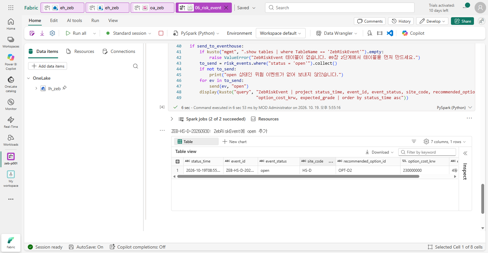

3.  `eh_zeb_queryset`에서 아래 쿼리로 Eventhouse 쪽도 확인합니다.

    ``` text
    ZebRiskEvent
    | project status_time, event_id, event_status, site_name, recommended_option_id, option_cost_krw, expected_grade
    | order by status_time asc
    ```

**예상 결과:** 1행. `ZEB-HS-D-20260930`, `open`, `에코시티 D단지 현장`, `OPT-D2`, `230000000`, `4등급`

## 7. Teams 제안 확인

1.  Teams에서 **Fabric operations agent** 채팅을 엽니다. 에이전트는 약 5분마다 조회하며, 메시지 생성·전송 시간이 더해질 수 있습니다. 이전 실습이나 다른 에이전트의 메시지가 있으면 맨 아래의 `oa_zeb` 메시지를 봅니다.

    **예상 결과:** `oa_zeb`가 보낸 카드의 제목이 규칙 이름(예: `Zeb Risk Event Open Notify And Recommend`)이고, 본문에 위험 이벤트 `ZEB-HS-D-20260930`이 `open`이 되었고 추천 보완안이 `OPT-D2`라는 내용이 있습니다. **Recommended action**에 `ApplyZebOption`과 설명이 있고, 아래에 **Proceed**, **Investigate further (preview)**, **Dismiss**, **Ask a question** 버튼이 있습니다. 메시지 문장은 AI가 만들므로 다를 수 있고, 현장 이름이나 비용이 빠질 수도 있습니다.

    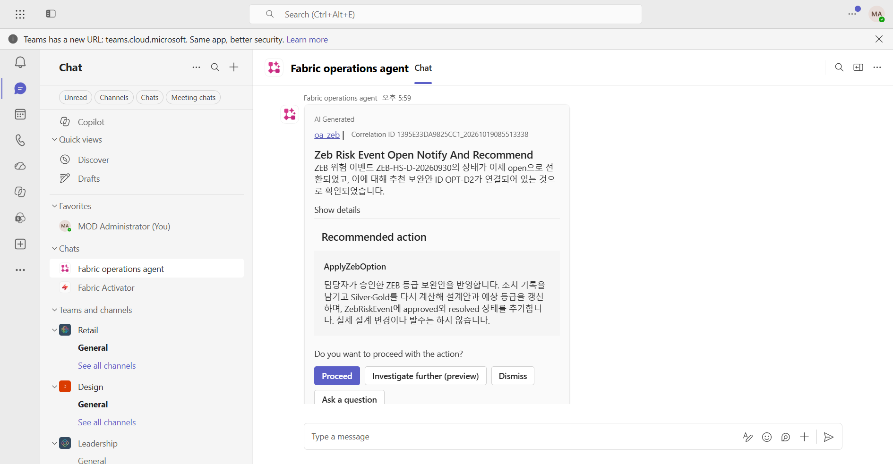

2.  카드의 **Show details**를 눌러 근거를 확인합니다.

    **예상 결과:** 이벤트 ID 속성(예: `Id`)은 `ZEB-HS-D-20260930`, 상태 속성(예: `ZebEventStatusText`)은 `open`, 보완안 속성(예: `OptionId`)은 `OPT-D2`입니다. **Rule Condition**에 Playbook 규칙이, **Data Source**에 `eh_zeb`가 보입니다. 속성 이름은 5단계 Playbook의 이름을 따릅니다.

    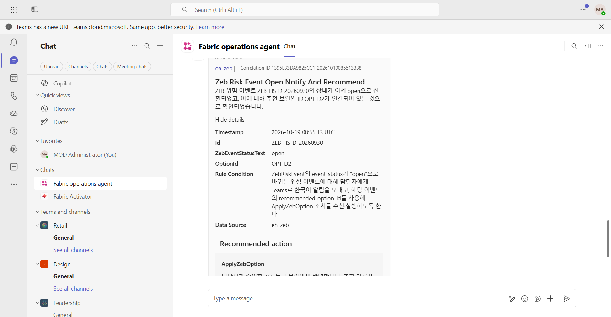

3.  **아직 Proceed·Confirm을 누르지 않습니다.** 승인하기 전에 근거를 검토합니다.

    - 07장 Q8과 이 장의 `ops.option_eval`에서 **OPT-D2가 등급을 회복하는 가장 싼 안**인지 확인합니다.
    - 시간이 있으면 [10. Foundry agent (선택)](10-foundry-agent.md)에서 Ontology에 근거를 다시 묻습니다.
    - 검토가 끝나면 [11. 승인과 반영](11-approval.md)으로 갑니다. 에이전트나 위험 이벤트를 새로 만들거나 다시 보내지 않습니다.

## 이 장의 완료 기준

`eh_zeb`의 `ZebRiskEvent`에 `open` 행 1개가 있고, `oa_zeb`가 **시작 상태**이며 `ApplyZebOption`이 **Action connected**입니다. Teams에서 D단지 위험과 추천 보완안 `OPT-D2`의 제안을 받았고, **아직 승인하지 않았습니다.**

## Troubleshooting

- **Generate playbook** 뒤 **No playbook generated**가 보이면 지침에 `ZebRiskEvent.event_status`처럼 테이블 이름과 열 이름이 있는지, **Knowledge**가 `eh_zeb`인지 확인하고 저장한 뒤 다시 누릅니다.
- 데이터 원본이 요청을 제한한다는 안내(rate-limiting)가 보이면 1–2분 뒤 다시 **Generate playbook**을 누릅니다.
- **Start**를 누를 수 없으면 Playbook을 만든 뒤 저장했는지 확인합니다.
- `06_risk_event`에서 `ZebRiskEvent 테이블이 없습니다` 오류가 나면 2단계를 먼저 실행합니다. `eh_zeb Eventhouse가 정확히 1개 있어야 합니다` 오류는 1단계 이름을 확인합니다.
- `open 상태인 위험 이벤트가 없어 보내지 않았습니다`가 나오면 이미 승인·해소된 이벤트입니다. 11장을 마친 상태라면 정상입니다.
- Teams 채팅 목록에 **Fabric operations agent**가 없으면 Teams 왼쪽 **앱**에서 `Fabric Operations Agent`를 검색해 추가합니다.
- 10분이 지나도 메시지가 오지 않으면 에이전트가 시작 상태인지, `06_risk_event`를 **Start 뒤에** 실행했는지 확인합니다. 도구 모음의 **View activity**에서 규칙 실행 기록을 봅니다.
- 반복 실습에서 새 알림이 필요하면 **Stop**한 뒤, 실습 전용 이력이 필요 없을 때만 `.clear table ZebRiskEvent data`로 지우고 [관리자 준비 가이드](../admin/README.md)의 초기화 순서를 따릅니다.
- 승인 요청은 3일 안에 응답하지 않으면 만료됩니다.

## 다음 단계

- 선택: [10. Foundry agent](10-foundry-agent.md)에서 승인 전에 근거를 다시 검토합니다.
- 필수: [11. 승인과 반영](11-approval.md)에서 Teams 제안을 승인하고 결과를 확인합니다.
