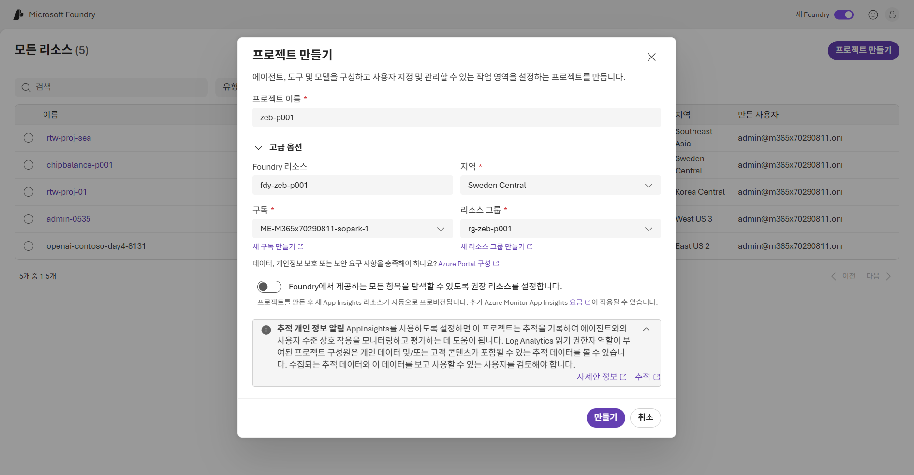
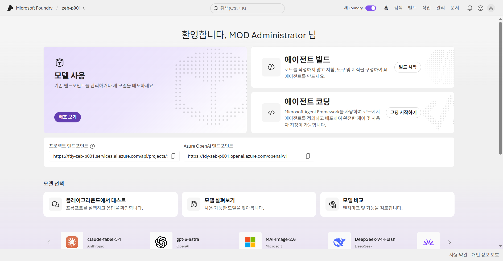
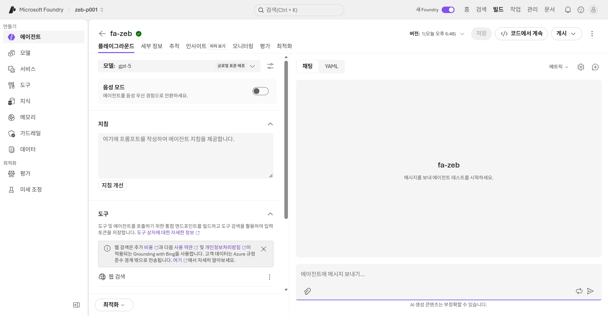
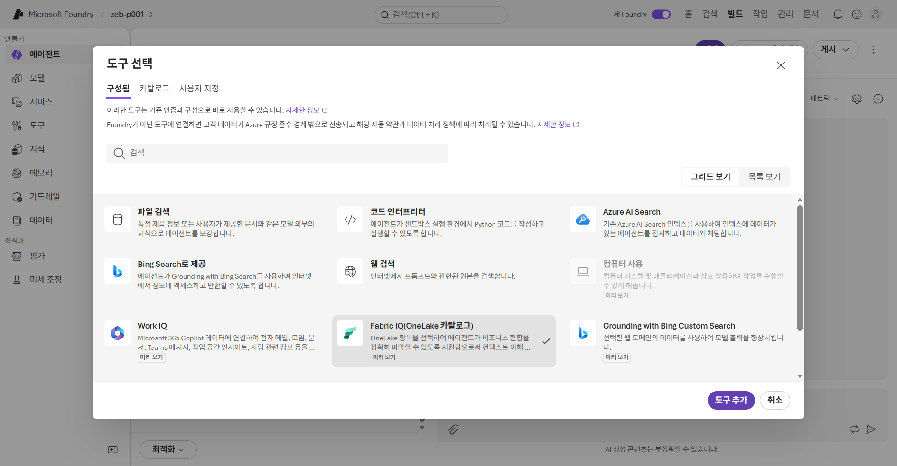
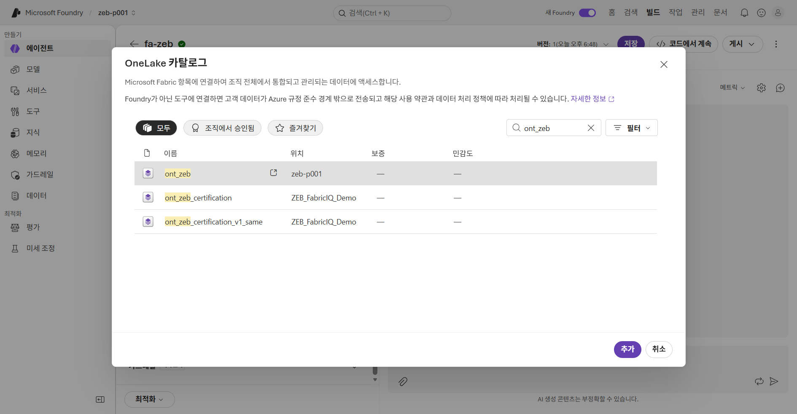
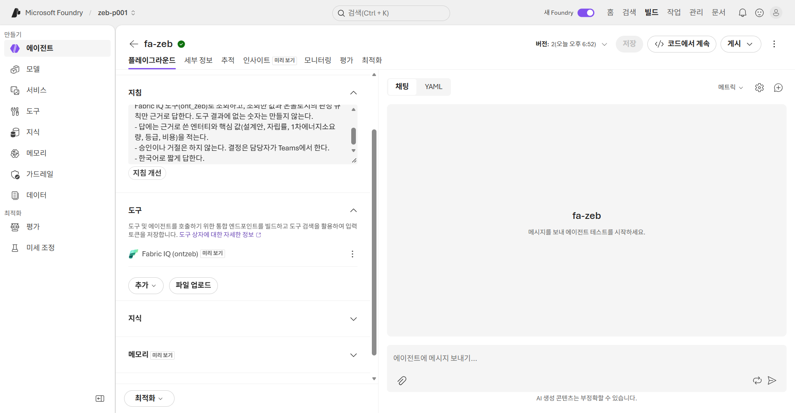
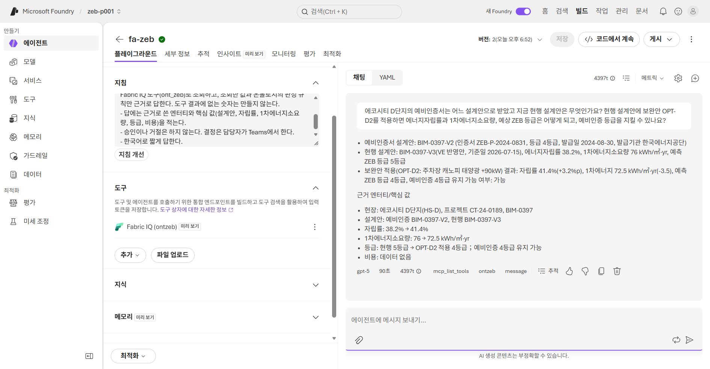
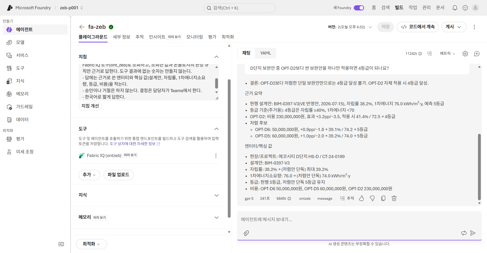
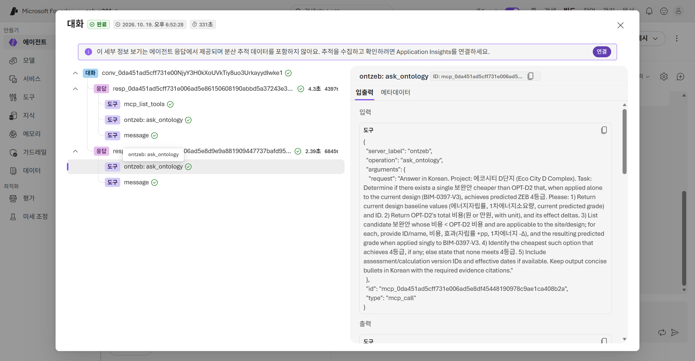
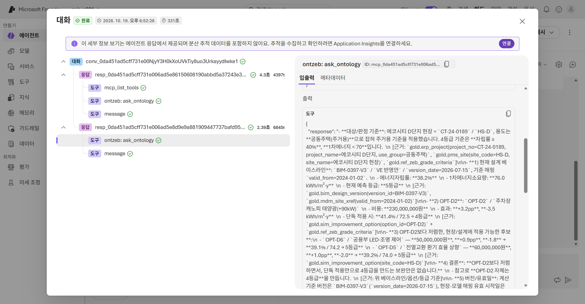

# 10. Foundry agent (선택)

[목차](../README.md) \| 이전: [09. Operations agent](09-operations-agent.md) \| 다음: [11. 승인과 반영](11-approval.md)

Teams에 도착한 `OPT-D2`를 승인하기 전에, **다른 경로로 근거를 한 번 더 확인**합니다. Microsoft Foundry에 `fa-zeb`를 만들고 **Fabric IQ** 도구로 06장의 `ont_zeb`를 직접 연결합니다. **07장의 Data agent `da_zeb`를 경유하지 않습니다.** Foundry는 근거를 조회하는 역할이며 승인·거절은 하지 않습니다.

**이 장은 선택입니다.** Foundry 프로젝트·모델·인증 연결이 준비되지 않았거나 시간이 부족하면 건너뛰고 [11. 승인과 반영](11-approval.md)으로 갑니다. 07장 Q8과 09장의 `ops.option_eval`로 이미 근거를 확인했습니다.

**진행 위치:** 09장 7단계에서 **승인을 보류한 상태**로 시작합니다. 4단계 검토가 끝나면 11장으로 갑니다.

## 시작 전 확인

- 06장의 `ont_zeb`(업무 규칙 포함). 연결에 인증할 사용자는 Ontology와 바인딩된 `lh_zeb`를 읽을 수 있어야 합니다([Ontology MCP 조건](https://learn.microsoft.com/en-us/fabric/iq/ontology/how-to-use-ontology-mcp-server#prerequisites)).
- 관리자가 준비한 Foundry 프로젝트(또는 프로젝트를 만들 권한), **Foundry User** 역할, 사용 가능한 모델 배포, Ontology용 **BYO Entra 앱 또는 managed OAuth** 위임 인증 연결([Fabric IQ 사전 조건](https://learn.microsoft.com/en-us/azure/foundry/agents/how-to/tools/fabric-iq#prerequisites), [관리자 준비 가이드](../admin/README.md)).

화면의 기본 모델·버튼과 AI 응답은 환경에 따라 달라질 수 있습니다. 답의 숫자와 **실제 도구 출력**을 검증합니다.

## 1. 프로젝트와 에이전트 준비

1.  <https://ai.azure.com>을 열고 Fabric과 같은 계정으로 로그인합니다. 오른쪽 위 **새 Foundry** 스위치가 켜져 있는지 확인합니다.
2.  관리자가 안내한 프로젝트가 있으면 **모든 리소스**에서 그 프로젝트를 엽니다. 직접 만드는 경우 오른쪽 위 **프로젝트 만들기**를 누르고 아래와 같이 입력한 뒤 **만들기**를 누릅니다.

    | 필드 | 값 |
    |---|---|
    | **프로젝트 이름** | `zeb-p001` |
    | **고급 옵션** > **Foundry 리소스** | `fdy-zeb-p001` |
    | **지역** | 관리자가 지정한 Agent Service·모델 지원 지역. 캡처 예시는 `Sweden Central` |
    | **구독**, **리소스 그룹** | 관리자가 알려 준 값. 캡처 예시는 `rg-zeb-p001` |
    | **Foundry에서 제공하는 모든 항목을 탐색할 수 있도록 권장 리소스를 설정합니다.** | 끔. 추적 기록용 App Insights 리소스를 만들지 않습니다. |

    

3.  **모두 완료했습니다. 에이전트를 구성해 보겠습니다.**가 보이면 **그럼 시작합시다.**를 누릅니다(1–2분).

    

4.  **에이전트 빌드** 카드의 **빌드 시작**을 누릅니다. **에이전트 이름**의 자동 이름을 지우고 `fa-zeb`(`_` 대신 `-`)를 입력합니다. **상호 작용 모드**는 **텍스트**로 두고 **만들기**를 누릅니다.

**예상 결과:** `fa-zeb`의 **플레이그라운드**가 열리고 **모델**에 배포된 모델이 표시됩니다. 캡처 예시는 `gpt-5`(글로벌 표준 배포)와 **웹 검색** 도구입니다. 기본 모델은 환경에 따라 다르며, 모델 선택 안내가 나오면 관리자가 확인한 배포를 고릅니다.



## 2. 지침과 Fabric IQ 도구

1.  **지침**에 아래 내용을 붙여 넣습니다.

    ``` text
    너는 Contoso 건설의 ZEB 인증 보완안 검토 도우미다. Operations agent가 Teams로 제안한 보완안을 담당자가 승인하기 전에 근거를 확인하도록 돕는다.
    - 현장, 설계안, 인증서, 등급 기준, 보완안 같은 데이터 질문은 반드시 Fabric IQ 도구(ont_zeb)로 조회하고, 조회한 값과 온톨로지의 판정 규칙만 근거로 답한다. 도구 결과에 없는 숫자는 만들지 않는다.
    - 답에는 근거로 쓴 엔터티와 핵심 값(설계안, 자립률, 1차에너지소요량, 등급, 비용)을 적는다.
    - 승인이나 거절은 하지 않는다. 결정은 담당자가 Teams에서 한다.
    - 한국어로 짧게 답한다.
    ```

2.  **도구**에 **웹 검색**이 있으면 오른쪽 **⋮ → 제거**를 고릅니다. 이 에이전트는 인터넷이 아니라 Ontology만 근거로 답합니다.
3.  **도구**의 **추가 → 도구 추가**를 누릅니다. **도구 선택** 창의 **구성됨** 탭에서 **Fabric IQ(OneLake 카탈로그)**를 고르고 **도구 추가**를 누릅니다.

    
4.  **OneLake 카탈로그**가 로드되면(10–20초) **키워드로 필터링**에 `ont_zeb`를 입력하고 위치가 `zeb-p001`인 `ont_zeb`를 고른 뒤 **추가**를 누릅니다. 이름이 비슷한 다른 작업 영역의 Ontology를 고르지 않습니다.

    
5.  연결 선택·인증 안내가 나오면 관리자가 준비한 **BYO Entra/managed OAuth** 연결을 고르고 로그인·동의합니다. 캡처 환경에서는 안내 없이 바로 추가되었고, 3단계 첫 질문도 동의 요청 없이 실행되었습니다. 환경에 따라 첫 호출에서 동의를 요구할 수 있습니다.
6.  오른쪽 위 **저장**을 누릅니다.

**확인할 결과:** **도구**에 **Fabric IQ (ontzeb)** 하나만 있고 **지침**이 저장되어 있습니다. 저장하면 **버전**이 `2`로 바뀝니다.



## 3. 근거 질문하기

1.  오른쪽 채팅 창에 아래 질문을 보냅니다.

    ``` text
    에코시티 D단지의 예비인증서는 어느 설계안으로 받았고 지금 현행 설계안은 무엇인가요? 현행 설계안에 보완안 OPT-D2를 적용하면 에너지자립률과 1차에너지소요량, 예상 ZEB 등급은 어떻게 되고, 예비인증 등급을 지킬 수 있나요?
    ```

    첫 호출에 `CONSENT_REQUIRED`가 나오면 오류의 동의 URL을 열어 인증·동의한 뒤 같은 질문을 다시 보냅니다.

    **검증 목표:** 예비인증서 `ZEB-P-2024-0831`(4등급)은 **V2**(자립률 43.5%)로 받았고, 현행은 **V3**(자립률 38.2%, 1차에너지 76, 예상 5등급)입니다. OPT-D2(+3.2%p, -3.5)를 적용하면 **자립률 41.4%·1차에너지 72.5 → 자립률 기준 4등급**으로 예비인증 등급을 지킵니다.

    답이 나오기까지 1–2분 걸립니다. 답 아래에 사용한 도구(`mcp_list_tools`, `ontzeb`)가 표시됩니다.

    

2.  이어서 아래 질문을 보냅니다.

    ``` text
    D단지 보완안 중 OPT-D2보다 싼 보완안을 하나만 적용하면 4등급이 되나요?
    ```

    **검증 목표:** 더 싼 OPT-D6(5천만 원, 39.1%·74.2)과 OPT-D5(6천만 원, 39.2%·74.0)는 두 기준 모두 4등급에 못 미쳐 **5등급**입니다. 이 질문은 2–4분 걸릴 수 있습니다.

    

## 4. 실제 도구 출력 확인

1.  두 번째 답 아래의 **추적**을 누릅니다. **대화** 창 왼쪽에 응답별로 사용한 도구가 나옵니다. 두 번째 응답 아래의 **ontzeb: ask_ontology**를 고릅니다.

    **예상 결과:** **입력**의 `arguments.request`에 에이전트가 Ontology에 보낸 질문이 있습니다.

    

2.  오른쪽 창을 아래로 내려 **출력**을 봅니다.

    **예상 결과:** `response`에 Ontology가 데이터에서 찾은 값(현행 `BIM-0397-V3` 38.2%·76.0, OPT-D2 41.4%·72.5 → 4등급, OPT-D6·OPT-D5 → 5등급)과 근거 테이블(`gold.bim_design_version`, `gold.sim_improvement_option` 등)이 있습니다. 에이전트의 답이 출력과 다르면 출력 쪽을 기준으로 07장 정답과 비교합니다.

    

3.  오른쪽 위 **X**로 추적 창을 닫습니다.

이 검토는 승인 근거를 **보완**하는 것이며, Foundry 답변이 승인을 대신하지 않습니다.

## 이 장의 완료 기준

`fa-zeb`가 Fabric IQ 도구로 `ont_zeb`를 조회했고, **추적**에서 `ask_ontology`의 실제 출력을 확인했습니다. D단지의 V2/V3 차이와 OPT-D2 적용 후 4등급 회복이 07장·09장의 계산과 일치합니다.

## Troubleshooting

- <b>Fabric IQ(OneLake 카탈로그)</b>가 없으면 프로젝트 지역의 도구 지원 여부와 Foundry 역할을 관리자에게 확인합니다.
- `CONSENT_REQUIRED`가 반복되면 사용자 동의 외에 관리자 동의·Ontology와 Lakehouse 읽기 권한이 있는지 확인합니다.
- 답이 V2와 V3를 섞으면 06장 4단계의 `SiteCertificate`·`DesignVersion` 설명(인증 설계안과 `현행`)이 저장되었는지 확인하고 새 대화에서 다시 묻습니다.
- 모델 할당량 오류가 나면 관리자가 확인한 다른 배포를 선택합니다.

## 다음 단계

[11. 승인과 반영](11-approval.md)에서 Teams 제안을 승인합니다. 이미 만든 Foundry 프로젝트·에이전트는 다시 만들지 않습니다.
