# 10. Operations agent — 제안·승인·반영

[목차](../README.md) \| 이전: [07. Data agent](07-data-agent.md) \| 다음: [11. 마무리](11-finish.md)

Notebook과 에이전트로 D단지 위험과 근거를 확인했습니다. 운영에서는 사람이 직접 조회하기 전에 위험을 감지해 담당자에게 알리고, 할 일을 제안해야 합니다. 이 장에서는 Operations agent가 D단지 위험과 추천 보완안을 Teams로 제안하게 만들고(1–7단계), 담당자로서 승인한 뒤 그 결과가 데이터 전체에 어떻게 반영되는지 따라가 확인합니다(8–13단계). 선택 08장을 진행하지 않아도 되며, 09장 Foundry는 실습 종료 후 강사 시연입니다.

이 장의 미션: “Teams에서 접수됐다”가 아니라 승인한 이벤트·보완안 → 실행 상태 → 조치 기록 → V4·등급 회복 → 이벤트 종료를 같은 ID로 확인합니다. AI는 이미 계산된 추천안을 전달하고, 사람이 근거와 매개 변수를 검토한 뒤 승인합니다.

| 항목 | 역할 |
|---|---|
| Eventhouse `eh_zeb` | 위험 이벤트의 상태가 바뀔 때마다 `ZebRiskEvent` 테이블에 한 행씩 쌓습니다(`open` → `approved` → `resolved`). |
| Notebook `06_risk_event` | 위험 현장의 보완안을 평가해 가장 싼 추천 보완안을 정하고, 위험 이벤트를 `open`으로 Eventhouse에 보냅니다. |
| Operations agent `oa_zeb` | `ZebRiskEvent`를 약 5분마다 조회해 `event_status`가 `open`이 된 이벤트를 찾고, Teams로 알리며 조치를 추천합니다. |
| Notebook `nb_apply_decision` | 담당자가 Teams에서 승인하면 실행됩니다. 조치를 기록하고 Silver·Gold를 다시 계산합니다. |

Operations agent가 감시하는 것은 Lakehouse가 아니라 Eventhouse의 `ZebRiskEvent`입니다. Gold·ops의 위험을 Notebook이 명시적으로 전송합니다. 자동 수집 파이프라인을 만드는 단계는 아닙니다.

승인 뒤에는 아래 순서로 반영됩니다.

| 순서 | 일어나는 일 | 확인할 곳 |
|---|---|---|
| 1 | 담당자가 Teams에서 Proceed → Confirm | Teams |
| 2 | `bronze.pms_action_log`에 `apply_options` 조치 1행, Eventhouse에 `approved` | Lakehouse, Eventhouse |
| 3 | `03_silver_conform`이 조치를 읽어 <b>설계안 V4(조치 반영안)</b>를 만들고 `현행`으로 바꿈 | Lakehouse |
| 4 | `04_gold_model`이 예상 등급·현장 상태를 다시 계산 | `ops.site_status` |
| 5 | D단지 위험이 해소되면 Eventhouse에 `resolved` | Eventhouse |
| 6 | 원본 SQL·Ontology Agent의 Plan에서 바뀐 결과 확인, 에이전트 Stop | SQL analytics endpoint, Ontology Agent, Operations agent |

시작 전: 05장의 `ops.site_status`가 있어야 합니다. 작업 영역 Contributor 이상, KQL 데이터베이스·Notebook 작업 권한, Teams 라이선스와 Fabric Operations Agent 앱 사용 권한이 필요합니다([공식 요구 사항](https://learn.microsoft.com/fabric/real-time-intelligence/operations-agent#prerequisites)).

## 1. Eventhouse 만들기

1.  본인 작업 영역에서 + New item을 누르고 `Eventhouse`를 검색해 Eventhouse를 고릅니다. 한국어 UI에서는 `이벤트하우스`로 검색합니다.
2.  Eventhouse name에 `eh_zeb`를 입력하고 Create를 누릅니다.

예상 결과: Eventhouse가 열리고 같은 이름의 KQL 데이터베이스 `eh_zeb`가 만들어집니다(1분 이내).

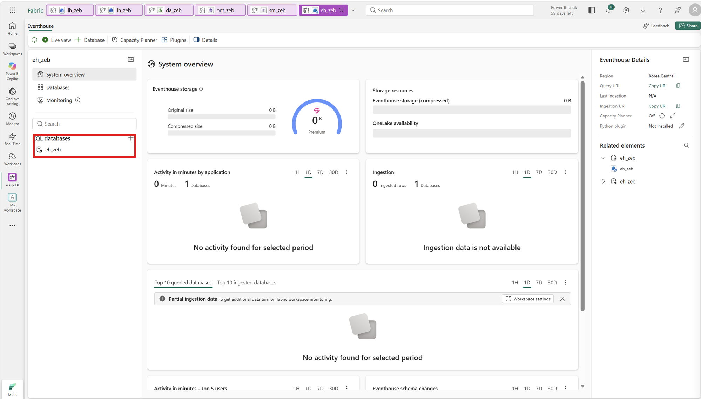

## 2. ZebRiskEvent 테이블 만들기

이 테이블은 상태 이력입니다. 같은 `event_id`의 상태가 바뀔 때 새 행을 추가하고, 시간 열 `status_time`으로 순서를 구분합니다.

1.  KQL 데이터베이스 `eh_zeb`에 연결된 Queryset `eh_zeb_queryset`을 엽니다. 없으면 데이터베이스에서 New KQL queryset을 만들고 대상이 `eh_zeb`인지 확인합니다.
2.  편집 창의 내용을 지우고 아래 명령을 붙여 넣은 뒤 Run을 누릅니다.

    ``` text
    .create-merge table ZebRiskEvent (
        event_id: string,
        status_time: datetime,
        event_status: string,
        site_code: string,
        site_name: string,
        risk_reason: string,
        prelim_grade: string,
        forecast_grade: string,
        selfsuff_pct: real,
        recommended_option_id: string,
        recommended_option_name: string,
        option_cost_krw: long,
        expected_selfsuff_pct: real,
        expected_grade: string)
    ```

    | 열 | 뜻 |
    |---|---|
    | `event_id`, `status_time`, `event_status` | 위험 이벤트 ID, 상태가 바뀐 시각, 상태(`open` 대응 전, `approved` 담당자 승인, `resolved` 위험 해소) |
    | `site_code`, `site_name`, `risk_reason` | 위험 현장과 사유 |
    | `prelim_grade`, `forecast_grade`, `selfsuff_pct` | 예비인증 등급, 현재 예상 등급과 자립률 |
    | `recommended_option_id`, `recommended_option_name`, `option_cost_krw` | 추천 보완안과 비용 |
    | `expected_selfsuff_pct`, `expected_grade` | 추천 보완안을 적용했을 때의 자립률과 예상 등급 |

예상 결과: 결과 창에 `ZebRiskEvent` 한 행이 보이고, 왼쪽 Tables 아래에 `ZebRiskEvent`가 생깁니다.

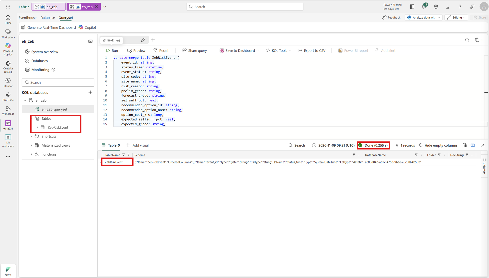

## 3. 승인 반영 Notebook 확인

승인할 때(8단계) 실행될 `nb_apply_decision`을 먼저 확인합니다. Operations agent가 넘기는 `event_id`, `option_id`로 위험 이벤트를 확인한 뒤 조치 기록 → Eventhouse `approved` → Silver·Gold 재계산 → `resolved`를 차례로 처리합니다. 지금은 열어서 확인만 하고 실행하지 않습니다.

1.  작업 영역에서 `nb_apply_decision`을 엽니다.
2.  [01장 4단계](01-workspace.md#4-notebook의-기본-lakehouse-연결)와 같은 방법으로 본인 `lh_zeb`를 기본 Lakehouse로 연결합니다.
3.  매개 변수 셀이 parameters 셀이고 `event_id`, `option_id` 두 변수가 있는지 확인합니다.

예상 결과: 기본 Lakehouse가 `lh_zeb`이고, parameters 셀에 `event_id = "ZEB-HS-D-20260930"`, `option_id = "OPT-D2"`가 있습니다. 이 값은 직접 실행할 때의 기본값이며, 에이전트는 이벤트의 값을 넘깁니다.

## 4. Operations agent 만들기

1.  작업 영역에서 + New item → Operations agent(한국어 UI: 운영 에이전트)를 고릅니다. Name에 `oa_zeb`를 입력하고 Create를 누릅니다. Welcome 창은 X로 닫습니다.

2.  Agent instructions에 아래 영문 지침을 붙여 넣습니다. 현재 Operations agent의 지침·업무 목표는 영어만 지원하므로 감시 조건은 영어로 정의하고 알림 본문은 한국어로 요청합니다([언어 제약](https://learn.microsoft.com/en-us/fabric/real-time-intelligence/operations-agent-limitations)). 감시할 열을 `ZebRiskEvent.event_status`처럼 테이블 이름과 함께 적습니다.

    ``` text
    Monitor ZEB certification risk events for Contoso Construction.

    Source: ZebRiskEvent table in the eh_zeb KQL database.
    - Business object ID: ZebRiskEvent.event_id
    - Status timestamp: ZebRiskEvent.status_time
    - Status: ZebRiskEvent.event_status ("open", "approved", "resolved")
    - Recommended option ID: ZebRiskEvent.recommended_option_id
    - Evidence fields: ZebRiskEvent.site_name, ZebRiskEvent.risk_reason,
      ZebRiskEvent.prelim_grade, ZebRiskEvent.forecast_grade, ZebRiskEvent.selfsuff_pct,
      ZebRiskEvent.recommended_option_name, ZebRiskEvent.option_cost_krw,
      ZebRiskEvent.expected_selfsuff_pct, ZebRiskEvent.expected_grade

    Evaluate the latest status per event_id by status_time.
    When an event's status becomes "open", send a Teams notification and recommend ApplyZebOption.
    Use a transition condition, not a repeatedly satisfied state condition.
    Do not send another notification while the same event remains open, or when it becomes approved or resolved.
    Map ApplyZebOption.event_id to ZebRiskEvent.event_id and ApplyZebOption.option_id to ZebRiskEvent.recommended_option_id.
    Use the option already calculated by the Notebook; do not invent or replace it.
    Include the site, risk reason, preliminary and forecast grades, recommended option and cost,
    and expected self-sufficiency percentage and grade after applying the option.
    Write the notification body in Korean. Built-in labels and buttons may remain in English.
    Execute the action only after the recipient reviews the evidence and approves it in Teams.
    The action records workshop data and recalculates it; it does not change real designs or place orders.
    ```

3.  Knowledge에서 Add data 옆 아래 화살표 → Add from OneLake catalog를 고릅니다. 오른쪽 위 Filter by keyword에 `eh_zeb`를 입력하고, Location이 본인 작업 영역인 `eh_zeb`를 고른 뒤 Add를 누릅니다.

    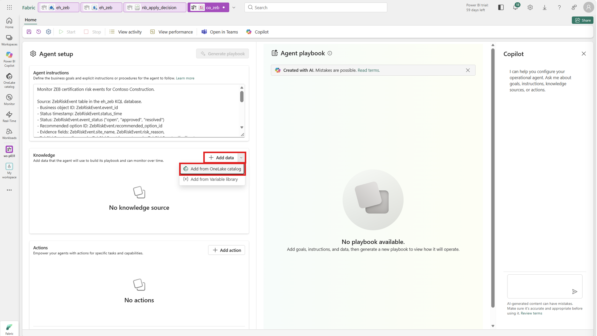

    예상 결과: Knowledge에 `eh_zeb`가 KQL Database 형식으로 보이고, 위쪽 Generate playbook이 활성화됩니다.

    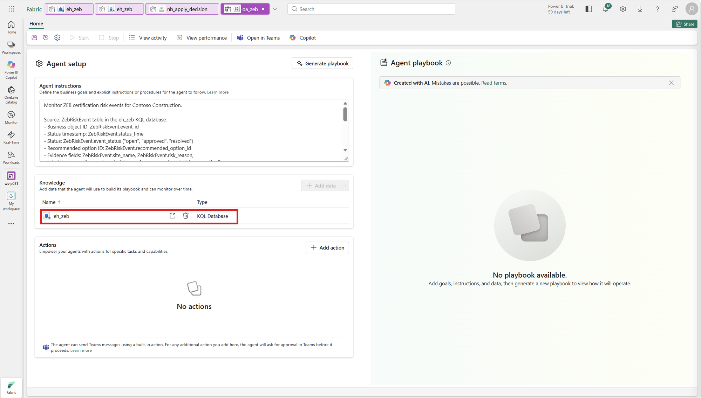

4.  Actions의 Add action을 누르고 Select action type에서 Fabric item을 고릅니다. Browse를 누르고 Filter by keyword에 `nb_apply_decision`을 입력해 Location이 본인 작업 영역인 항목을 고른 뒤 Add를 누릅니다.

5.  아래와 같이 입력하고 Next를 누릅니다. Parameters의 `event_id`, `option_id`는 Notebook의 parameters 셀에서 자동으로 채워집니다. Description만 입력합니다.

    | 입력란 | 값 |
    |---|---|
    | Action name | `ApplyZebOption` |
    | Action description | `After Teams approval, record the recommended ZEB improvement option and rerun Silver and Gold to update the workshop design version and forecast grade. Append approved and resolved statuses to ZebRiskEvent. Do not change real designs or place orders.` |
    | `event_id`의 Description | `The approved risk event ID from ZebRiskEvent.event_id.` |
    | `option_id`의 Description | `The approved option ID from ZebRiskEvent.recommended_option_id.` |

    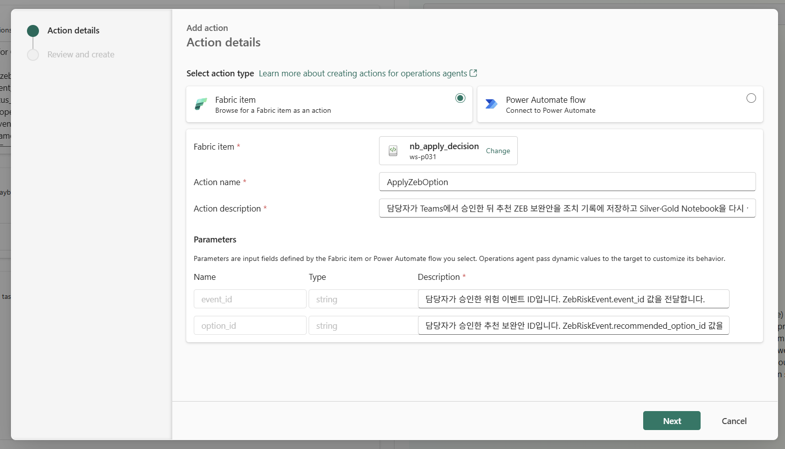

6.  Review and create에서 Action type이 `Notebook`, Item name이 `nb_apply_decision`, Workspace가 본인 작업 영역이고 Parameters가 2개인지 확인한 뒤 Create를 누릅니다.

    예상 결과: Actions에 `ApplyZebOption`이 Action connected 상태로 보입니다.

    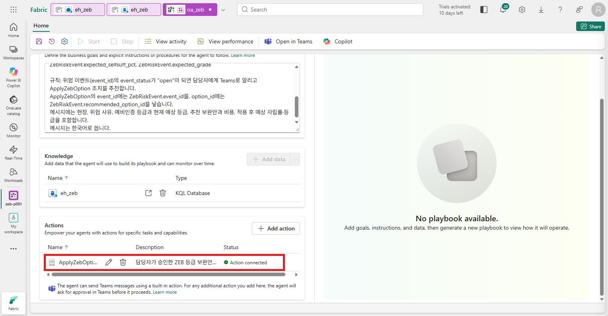

7.  도구 모음 왼쪽의 저장 아이콘을 누릅니다.

수신자 확인: 도구 모음의 톱니바퀴(설정) → Agent behavior에서 Run as가 본인이고, Message delivery가 기본값(에이전트를 만든 사람에게 메시지와 조치 요청을 보냄)인지 확인합니다. Teams에는 Fabric과 같은 계정으로 로그인합니다. 조치는 수신자가 아니라 에이전트 생성자의 위임된 권한으로 실행됩니다([조치·수신자 설정](https://learn.microsoft.com/fabric/real-time-intelligence/operations-agent-actions)).

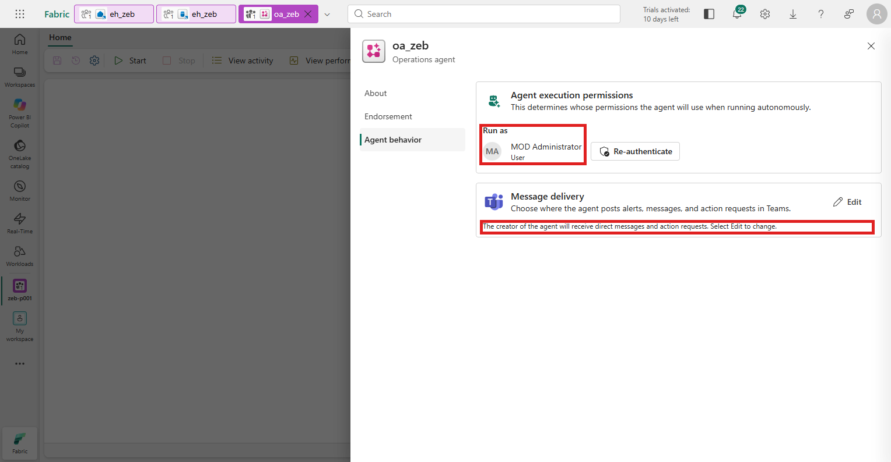

## 5. Playbook 만들기

Playbook은 Operations agent가 지침과 데이터를 읽고 만드는 감시 규칙입니다.

1.  Agent setup의 Generate playbook을 누릅니다(2–3분).

    예상 결과: 오른쪽 Agent playbook의 Business term glossary에 Class 하나(예: `ZebRiskEventItem`, Table `ZebRiskEvent`)가 있고, `Id`, `Timestamp`, `ZebEventStatusText`, `OptionId` 같은 속성이 `ZebRiskEvent`의 열(`event_id`, `status_time`, `event_status`, `recommended_option_id` 등)과 연결되어 있습니다. Class와 속성 이름은 생성할 때마다 다를 수 있습니다.

    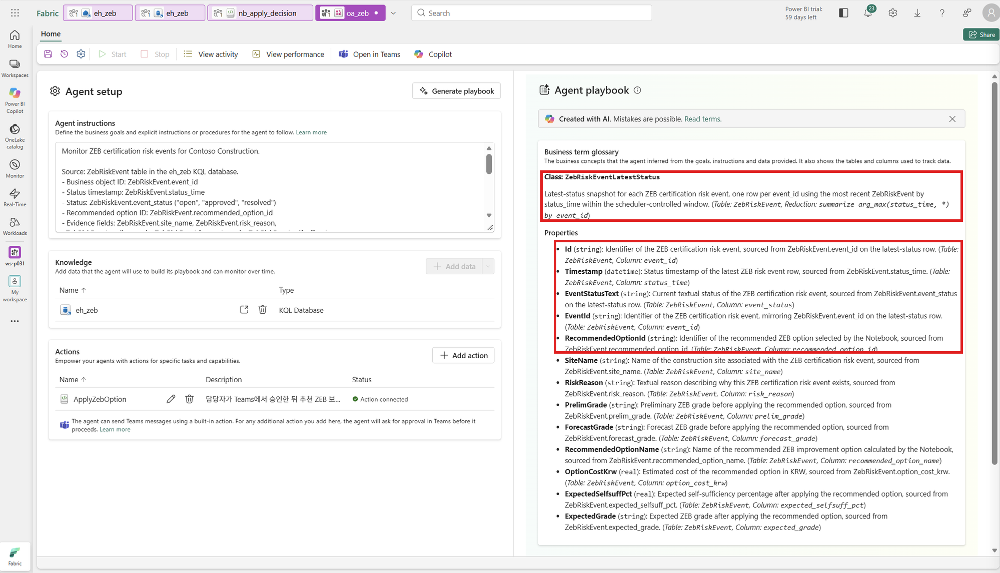

2.  Agent playbook을 아래로 내려 Rules의 규칙을 펼칩니다.

    확인할 기준: KQL 쿼리의 조회 시간은 `status_time`, 객체 ID는 `event_id`여야 하며, 같은 이벤트의 최신 상태를 평가해야 합니다(예: `arg_max(status_time, *) by event_id`). 조건은 `event_status`가 `open`으로 바뀔 때입니다(`Changes To` 또는 `Becomes`). 숫자 플래그 `open_flag`를 0/1로 계산하고 Crosses above 0.5를 쓰는 동등한 전환 조건도 가능합니다. `Is open`·`Is above`처럼 상태를 매번 평가하는 조건은 반복 알림을 만들 수 있습니다. 생성된 질의·조건·액션 매핑을 검토하고, 이후 첫 `open` 알림과 상태 유지 중 반복 여부를 실제로 확인합니다.

    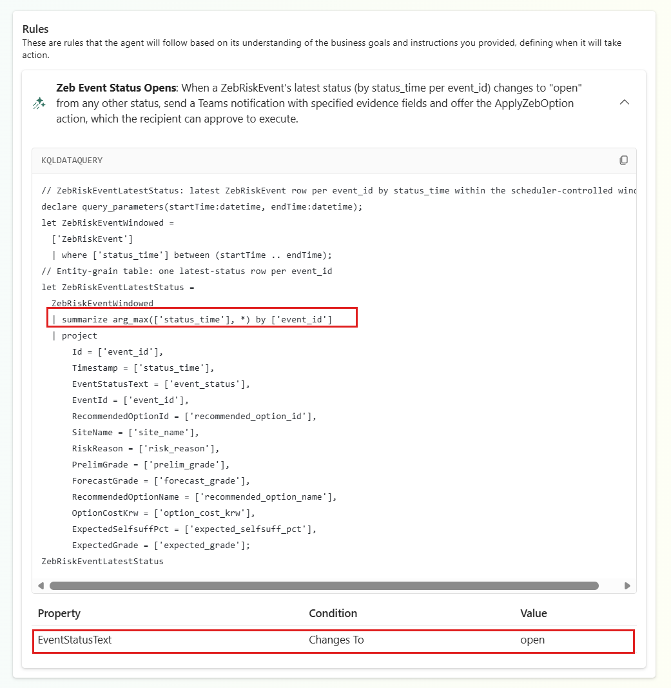

3.  저장 아이콘을 누릅니다.

예상 결과: 오른쪽 위에 Configuration saved successfully가 보이고 도구 모음의 Start를 누를 수 있습니다. Playbook을 만들기 전과 저장하기 전에는 Start가 비활성입니다.

## 6. 에이전트를 시작하고 위험 이벤트 보내기

1.  도구 모음의 Start를 누릅니다. Start가 비활성이 되고 Stop을 누를 수 있게 되면 감시가 시작된 것입니다(Start에 마우스를 올리면 `The agent is already running.`). 다음 Notebook은 Start 뒤에 실행합니다.

2.  작업 영역에서 `06_risk_event`를 열고, [01장 4단계](01-workspace.md#4-notebook의-기본-lakehouse-연결)와 같은 방법으로 본인 `lh_zeb`를 기본 Lakehouse로 연결한 뒤 Run all을 누릅니다. 세션 시작을 포함해 약 2–3분 걸립니다.

    1.  보완안 평가

        위험·주의 현장 중 보완안이 있는 D단지·H단지의 보완안을 하나씩 현행 설계안에 더해 예상 등급을 다시 계산합니다. 필요 등급(예비인증이 있으면 예비 등급, 없으면 목표 등급)을 회복하고(`meets_grade`), 기준일부터 준비 기간이 설비 설치 완료 계획일 안에 끝나는(`meets_schedule`) 안이 `feasible`입니다.

        예상 결과: `ops.option_eval 11행`과 표.

        | 현장 | 보완안 | 비용(원) | 적용 후 자립률 | 1차에너지 | 예상 등급 | 준비 완료 | feasible | 순위 |
        |---|---|---|---|---|---|---|---|---|
        | HS-D | OPT-D6 | 50,000,000 | 39.1 | 74.2 | 5등급 | 2026-10-20 | false | |
        | HS-D | OPT-D5 | 60,000,000 | 39.2 | 74.0 | 5등급 | 2026-10-30 | false | |
        | HS-D | OPT-D2 | 230,000,000 | 41.4 | 72.5 | 4등급 | 2026-11-14 | true | 1 |
        | HS-D | OPT-D3 | 280,000,000 | 39.6 | 74.5 | 5등급 | 2026-12-14 | false | |
        | HS-D | OPT-D4 | 340,000,000 | 40.3 | 72.0 | 4등급 | 2026-11-19 | true | 2 |
        | HS-D | OPT-D1 | 420,000,000 | 43.5 | 70.0 | 4등급 | 2026-11-29 | true | 3 |

        H단지는 `OPT-H3`(지열 히트펌프 도입)만 목표 4등급을 회복합니다. D단지의 설치 완료 계획일은 `2026-11-30`이며, OPT-D3는 등급도 회복하지 못하고 준비도 늦습니다.

    2.  위험 이벤트와 추천 보완안

        현장 상태가 위험이고 예상 등급이 예비인증 등급보다 낮은 현장마다 이벤트 1건을 만들고, 순위 1 보완안을 추천합니다.

        예상 결과: 1행. `ZEB-HS-D-20260930`, 에코시티 D단지 현장, 예비 `4` → 예상 `5등급`, 추천 `OPT-D2` 주차장 캐노피 태양광(+90kW), `230,000,000`원, 적용 후 자립률 `41.4` → `4등급`, 상태 `open`

    3.  Eventhouse로 보내기

        예상 결과: `ZEB-HS-D-20260930: ZebRiskEvent에 open 추가` 한 줄과, Eventhouse에서 다시 읽은 1행 표.

        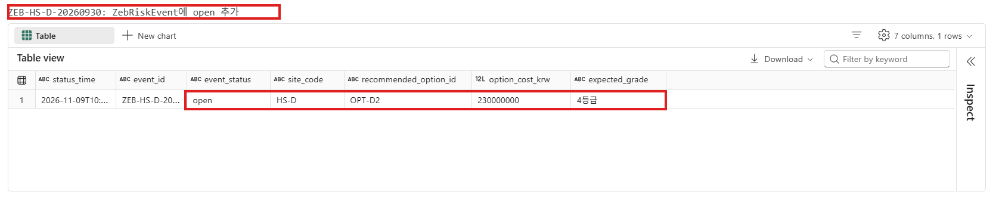

3.  `eh_zeb_queryset`에서 아래 쿼리로 Eventhouse 쪽도 확인합니다.

    ``` text
    ZebRiskEvent
    | project status_time, event_id, event_status, site_name, recommended_option_id, option_cost_krw, expected_grade
    | order by status_time asc
    ```

예상 결과: 1행. `ZEB-HS-D-20260930`, `open`, `에코시티 D단지 현장`, `OPT-D2`, `230000000`, `4등급`

## 7. Teams 제안 확인

1.  Teams에서 Fabric operations agent 채팅을 엽니다. 에이전트는 약 5분마다 조회하며, 메시지 생성·전송 시간이 더해질 수 있습니다. 이전 실습이나 다른 에이전트의 메시지가 있으면 맨 아래의 `oa_zeb` 메시지를 봅니다.

    예상 결과: `oa_zeb`가 보낸 카드의 제목이 규칙 이름(예: `Zeb Risk Event Open Notify And Recommend`)이고, 본문에 위험 이벤트 `ZEB-HS-D-20260930`이 `open`이 되었고 추천 보완안이 `OPT-D2`라는 내용이 있습니다. Recommended action에 `ApplyZebOption`과 설명이 있고, 아래에 Proceed, Investigate further (preview), Dismiss, Ask a question 버튼이 있습니다. 메시지 문장은 AI가 만들므로 다를 수 있고, 현장 이름이나 비용이 빠질 수도 있습니다.

    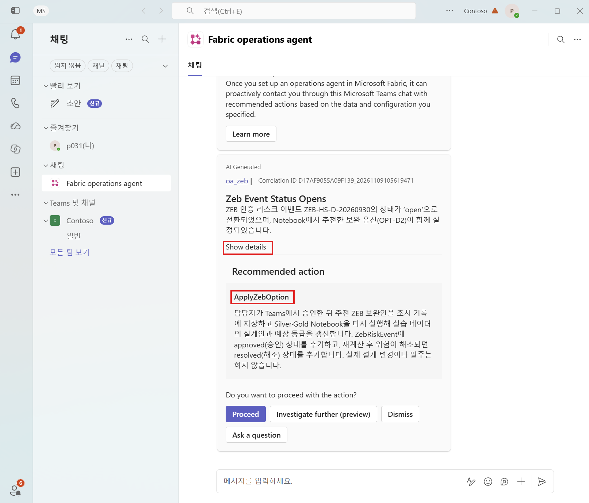

2.  카드의 Show details를 눌러 근거를 확인합니다.

    예상 결과: 이벤트 ID 속성(예: `Id`)은 `ZEB-HS-D-20260930`, 상태 속성(예: `ZebEventStatusText`)은 `open`, 보완안 속성(예: `OptionId`)은 `OPT-D2`입니다. Rule Condition에 Playbook 규칙이, Data Source에 `eh_zeb`가 보입니다. 속성 이름은 5단계 Playbook의 이름을 따릅니다.

    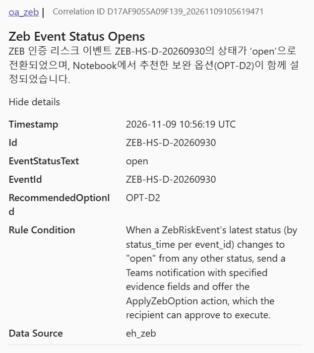

3.  바로 Proceed를 누르지 않고 근거를 먼저 검토합니다.

    - 07장 Q8과 6단계의 `ops.option_eval`에서 OPT-D2가 등급을 회복하는 가장 싼 안인지 확인합니다.
    - 검토가 끝나면 8단계에서 승인합니다. 에이전트나 위험 이벤트를 새로 만들거나 다시 보내지 않습니다.

## 8. Teams에서 승인

1.  Teams의 Fabric operations agent 채팅에서 7단계에서 확인한 `oa_zeb` 제안을 엽니다.
2.  Proceed를 누릅니다.
3.  Confirm details for ApplyZebOption에서 값을 확인합니다.

    | 매개 변수 | 확인할 값 |
    |---|---|
    | `event_id` | `ZEB-HS-D-20260930` |
    | `option_id` | `OPT-D2` |

    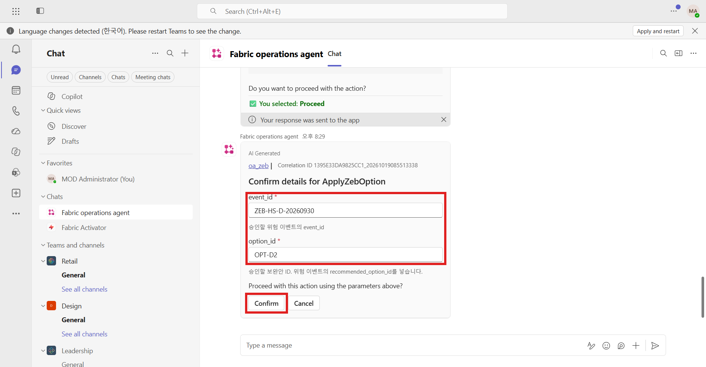

4.  값이 맞으면 Confirm을 누릅니다. 다르면 Cancel을 누르고 6단계의 이벤트를 다시 확인합니다.

예상 결과: 카드에 You selected: Confirm이 보이고, 이어서 `oa_zeb`의 Action submitted 메시지(`ApplyZebOption has been submitted using the provided parameters.`)가 옵니다. 접수 메시지가 완료를 뜻하지는 않습니다. Notebook이 Silver·Gold를 다시 계산하는 데 약 5–8분 걸립니다.

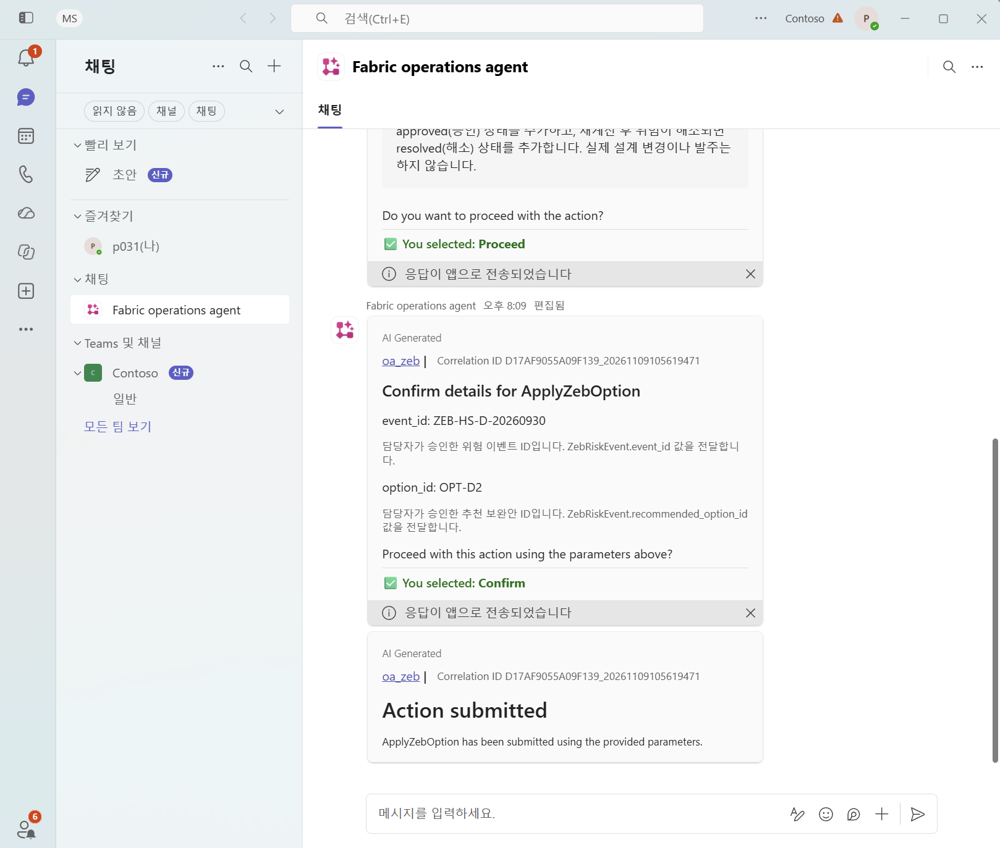

## 9. 실행 완료 확인

1.  Fabric 왼쪽 Monitor를 엽니다. Activity name이 `nb_apply_decision_…`인 행을 찾습니다. Submitted by는 에이전트를 만든 사람입니다.
2.  상태가 Succeeded가 될 때까지 기다리며 Refresh를 누릅니다(캡처 환경에서 약 6분). 실행 중에는 `03_silver_conform`, `04_gold_model`이 차례로 실행됩니다.

예상 결과: `nb_apply_decision`이 Succeeded입니다. 비슷한 시각에 `ont_zeb_graph_…`의 새로 고침 기록이 생길 수 있습니다. Graph의 실패·취소와 Lakehouse 재계산 결과는 따로 확인합니다. Graph가 최신이라고 가정하지 말고, 10–11단계에서 원본 상태 이력·V4·등급을 확인합니다. Graph를 사용해 다시 질문할 경우에는 갱신 성공과 최신 인스턴스를 먼저 확인합니다.

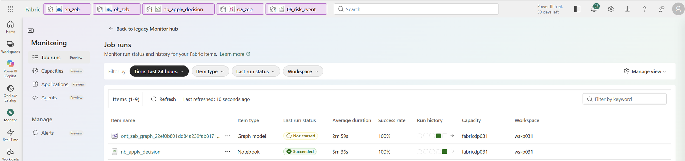

실행 기록을 열면 마지막 셀에 다음과 비슷한 줄이 있습니다.

``` text
에코시티 D단지 현장: 현행 V4(조치 반영안) 자립률 41.4% · 1차에너지 72.5 → 예상 4등급, 상태 정상
ZEB-HS-D-20260930: ZebRiskEvent에 resolved 추가
```

## 10. Eventhouse 상태 이력 확인

`eh_zeb_queryset`에서 아래 쿼리를 실행합니다.

``` text
ZebRiskEvent
| project status_time, event_id, event_status, forecast_grade, selfsuff_pct, recommended_option_id
| order by status_time asc
```

예상 결과: 같은 `ZEB-HS-D-20260930`의 3행이 시간 순서로 있습니다.

| event_status | forecast_grade | selfsuff_pct | 뜻 |
|---|---|---|---|
| `open` | 5등급 | 38.2 | 6단계에서 보낸 위험 |
| `approved` | 5등급 | 38.2 | 담당자 승인 직후(아직 재계산 전) |
| `resolved` | 4등급 | 41.4 | 재계산 후 위험 해소 |

Operations agent는 `event_status`가 `open`으로 바뀔 때만 알리므로, `approved`·`resolved` 행으로는 알림을 다시 보내지 않습니다.

## 11. Lakehouse 반영 확인

SQL analytics endpoint `lh_zeb`를 엽니다. 먼저 도구 모음 맨 왼쪽의 Sync metadata from the Lakehouse 아이콘을 누릅니다. SQL analytics endpoint는 Lakehouse의 변경을 늦게 반영할 수 있어서, 누르지 않으면 승인 전 값(V3·위험, 조치 기록 0행)이 그대로 보일 수 있습니다(캡처 환경에서 15분 넘게 지연). 이어서 New SQL query로 아래 쿼리를 실행합니다.

``` sql
SELECT action_id, site_code, action_type, detail_json, approved_by, source_system
FROM bronze.pms_action_log;

SELECT version_code, version_name, version_date, selfsuff_pct, primary_energy_kwh_m2y, change_note, version_status
FROM gold.bim_design_version
WHERE bim_model_id = 'BIM-0397'
ORDER BY version_code;

SELECT site_name, current_version_code, selfsuff_pct, primary_energy_kwh_m2y,
       forecast_zeb_label, grade_basis, grade_risk, risk_level
FROM ops.site_status
WHERE site_code = 'HS-D';
```

결과 창 오른쪽 위의 Result: 1 드롭다운에서 쿼리 1–3의 결과를 차례로 고릅니다.

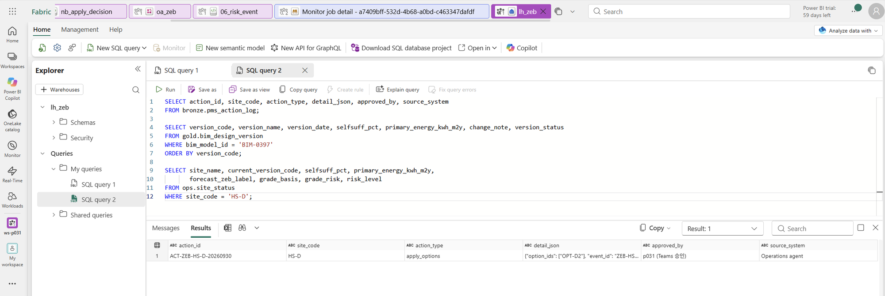

예상 결과:

- 조치 기록 1행: `ACT-ZEB-HS-D-20260930`, `HS-D`, `apply_options`, `{"option_ids": ["OPT-D2"], "event_id": "ZEB-HS-D-20260930"}`, 승인자 `<에이전트를 만든 계정> (Teams 승인)`, 출처 `Operations agent`
- 설계안 4행: V1·V2·V3는 `이전`, 새 V4 `조치 반영안`은 자립률 `41.4`, 1차에너지 `72.5`, 변경 내용 `보완안 적용: 주차장 캐노피 태양광(+90kW)`, 상태 `현행`. 기존 V3는 지워지지 않고 `이전`으로 남습니다.
- 현장 상태: 현행 `V4`, 예상 4등급, 등급 근거 `에너지자립률`, 등급 위험 `정상`, 상태 `정상`

설비 계획(`gold.pms_equipment_plan`)에도 `HS-D-OPT-D2`(주차장 캐노피 태양광, 2억 3천만 원, 설계안 V4)가 추가됩니다. 이 모든 변경은 실습 데이터 안의 기록과 재계산이며 실제 설계 변경·발주는 아닙니다.

`approved_by`는 Notebook 실행 계정(에이전트 생성자의 위임된 권한)을 기록한 값입니다. 뒤의 `(Teams 승인)` 문구만으로 실제 Teams 승인자 신원이 증명되지는 않습니다. 승인 증빙은 Teams 카드·에이전트 액션 기록과 함께 확인합니다.

## 12. 읽기 전용 질의로 다시 확인

1.  `ont_zeb`의 Ontology Agent → Plan에서 07장 공통 프롬프트를 먼저 보낸 뒤 `에코시티 D단지의 현행 설계안과 예상 ZEB 등급은? 예비인증 등급을 지키나? 현재 원본에서 다시 조회하고 근거를 보여줘.`를 묻습니다. 이전 V3 답변을 재사용하지 않습니다.

    예상 결과: 현행 V4(조치 반영안), 자립률 41.4%·1차에너지 72.5 → 4등급, 예비인증 4등급을 지킴. 07장 Q3을 다시 물으면 본인증 위험 현장이 없다고 답해야 합니다. 답 문장과 길이는 실행할 때마다 다릅니다(캡처 환경에서 약 1분).

    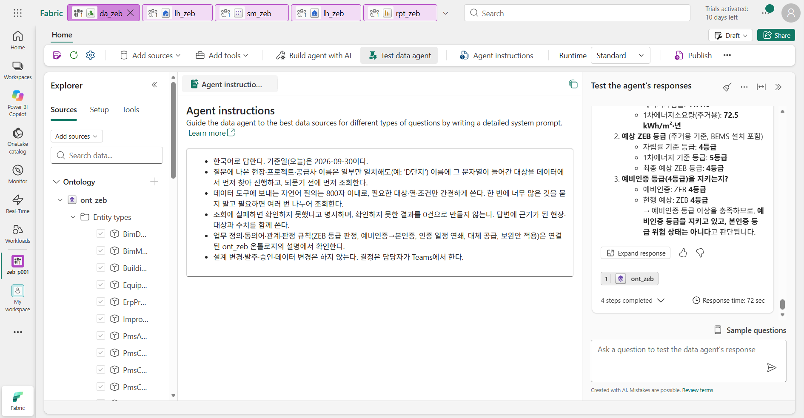

    Data agent 연계를 검증한 환경에서는 `da_zeb`의 Clear chat 후 같은 질문을 선택적으로 비교합니다. 어느 경로든 11단계 원본과 대조하고, 조회 오류나 미확인을 ‘위험 없음’으로 바꾸지 않습니다.

2.  (선택 08장 완료 시) `rpt_zeb`의 `현장 컨트롤 타워`도 확인합니다. 08장을 건너뛰었다면 이 단계는 생략합니다. 숫자가 그대로면 브라우저를 새로 고치고, 그래도 같으면 작업 영역의 `sm_zeb` 행에서 Refresh now를 누른 뒤 보고서를 다시 엽니다.

    예상 결과: 현장 수 `8`, 위험 현장 `0`, 주의 현장 `3`, 설치 지연 발주 `0`. D단지 행은 `V4`, `41.40`, `72.50`, `4등급`, `정상`입니다.

    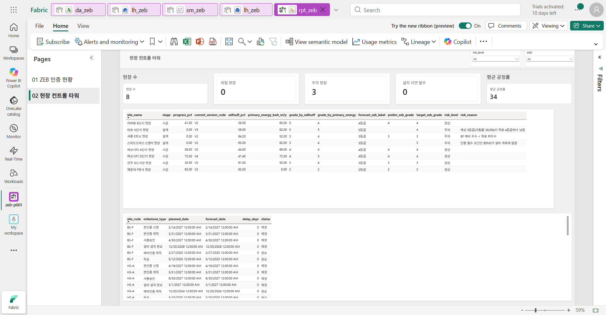

## 13. 감시 멈추기

`oa_zeb`로 돌아가 도구 모음의 Stop을 누릅니다. Welcome to operations agents 창이 다시 뜨면 X로 닫고 누릅니다. 에이전트는 멈추기 전까지 약 5분마다 조회하며 용량을 씁니다.

예상 결과: 오른쪽 위에 Agent stopped successfully가 보이고, 도구 모음의 Start가 활성, Stop이 비활성입니다.

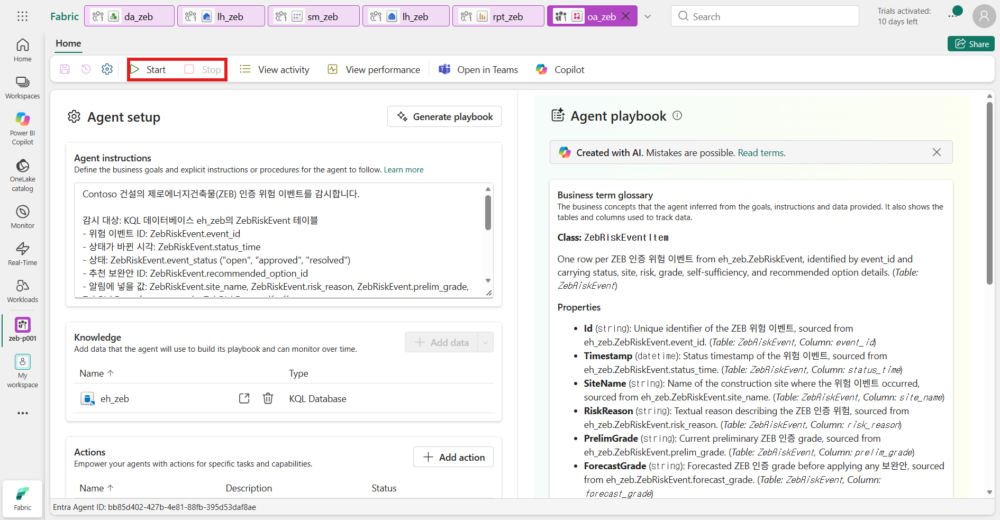

## 이 장의 완료 기준

- `oa_zeb`의 `ApplyZebOption`이 Action connected이고, Teams에서 D단지 위험과 추천 보완안 `OPT-D2`의 제안을 받았습니다.
- 근거를 검토한 뒤 Teams에서 `OPT-D2`를 승인했고 `nb_apply_decision`이 Succeeded입니다.
- `ZebRiskEvent`에 `open` → `approved` → `resolved` 이력이 있습니다.
- `bronze.pms_action_log`에 조치 1행, `gold.bim_design_version`에 현행 V4, `ops.site_status`에서 D단지가 4등급·정상입니다.
- 읽기 전용 Plan 질의의 결과를 V4 원본과 대조했습니다. 에이전트가 조회하지 못한 경우는 미확인으로 기록하고 11단계 SQL 결과로 반영을 확인했습니다. 보고서 확인은 선택 08장을 진행한 경우에만 합니다.
- `oa_zeb`가 Stop 상태입니다.

여기에 남긴 것은 담당자의 승인과 그에 따른 데이터 재계산입니다. 실제 설계 변경·발주를 실행한 것은 아닙니다.

## Troubleshooting

제안 받기(1–7단계)

- Generate playbook 뒤 No playbook generated가 보이면 지침에 `ZebRiskEvent.event_status`처럼 테이블 이름과 열 이름이 있는지, Knowledge가 `eh_zeb`인지 확인하고 저장한 뒤 다시 누릅니다.
- 데이터 원본이 요청을 제한한다는 안내(rate-limiting)가 보이면 1–2분 뒤 다시 Generate playbook을 누릅니다.
- Start를 누를 수 없으면 Playbook을 만든 뒤 저장했는지 확인합니다.
- `06_risk_event`에서 `ZebRiskEvent 테이블이 없습니다` 오류가 나면 2단계를 먼저 실행합니다. `eh_zeb Eventhouse가 정확히 1개 있어야 합니다` 오류는 1단계 이름을 확인합니다.
- `open 상태인 위험 이벤트가 없어 보내지 않았습니다`가 나오면 이미 승인·해소된 이벤트입니다. 8–13단계를 마친 상태라면 정상입니다.
- Teams 채팅 목록에 Fabric operations agent가 없으면 Teams 왼쪽 앱에서 `Fabric Operations Agent`를 검색해 추가합니다.
- 10분이 지나도 메시지가 오지 않으면 에이전트가 시작 상태인지, `06_risk_event`를 Start 뒤에 실행했는지 확인합니다. Activity log(이전 UI의 View activity)에서 규칙 실행·오류 기록을 봅니다.
- 반복 실습에서 새 알림이 필요하면 Stop한 뒤, 실습 전용 이력이 필요 없을 때만 `.clear table ZebRiskEvent data`로 지우고 [관리자 준비 가이드](../admin/README.md)의 초기화 순서를 따릅니다.
- 승인 요청은 3일 안에 응답하지 않으면 만료됩니다.

승인과 반영(8–13단계)

- `Action submitted` 뒤 Monitor에 실행 기록이 없으면 2–3분 기다립니다. 계속 없으면 `ApplyZebOption`이 Action connected인지 4단계를 확인합니다.
- Failed이면 Monitor에서 실패한 셀을 확인합니다.
  - `option_id=… 추천 보완안과 다릅니다`: Confirm 단계에서 값이 바뀐 경우입니다. 추천안과 다른 값은 기록하지 않습니다.
  - `상태 'resolved'에서는 승인을 반영할 수 없습니다`: 이미 반영된 이벤트입니다. 10–11단계로 결과만 확인합니다.
  - `03_silver_conform`·`04_gold_model`을 찾지 못하는 오류: Notebook 이름이 바뀌었는지 확인합니다. 두 Notebook은 같은 작업 영역에 원래 이름으로 있어야 합니다.
- 실패 후에는 재승인 전에 10–11단계의 상태 이력·조치 기록·현재 설계안을 읽기 전용으로 확인합니다. 실제로 승인했던 이벤트와 보완안이고 상태가 `open` 또는 `approved`인 경우에만 관리자 안내에 따라 같은 액션을 재시도합니다. 승인 증빙 없이 기본 매개 변수로 Notebook을 직접 실행하지 않습니다. `resolved`이면 재실행하지 않고 결과만 확인합니다. 같은 이벤트의 조치 기록 중복 방지와 전체 실행 성공은 별개입니다.
- 10단계에서 `approved`만 있고 `resolved`가 없으면 재계산 후에도 D단지가 위험인 경우입니다. 마지막 셀의 사유를 확인합니다.
- 선택 08장의 보고서 값이 바뀌지 않으면 Semantic model의 Refresh → Data를 실행합니다. Direct Lake는 새로 고침으로 최신 Delta 버전을 다시 읽습니다.
- 실습을 처음부터 다시 하려면 `02_bronze_contoso_generate` → `03_silver_conform` → `04_gold_model` 순서로 실행합니다. 조치 기록이 지워지고 D단지가 다시 V3·위험 상태가 됩니다.

## 다음 단계

[11. 마무리](11-finish.md)에서 만든 결과를 확인하고 실습을 정리합니다.
